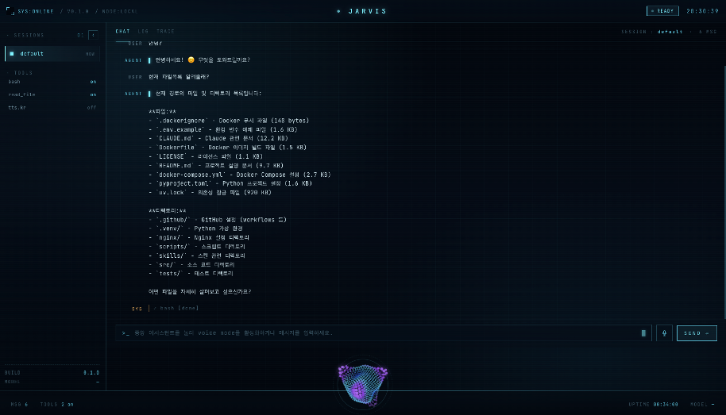

# Jarvis

개인 AI 비서 에이전트. 터미널 TUI와 브라우저 Web HUD 두 가지 모드로 동작하며, 멀티프로바이더 LLM · 멀티 에이전트 오케스트레이션 · 장기 메모리에 더해, 요청에만 답하지 않고 스스로 사고하고 먼저 행동하는 **proactive agent** 기능을 지원한다.

<div align="center">
    
</div>

---


## Quick Start

**요구사항:** Python 3.11+, [uv](https://docs.astral.sh/uv/)

```bash
git clone https://github.com/ash-hun/jarvis.git
cd jarvis

uv sync
cp .env.example .env
# .env에서 최소 JARVIS_LLM__API_KEY 설정

jarvis           # TUI 실행
jarvis --web     # Web HUD 실행 (http://localhost:7777)
```

<details>
<summary>Docker로 실행하기</summary>

```bash
cp .env.example .env  # .env 설정

# TUI (PostgreSQL 세션 포함)
docker compose --profile app up jarvis

# Web HUD 전체 스택 (nginx + backend + postgres)
docker compose --profile web up

# 종료
docker compose --profile web down
```

| 프로파일 | 포함 서비스 | 접속 |
|----------|------------|------|
| `app` | jarvis TUI + postgres | 터미널 |
| `web` | nginx + jarvis-backend + postgres | http://localhost:7777 |

</details>

---

## LLM 프로바이더

| 프로바이더 | `JARVIS_LLM__PROVIDER` 값 | API 키 필요 |
|-----------|--------------------------|------------|
| Anthropic (Claude) | `anthropic` | ✅ |
| OpenAI (GPT) | `openai` | ✅ |
| Google (Gemini) | `google` | ✅ |
| Ollama (로컬) | `ollama` | ❌ |
| vLLM (로컬) | `vllm` | ❌ |

```bash
# Anthropic (기본)
JARVIS_LLM__PROVIDER=anthropic
JARVIS_LLM__MODEL=claude-sonnet-4-5
JARVIS_LLM__API_KEY=sk-ant-...

# 로컬 모델 (API 키 불필요)
JARVIS_LLM__PROVIDER=ollama
JARVIS_LLM__BASE_URL=http://localhost:11434
JARVIS_LLM__MODEL=llama3.2
```

---

## 주요 기능

### 메모리 시스템

| 계층 | 설명 |
|------|------|
| **STM (Short-Term)** | 슬라이딩 윈도우 + LLM 압축 — 컨텍스트 초과 방지 |
| **LTM (Long-Term)** | PostgreSQL 영속화 — 세션 간 기억 유지 |
| **Episodic** | 세션 종료 시 자동 요약 → LTM 저장 |

```bash
JARVIS_MEMORY__BACKEND=postgres    # in_memory | postgres
```

### 세션 관리

- **JSONL** (기본, 로컬): append-only, git-friendly
- **PostgreSQL** (Docker/운영): 풀 관리, 자동 스키마 생성
- **세션 브랜치**: 특정 시점에서 대화를 분기해 실험 가능

```bash
jarvis -s <session_id>      # 기존 세션 재개
jarvis --list-sessions      # 세션 목록
```

### 스케줄러

자연어 또는 cron 표현식으로 작업 예약:

```
/schedule 매일 오전 9시에 날씨 알려줘
/schedule 0 9 * * * date && uptime
```

### Proactive Agent (Inner Thought 기반)

요청에만 응답하던 reactive agent를 **스스로 사고하고 먼저 행동하는 proactive agent**로 확장한다. 설계 문서: [proactive-inner-thought-design.md](docs/proactive-inner-thought-design.md).

| 계층 | 설명 |
|------|------|
| **Inner Thought** | 매 요청 시 메인 응답과 분리된 별도 LLM 호출로 구조화된 사고(`ThoughtFrame`) 생성 → 컨텍스트 증강 + 사고 로그·이벤트 노출 (TUI 💭 / Web 시안 라인) |
| **Dual-Channel** | 오래 걸릴 작업이면 filler("잠깐만요, 확인할게요")를 **즉시 발화**(voice는 TTS)하고 메인 루프는 백그라운드 수행 — 대기 체감 감소 |
| **Proactivity Daemon** | 요청 없이 주기적/idle 시점에 성찰해, 게이팅을 통과하면 **먼저 말 검**. 저위험 읽기 작업은 자율로 미리 처리(이중 안전 게이트) |
| **Open-loop 추적** | 대화에서 흘린 약속·미완 작업을 감지·저장 → 이후 성찰 시 상기/처리 (`/openloop`) |
| **피드백 학습** | proactive 발화의 수락(👍)/무시(👎)를 학습해 발화 임계치를 자동 조정 |
| **User Model · 저널** | 누적 기억을 증류한 사용자 모델(`/usermodel`)을 사고에 주입, 자기 성찰 저널(`/journal`)을 남겨 회상에 반영 |

```bash
# Inner Thought + Dual-Channel: 기본 ON (false로 끔)
JARVIS_THOUGHT__ENABLED=true
JARVIS_PROACTIVE__ENABLED=true

# 별도(저렴) 사고 모델 분리 — 메인=anthropic / 사고=ollama 등
JARVIS_THOUGHT__MODEL=claude-haiku-4-5

# 자율 성찰 daemon: 기본 ON — 요청 없이 먼저 말 검 (false로 끔)
JARVIS_PROACTIVE__DAEMON_ENABLED=false
JARVIS_PROACTIVE__DAEMON_TRIGGER=both    # interval | idle | both
```

| 피드백 단축키 | 동작 |
|--------------|------|
| `Ctrl+Y` (TUI) / 👍 (Web) | proactive 발화 "도움됨" |
| `Ctrl+G` (TUI) / 👎 (Web) | proactive 발화 "무시" |

> 사고 방식은 프롬프트 파일로 직접 조율할 수 있다: `~/.jarvis/inner_thought.md`(요청), `~/.jarvis/inner_thought_reflection.md`(성찰).

### 음성 (Web HUD)

브라우저 HUD에서 구체를 클릭하면 음성 대화가 가능하다. STT/TTS 처리 위치는 설정으로 결정된다.

| 설정 | `browser` (기본) | 서버 처리 |
|------|-----------------|-----------|
| **STT** | Web Speech API (브라우저 인식) | `whisper` — 브라우저가 녹음 → 백엔드 faster-whisper 전사 |
| **TTS** | Web Speech API (브라우저 합성) | `supertonic` — 백엔드 ONNX 합성 → WAV 스트림 |

```bash
JARVIS_VOICE__STT_PROVIDER=whisper       # browser | whisper
JARVIS_VOICE__TTS_PROVIDER=supertonic    # browser | supertonic
JARVIS_VOICE__WHISPER_MODEL_SIZE=base    # tiny | base | small | medium | large-v3
JARVIS_VOICE__STT_LANG=ko-KR

# 서버 STT/TTS 사용 시 추가 의존성
uv sync --extra voice
```

서버 STT 모드에서는 `connected` 메시지의 `voice.stt_mode=server`를 받아, 브라우저가 `MediaRecorder`로 녹음한 오디오를 `voice_stt_submit`으로 전송하고 백엔드가 `voice_stt_result`로 전사 결과를 돌려준다.

### 음성 (TUI)

터미널 TUI에서도 음성 입출력이 가능하다. 브라우저 API가 없으므로 **서버 프로바이더(whisper/supertonic) + 시스템 오디오 도구**를 사용한다.

```bash
JARVIS_VOICE__TUI_ENABLED=true
JARVIS_VOICE__STT_PROVIDER=whisper       # 음성 입력(Ctrl+R)
JARVIS_VOICE__TTS_PROVIDER=supertonic    # 음성 출력(Ctrl+T)
JARVIS_VOICE__TUI_RECORD_SECONDS=5       # Ctrl+R 녹음 길이(초)

uv sync --extra voice                    # whisper/supertonic
# 시스템 오디오 도구: 재생 afplay(macOS)/paplay/aplay/ffplay, 녹음 sox 또는 arecord
```

| 단축키 | 동작 |
|--------|------|
| `Ctrl+T` | 응답 음성 출력(TTS) 토글 |
| `Ctrl+R` | 마이크 녹음 → 전사 → 입력창에 채움 (자동 전송 안 함, 검토 후 Enter) |

프로바이더가 `browser`이거나 오디오 도구가 없으면 안내 메시지와 함께 비활성화된다.

### 보안 파이프라인

모든 입력은 4단계를 순서대로 통과한다. 순서 변경·스킵 불가.

```
InputValidator → Authenticator → PolicyEngine → Sandbox
```

**Web HUD 접근 키.** `JARVIS_SECURITY__API_KEYS` 에 키 → 사용자(이름, roles)를 등록하면 `/ws` 와 `/api/*` 가 그 키를 요구한다. 키가 곧 식별자이므로 길고 무작위인 값을 쓴다. 브라우저는 처음 연결이 거부되면 키를 한 번 묻고 저장한다. 비워두면 web 인증이 꺼지고, TUI 는 설정과 무관하게 로컬 NoAuth 다.

```bash
JARVIS_SECURITY__API_KEYS='{"<long-random-key>": {"name": "jh", "roles": ["admin"]}}'
```

---

## 내장 도구 (Tools)

| 도구 | 주요 파라미터 | 설명 |
|------|-------------|------|
| `bash` | `command`, `timeout` | 셸 명령 실행. 위험 명령은 human-in-the-loop 승인 요청 |
| `read_file` | `path`, `offset`, `limit` | 파일 읽기. 라인 번호 기반 범위 지정 가능 |
| `write_file` | `path`, `content` | 파일 쓰기. 부모 디렉토리 자동 생성, 기존 파일 덮어쓰기 |
| `edit_file` | `path`, `old_string`, `new_string`, `replace_all` | 파일 내 문자열 정밀 교체. 매칭 실패 시 에러 반환 |
| `glob` | `pattern`, `path`, `limit` | 글롭 패턴으로 파일 탐색 (`**/*.py`). 최근 수정순 정렬 |
| `grep` | `pattern`, `path`, `glob`, `case_insensitive` | 파일 내용 정규식 검색. `path:line: text` 형식 반환, 바이너리 자동 스킵 |
| `list_dir` | `path`, `all` | 디렉토리 나열. 타입(dir/file)·크기 표시 |
| `web_search` | `query`, `max_results` | 웹 검색. Brave API 키 설정 시 Brave, 미설정 시 DuckDuckGo fallback |
| `web_fetch` | `url`, `max_length` | URL 본문을 가져와 텍스트로 변환 (HTML 태그 제거) |

---

## 슬래시 커맨드 (Skills)

| 커맨드 | 별칭 | 설명 |
|--------|------|------|
| `/test` | `/t`, `/pytest` | 유닛 테스트 실행 및 결과 리포트 |
| `/schedule` | — | 작업 예약 |
| `/remember` | — | 장기 기억 저장/검색/삭제 (`list` \| `search <키워드>` \| `forget <id>`) |
| `/sessions` | — | 저장된 세션 목록 표시 |
| `/branch` | — | `[session_id]` 세션을 특정 시점에서 분기 |
| `/tools` | — | 현재 사용 가능한 도구 목록 표시 |
| `/compact` | — | 현재 세션을 요약해 장기 기억에 저장 |
| `/export` | — | 현재 세션 대화를 파일로 내보내기 (`md` \| `json`, `~/.jarvis/exports/`) |
| `/cost` | — | 현재 세션 토큰 사용량·추정 비용 리포트 (모델별 집계) |
| `/openloop` | — | 추적 중인 약속/미완 작업 (`done <id>` \| `dismiss <id>`) — proactive |
| `/usermodel` | — | 증류된 사용자 모델 표시 / `build`로 갱신 — proactive |
| `/journal` | — | 자기 성찰 저널 표시 / `write`로 작성 — proactive |
| `/help` | `/?` | 사용 가능한 명령 목록 표시 |

```
/test                          # 전체 테스트
/test -k "test_policy"         # 키워드 필터
/test tests/unit/test_config.py
```

---

## 확장하기

<details>
<summary>새 LLM 프로바이더 추가</summary>

1. `src/jarvis/model_layer/providers/` 아래에 `my_provider.py` 생성
2. `AsyncIterator[StreamEvent]`를 반환하는 `stream()` 함수 구현
3. `ProviderRegistry`에 등록

```python
# src/jarvis/model_layer/providers/my_provider.py
from collections.abc import AsyncIterator
from jarvis.model_layer.types import LLMContext, ModelConfig, StreamEvent

async def stream(model: ModelConfig, ctx: LLMContext, options) -> AsyncIterator[StreamEvent]:
    # SDK 호출 → StreamEvent yield
    yield TextDeltaEvent(delta="Hello")
    yield StopEvent(reason="stop", usage=Usage())
```

```python
# src/jarvis/model_layer/registry.py
registry.register("my-provider", my_provider.stream)
```

```bash
JARVIS_LLM__PROVIDER=my-provider
```

</details>

<details>
<summary>새 도구(Tool) 추가</summary>

`~/.jarvis/tools/` 에 파일을 놓으면 핫리로드된다.

**방식 1 — Python 파일:**

```python
# ~/.jarvis/tools/my_tool.py
TOOL_NAME = "my-tool"
TOOL_DESCRIPTION = "유용한 작업 수행"
TOOL_PARAMETERS = {
    "type": "object",
    "properties": {"query": {"type": "string"}},
    "required": ["query"],
}

async def execute(tool_call_id: str, params: dict, **kwargs) -> dict:
    return {"content": f"결과: {params['query']}"}
```

**방식 2 — YAML 선언:**

```yaml
# ~/.jarvis/tools/my_tool.yaml
name: my-tool
description: "유용한 작업 수행"
execution_mode: parallel   # parallel | sequential
parameters:
  type: object
  properties:
    query: {type: string}
  required: [query]
```

</details>

<details>
<summary>MCP 서버 연결</summary>

[MCP](https://modelcontextprotocol.io) 서버의 툴을 자동으로 발견·등록한다. `stdio`(로컬 프로세스)와 `http`(SSE) transport를 지원한다.

```python
# config / .env 로 주입되는 mcp_servers 항목
{
  "name": "filesystem",
  "transport": "stdio",
  "command": ["npx", "-y", "@modelcontextprotocol/server-filesystem", "/data"],
  "timeout": 30.0                      # 연결/호출 타임아웃(초) — 응답 없는 서버가 startup을 막지 않음
}

{
  "name": "remote-api",
  "transport": "http",
  "url": "https://mcp.example.com/sse",
  "auth_token": "sk-...",              # Authorization: Bearer 헤더로 변환
  "headers": {"X-Org": "acme"},        # 커스텀 헤더 (auth_token보다 우선)
  "timeout": 30.0
}
```

- **격리**: 한 서버의 연결 실패·타임아웃이 다른 서버 로딩을 막지 않는다.
- **타임아웃**: 각 서버는 `timeout`(기본 30초) 내 응답하지 않으면 skip된다.
- 사용하려면 `uv sync --extra mcp` (mcp 패키지) 필요. 미설치 시 자동 skip.

</details>

<details>
<summary>새 슬래시 커맨드(Skill) 추가</summary>

`~/.jarvis/skills/` 에 Markdown 파일을 놓는다.

```markdown
---
name: summarize
description: 텍스트를 요약합니다
aliases: [sum, tldr]
---
다음 텍스트를 간결하게 요약해 주세요:

{{args}}
```

사용: `/summarize <텍스트>` 또는 `/sum <텍스트>`

**고급 — Python 핸들러 연결:**

```python
# ~/.jarvis/skills/summarize.py  (같은 이름의 .py 파일)
async def run(args: str, context) -> str:
    # 커스텀 전처리 후 반환된 문자열이 LLM 프롬프트로 사용됨
    return f"아래를 3줄로 요약:\n{args}"
```

</details>

<details>
<summary>새 플러그인(Plugin) 추가</summary>

플러그인은 에이전트 실행 흐름에 훅을 걸 수 있다.

```python
# ~/.jarvis/plugins/my_plugin.py
class MyPlugin:
    name = "my-plugin"
    version = "1.0.0"

    async def before_agent_start(self, context): ...
    async def before_tool_call(self, tool_name: str, args: dict, auth) -> dict:
        print(f"툴 호출: {tool_name}")
        return args  # 수정된 args 반환 가능
    async def after_tool_call(self, tool_name: str, result: dict) -> dict:
        return result
    async def on_message_end(self, message): ...
    async def transform_context(self, messages: list) -> list:
        return messages  # 컨텍스트 변형 가능
```

파일을 놓으면 자동 감지·로드된다. `JARVIS_PLUGIN__PLUGINS_DIR` (기본: `~/.jarvis/plugins/`).

</details>

<details>
<summary>멀티 에이전트 오케스트레이션</summary>

YAML 파일로 에이전트를 선언하고 `~/.jarvis/agents/` 에 배치한다.

**단일 에이전트 선언 (`researcher.yaml`):**

```yaml
name: researcher
description: "웹 검색과 문서 분석을 담당하는 에이전트"
enabled: true
tools:
  - web_search
  - read_file
system_prompt: |
  당신은 리서처 에이전트입니다.
  사용자의 질문에 답하기 위해 웹을 검색하고 문서를 분석합니다.
model_override: null   # null이면 전역 설정 사용
```

**여러 에이전트를 한 파일에 (list 형식):**

```yaml
# ~/.jarvis/agents/team.yaml
- name: coder
  description: "코드 작성 전담 에이전트"
  tools: [bash, read_file]
  system_prompt: "당신은 Python 전문 코더입니다."

- name: reviewer
  description: "코드 리뷰 전담 에이전트"
  tools: [read_file]
  system_prompt: "당신은 시니어 코드 리뷰어입니다. 보안과 성능을 중점으로 리뷰합니다."
```

**오케스트레이션 로직 (AgentHarness 활용):**

```python
from jarvis.agent_layer.harness import AgentHarness

# 두 에이전트를 순차 실행 (supervisor → worker 패턴)
supervisor = AgentHarness(session=session, agent_name="supervisor")
result = await supervisor.run("아래 코드를 리뷰해줘:\n" + code)

worker = AgentHarness(session=session, agent_name="coder")
fixed = await worker.run(f"리뷰 내용: {result}\n위 피드백으로 코드를 수정해줘")
```

**이벤트 계층 추적:**

각 에이전트 이벤트는 `agent_name`을 포함한다. 중첩 에이전트 호출 시 부모-자식 관계를 UI에서 시각화한다.

```python
# AgentStartEvent, AgentEndEvent 모두 agent_name 포함
AgentStartEvent(session_id="...", agent_name="researcher")
AgentEndEvent(session_id="...", agent_name="researcher", turns=3)
```

</details>

<details>
<summary>메모리 미들웨어 추가</summary>

```python
from jarvis.agent_layer.memory.protocol import MemoryMiddleware

class MyMemory:
    async def transform(self, messages, context):
        # 메시지 리스트를 변형해서 반환
        return messages

    async def store(self, message, context):
        # 메시지를 외부 저장소에 저장
        ...

    async def retrieve(self, query, context, limit):
        # 관련 메모리 검색
        return []

    async def clear(self, context):
        ...
```

`MemoryMiddlewareChain`에 등록:

```python
chain = MemoryMiddlewareChain([
    WindowMemory(max_messages=20),
    MyMemory(),          # 커스텀 미들웨어 삽입
    SqliteMemory(db_path="~/.jarvis/memory.db"),
])
```

</details>

---

## 설정 레퍼런스

<details>
<summary>전체 환경변수 목록</summary>

```bash
# ── LLM ─────────────────────────────────────────────────────────────────────
JARVIS_LLM__PROVIDER=anthropic        # anthropic | openai | google | ollama | vllm
JARVIS_LLM__MODEL=claude-sonnet-4-5
JARVIS_LLM__API_KEY=sk-ant-...
JARVIS_LLM__BASE_URL=                 # Ollama/vLLM 전용
JARVIS_LLM__MAX_TOKENS=4096
JARVIS_LLM__TEMPERATURE=0.7

# ── 메모리 ───────────────────────────────────────────────────────────────────
JARVIS_MEMORY__BACKEND=in_memory      # in_memory | postgres
JARVIS_MEMORY__WINDOW_SIZE=20
JARVIS_MEMORY__COMPACTION_THRESHOLD=30

# ── 세션 영속성 ──────────────────────────────────────────────────────────────
JARVIS_SESSION__BACKEND=jsonl         # jsonl | postgres
JARVIS_SESSION__JSONL_DIR=~/.jarvis/sessions
JARVIS_SESSION__POSTGRES_DSN=postgresql://user:pw@host:5432/db

# ── 보안 ─────────────────────────────────────────────────────────────────────
JARVIS_SECURITY__API_KEYS=            # Web HUD 접근 키 → 사용자 JSON. 비우면 web 인증 없음 (TUI는 항상 NoAuth)
JARVIS_SECURITY__ALLOWED_DIRS=        # Sandbox 허용 디렉토리 (콤마 구분)

# ── 플러그인 ─────────────────────────────────────────────────────────────────
JARVIS_PLUGIN__TOOLS_DIR=~/.jarvis/tools
JARVIS_PLUGIN__SKILLS_DIR=~/.jarvis/skills
JARVIS_PLUGIN__PLUGINS_DIR=~/.jarvis/plugins
JARVIS_PLUGIN__AGENTS_DIR=~/.jarvis/agents

# ── Web HUD ──────────────────────────────────────────────────────────────────
JARVIS_WEB__HOST=127.0.0.1
JARVIS_WEB__PORT=7777

# ── Proactive: Inner Thought (Tier 0) ────────────────────────────────────────
JARVIS_THOUGHT__ENABLED=true             # 기본 ON
JARVIS_THOUGHT__MODEL=                    # 비우면 메인 모델, 지정 시 별도 사고 모델
JARVIS_THOUGHT__PROVIDER=                 # 사고 모델만 다른 provider로 분리(예: ollama)
JARVIS_THOUGHT__PROMPT_PATH=~/.jarvis/inner_thought.md
JARVIS_THOUGHT__REFLECTION_PROMPT_PATH=~/.jarvis/inner_thought_reflection.md
JARVIS_THOUGHT__LOG_SINKS=["ltm"]         # ltm | stm (복수 가능)
JARVIS_THOUGHT__COMPOSER=default          # default | interpretation_only

# ── Proactive: Dual-Channel + Daemon (Tier 1~2) ──────────────────────────────
JARVIS_PROACTIVE__ENABLED=true            # 기본 ON (요청 시 filler+백그라운드)
JARVIS_PROACTIVE__CONFIDENCE_THRESHOLD=0.6
JARVIS_PROACTIVE__COOLDOWN_SEC=300
JARVIS_PROACTIVE__DAEMON_ENABLED=true     # 자율 성찰 루프 (기본 on)
JARVIS_PROACTIVE__DAEMON_TRIGGER=interval # interval | idle | both
JARVIS_PROACTIVE__DAEMON_INTERVAL_SEC=900
JARVIS_PROACTIVE__DAEMON_IDLE_SEC=180

# ── Proactive: Open-loop / User Model (Tier 2~3) ─────────────────────────────
JARVIS_OPENLOOP__BACKEND=jsonl            # jsonl | in_memory | postgres
JARVIS_OPENLOOP__PATH=~/.jarvis/openloops.jsonl
JARVIS_USER_MODEL__ENABLED=true
JARVIS_USER_MODEL__BACKEND=jsonl          # jsonl | in_memory
JARVIS_USER_MODEL__PATH=~/.jarvis/user_model.json
```

</details>

---

## 개발

```bash
uv sync                          # 의존성 설치 (dev 포함)
uv run pytest                    # 전체 테스트 (실 API 호출 없음, 612개)
uv run pytest -k "test_policy"   # 특정 테스트
uv run ruff check .              # 린트
uv run ruff format .             # 포매팅
uv run mypy src/                 # 타입 체크
```

<details>
<summary>테스트 구조</summary>

```
tests/
├── unit/
│   ├── test_config.py           Pydantic Settings, env override
│   ├── test_types.py            Message/StreamEvent 직렬화
│   ├── test_stream.py           FauxProvider 스트리밍
│   ├── test_policy.py           보안 파이프라인 4단계
│   ├── test_memory.py           MemoryMiddlewareChain
│   ├── test_tools.py            ToolRegistry, BashTool, ReadFileTool
│   ├── test_skills.py           SkillRegistry, /command 확장
│   ├── test_session.py          AgentSession 전체 플로우
│   └── test_multi_agent/
│       └── test_loader.py       YAML 에이전트 정의 로더
└── integration/
    └── test_postgres_session_repo.py   PostgreSQL 세션 repo (testcontainers)
```

**통합 테스트 실행 (Docker 필요):**

```bash
uv sync  # testcontainers, asyncpg 포함
uv run pytest tests/integration/ -v
```

</details>

---

## License

MIT
