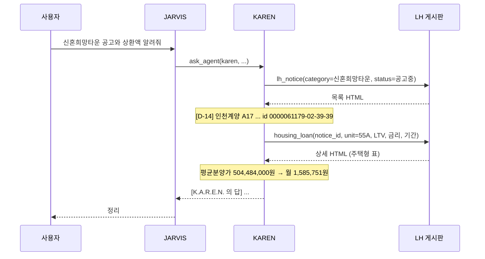
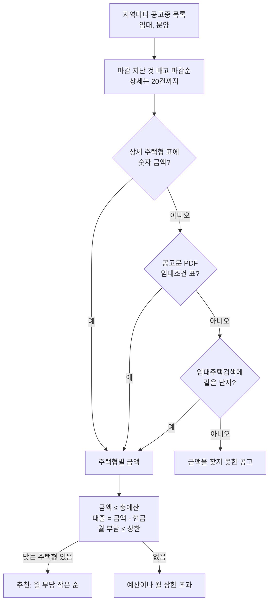
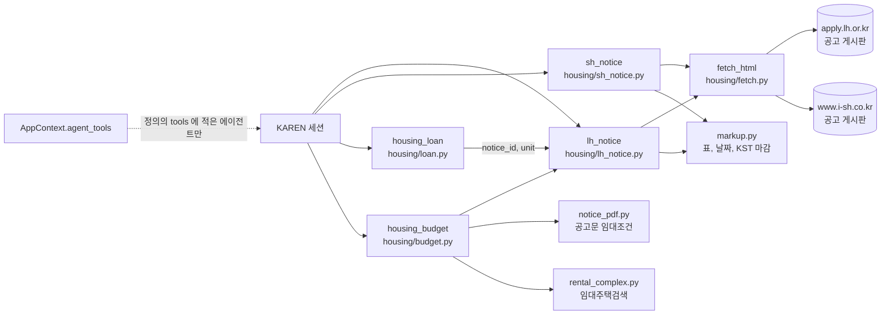

# 청약 공고와 대출 계산

KAREN 에게 LH, SH 청약 공고를 묻고, 예산에 맞는 공고를 추천받고, 공고의 분양가나 보증금으로 대출 상환액을 계산한다.

KAREN 은 아래 도구 네 개로 이 일을 한다. JARVIS 는 이 도구를 갖지 않고, 청약 질문을 받으면 `ask_agent` 로 KAREN 에게 맡긴다.

| 도구 | 하는 일 | 출처 |
|---|---|---|
| `lh_notice` | LH 임대, 분양, 주거복지(매입/전세임대), 신혼희망타운, 토지, 상가 공고를 지역, 상태, 유형, 키워드로 조회하고 KST 기준 마감을 붙인다. `id` 를 주면 상세 | LH 청약플러스 `apply.lh.or.kr` 공개 게시판 |
| `sh_notice` | SH 공고 및 공지 게시판을 키워드, 공고 종류로 조회한다. `seq` 를 주면 본문, 담당부서, 첨부 이름과 크기, 미리보기 링크 | SH `www.i-sh.co.kr` 공개 게시판 |
| `housing_budget` | 총예산, 보유 현금, 월 부담 상한으로 지금 공고중인 LH 공고를 골라 대출(금액 - 현금)과 월 부담을 계산해 추천한다. 목록, 금액 찾기, 계산을 한 번에 한다 | LH 게시판, 공고문 PDF, LH 임대주택검색 |
| `housing_loan` | 원리금균등, 원금균등, 만기일시의 월, 연간 상환액과 총이자. 거치기간, 분양가와 LTV 또는 자기자금으로 원금 정하기, 월 상환액에서 금리 역산. LH 공고 id 와 주택형을 주면 그 공고의 분양가나 보증금을 직접 읽는다 | 계산. `notice_id` 를 주면 LH 공고 상세 |

:::note

청약 도구는 공고를 읽고 계산만 한다. 로그인이나 청약 신청은 하지 않으므로 승인을 묻지 않는다.

:::

`housing_budget` 은 금액을 읽으려고 공고문 PDF 를 받지만, 사용자에게 그 파일을 넘기지는 않는다.

## 흐름

사용자가 JARVIS 에게 물으면, JARVIS 는 도구가 없으므로 KAREN 에게 맡긴다. KAREN 세션에서 바로 물으면 위임 단계 없이 KAREN 이 도구를 부른다.



## 쓰는 법

HUD 에서 KAREN 칩을 눌러 KAREN 세션에서 묻거나, JARVIS 에게 "카렌에게 ... 물어봐" 라고 말한다.

| 물어볼 말 | KAREN 이 부르는 도구 |
|---|---|
| LH 신혼희망타운 공고중인 거 마감 가까운 순으로 알려줘 | `lh_notice(category=신혼희망타운, status=공고중, order=마감순)` |
| 서울 LH 공고 중 7일 안에 마감하는 거 있어? | `lh_notice(region=서울, closing_within_days=7)` |
| 행복주택 공고 보여줘 | `lh_notice(subtype=행복주택)` |
| 인천계양 A17 55A 분양가로 LTV 70%, 연 3.5%, 30년이면 월 얼마야? | `housing_loan(notice_id=…, unit=55A, ltv_percent=70, annual_rate_percent=3.5, years=30)` |
| 3억 빌려서 월 135만원 갚으면 금리가 몇 %야? (30년) | `housing_loan(principal=300000000, monthly_payment=1350000, years=30)` |
| 총 3억 안쪽, 현금 1억 2천, 월 200만원 이하 공고 3개 추천해줘. 서울/경기 | `housing_budget(budget=300000000, cash=120000000, monthly_limit=2000000, regions=서울,경기)` |
| SH 장기전세 최신 공고 알려줘 | `sh_notice(keyword=장기전세)` |
| SH 공고 seq 310563 첨부 뭐 있어? | `sh_notice(seq=310563)` |

금리와 LTV 는 사용자가 준 값을 쓴다. 사용자가 주지 않으면 KAREN 이 값을 가정하고, 가정한 값임을 밝히도록 프롬프트에 적혀 있다.

:::warning

계산한 상환액은 추정치다. 고정금리를 가정하고, 금리 변동, 중도상환, 보증료, DSR 한도는 반영하지 않는다.

:::

## 예산으로 공고 추천

`housing_budget` 은 "목록 조회, 공고마다 상세, 금액 거르기, 계산" 을 한 번의 호출로 묶은 도구다. 실서버에서 작은 모델이 이 단계를 여러 번 오가다 멈추는 것을 보고 묶었다.



- **금액은 세 출처를 차례로 찾는다**:
  - 상세 주택형 표의 분양가나 보증금을 쓴다. 분양 공고는 대개 여기서 끝난다
  - 공고문 PDF 의 "임대조건" 표를 읽는다. 임대 공고 상세에는 금액 대신 "공고문 확인" 만 적혀 있어서, 공고문 PDF 를 받아 첫 15쪽에서 표를 찾는다(`notice_pdf.py`, `pypdf`). 한 행이 "보증금 계, 계약금, 잔금, 월임대료" 네 숫자이고 계 = 계약금 + 잔금 인 행만 금액으로 본다. 보증금 머리에 "(천원)" 이 있으면 1,000 을 곱한다. PDF 는 한 번에 8건까지 받는다
  - LH 임대주택검색(`/lhapply/csvc/lshs_sch/ajax.do`)에서 같은 단지의 금액을 가져온다. 공고 제목의 지명, 블록(A1 등), 공급유형이 모두 같은 단지가 하나일 때만 쓰고, 블록이 없는 공고는 고르지 않는다. 국민임대와 영구임대가 섞인 단지(예: `양주회천 A25BL 국민·영구임대주택`)에서 국민임대 금액을 영구임대 공고에 붙이는 식의 틀린 금액을 피하려는 것이다
- **계산**: 대출은 금액에서 현금을 뺀 값이고, 음수면 0 으로 둔다. 분양은 연 4%, 30년 원리금균등으로 월 상환액을 낸다. 임대 보증금 대출은 전세자금 대출처럼 매달 이자만 낸다고 본다. 월 부담은 대출 상환액이나 이자에 월임대료를 더한 값이다. 금리와 기간은 인자로 바꿀 수 있고, 결과 첫 줄에 가정을 적는다
- **고르기**: 공고마다 조건에 맞는 주택형 중 월 부담이 가장 작은 것을 고르고, 맞는 주택형 수를 함께 적는다. 공급대상(수급자, 청년, 「가」군 등)은 신청 자격이므로, 사용자에게 맞는지 확인하라고 결과에 적는다
- **금액을 찾지 못한 공고**: 매입임대와 전세임대(든든전세 등)는 집마다 금액이 다르고 주택목록이 엑셀 첨부라서 이 목록에 남는다. SH 공고도 금액이 첨부에만 있어서 예산 추천에서 빠진다

## 어떻게 가져오나

데이터를 가져오는 방식은 [k-skill](https://github.com/NomaDamas/k-skill) 의 `lh-notice-search`, `sh-notice-search` 를 참고했다. 다만 그 스킬이나 프록시를 쓰지 않고, 같은 공개 출처를 우리 도구가 직접 읽는다.

- **LH**: k-skill 은 공공데이터포털 LH 공고 API 를 자기 프록시(서비스키 보관)로 부른다. 여기서는 서비스키 없이 열리는 청약플러스 공고문 게시판을 읽는다. 게시판 검색 폼과 같은 값(메뉴, 유형 코드, 지역 코드, 상태, 기간, 공고명)을 보내고, 돌아온 목록 표와 상세 페이지를 파싱한다
  - 검색 기간은 기본으로 게시일 최근 1년이다. 게시판 기본값(2개월)을 쓰면 연초에 올라와 연말까지 열린 수시모집 공고가 빠지기 때문이다
  - `closing_within_days` 를 주면 게시판의 마감일 기간 검색으로 바꿔 오늘부터 n일 안에 마감하는 공고만 받는다
  - 상세 페이지에서는 공고 상태, 공고일, 마감일, 공고문 파일 이름, 주택형 표(세대수, 임대보증금과 월임대료 또는 평균분양가격), 공급정보, 공급일정, 접수처를 읽는다
- **SH**: k-skill 과 같이 공개 HTML 게시판을 직접 읽는다. 검색어를 보낼 때 `srchTp`(제목 0, 본문 1)를 꼭 붙인다. 없으면 게시판이 검색어를 무시한다. 한 쪽은 10건으로 고정이라 더 보려면 `page` 를 넘긴다. 첨부 목록은 페이지 스크립트의 `downList` 가 정본이고, 주석 속에 있는 확장자 아이콘 견본은 첨부가 아니다

## 마감 표시

마감 표시는 KST 기준 오늘 날짜와 마감일을 비교해 붙인다(`markup.deadline_label`). 서버 시간대와는 상관없다.

| 경우 | 표시 |
|---|---|
| 마감일이 지남 | `마감됨` |
| 마감일이 오늘 | `오늘 마감` |
| n일 남음 | `D-n` |
| 마감일이 없음(토지, 상가의 상담요청 등) | `마감일 없음` |

LH 상태 값 `공고중` 으로 찾으면 게시판이 `접수중`, `정정공고중` 공고까지 함께 보여준다. SH 게시판에는 상태 칸이 없어서 제목에 든 말로 상태를 짐작한다(`모집/접수`, `마감/결과`, `당첨/발표`). 도구 결과에도 짐작한 값이라고 적는다.

## 인자

`lh_notice`

| 인자 | 값 |
|---|---|
| `category` | `임대`, `주거복지`, `신혼희망타운`, `분양`, `토지`, `상가`. 비우면 임대와 분양을 함께 |
| `subtype` | `행복주택`, `국민임대`, `영구임대`, `매입임대`, `전세임대`, `공공분양(신혼희망)` 등. 주면 category 는 따라 정해진다 |
| `region` | `서울`, `경기`, `충북`, `부산광역시` 처럼 줄여도 된다. 비우면 전국 |
| `status` | `공고중`, `접수중`, `접수마감`, `정정공고중`, `상담요청` |
| `keyword` | 공고명에 든 말 |
| `closing_within_days` | 오늘부터 n일 안 마감 |
| `limit` | 기본 10, 최대 50 |
| `id` | 목록 결과의 id(`공고ID-시스템-대분류-세부`). 주면 상세 |

`housing_budget` 은 `budget`, `cash`(필수), `monthly_limit`, `regions`(쉼표, 기본 전국), `annual_rate_percent`(기본 4), `years`(기본 30), `limit`(기본 3)를 받는다.

`sh_notice` 는 `category`(`임대` 기본, `분양`, `주거복지`, `입주`, `토지`, `상가`, `보상`, `기타`, `전체`), `keyword`, `search_in`(`제목`, `본문`), `status`, `page`, `seq` 를 받는다. `주거복지` 는 SH 공개 게시판의 `주택매입` 분류로 찾고, 결과에 그렇게 적는다. `keyword` 가 지역 이름(서울, 경기 등)이면 검색어를 버리고 그렇다고 적는다. 실서버에서 모델이 지역을 검색어로 넣어, 제목에 '서울'이 든 옛 글만 받은 적이 있어서다.

`housing_loan` 은 `years`(필수)와 금리(`annual_rate_percent`) 또는 월 상환액(`monthly_payment`)을 받는다. 원금은 `principal` 로 주거나, `price` 와 함께 `ltv_percent` 나 `down_payment` 를 준다. 금리 역산은 거치기간이 없는 원리금균등에서만 된다.

`notice_id`(lh_notice 의 id)와 `unit`(주택형)을 주면 그 공고 상세의 주택형 표에서 금액을 읽어 `price` 로 쓴다. 분양가 칸이 있으면 분양가, 없으면 임대보증금이다. `55A` 는 `55.9000A` 처럼 면적 정수부와 끝 글자로 맞춘다. 실서버에서 작은 모델(gemma4:e4b)이 상세를 조회한 뒤 계산 도구를 부르지 않고 손으로 계산해 틀리는 것을 보고, 한 번의 호출로 끝나게 했다. 결과는 다음처럼 나온다.

```text
대출원금 353,138,800원(약 3억 5,314만원) (인천계양 A17블록 신혼희망타운(공공분양) 입주자모집공고 55.9000A 평균분양가격(원) 504,484,000원(약 5억 448만원) × LTV 70%)
금리 연 3.5%, 기간 30년, 원리금균등
월 상환액 1,585,751원(약 159만원) (매달 같음)
1년차 연간 상환액 19,029,012원(약 1,903만원)
```

## 에이전트만 쓰는 도구

이 도구들은 앱 레지스트리가 아니라 `AppContext.agent_tools` 에 들어간다. 그래서 정의의 `tools` 에 이름을 적은 에이전트만 받는다. JARVIS 처럼 `tools` 가 빈 에이전트는 앱 레지스트리 전체를 쓰므로 이 도구가 보이지 않는다. 다른 에이전트에게 주려면 그 정의 파일의 `tools` 에 이름을 더한다.

## 한계

- 두 게시판의 HTML 이 바뀌면 파싱이 깨진다. 목록 표나 상세 표를 못 찾으면 도구는 지어내지 않고 오류 결과를 돌려준다
- LH 목록은 첫 쪽(최대 100건)만 읽는다. 게시판에서 쪽을 넘기면 검색 조건이 사라지기 때문이다. 결과가 많으면 조건을 좁혀 찾는다
- 대출 계산은 고정금리 가정이다. 금리 변동, 중도상환, 보증료, DSR 한도는 반영하지 않는다
- GH, iH 같은 다른 지방 공사 공고는 다루지 않는다
- 공고문 PDF 의 임대조건 표가 표준 꼴(보증금 계, 계약금, 잔금, 월임대료)이 아니면 금액을 읽지 못하고 다음 출처로 넘어간다
- 매입임대, 전세임대의 주택목록(엑셀) 금액은 읽지 않는다

## 구현 위치

왼쪽이 사용자와 화면, 가운데가 코드 모듈, 오른쪽이 저장소다. 화살표는 호출이나 데이터의 방향이다.



- 핵심 모듈: `core/tools/housing/`
- 저장: 없음(매번 게시판을 읽는다)
