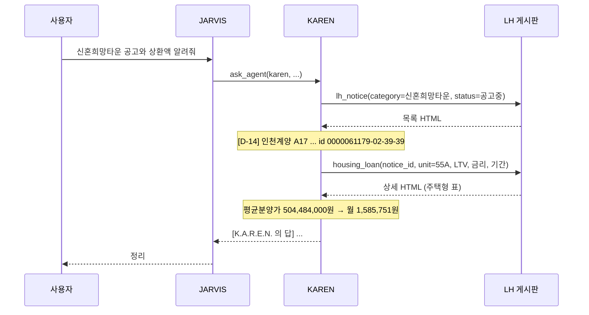
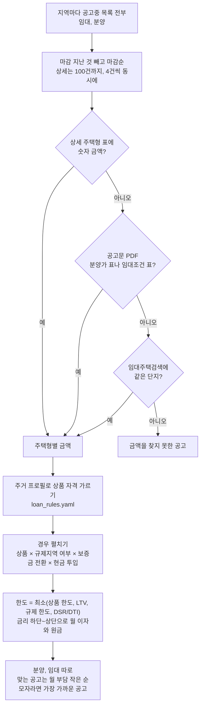
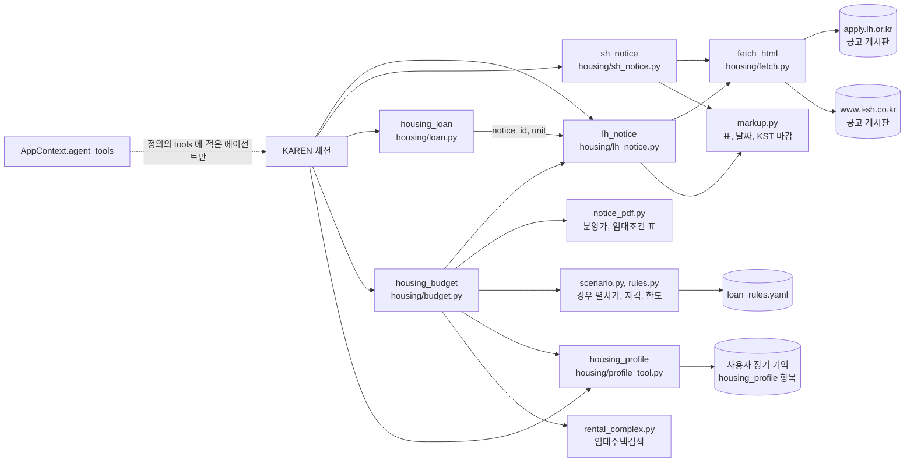

# 청약 공고와 대출 계산

KAREN 에게 LH, SH 청약 공고를 묻고, 현금과 월 여유자금으로 공고마다 대출 경우의 수를 받고, 공고의 분양가나 보증금으로 대출 상환액을 계산한다.

KAREN 은 아래 도구 다섯 개로 이 일을 한다. JARVIS 는 이 도구를 갖지 않고, 청약 질문을 받으면 `ask_agent` 로 KAREN 에게 맡긴다.

| 도구 | 하는 일 | 출처 |
|---|---|---|
| `lh_notice` | LH 임대, 분양, 주거복지(매입/전세임대), 신혼희망타운, 토지, 상가 공고를 지역, 상태, 유형, 키워드로 조회하고 KST 기준 마감을 붙인다. `id` 를 주면 상세 | LH 청약플러스 `apply.lh.or.kr` 공개 게시판 |
| `sh_notice` | SH 공고 및 공지 게시판을 키워드, 공고 종류로 조회한다. `seq` 를 주면 본문, 담당부서, 첨부 이름과 크기, 미리보기 링크 | SH `www.i-sh.co.kr` 공개 게시판 |
| `housing_budget` | 보유 현금과 월 여유자금으로 지금 공고중인 LH 공고마다 대출 경우의 수(상품, 규제지역 여부, 보증금 전환, 현금 투입 방식)를 펼쳐 월 이자와 원금 상환을 계산한다. 목록, 금액 찾기, 자격, 계산을 한 번에 한다 | LH 게시판, 공고문 PDF, LH 임대주택검색, `loan_rules.yaml` |
| `housing_profile` | 대출 자격을 가르는 사용자의 주거 프로필(무주택, 생애최초, 혼인, 연소득, 순자산, 생년월일이나 나이)을 보거나 준 항목만 고친다 | 사용자 장기 기억 |
| `housing_loan` | 원리금균등, 원금균등, 만기일시의 월, 연간 상환액과 총이자. 거치기간, 분양가와 LTV 또는 자기자금으로 원금 정하기, 월 상환액에서 금리 역산. LH 공고 id 와 주택형을 주면 그 공고의 분양가나 보증금을 직접 읽는다 | 계산. `notice_id` 를 주면 LH 공고 상세 |

:::note

청약 도구는 공고를 읽고 계산만 한다. 로그인이나 청약 신청은 하지 않으므로 승인을 묻지 않는다.

:::

`housing_budget` 은 금액을 읽으려고 공고문 PDF 를 받지만, 사용자에게 그 파일을 넘기지는 않는다.

## 흐름

사용자가 JARVIS 에게 물으면, JARVIS 는 도구가 없으므로 KAREN 에게 맡긴다. KAREN 세션에서 바로 물으면 위임 단계 없이 KAREN 이 도구를 부른다.



## 쓰는 법

HUD 에서 KAREN 칩을 눌러 KAREN 세션에서 묻거나, JARVIS 에게 "카렌에게 ... 물어봐" 라고 말한다.

| 물어볼 말 | KAREN 이 부르는 도구 |
|---|---|
| LH 신혼희망타운 공고중인 거 마감 가까운 순으로 알려줘 | `lh_notice(category=신혼희망타운, status=공고중, order=마감순)` |
| 서울 LH 공고 중 7일 안에 마감하는 거 있어? | `lh_notice(region=서울, closing_within_days=7)` |
| 행복주택 공고 보여줘 | `lh_notice(subtype=행복주택)` |
| 인천계양 A17 55A 분양가로 LTV 70%, 연 3.5%, 30년이면 월 얼마야? | `housing_loan(notice_id=…, unit=55A, ltv_percent=70, annual_rate_percent=3.5, years=30)` |
| 3억 빌려서 월 135만원 갚으면 금리가 몇 %야? (30년) | `housing_loan(principal=300000000, monthly_payment=1350000, years=30)` |
| 현금 1억 5천, 월 여유자금 200만원으로 이자랑 원금 따져서 맞는 공고 찾아줘 | `housing_budget(cash="1억 5천", monthly_limit="200만원")` |
| 총 3억 안쪽, 현금 1억 2천, 월 200만원 이하 공고 추천해줘. 서울/경기 | `housing_budget(budget="3억 안쪽", cash="1억 2천", monthly_limit="200만원", regions=서울,경기)` |
| 나 무주택이고 미혼, 연소득 6천이야. 기억해줘 | `housing_profile(action=set, homeless=true, married=false, income="6000만")` |
| SH 장기전세 최신 공고 알려줘 | `sh_notice(keyword=장기전세)` |
| SH 공고 seq 310563 첨부 뭐 있어? | `sh_notice(seq=310563)` |

금리와 LTV 는 사용자가 준 값을 쓴다. `housing_loan` 에서 사용자가 주지 않으면 KAREN 이 값을 가정하고, 가정한 값임을 밝히도록 프롬프트에 적혀 있다. `housing_budget` 은 금리를 비우면 상품별로 조사한 금리 범위를 쓴다.

:::warning

계산한 상환액은 추정치다. 고정금리를 가정하고, 금리 변동, 중도상환, 보증료는 반영하지 않는다. 대출 규칙은 조사한 날의 값이고 정부 정책이 바뀌면 달라진다.

:::

## 현금과 월 여유자금으로 대출 경우의 수

`housing_budget` 은 "목록 조회, 공고마다 금액 찾기, 자격 가르기, 대출 경우 펼치기, 계산" 을 한 번의 호출로 묶은 도구다. 실서버에서 작은 모델이 이 단계를 여러 번 오가다 멈추는 것을 보고 묶었다.

필요한 대출을 "공고 금액 - 현금" 하나로 정하지 않는다. 사람마다 받을 수 있는 상품, 지역 규제, 남겨 둘 현금이 달라서다. 그래서 결과는 하나의 답이 아니라 고를 수 있는 경우의 목록이고, 고르는 것은 사용자다.



- **금액은 세 출처를 차례로 찾는다**:
  - 상세 주택형 표의 분양가나 보증금을 쓴다
  - 공고문 PDF 를 받아 첫 15쪽에서 표를 읽는다(`notice_pdf.py`, `pypdf`). 분양 공고는 분양가 표, 임대 공고는 임대조건 표다. PDF 는 한 번에 60건까지, 분양 공고를 먼저 받는다(임대는 아래 단지 금액으로 한 번 더 찾을 수 있어서다)
    - 분양가 표: 주택가격 뒤 납부 칸(계약금, 중도금, 잔금, 융자금, 할부금)의 합이 주택가격인 행만 읽는다. 옵션, 발코니 표도 합이 맞아서, 주택형 코드 바로 뒤이거나 앞 가격 행에 이어지는 행만 쓴다. 금액 단위는 가장 가까운 `[단위 : 천원]` 표시를 따른다. 계약금이 정액이라 둘째 층부터 칸이 비어 있으면 앞 행의 계약금을 더해 맞춘다. 층별 가격은 최저가와 최고가로 묶고, 계산은 최고가로 한다
    - 임대조건 표: 표를 낱말 흐름으로 읽는다. "보증금 계, 계약금, 잔금, 월임대료" 네 숫자이고 계 = 계약금 + 잔금 인 행이 기본 조건이다. 계약금이 정액(`500 (정액)`)이라 칸이 합쳐진 행은 "계, 잔금, 월임대료" 세 숫자로 읽는다. `(+)`, `(-)` 행은 그 주택형의 최대 전환 조건(보증금 증액, 감액)이다. 부호가 잘못 찍힌 공고문이 있어 보증금이 늘었는지로 증액, 감액을 가른다
  - LH 임대주택검색(`/lhapply/csvc/lshs_sch/ajax.do`)에서 같은 단지의 금액을 가져온다. 공고 제목의 지명, 블록(A1 등), 공급유형이 모두 같은 단지가 하나일 때만 쓰고, 블록이 없는 공고는 고르지 않는다. 국민임대와 영구임대가 섞인 단지(예: `양주회천 A25BL 국민·영구임대주택`)에서 국민임대 금액을 영구임대 공고에 붙이는 식의 틀린 금액을 피하기 위해서다
- **자격**: 주거 프로필로 상품마다 가능, 불가, 미확인을 가른다. 불가인 상품은 이유와 함께 결과 머리에 적고 계산에서 뺀다. 프로필에 없는 조건이 걸린 상품은 빼지 않고 계산한 뒤 "자격 확인: 연소득 5,000만원 이하" 처럼 확인할 조건을 붙인다. 주택형 이름의 공급대상이 프로필과 어긋나면(미혼인데 신혼부부형, 65세 미만인데 고령자형) 그 주택형을 뺀다
- **경우 펼치기**:
  - 분양은 구입 대출(디딤돌, 보금자리론, 시중 주담대)마다 "현금 최대 투입"(대출 = 금액 - 현금, 한도 안에서)과 "대출 최대"(한도까지 빌리고 현금을 남김) 두 경우를 계산한다. 30년 원리금균등이 기본이고, 월 상환과 함께 금리 상단 첫 달의 이자와 원금을 나눠 적는다
  - 임대는 보증금 대출(버팀목, 청년 버팀목, 시중 전세대출)로 모자란 보증금을 빌린다고 보고, 만기일시라 매달 이자만 낸다. 공고문에 최대 전환 조건이 있으면 기본, 보증금 증액 전환, 감액 전환을 함께 계산한다. 현금으로 보증금을 다 채우면 상품과 상관없이 "대출 없음" 한 경우다
  - 경기도처럼 일부만 규제지역인 곳은 공고 지역과 제목으로 규제 여부를 모르면 "규제지역이면", "비규제지역이면" 두 경우로 펼친다
- **한도**: 상품 한도, LTV(보증금이면 보증금 비율), 수도권, 규제지역 주담대 한도, DSR(시중 주담대, 스트레스 금리 포함) 또는 DTI(정책 대출) 중 가장 작은 값이다. 결과에 어느 조건이 얼마였는지 모두 적는다. 소득을 모르면 DSR, DTI 를 빼고 그렇다고 적는다
- **고르기**: 맞음은 자격이 불가가 아니고, 현금이 모자라지 않고, 금리 상단의 월 부담이 월 여유자금 이하인 경우다. 공고마다 맞는 경우의 월 부담이 가장 작은 주택형을 보이고, 분양과 임대를 따로, [신청 가능성](#신청-가능성)이 높은 공고부터, 그 안에서 월 부담 작은 순으로 적는다. 맞는 공고가 `limit` 보다 적으면 가장 가까운 공고(현금 부족이 작은 순)로 채워, 무엇이 얼마나 모자란지 보인다
- **금액을 찾지 못한 공고**: 매입임대와 전세임대(든든전세 등)는 집마다 금액이 다르고 주택목록이 엑셀 첨부라서 이 목록에 남는다. 분양가 표가 그림인 공고문도 여기 남는다. SH 공고도 금액이 첨부에만 있어서 빠진다. 목록은 10건까지 이름을 적고 나머지는 수만 센다

`housing_budget` 의 결과 글은 그대로 KAREN 의 답이 된다. 에이전트 루프가 결과를 모델에 다시 넘기지 않고 그 글로 턴을 끝낸다(`ToolResultMessage.final`). gpt-4o-mini 가 결과를 옮겨 적으며 "대출 최대" 줄, 임대 묶음, 뒤로 보낸 공고 줄을 떨어뜨리고 링크 경로를 자르는 일이 실측에서 나와서다. 같은 턴에 다른 도구와 함께 부르면 모델이 결과를 받아 정리하므로, KAREN 은 이 도구를 혼자 부른다.

결과의 한 공고는 다음처럼 나온다(2026-10-22 전국 실측, 현금 1억 5천, 월 200만원, 개발자 프로필). 한 줄이 상품 하나이고, 그 상품의 경우를 ` / ` 로 이어 한 줄에 둔다.

```text
1. [D-329] [정정공고]익산평화 공공분양주택 추가 입주자모집(5년 무이자할부)
   분양주택 | 전북특별자치도 | 마감 2027.09.16 | id 0000061178-02-05-05 | 비수도권
   84E 분양가 2억 8,902만원 (공고문 PDF 분양가, 층별 2억 8,598만원~2억 8,902만원 중 최고가)
   신청 가능성 확인 필요: 공고문 신청자격 확인
   · 보금자리론 연 5.1% 30년 원리금균등: 현금 최대 투입 대출 1억 3,902만원, 현금 1억 5,000만원 투입 → 월 754,809원 = 이자 590,835원 + 원금 163,974원(금리 상단, 첫 달) [맞음] / 대출 최대 대출 2억 231만원, ... → 월 1,098,463원 = 이자 859,834원 + 원금 238,629원(금리 상단, 첫 달) [맞음] (한도 2억 231만원 = 최소(상품 한도 4억 2,000만원, LTV 70% 2억 231만원, DTI 60% 5억 5,254만원))
   · 시중은행 주택담보대출 연 4.66~6% 30년 원리금균등: ...
```

## 신청 가능성

대출 자격과 별개로, 그 공고에 신청할 수 있는지를 공고 유형과 프로필로 "높음, 확인 필요, 낮음" 셋 중 하나로 적는다. 가구원 수와 공고별 기준을 모르니 판정이 아니라 가능성이다. 낮음인 공고도 빼지 않고 뒤로 보내며, 보인 공고 밖으로 밀린 것은 "신청 가능성이 낮아 뒤로 보낸 공고" 로 이름과 이유를 적는다. 기준은 `loan_rules.yaml` 의 `notice_kinds` 에 2026년 LH 공고문 원문에서 옮겨 두었다.

| 공고 | 기준(1인 가구, 세전 세대 월평균소득) | 근거 공고문 |
|---|---|---|
| 신혼희망타운(분양, 행복주택) | 신혼부부, 예비신혼부부, 6세 이하 자녀 한부모만. 미혼이면 예비신혼부부로만(잔여세대 선착순도 같다) | 광주선운2 신혼희망타운 선착순계약(2026.07.06) |
| 제목에 자격완화 | 소득, 자산 기준을 완화하거나 뺀 모집이라 높음 | 남원노암 영구임대 입주자격완화(소득요건 배제) |
| 영구임대 | 일반 입주자 월 2,669,354원 이하(도시근로자 50%, 1인 70%) | 대전광역시 영구임대(2026.10.06) |
| 국민임대 | 월 3,432,027원 이하(70%, 1인 90%) | 태백철암1 국민임대 |
| 통합공공임대 | 일반공급 월 4,359,205원 이하(기준 중위소득 150%, 1인 +20%p) | 부산모라 1블록 통합공공임대(2026.10.15) |
| 행복주택 | 청년 월 4,576,036원 이하(100%, 1인 120%) | 창원시 행복주택(2026.10.15) |

- 프로필의 연소득을 12로 나눠 댄다. 미혼은 본인 소득이라 1인 가구 기준과 같다고 보지만, 가구원이 많으면 기준 금액이 올라간다고 함께 적는다
- 그 밖의 유형(공공분양, 분양전환 공공임대, 매입임대)은 "공고문 신청자격 확인" 으로 둔다

## 대출 규칙

상품과 규제의 숫자는 코드가 아니라 `core/tools/housing/loan_rules.yaml` 한 파일에 있다. 값마다 출처 URL 과 근거 수준(`공식`, `기사`, `가정`)을 함께 두고, 파일 머리의 `checked` 가 조사한 날이다. 정책이 바뀌면 이 파일만 고친다.

| 묶음 | 담은 것 |
|---|---|
| `regulation` | 10.15 대책 규제지역 이름, 수도권, 주담대 LTV(무주택, 생애최초), 수도권, 규제지역 시가 구간별 주담대 한도, DSR 40% 와 스트레스 금리, 수도권 만기 30년 |
| `products` | 디딤돌, 보금자리론, 시중 주담대(구입), 버팀목, 청년전용 버팀목, 시중 전세대출(보증금). 상품마다 금리 범위, 소득, 순자산, 나이, 집값이나 보증금 상한, 상품 한도, LTV 나 보증금 비율, DTI/DSR |

- 금리는 범위(하단~상단)로 둔다. 소득 구간별 금리표처럼 확인하지 못한 값은 범위로 넓히고, 맞음 여부는 상단으로 본다
- 조사하지 못한 값은 `null` 로 두고 계산에 쓰지 않는다(예: 시중 전세대출의 보증기관 한도)
- `checked` 에서 `stale_after_days`(60일)가 지나면 결과에 규칙이 오래됐다고 적는다. KAREN 은 그때 `web_search` 로 금리와 규제를 다시 확인한다
- 확인하지 못한 것: 디딤돌 소득 구간별 금리표, 시중 주담대 금리 상단, LH 공공임대 보증금에 시중 전세대출을 쓸 수 있는지, 무주택자 전세대출 DSR, 지방 스트레스 DSR 유예

## 주거 프로필

대출 자격을 가르는 조건은 사용자마다 다르고 바뀐다. 그래서 코드에 두지 않고 사용자 장기 기억에 사용자마다 한 항목(`source=housing_profile`, id 는 사용자로 정한 자연 키)으로 둔다. 모든 에이전트가 보는(`shared`) 사용자 사실이다.

| 항목 | 값 |
|---|---|
| 무주택 | 세대원 전원 무주택인가 |
| 생애최초 | 생애최초 혜택을 아직 쓰지 않았는가 |
| 혼인 | 기혼, 미혼 |
| 연소득 | 미혼은 본인, 기혼은 부부 합산 |
| 순자산 | 원 |
| 생년월일 또는 나이 | 생년월일이 있으면 만 나이를 매번 계산한다(만 30세가 되면 디딤돌 판정이 저절로 바뀐다). 만 나이만 주면 받은 날부터 지난 해만큼 더한다 |

- **대화로 고치기**: "연소득이 7천으로 올랐어" 처럼 말하면 KAREN 이 `housing_profile(action=set)` 으로 그 항목만 고친다. 같은 값을 다시 넣어도 결과가 같다
- **명령으로 고치기**: `/housing` 으로 보고, `/housing set 연소득=7000만 혼인=기혼` 으로 고치고, `/housing clear` 로 지운다. 값은 예/아니오, 금액('6000만'), 생년월일 `YYYY-MM-DD`, 비우려면 `모름`
- **이번 질문에만 다른 조건**: `housing_budget` 의 `conditions`(예: `연소득=7000만, 혼인=기혼`)로 저장하지 않고 덧씌운다
- 프로필이 비어 있으면 상품을 빼지 않고 모든 상품을 계산한 뒤 확인할 조건을 붙인다

금액 인자는 숫자(원)나 사용자가 말한 그대로('1억 5천', '200만원', '3억 안쪽')를 받는다(`amount.parse_won`). 단위 없이 '천'으로 끝나는 말은 천만으로 읽는다(주택 금액 관례). 작은 모델이 '1억 5천'을 15,000,000 으로 잘못 바꾼 실측이 있어, 모델이 숫자로 바꾸지 않고 그대로 넘기게 했다. 8가지 말투, 3번씩 넣은 실험(gpt-4o-mini)에서 첫 도구 호출의 현금, 월 상한, 총액이 24/24 맞았다(`scripts/experiments/karen_budget_calls.py`).

## 어떻게 가져오나

데이터를 가져오는 방식은 [k-skill](https://github.com/NomaDamas/k-skill) 의 `lh-notice-search`, `sh-notice-search` 를 참고했다. 다만 그 스킬이나 프록시를 쓰지 않고, 같은 공개 출처를 우리 도구가 직접 읽는다.

- **LH**: k-skill 은 공공데이터포털 LH 공고 API 를 자기 프록시(서비스키 보관)로 부른다. 여기서는 서비스키 없이 열리는 청약플러스 공고문 게시판을 읽는다. 게시판 검색 폼과 같은 값(메뉴, 유형 코드, 지역 코드, 상태, 기간, 공고명)을 보내고, 돌아온 목록 표와 상세 페이지를 파싱한다
  - 검색 기간은 기본으로 게시일 최근 1년이다. 게시판 기본값(2개월)을 쓰면 연초에 올라와 연말까지 열린 수시모집 공고가 빠지기 때문이다
  - `closing_within_days` 를 주면 게시판의 마감일 기간 검색으로 바꿔 오늘부터 n일 안에 마감하는 공고만 받는다
  - 상세 페이지에서는 공고 상태, 공고일, 마감일, 공고문 파일 이름, 주택형 표(세대수, 임대보증금과 월임대료 또는 평균분양가격), 공급정보, 공급일정, 접수처를 읽는다
- **SH**: k-skill 과 같이 공개 HTML 게시판을 직접 읽는다. 검색어를 보낼 때 `srchTp`(제목 0, 본문 1)를 꼭 붙인다. 없으면 게시판이 검색어를 무시한다. 한 쪽은 10건으로 고정이라 더 보려면 `page` 를 넘긴다. 첨부 목록은 페이지 스크립트의 `downList` 가 정본이고, 주석 속에 있는 확장자 아이콘 견본은 첨부가 아니다

## 마감 표시

마감 표시는 KST 기준 오늘 날짜와 마감일을 비교해 붙인다(`markup.deadline_label`). 서버 시간대와는 상관없다.

| 경우 | 표시 |
|---|---|
| 마감일이 지남 | `마감됨` |
| 마감일이 오늘 | `오늘 마감` |
| n일 남음 | `D-n` |
| 마감일이 없음(토지, 상가의 상담요청 등) | `마감일 없음` |

LH 상태 값 `공고중` 으로 찾으면 게시판이 `접수중`, `정정공고중` 공고까지 함께 보여준다. SH 게시판에는 상태 칸이 없어서 제목에 든 말로 상태를 짐작한다(`모집/접수`, `마감/결과`, `당첨/발표`). 도구 결과에도 짐작한 값이라고 적는다.

## 인자

`lh_notice`

| 인자 | 값 |
|---|---|
| `category` | `임대`, `주거복지`, `신혼희망타운`, `분양`, `토지`, `상가`. 비우면 임대와 분양을 함께 |
| `subtype` | `행복주택`, `국민임대`, `영구임대`, `매입임대`, `전세임대`, `공공분양(신혼희망)` 등. 주면 category 는 따라 정해진다 |
| `region` | `서울`, `경기`, `충북`, `부산광역시` 처럼 줄여도 된다. 비우면 전국 |
| `status` | `공고중`, `접수중`, `접수마감`, `정정공고중`, `상담요청` |
| `keyword` | 공고명에 든 말 |
| `closing_within_days` | 오늘부터 n일 안 마감 |
| `limit` | 기본 10, 최대 50 |
| `id` | 목록 결과의 id(`공고ID-시스템-대분류-세부`). 주면 상세 |

`housing_budget` 은 `cash`(필수), `monthly_limit`, `budget`(사용자가 총액 상한을 말했을 때만), `regions`(쉼표, 기본 전국), `annual_rate_percent`(비우면 상품별 범위), `years`(비우면 상품 기본 30년), `conditions`(이번 계산에만 쓸 프로필 조건), `limit`(분양, 임대 각각, 기본 3)를 받는다. 금액은 숫자나 말 그대로의 글이다.

`housing_profile` 은 `action`(`get`, `set`, `clear`)과 고칠 항목 `homeless`, `first_home`, `married`, `income`, `assets`, `birth_date`, `age` 를 받는다.

`sh_notice` 는 `category`(`임대` 기본, `분양`, `주거복지`, `입주`, `토지`, `상가`, `보상`, `기타`, `전체`), `keyword`, `search_in`(`제목`, `본문`), `status`, `page`, `seq` 를 받는다. `주거복지` 는 SH 공개 게시판의 `주택매입` 분류로 찾고, 결과에 그렇게 적는다. `keyword` 가 지역 이름(서울, 경기 등)이면 검색어를 버리고 그렇다고 적는다. 실서버에서 모델이 지역을 검색어로 넣어, 제목에 '서울'이 든 옛 글만 받은 적이 있어서다.

`housing_loan` 은 `years`(필수)와 금리(`annual_rate_percent`) 또는 월 상환액(`monthly_payment`)을 받는다. 원금은 `principal` 로 주거나, `price` 와 함께 `ltv_percent` 나 `down_payment` 를 준다. 금리 역산은 거치기간이 없는 원리금균등에서만 된다.

`notice_id`(lh_notice 의 id)와 `unit`(주택형)을 주면 그 공고 상세의 주택형 표에서 금액을 읽어 `price` 로 쓴다. 분양가 칸이 있으면 분양가, 없으면 임대보증금이다. `55A` 는 `55.9000A` 처럼 면적 정수부와 끝 글자로 맞춘다. 실서버에서 작은 모델(gemma4:e4b)이 상세를 조회한 뒤 계산 도구를 부르지 않고 손으로 계산해 틀리는 것을 보고, 한 번의 호출로 끝나게 했다. 결과는 다음처럼 나온다.

```text
대출원금 353,138,800원(약 3억 5,314만원) (인천계양 A17블록 신혼희망타운(공공분양) 입주자모집공고 55.9000A 평균분양가격(원) 504,484,000원(약 5억 448만원) × LTV 70%)
금리 연 3.5%, 기간 30년, 원리금균등
월 상환액 1,585,751원(약 159만원) (매달 같음)
1년차 연간 상환액 19,029,012원(약 1,903만원)
```

## 에이전트만 쓰는 도구

이 도구들은 앱 레지스트리가 아니라 `AppContext.agent_tools` 에 들어간다. 그래서 정의의 `tools` 에 이름을 적은 에이전트만 받는다. JARVIS 처럼 `tools` 가 빈 에이전트는 앱 레지스트리 전체를 쓰므로 이 도구가 보이지 않는다. 다른 에이전트에게 주려면 그 정의 파일의 `tools` 에 이름을 더한다.

## 한계

- 두 게시판의 HTML 이 바뀌면 파싱이 깨진다. 목록 표나 상세 표를 못 찾으면 도구는 지어내지 않고 오류 결과를 돌려준다
- LH 목록은 최신순이면 첫 쪽만 읽는다(돌려주는 공고가 최대 50건이라 충분하다). 마감순과 `housing_budget` 은 100건씩 5쪽(500건)까지 넘겨 전부 본다. 게시판은 2쪽부터 `srchY=N` 과 앞 쪽 크기(`prevListCo`)를 함께 보내야 검색 조건을 지킨 채 다음 쪽을 주고, 마지막 쪽을 넘기면 마지막 쪽을 다시 주므로 전체 건수로 멈춘다
- `housing_budget` 은 전국 조회(2026-10 기준 공고중 80건 안팎)에 1분 남짓에서 2분 걸린다. 상세 80건과 공고문 PDF 60건까지 받기 때문이다
- 대출 계산은 고정금리 가정이다. 금리 변동, 중도상환, 보증료는 반영하지 않는다. DSR, DTI 는 다른 대출이 없다고 보고 센다
- 분양은 입주 때 잔금 대출 기준이다. 계약금, 중도금 일정과 중도금 대출 이자, 공고문의 융자금(주택도시기금) 승계 조건은 단지마다 달라 계산하지 않고 공고문을 보라고 적는다
- 신혼희망타운처럼 공고 자체에 신청 자격이 걸린 경우와 임대의 소득, 자산 기준은 가르지 않는다. 주택형 이름으로 가르는 것은 신혼부부형, 고령자형뿐이다
- GH, iH 같은 다른 지방 공사 공고는 다루지 않는다
- 공고문 PDF 의 표가 위의 꼴(합이 맞는 행)이 아니거나 그림이면 금액을 읽지 못하고 다음 출처로 넘어간다. 임대조건 표의 공급대상 이름은 PDF 줄바꿈 때문에 어색하게 붙을 수 있다(예: `16 청 년 소득 無`)
- 매입임대, 전세임대의 주택목록(엑셀) 금액은 읽지 않는다

## 구현 위치

왼쪽이 사용자와 화면, 가운데가 코드 모듈, 오른쪽이 저장소다. 화살표는 호출이나 데이터의 방향이다.



- 핵심 모듈: `core/tools/housing/`
- 저장: 공고는 저장하지 않는다(매번 게시판을 읽는다). 주거 프로필만 사용자 장기 기억에 사용자마다 한 항목으로 남는다
