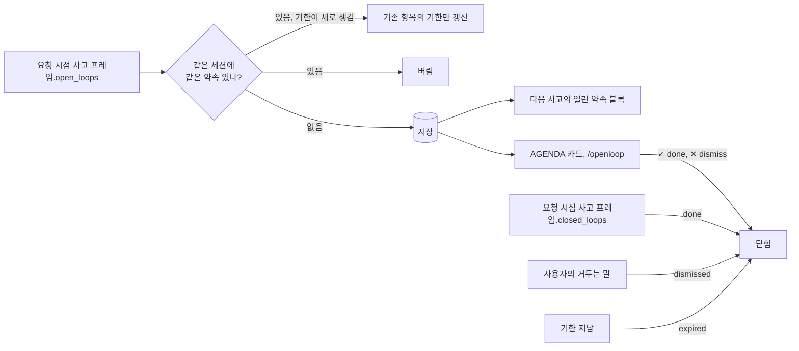
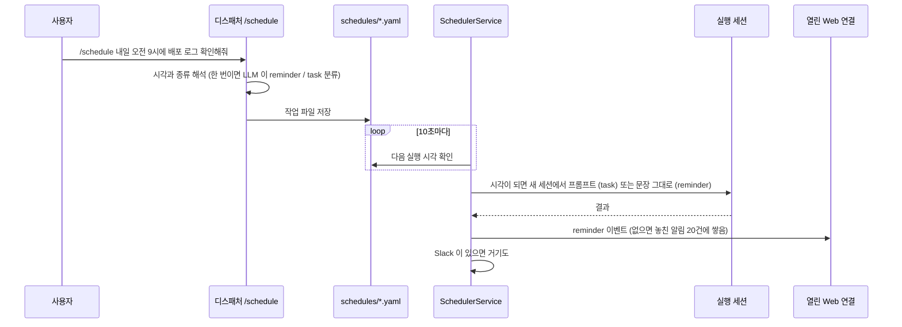
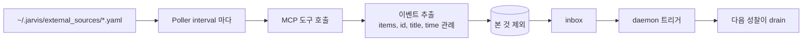
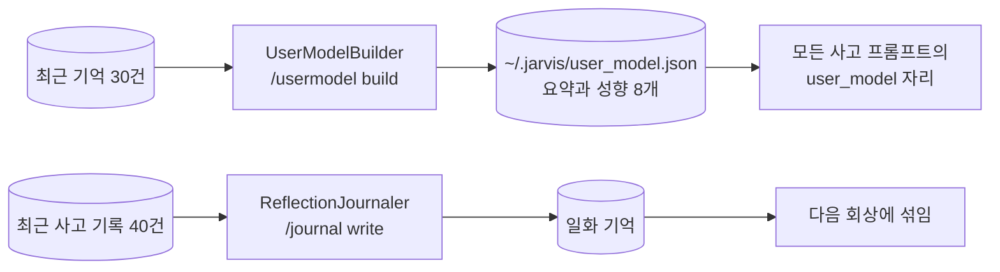
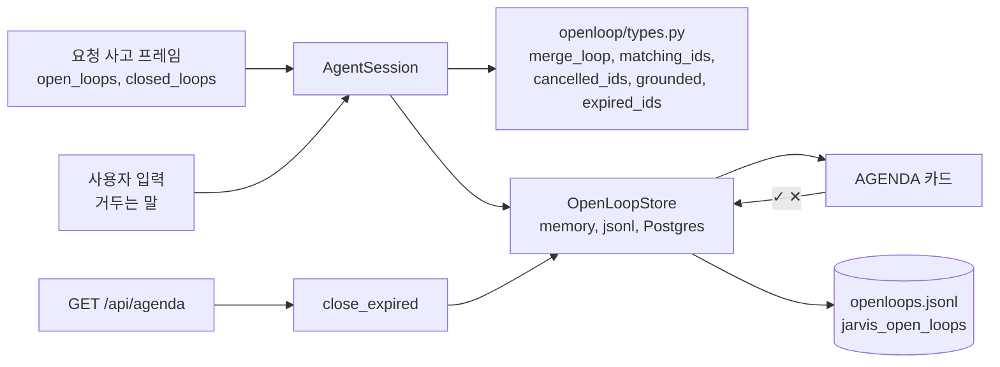
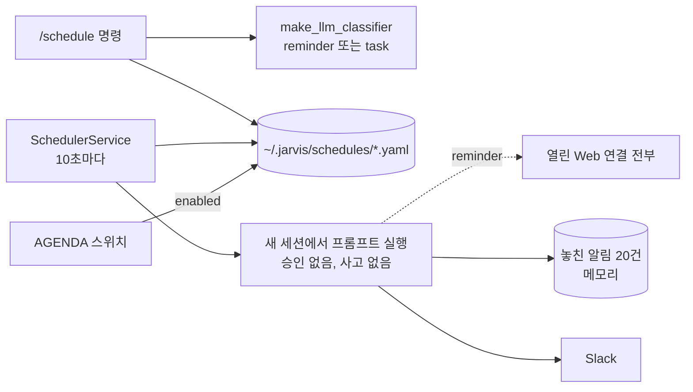
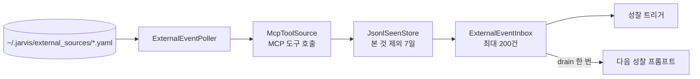

# 약속, 스케줄, 외부 이벤트

JARVIS 는 대화에서 흘린 약속(open loop), 정한 시각에 도는 스케줄, MCP 도구로 가져온 외부 이벤트를 따로 관리하고, Web HUD 의 AGENDA 카드에 모아 보여 준다. 셋은 저장소와 흐름이 각각 다르다.

## Open loop: 흘린 약속 추적

JARVIS 는 대화에서 나온 약속과 미완 작업을 기억했다가 성찰 때 다시 본다.



- 약속은 요청 모드의 내적 사고에서만 저장한다. 성찰은 약속을 보기만 하고 닫지도 않는다
- 새 약속은 사용자 입력에서 나온 것만 저장한다(`grounded`: 약속 글자 bigram 의 20% 이상이 입력에 있어야 한다). 작은 사고 모델(gemma4:e4b)은 회상된 기억 속 다른 약속을 새로 흘린 것처럼 옮겨 적는다. 그런 항목은 입력과 겹침이 0 이었다
- 내적 사고에는 열린 약속이 최신순으로 `[1] 설명 (기한 ...)` 처럼 번호와 함께 보인다
- 기한: 사고 프레임이 약속 끝에 ` @YYYY-MM-DD HH:MM` 을 붙이면 `due_ms` 로 저장한다. 다음 사고에는 `설명 (기한 2026-10-12 10:00)` 으로 보인다
- 같은 약속 판정(`openloop/types.py` 의 `same_loop`): 공백 정리와 소문자로 정규화해 같거나, 짧은 쪽(6자 이상)이 긴 쪽에 통째로 들어가거나, 공백을 뺀 글자 bigram 의 Jaccard 가 0.4 이상이면 같은 약속으로 본다. 실제로 쌓였던 바꿔 말한 중복은 0.43 에서 0.85, 서로 다른 약속은 0.21 이하였다. 다만 단어를 통째로 바꾼 약속("참석자 목록 확정" 과 "참석자들의 최종 리스트 확정")은 여전히 따로 쌓인다
- 같은 약속이 다시 오면 새로 만들지 않는다. 기한이 새로 붙었을 때만 기존 항목의 기한을 갱신한다
- 약속은 다음 경우에 저절로 닫힌다.
  - 사고의 `closed_loops`: 이번 입력으로 끝났거나, 하지 말라고 했거나, 취소된 약속의 번호(또는 문구)를 사고가 짚으면 `done` 으로 닫는다
  - 사용자의 거두는 말: 입력에 `취소`, `안 해도`, `하지 마`, `그만해`, `필요 없`, `안 챙겨` 같은 말이 있고 그 입력이 열린 약속을 가리키면(짧은 쪽 기준 bigram 겹침 0.5 이상) 사고가 놓쳐도 `dismissed` 로 닫는다. 완료 표현("보냈어", "다 했어")은 질문과 구분이 안 돼 사고에만 맡긴다
  - 같은 사고 결과에서 닫으라고 한 약속은 `open_loops` 에 다시 있어도 새로 열지 않는다
  - 기한: 사고 전과 `GET /api/agenda` 때, 기한 뒤 `JARVIS_OPENLOOP__EXPIRE_AFTER_SEC`(6시간)가 지났거나 기한 없이 `JARVIS_OPENLOOP__MAX_AGE_SEC`(7일)보다 오래되면 `expired` 로 닫는다
- 상태는 `open`, `done`, `dismissed`, `expired` 넷이다
- 저장소: `~/.jarvis/openloops.jsonl`(append 로그, id 기준 마지막이 이긴다), Postgres `jarvis_open_loops`, 메모리
- 조작: `/openloop`, `/openloop done <id>`, `/openloop dismiss <id>`, `POST /api/openloops/{id}` 로 약속을 보고 닫는다

### 한계

자동 닫힘과 중복 판정은 작은 사고 모델의 출력과 글자 겹침에 기댄다. 그래서 아래 경우는 사람이 ✓ / ✕ 로 정리해야 한다. 측정은 gemma4:e4b(ollama)로 "내일 오후 3시까지 분기 보고서 초안을 팀장님께 보내야 해" 뒤 "그건 취소됐어, 안 챙겨도 돼" 를 새 세션에서 반복한 것이다.

| 한계 | 왜 | 실측 또는 예 | 우회 |
|---|---|---|---|
| 단어를 통째로 바꾼 같은 약속은 따로 쌓인다 | 같은 약속 판정이 글자 bigram 겹침이라 뜻은 보지 않는다 | "참석자 목록 확정" 과 "참석자들의 최종 리스트 확정" 은 Jaccard 0.21 로 다른 약속 | ✕ 로 하나를 닫는다. 계속 쌓이면 임베딩 유사도로 바꾼다(`types.py` 의 `ponytail`) |
| 완료 표현으로는 코드가 닫지 않는다 | "보냈어", "다 했어" 는 "보냈어?" 같은 질문과 글자로 구분이 안 된다 | 완료는 사고의 `closed_loops` 에만 맡긴다 | ✓ 로 닫는다 |
| 사고가 닫을 번호를 놓친다 | 작은 모델은 취소 턴에 `closed_loops` 를 비우거나 `[열린 약속]` 에 없는 문구를 적는다 | 번호 방식 전에는 문구가 맞지 않아 닫히지 않았다. 지금은 사고가 놓쳐도 거두는 말이 약속을 가리키면 닫힌다 | 거두는 말에 약속을 가리키는 낱말을 넣는다("보고서는 취소됐어") |
| 거두는 말이 약속을 가리키지 않으면 안 닫힌다 | 입력과 약속의 글자 겹침이 짧은 쪽 기준 0.5 미만이면 다른 약속으로 본다 | "그건 취소됐어" 만으로는 닫히지 않는다 | 약속 이름을 같이 말하거나 ✕ |
| 기한이 절반쯤 빠진다 | 사고 모델이 ` @YYYY-MM-DD HH:MM` 표기를 자주 빼먹는다 | 약속을 만든 7번 중 4번만 기한이 붙었다 | 기한 없는 약속은 `MAX_AGE_SEC`(7일)에 닫힌다 |
| 약속이 생기지 않거나 취소 턴에 생긴다 | 사고 모델이 약속을 놓쳤다가 다음 턴에 적는다 | 한 번은 첫 턴에 약속이 없고 "취소됐어" 턴에 생겼다. 같은 프레임에서 닫으라고 한 것은 열지 않지만 이 경우는 막지 못한다 | ✕ |
| 바꿔 말한 새 약속이 버려진다 | 입력과 글자가 20% 미만 겹치는 새 약속은 회상된 기억에서 옮겨 적은 것으로 보고 저장하지 않는다 | 옮겨 적은 약속은 겹침이 0 이었다. "배포 끝나면 알려줄게" 를 "결과 공유" 로만 적으면 버려진다 | 사고가 근거 문장을 같이 내게 바꾼다(`grounded` 의 `ponytail`) |
| 닫힘이 답보다 늦다 | `JARVIS_THOUGHT__REQUEST_TIMING=after` 면 사고가 응답 뒤에 돈다 | 로컬 한 GPU 에서 응답 뒤 약 10초 | 없음. 사고가 끝나면 AGENDA 가 다시 불린다 |
| 잘못 닫힌 약속을 되살릴 수 없다 | 닫기만 있고 `open` 으로 되돌리는 API 와 화면이 없다 | | 다시 말하면 새 약속으로 생긴다 |
| 기한은 서버 시간대로 계산한다 | `[지금]` 과 기한 해석 모두 프로세스 로컬 시각이다 | 컨테이너 `TZ=Asia/Seoul` | 컨테이너 `TZ` 를 사용자 시간대로 맞춘다 |

## 스케줄

```text
/schedule 내일 오전 9시에 배포 로그 확인해줘      # 한 번
/schedule 2026.10.20 오후 6시까지 보고서 초안 작성   # 마감까지 반복
/schedule 0 9 * * * date && uptime                  # cron
```



- 한 번 실행(`...에`): LLM 분류기에 `reminder`(그 문장을 그대로 알림)인지 `task`(프롬프트를 실행)인지 한 번 묻는다. 분류에 실패하면 reminder 로 둔다
- 마감까지 반복(`...까지`): 남은 시간으로 주기를 고른다. 7일 이상이면 매일 9시, 하루 이상이면 6시간마다, 1시간 이상이면 매시, 그 아래는 10분마다
- 파일: 작업은 `~/.jarvis/schedules/<name>.yaml` 에 저장한다. 켜고 끄면 `enabled` 키만 바뀐다. 한 번 실행을 마친 작업은 스케줄러가 파일을 지우거나 `enabled: false` 로 바꾼다
- 실행: 스케줄러는 10초마다 깨어나 새 세션에서 프롬프트를 돌린다. 이 세션은 빈 메모리 체인을 쓰고 사고 엔진이 없다. 늦게 켜져 지난 일정은 기동 때 `delayed_sec` 를 달고 실행된다
- 전달: 열린 Web 연결 전부에 `reminder` 이벤트를 보낸다. 아무도 없으면 최근 20건을 쌓아 두었다가 다음 접속 때 `missed: true` 로 보낸다. Slack 이 있으면 Slack 에도 보낸다

:::danger

스케줄 실행 세션은 승인 없는 샌드박스를 쓴다. 스케줄 작업이 부르는 도구는 사람에게 묻지 않고 실행된다.

:::

:::warning

놓친 알림은 프로세스 메모리에만 쌓인다. 재시작하면 사라진다.

:::

## 외부 이벤트

JARVIS 는 MCP 도구를 주기적으로 불러 새 항목을 성찰의 재료로 넣는다. 캘린더나 메일 같은 소스를 비서가 먼저 보고 말하게 하는 길이다.



- 소스 정의: `name`, `server`(mcp_servers 의 이름), `tool`, `args`, `interval_sec`(300), `enabled` 키로 쓴다
- 응답 해석은 벤더 중립 관례를 따른다. 목록은 `items`, `events`, `messages`, `results`, `data` 필드에서 읽는다. id 는 `id`, `uid`, `eventId`, `messageId`, `threadId` 에서 찾고, 없으면 본문 해시를 쓴다. 제목은 `title`, `summary`, `subject`, `name`, `description` 에서 찾는다
- 본 것은 `~/.jarvis/external_seen.jsonl` 에 TTL(7일)로 기억한다. 틱당 최대 20건을 가져오고, inbox 는 200건까지 담는다
- drain 은 한 번만 일어나므로 여러 세션이 성찰해도 이벤트당 발화는 한 번이다. 요청 시점 사고는 외부 이벤트를 받지 않는다
- 성찰 프롬프트는 이벤트를 "말하라는 명령이 아니라 사실" 로 다루고, 긴급성과 관련성이 분명할 때만 말한다

## 사용자 모델과 저널



- **사용자 모델** (`agent_layer/usermodel/`): LLM 이 최근 기억 30건을 요약과 성향(최대 8개)으로 증류한다. `/usermodel build` 로 만들고 `~/.jarvis/user_model.json` 에 덮어쓴다. 모든 사고 프롬프트의 `{{user_model}}` 에 들어간다. 자동으로는 만들지 않는다
- **저널** (`agent_layer/journal/`): 최근 사고 기록 40건을 보고 1 에서 3 문장의 메타 성찰을 쓴다. `/journal write` 로 실행한다. 일화 기억으로 저장되어 회상에 섞여 들어온다

## 구현 위치

왼쪽이 사용자와 화면, 가운데가 코드 모듈, 오른쪽이 저장소다. 화살표는 호출이나 데이터의 방향이다.

### Open loop



- 핵심 모듈: `agent_layer/openloop/`
- 저장: `openloops.jsonl` 또는 Postgres

### 스케줄



- 핵심 모듈: `core/scheduler/`
- 저장: `~/.jarvis/schedules/*.yaml`

### 외부 이벤트



- 핵심 모듈: `core/external/`
- 저장: `external_seen.jsonl`
