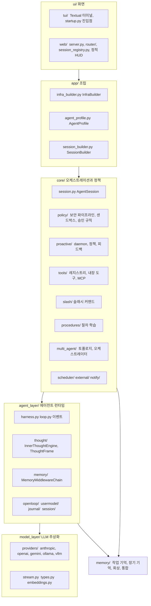
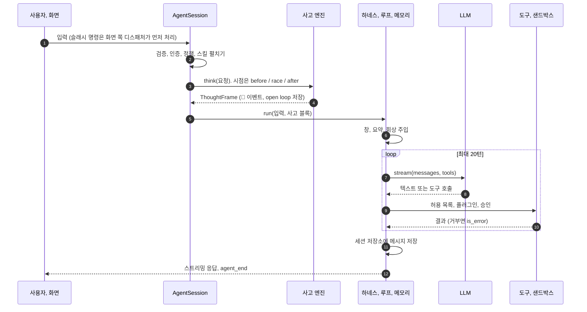
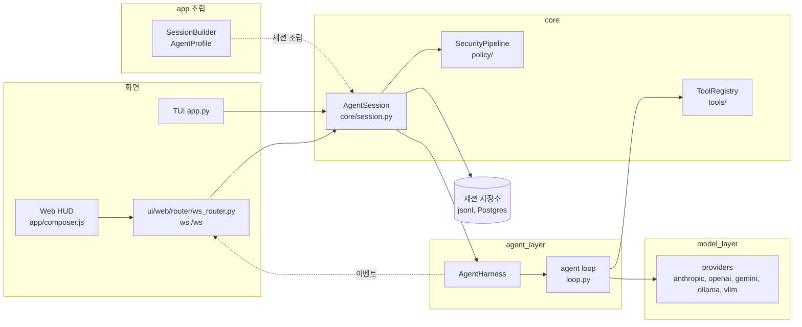

# 아키텍처

## 계층

`src/jarvis/` 는 아래에서 위로 model_layer, memory, agent_layer, core, app, ui 순서다. 아래층은 위층을 모른다. `common/`(로거)은 어느 층이든 쓸 수 있고 자신은 아무 층도 모른다.

- **model_layer**: 프로바이더마다 `stream()` 하나. 텍스트 델타, 도구 호출 델타, 정지 이벤트를 같은 모양으로 낸다. 임베딩도 여기
- **agent_layer**: 에이전트 루프(`run_agent_loop`), 세션 저장소, 내적 사고 엔진, 메모리 미들웨어. 벤더를 모른다
- **core**: `AgentSession` 이 한 턴을 지휘한다. 보안, 도구, 승인, proactive 정책, 슬래시, 절차 학습, 멀티 에이전트, 스케줄러
- **app**: 조립 층. `InfraBuilder` 가 설정 하나로 도구, 메모리, 저장소, 보안, 스케줄러, proactive, 슬래시 명령을 만들고, `AgentProfile`(에이전트 한 명분 설정과 피드백 학습기)과 `SessionBuilder` 가 세션을 만든다
- **ui**: TUI 와 Web. 둘 다 `app` 의 조립 결과(`AppAssembly`)를 받아 화면만 담당한다
- **memory**: 작업 기억(요약과 창)과 장기 기억(의미, 일화, 절차)을 가진 `MemoryService`

## 요청 한 번의 흐름

순서가 고정인 곳.

- 보안 파이프라인은 검증, 인증, 정책 순이고 건너뛸 수 없다. 검증은 빈 입력, 길이 상한(기본 10,000자), 스크립트 패턴을 막고 NFC 정규화와 HTML 이스케이프를 한다
- 도구 호출은 정책 허용 목록, 플러그인 `before_tool_call`, 샌드박스 승인 순으로 검사한다. 거부는 예외가 아니라 `is_error` 결과로 LLM 에 돌아가고 루프는 계속된다
- 메모리 주입은 LLM 호출 직전 `transform` 한 곳이다. `[핵심 사실]`, `[장기 기억]`, `[절차 기억]`, `[작업 공유 메모리]`, 요약 순으로 앞에 붙는다

## 이벤트

한 턴 동안 하네스가 구독자에게 보내는 이벤트. Web 은 그대로 WebSocket 으로 흘리고, TUI 는 화면 동작으로 번역한다.

| type | 언제 | 주요 필드 |
|---|---|---|
| `agent_start` | 루프 시작 | `agent_name` |
| `turn_start` | 루프의 매 반복 | `turn` |
| `message_update` | 스트리밍 | `text_delta`, `thinking_delta` |
| `tool_execution_start`, `tool_execution_end` | 도구 호출 전후 | `tool_name`, `args`, `is_error` |
| `agent_end` | 루프 끝 | `final_message.usage`, `turns` |
| `agent_error` | 프로바이더 오류 | `message` |
| `inner_thought` | 사고 프레임이 나왔을 때 | `interpretation`, `decision`, `confidence`, `frame` |
| `proactive_message` | filler 또는 먼저 건네는 말 | `text`, `kind`, `message_id` |

## 두 화면, 한 배선

TUI 와 Web 모두 `app/infra_builder.py` 의 `build_app`(도구, 스케줄러, 알림, 서브 에이전트, 디스패처)과 `app/session_builder.py` 의 `SessionBuilder`(사고 엔진, proactive 코어, open loop, 사용자 모델)를 쓴다. 에이전트마다 달라질 수 있는 값(브랜드, 모델, 사고와 proactive 설정, 피드백 학습기)은 `AgentProfile` 에 모여 있고 지금은 `main` 하나다. Web 은 세션마다 샌드박스와 보안 파이프라인을 따로 두고, 승인은 세션 단위 브로커가 모든 연결에 방송한다. 차이는 화면과 승인 입력 방식뿐이다.

## 저장 위치

| 데이터 | 위치 |
|---|---|
| 세션 대화 | `~/.jarvis/sessions/<id>.jsonl` 또는 Postgres `jarvis_sessions`, `jarvis_entries` |
| 장기 기억 | 메모리 또는 Postgres `jarvis_ltm_entries`(pgvector 선택) |
| 작업 기억 | Postgres `jarvis_working_memory` 또는 메모리 |
| open loop | `~/.jarvis/openloops.jsonl` 또는 Postgres `jarvis_open_loops` |
| 승인 규칙 | 공용 `~/.jarvis/approvals.yaml`, 에이전트별 `~/.jarvis/approvals/<agent_id>.yaml` |
| 절차 | `~/.jarvis/procedures/<name>.md` |
| 스케줄 | `~/.jarvis/schedules/*.yaml` |
| 사용자 모델 | `~/.jarvis/user_model.json` |
| 사고 템플릿 | `~/.jarvis/inner_thought.md`, `inner_thought_reflection.md` |
| 외부 소스 | `~/.jarvis/external_sources/*.yaml`, 본 것은 `external_seen.jsonl` |

Docker 에서는 `~/.jarvis` 가 `jarvis_data` 볼륨이다.

## 구현 위치

왼쪽이 사용자와 화면, 가운데가 코드 모듈, 오른쪽이 저장소다. 화살표는 호출이나 데이터의 방향이다.

- 핵심 모듈: `core/session.py`, `agent_layer/loop.py`, `model_layer/`
- 저장: 세션 저장소
