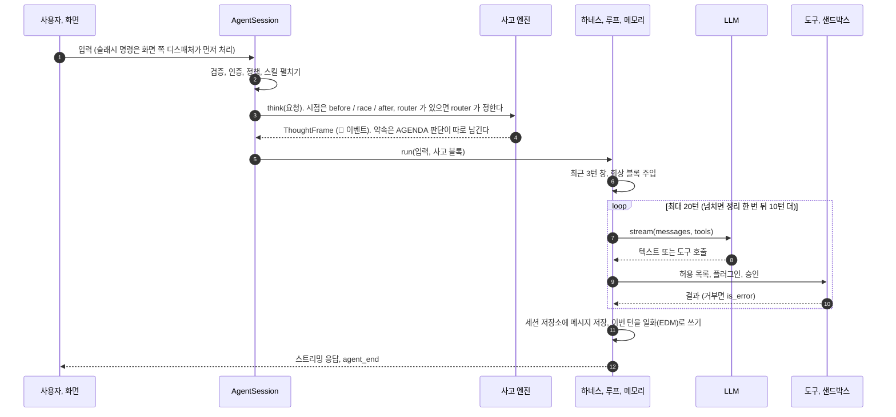
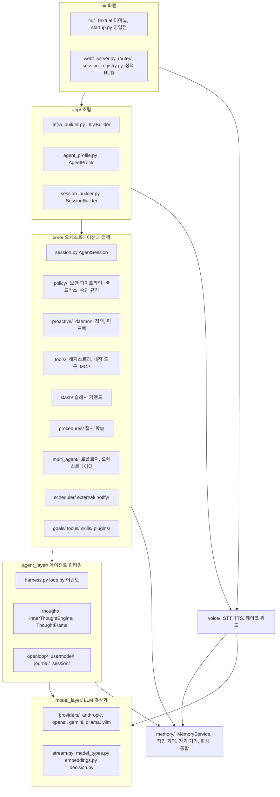
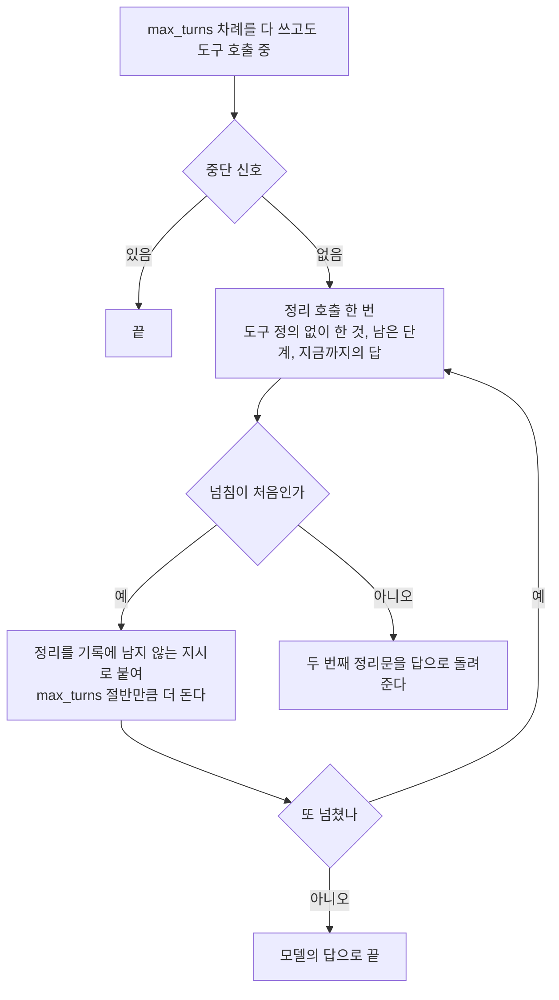
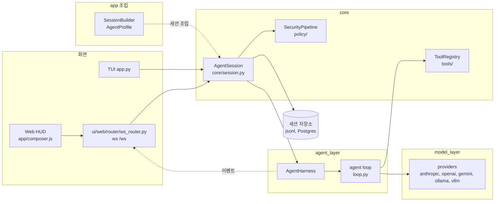

import InfoArchitecture from '@site/src/figures/info-architecture.svg';
import FigureArchitecture from '@site/src/figures/architecture.svg';
import FigureExpArchitecture from '@site/src/figures/exp-architecture.svg';
import FigureExpLoopOverflow from '@site/src/figures/exp-loop-overflow.svg';

# Architecture

Architecture는 Jarvis-Agent의 뼈대가 되는 구조를 소개하는 페이지다. LLM 추상화, 기억, 에이전트 런타임, 오케스트레이션, 조립, 화면을 layer로 쌓고, 아래 layer가 위 layer를 모르도록 설계했다. 덕분에 TUI 와 Web 두 화면은 같은 조립 결과를 받아 쓰고 화면만 다르게 그리며, Conversation, Memory 같은 다른 기능들은 모두 이 구조 위에서 동작한다.

<figure className="info-fig">
  <InfoArchitecture />
</figure>

## Architecture가 주목한 점

사용자는 같은 JARVIS 를 터미널(TUI)에서도, 브라우저(Web HUD)에서도 쓰고, 때로는 브라우저 탭을 여러 개 열어 둔다. 일반적인 Agent 애플리케이션은 화면마다 에이전트를 따로 조립하는 경우가 많은데, 이렇게 되면 한쪽에서 고친 동작이 다른 쪽에는 빠지고, 에이전트를 여럿 두려 할수록 조립 코드가 화면 수만큼 늘어난다. 프로세스가 중간에 죽었을 때의 복구 절차마저 화면과 실패 지점마다 달라진다. 화면별 코드를 공통 함수로 묶는 우회도 가능하지만, 층끼리 서로 import 하는 구조가 남아 있으면 결국 한 곳을 고칠 때 다른 곳이 흔들린다. Jarvis-Agent는 조립을 한 곳에 모으고 화면은 그 결과를 받아 그리기만 하도록 layer를 나누었다. 또한 같은 작업을 다시 실행하면 한 번 한 것과 같은 상태가 되도록 만들어, 사람이 손으로 상태를 맞출 일이 없도록 했다.

### 어떤 기능을 가지고 있나요?

#### 조립 층을 따로 둔다

- 조립만 하는 `app/` 층(AgentProfile, SessionBuilder, SubagentBuilder 등)을 따로 만들었다. 정의 파일 하나로 최상위 에이전트를 늘리고, 에이전트마다 브랜드, 모델, 사고 설정을 따로 가진다.
- 대안으로는 에이전트가 하나일 때처럼 TUI 시작 코드와 Web 서버가 각자 객체를 조립하는 방식이 있었다.
- 최상위 에이전트를 여럿 받으려면 "에이전트 한 명분의 설정" 이 단위가 되어야 한다. 이 정리는 동작을 하나도 바꾸지 않는 것을 조건으로 했다. 테스트는 1053개에서 단위 1167개와 통합 82개로 늘었고, mypy 오류는 777개에서 0개가 됐다.

#### 의존은 한 방향

- `model_layer` 는 `core` 를 모르고, `agent_layer` 는 화면을 모르고, 화면은 `UIAdapter` 로만 이벤트를 받는다.
- 대안으로는 층끼리 서로 import 하는 구조가 있었다.
- 의존이 한 방향이어야 같은 세션이 TUI 와 Web 에 똑같이 붙고, 테스트에서는 실제 LLM 대신 각본 프로바이더(FauxProvider)를 꽂을 수 있다. 보안 파이프라인(검증, 인증, 정책, 샌드박스)은 단계마다 구현만 바꿀 수 있고 순서는 바꿀 수 없어서, 입력이 위험하거나 도구가 거부되어도 어느 단계도 건너뛰지 않는다.

#### 재실행해도 같은 결과

- 멱등성을 기본 원칙으로 둔다. 테이블과 칼럼은 `IF NOT EXISTS` 로 맞추고, 파일은 임시 파일에 쓴 뒤 바꿔 끼우고, 비결정적인 값(시각, id)은 경계에서 만들어 넣는다.
- 대안으로는 실패 지점마다 따로 복구 절차를 두는 방식이 있었다.
- 같은 작업을 두 번 해도 한 번 한 것과 같아야, 중간에 프로세스가 죽었을 때 복구가 "다시 실행" 으로 끝난다. 일부러 이 원칙을 어긴 곳에는 `# idempotent:` 마커를, 일부러 단순하게 둔 곳에는 `# ponytail:` 마커를 남겨 나중에 모아 볼 수 있게 했다.

#### 예산을 넘긴 차례는 정리하고 한 번 더 이어간다

- 루프가 `max_turns` 를 다 쓰고도 도구를 부르는 중이면 그 자리에서 끊지 않는다. 도구 없이 한 것과 남은 단계를 한 번 정리하고, 그 정리를 붙여 원래 예산의 절반만큼 더 돈다. 또 넘치면 정리문을 답으로 돌려준다.
- 대안으로는 예산을 그냥 늘리는 방식과, 넘칠 때마다 계속 이어가는 방식이 있었다.
- 예산을 다 썼다는 것은 실패가 아니라 단계가 너무 컸다는 신호로 본다. 이 관점은 [EMMA: Structured Episodic Memory for Multi-Agent Workflow Synthesis](https://arxiv.org/abs/2610.35966) 의 overflow decomposition 에서 가져왔다. EMMA 는 컨트롤러가 넘친 단계를 작은 단계로 쪼개 계획에 끼워 넣지만, Jarvis 는 컨트롤러 없이 한 에이전트가 도는 루프라 "정리 한 번, 이어가기 한 번" 으로 줄였다. 예산만 늘리면 단계 크기는 그대로라 같은 곳에서 다시 헤매고, 끝없이 이어가면 호출 수의 상한이 사라진다. 넘친 턴은 턴 일화에 `overflow` 로 남겨, 같은 작업 종류가 자주 넘치면 실패 반성이 절차를 다시 쓸 근거가 된다.

## 세부 동작

### 한 눈에 보기

<figure className="paper-fig">
  <FigureArchitecture />
  <figcaption><b>Figure 1.</b> 계층 구조. 화살표는 의존 방향이다. 아래층은 위층을 모르고, TUI 와 Web 은 app 이 조립한 같은 결과를 받아 화면만 다르게 그린다. memory 는 core 와 agent_layer 가 쓰고, voice 는 ui 와 app 이 쓰며, common 의 로거는 어느 층이든 쓴다.</figcaption>
</figure>

요청 한 번은 화면에서 `AgentSession` 으로 들어와 보안 파이프라인, 사고 엔진, 하네스와 루프를 차례로 지난다.

다음 세 곳은 순서가 고정이다.

- 보안 파이프라인은 검증, 인증, 정책 순으로 돌고, 어느 단계도 건너뛸 수 없다. 검증은 빈 입력, 길이 상한(기본 10,000자), 스크립트 패턴을 막고 NFC 정규화와 HTML 이스케이프를 한다
- 도구 호출은 정책 허용 목록, 플러그인 `before_tool_call`, 샌드박스 승인 순으로 검사한다. 거부는 예외가 아니라 `is_error` 결과로 LLM 에 돌아가고, 루프는 계속된다
- 메모리 주입은 LLM 호출 직전의 `MemoryService.observe` 한 곳에서만 한다. `[핵심 사실]`, `[장기 기억]`, `[절차 기억]`, `[작업 패턴]`, `[작업 공유 메모리]` 순으로 최근 3턴 앞에 붙는다

### 계층

`src/jarvis/` 의 층은 아래에서 위로 model_layer, memory, agent_layer, core, app, ui 순서다. 아래층은 위층을 모른다. `common/`(로거)은 어느 층이든 쓸 수 있고, 자신은 아무 층도 모른다.

- **model_layer**: 프로바이더마다 `stream()` 하나를 둔다. 텍스트 델타, 도구 호출 델타, 정지 이벤트를 같은 모양으로 낸다. 임베딩도 이 층에 있다
- **agent_layer**: 에이전트 루프(`run_agent_loop`), 세션 저장소, 내적 사고 엔진, 열린 약속(AGENDA 판단)을 가진다. 메모리는 별도 패키지 `memory/` 의 `MemoryService` 이고 하네스가 턴 앞뒤에 부른다. 벤더를 모른다
- **core**: `AgentSession` 이 한 턴을 지휘한다. 보안, 도구, 승인, proactive 정책, 슬래시, 절차 학습, 멀티 에이전트, 스케줄러가 이 층에 있다
- **app**: 조립 층. `InfraBuilder` 가 설정 하나로 도구, 메모리, 저장소, 보안, 스케줄러, proactive, 슬래시 명령을 만들고, `AgentProfile`(에이전트 한 명분 설정과 피드백 학습기)과 `SessionBuilder` 가 세션을 만든다
- **ui**: TUI 와 Web 이 있다. 둘 다 `app` 의 조립 결과(`AppAssembly`)를 받아 화면만 담당한다
- **memory**: `MemoryService` 가 작업 기억(되뇌기 횟수, 메모)과 장기 기억(의미, 일화, 절차)을 가진다. 모델에는 최근 3턴만 넣고 그 밖은 회상으로 되찾는다

### 이벤트

하네스는 한 턴 동안 아래 이벤트를 구독자에게 보낸다. Web 은 이벤트를 그대로 WebSocket 으로 흘리고, TUI 는 화면 동작으로 번역한다.

| type | 언제 | 주요 필드 |
|---|---|---|
| `agent_start` | 루프 시작 | `agent_name` |
| `turn_start` | 루프의 매 반복 | `turn` |
| `message_update` | 스트리밍 | `text_delta`, `thinking_delta` |
| `tool_execution_start`, `tool_execution_end` | 도구 호출 전후 | `tool_name`, `args`, `is_error` |
| `agent_end` | 루프 끝 | `final_message.usage`, `turns`, `overflows`(넘침 이어가기 횟수) |
| `agent_error` | 프로바이더 오류 | `message` |
| `inner_thought` | 사고 프레임이 나왔을 때 | `interpretation`, `decision`, `confidence`, `frame` |
| `thought_route` | router 가 사고를 돌릴지 정했을 때 | `think`, `p_think` |
| `thought_end` | router 가 띄운 사고가 끝났을 때(실패해도 보낸다) | `ok` |
| `agenda_changed` | AGENDA 판단이 약속을 열거나 닫았을 때 | `session_id` |
| `proactive_message` | filler, 먼저 건네는 말, 맡긴 일의 답 | `text`, `kind`(`filler`, `proactive`, `answer`), `message_id` |
| `focus_state`, `focus_panel` | Focus 작업 상태나 패널이 바뀌었을 때 | `state`, `area`, `markdown`, `busy` |

### 넘침 이어가기

루프는 `max_turns`(기본 20) 차례 안에서 LLM 호출과 도구 실행을 반복한다. 마지막 차례까지 도구를 부르고 끝나 다음 차례를 기다리는 도구 결과로 기록이 끝나면, 넘친 것으로 본다.

- **정리 호출**: 지금까지의 기록 끝에 "도구를 더 부르지 말고 한 것, 남은 단계, 지금까지의 답을 짧게 정리하라" 는 지시를 붙여 도구 정의 없이 한 번 부른다. 정리문은 2,000자에서 자르고, 화면에 흘리지 않으며 대화 기록에도 남기지 않는다. 호출이 실패하거나 빈 답이면 기록에서 부른 도구 이름을 모아 기본 정리문을 만든다
- **이어가기**: 정리를 담은 지시(남은 단계만 작은 단위로, 한 일은 반복하지 말고, 도구는 몇 번 남았는지)를 이어가는 차례마다 LLM 호출 끝에 붙인다. 빈 답 재촉 문구와 마찬가지로 기록에는 남지 않는다. 이어갈 차례 수는 `max(1, max_turns // 2)` 다
- **두 번째 넘침**: 다시 정리하고 그 정리문을 답으로 보낸다. 이 답만 `message_update` 로 화면에 가고 기록에 남는다
- **상한**: 이어가기는 한 턴에 한 번뿐이다. 한 턴의 LLM 호출은 차례 `max_turns + max_turns // 2` 개(빈 답 재촉을 포함하면 차례당 최대 두 번)와 정리 두 번을 넘지 않는다. 기본값 20이면 차례 30개, 정리 2번이다
- **중단과 예외**: 중단 신호는 정리 호출 전후에 확인하고, 켜져 있으면 이어가지 않는다. 승인 거부, `final` 도구 결과, 빈 답 재촉, provider 오류는 예전과 같은 자리에서 끝나 넘침과 상관없다
- **기록**: `agent_end.overflows` 가 넘친 횟수(0, 1, 2)를 알린다. 하네스는 이 값을 보고 턴 일화 metadata 에 `overflow: true` 를 남긴다. 정리 호출의 도구 정의를 빼기 때문에, 도구 기록이 있으면 정의를 요구하는 provider(Anthropic)에서는 정리 호출이 오류가 나 기본 정리문을 쓴다
- **끄기**: `AgentLoopConfig.overflow_resume=False` 면 예전처럼 `max_turns` 에서 끊는다

### 두 화면, 한 배선

TUI 와 Web 모두 `app/infra_builder.py` 의 `build_app`(도구, 스케줄러, 알림, 서브 에이전트, 디스패처)과 `app/session_builder.py` 의 `SessionBuilder`(사고 엔진, proactive 코어, open loop, 사용자 모델)를 쓴다. 에이전트마다 달라질 수 있는 값(브랜드, 모델, 사고와 proactive 설정, 피드백 학습기)은 `AgentProfile` 에 모여 있다. `main`(JARVIS) 말고도 `~/.jarvis/team/<id>.yaml` 파일 하나마다 최상위 에이전트가 하나 생기고, `AgentRegistry` 가 에이전트마다 `AgentProfile` 과 `SessionBuilder` 를 들고 있다. Web 은 세션마다 샌드박스와 보안 파이프라인을 따로 두고, 승인은 세션 단위 브로커가 모든 연결에 방송하므로, 브라우저 탭을 여러 개 열어도 같은 세션에 붙은 모든 화면이 승인 요청을 함께 받는다. 차이는 화면과 승인 입력 방식뿐이다.

### 저장 위치

JARVIS 가 남기는 데이터는 아래 위치에 저장된다.

| 데이터 | 위치 |
|---|---|
| 세션 대화 | `~/.jarvis/sessions/<id>.jsonl` 또는 Postgres `jarvis_sessions`, `jarvis_entries` |
| 장기 기억 | 메모리 또는 Postgres `jarvis_ltm_entries`(pgvector 선택) |
| 작업 기억 | Postgres `jarvis_working_memory` 또는 메모리 |
| 약속(open loop) | `~/.jarvis/openloops.jsonl` 또는 Postgres `jarvis_open_loops` |
| 승인 기억 | 공용 `~/.jarvis/approvals.yaml`, 에이전트별 `~/.jarvis/approvals/<agent_id>.yaml` |
| 절차 | `~/.jarvis/procedures/<name>.md` |
| 스케줄 | `~/.jarvis/schedules/*.yaml` |
| 목표 | `~/.jarvis/goals/<id>.json` |
| Focus 작업 | `~/.jarvis/focus/<task_id>/`(`state.json`, `log.md`, `references.md`, `analysis.jsonl`) |
| 최상위 에이전트 정의 | `~/.jarvis/team/<id>.yaml` |
| 사용자 모델 | `~/.jarvis/user_model.json` |
| 사고 템플릿 | `~/.jarvis/inner_thought.md`, `inner_thought_reflection.md` |
| 외부 소스 | `~/.jarvis/external_sources/*.yaml`, 본 것은 `external_seen.jsonl` |

Docker 에서는 `~/.jarvis` 가 `jarvis_data` 볼륨이다.

### 구현 위치

왼쪽이 사용자와 화면, 가운데가 코드 모듈, 오른쪽이 저장소다. 화살표는 호출이나 데이터의 방향이다.

- 핵심 모듈: `core/session.py`, `agent_layer/loop.py`, `model_layer/`
- 저장: 세션 저장소

## Performance Experiments

모델 호출을 뺀 프레임워크 자체의 처리 비용이 얼마나 되는지 한눈에 보기 쉽도록 정리했다.

### 요청 한 번에 모델 밖에서 쓰는 시간

- **질문**: 요청 한 번에 모델 호출을 뺀 나머지(보안, 기억, 기록, 이벤트)가 얼마나 걸리나. 대화가 길어지면 어느 단계가 커지나
- **설정**: 실제 `AgentSession.prompt` 에 즉시 답하는 대본 모델, 통과시키는 보안, 이벤트 구독자 하나를 붙였다. 사고 엔진과 먼저 말하기는 껐다. 단계마다 `perf_counter` 로 감쌌다. 세션 3개에서 200턴씩 돌리고(앞의 예열 세션은 버림), 1~20턴과 181~200턴 각 60턴의 중앙값을 냈다. 비교 조건은 JSONL 기록과 기억 켬, JSONL 과 기억 끔, 메모리 기록(JSONL 읽기와 쓰기 비용을 떼어 보려는 가짜 저장소)과 기억 켬이다
- **결과**:

<figure className="paper-fig">
  <FigureExpArchitecture />
  <figcaption><b>Figure 2.</b> 모델 밖 처리 시간은 초반 턴에 3ms 아래다. JSONL 은 200턴째에 기록 읽기가 13.7ms 로 커지고, 메모리 저장소는 1ms 안팎에 머문다.</figcaption>
</figure>

| 조건 | 구간 | 전체 | 기록 읽기 | 기록 쓰기 | 기억 회상 | 기억 기록 | 이벤트 | 보안 |
|---|---|---|---|---|---|---|---|---|
| JSONL, 기억 켬 | 1~20턴 | 2.651ms | 0.816 | 1.176 | 0.170 | 0.060 | 0.407 | 0.004 |
| JSONL, 기억 켬 | 181~200턴 | 16.065ms | 13.705 | 1.262 | 0.537 | 0.061 | 0.428 | 0.004 |
| JSONL, 기억 끔 | 1~20턴 | 2.467ms | 0.816 | 1.183 | 0 | 0 | 0.407 | 0.004 |
| JSONL, 기억 끔 | 181~200턴 | 15.579ms | 13.693 | 1.253 | 0 | 0 | 0.421 | 0.004 |
| 메모리 기록, 기억 켬 | 1~20턴 | 0.669ms | 0.000 | 0.006 | 0.154 | 0.049 | 0.425 | 0.003 |
| 메모리 기록, 기억 켬 | 181~200턴 | 1.078ms | 0.001 | 0.006 | 0.542 | 0.052 | 0.432 | 0.003 |

- **해석**: 모델 호출이 초 단위인 것에 비해 프레임워크 비용은 무시할 만하다. 개선할 곳은 하나로 좁혀진다. 긴 세션에서 JSONL 기록을 매 턴 처음부터 읽는 비용이다. 세션이 수백 턴을 넘기는 사용이 늘면 최근 구간만 읽거나 Postgres 저장소로 옮긴다
- **한계**: Postgres 저장소는 오프라인으로 잴 수 없어 빠졌다. 도구, 사고 엔진, Thought Router, 먼저 말하기, 승인은 돌리지 않았다. 한 대의 macOS 에서 잰 값이다
- **재현**: `uv run python scripts/experiments/turn_overhead.py`

### 넘침 이어가기 전후, KramaBench 데이터 분석 과제

- **질문**: 도구를 여러 번 써야 하는 긴 과제에서 `max_turns` 를 다 쓴 루프를 정리 한 번 뒤 이어가게 하면, 그냥 끊을 때보다 답을 더 내고 더 맞히나. 그 대가로 LLM 호출은 얼마나 늘어나나
- **설정**: [EMMA](https://arxiv.org/abs/2610.35966) 가 평가에 쓴 [KramaBench](https://huggingface.co/datasets/eugenie-y/KramaBench) 의 archeology(엑셀과 CSV 5개, 7.5MB)와 legal(CSV 132개, 1MB) 도메인에서, 공식 채점이 코드로 끝나는 유형(numeric_exact, string_exact, list_exact, numeric_approximate)만 seed 0 으로 도메인마다 10개씩 20개를 골랐다. 실제 `run_agent_loop` 에 도구 셋(`list_dir`, `read_file` 내장 도구와 실험용 `python` 도구)을 주었다. 도구는 과제마다 만든 데이터 임시 사본 안에서만 돈다. 경로는 사본 밖을 거부하고, 파이썬은 리스트 인자로 실행하고(셸 없음), 60초 제한을 두고, API 키 같은 환경변수는 넘기지 않는다. 승인은 자동 허용이다. 채점은 공식 `benchmark/metrics.py` 의 규칙(exact 는 success, 목록은 f1, 근사 수치는 rae_score)을 옮긴 어댑터가 하고, 모델 답의 마지막 `ANSWER:` 줄(정리문이면 `지금까지의 답:`)을 읽는다. 조건은 `max_turns=6` 에서 이어가기 없음, 이어가기(6차례 뒤 3차례 더), 참고용 `max_turns=20` 이다. 모델은 gpt-4o-mini(temperature 0)이고, gemma4:e4b 는 도메인마다 3개씩 6개만 돌렸다. 결과는 과제와 조건별로 캐시해 다시 돌리면 읽기만 한다
- **결과**:

<figure className="paper-fig">
  <FigureExpLoopOverflow />
  <figcaption><b>Figure 3.</b> gpt-4o-mini 는 6차례 안에 20개 중 18개에서 예산을 넘겼다. 이어가기는 모든 과제에서 답이나 정리문을 돌려주게 했지만, 넘친 과제를 맞힌 경우는 없었다. 20차례를 줘도 15개는 끝까지 도구를 부르다 끊겼다.</figcaption>
</figure>

| 조건 (gpt-4o-mini, 20과제) | 정답률(공식 점수 평균) | 맞힌 과제 | 답을 낸 비율 | 예산을 넘긴 비율 | 넘친 뒤 모델 답으로 끝냄 | 과제당 LLM 호출 | 정리 호출 합 |
|---|---|---|---|---|---|---|---|
| 이어가기 없음, 6차례 | 0.000 | 0 | 10% | 90% | 0% | 6.0 | 0 |
| 넘침 이어가기, 6+3차례 | 0.075 | 1 | 100% | 95% | 5% (19개 중 1개) | 10.6 (최대 11) | 37 |
| 참고: 20차례 | 0.100 | 2 | 20% | 75% | 0% | 16.9 | 0 |

| 조건 (gemma4:e4b, 6과제) | 정답률 | 답을 낸 비율 | 예산을 넘긴 비율 | 과제당 LLM 호출 | provider 오류로 끝난 과제 |
|---|---|---|---|---|---|
| 이어가기 없음, 6차례 | 0.000 | 0% | 0% | 4.2 | 6 |
| 넘침 이어가기, 6+3차례 | 0.000 | 33% | 33% | 7.3 | 4 |
| 참고: 20차례 | 0.000 | 17% | 0% | 8.0 | 3 |

- **해석**: 넘침은 실제로 흔하다. gpt-4o-mini 는 데이터 파일을 둘러보고 파이썬을 고쳐 돌리는 데 6차례를 거의 다 쓴다. 이어가기의 확실한 효과는 빈손으로 끝나지 않는다는 것이다. 답을 낸 비율이 10% 에서 100% 로 올랐고, 끊긴 턴에도 한 것과 남은 단계가 남아 사용자가 이어서 시킬 수 있다. 정답률은 0 에서 0.075 로 올랐지만 이어가기 덕은 아니다. 맞힌 1개(archeology-easy-6)는 이어가기 조건에서 넘치지 않고 6차례 안에 끝났고, 기준선은 같은 과제를 6차례 안에 끝냈지만 도시 대신 인구 수를 답했다(temperature 0 에서도 남는 비결정성). 넘친 19개 중 3차례 안에 모델 답으로 끝낸 것은 1개(legal-easy-3, 부분 점수 0.50)뿐이고, 나머지는 두 번째 넘침의 정리문이 답이 됐다. 20차례를 줘도 맞힌 과제는 2개라, 이 과제에서는 차례 수보다 모델의 분석 능력이 병목이다(KramaBench 저장소의 GPT-4o 기준선도 이 두 도메인에서 0%에서 17% 사이다). 비용은 과제당 평균 4.6번(정리 2번 포함)이 더 들었고, 관측한 최대는 11번(9차례와 정리 2번)이었다. 20차례 조건보다는 호출이 37% 적다. gemma4:e4b 는 넘치기 전에 provider 오류(긴 기록에서 Ollama 응답이 끊긴 것으로 보임)로 끝나는 과제가 많아 넘침 효과를 따로 볼 수 없었다
- **한계**: 과제가 20개이고 맞힌 과제 수가 0에서 2개 사이라 정답률 차이는 통계적으로 의미가 없다. EMMA 의 overflow decomposition 은 컨트롤러가 단계를 다시 계획하지만, 여기서는 한 루프 안의 정리 한 번이라 그대로 비교할 수 없다. LLM 판정이 필요한 유형(string_approximate)과 하위 과제 채점은 뺐다. 실험용 `python` 도구는 작업 디렉터리만 사본으로 묶고 파일 시스템 접근 자체는 막지 않는다. gemma4:e4b 는 6개만 돌렸다
- **재현**: KramaBench 의 `workload/<도메인>.json` 을 `~/.jarvis/benchmarks/kramabench/raw/` 에, `data/<도메인>/input/` 을 `~/.jarvis/benchmarks/kramabench/data/<도메인>/input/` 에 받은 뒤 `uv run python -m scripts.experiments.loop_overflow --model gpt-4o-mini --model gemma4:e4b --max-turns 6`

## 참고 문헌

- Niu et al. EMMA: Structured Episodic Memory for Multi-Agent Workflow Synthesis. 2026. https://arxiv.org/abs/2610.35966
- Lai, Vitagliano, Zhang et al. KramaBench: Evaluating End-to-End Data-Science Agents. 2025. 데이터셋 https://huggingface.co/datasets/eugenie-y/KramaBench , 코드와 채점 https://github.com/mitdbg/Kramabench
