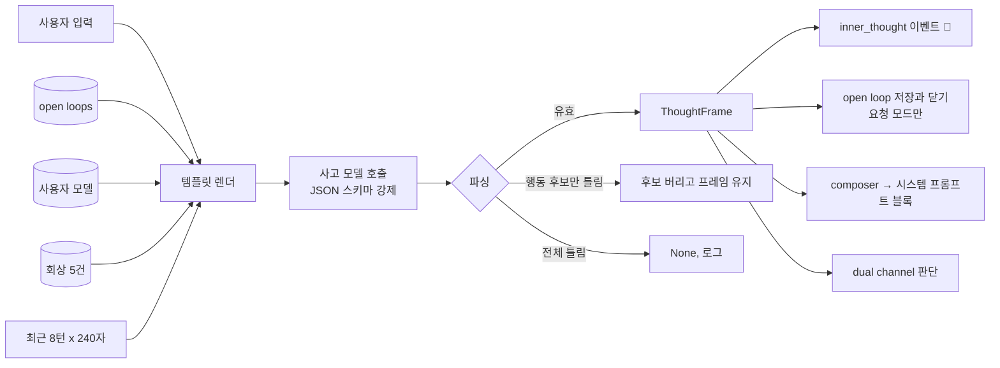
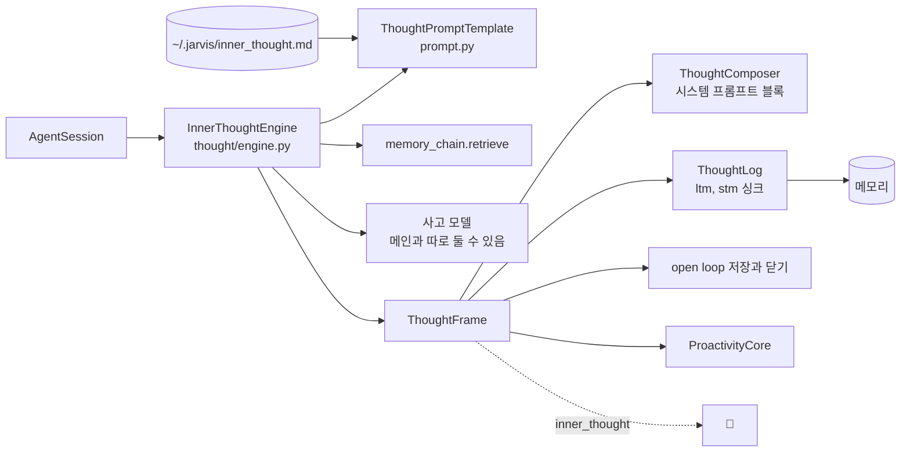

import FigureInnerThought from '@site/src/figures/inner-thought.svg';
import FigureExpInnerThought from '@site/src/figures/exp-inner-thought.svg';

# Inner Thought

<figure className="paper-fig">
  <FigureInnerThought />
  <figcaption><b>Figure 1.</b> (a) 사고 한 번. 다섯 가지 맥락을 템플릿에 채워 도구 없이 사고 모델을 한 번 부르고, JSON 으로 강제한 ThoughtFrame 을 네 곳에 나눠 쓴다. (b) 사고와 메인 응답의 순서. before 는 해석이 이번 응답에 섞이고, race(기본)는 3초까지만 기다리며, after 는 같은 GPU 를 나눠 쓰는 로컬에서 가장 빠르다.</figcaption>
</figure>

JARVIS 는 답하기 전에 따로 한 번 생각한다. 사용자 입력마다 메인 응답과 별개로 LLM 을 한 번 더 불러, 무엇이 들어왔는지와 먼저 말할지, 뒤에서 처리할지를 **사고 프레임**이라는 구조화된 판단으로 남긴다.

사고 프레임은 [Proactive Dialogue](./proactive.md) 기능 전체의 입력이 된다. Inner Thought 는 도구를 부르지 않는다.

## 사고 프레임

사고 프레임(`ThoughtFrame`)은 JSON 이다. 키 이름은 고정이고, 사용자는 프롬프트 템플릿으로 키가 채워지는 방식만 조정한다.

| 필드 | 뜻 |
|---|---|
| `observation` | 무엇이 들어왔는가(사실) |
| `interpretation` | 의도, 감정, 숨은 요구. 사용자를 3인칭으로 분석한 문장 |
| `recalled` | 회상한 기억 요약 |
| `options` | 가능한 대응 후보 |
| `proactive_actions` | 미리 해 두면 좋을 행동. `kind`(suggest, tool, remember, schedule), `tool_name`, `args`, `risk`(low, high) |
| `decision` | `act`, `ask`, `silent`. 확신 없으면 silent |
| `confidence` | 0 에서 1 |
| `rationale` | 결정 근거 |
| `utterance` | 사용자에게 실제로 건넬 말. 비어 있으면 침묵 |
| `needs_background`, `filler` | 오래 걸릴 작업이면 true 와 즉답 문구 |
| `open_loops` | 이번 입력에서 새로 감지한 약속과 미완 작업. 기한이 분명하면 끝에 ` @YYYY-MM-DD HH:MM` |
| `closed_loops` | [열린 약속] 중 이번 입력으로 끝났거나 취소된 것의 번호. 세션이 그 약속을 done 으로 닫는다 |

`utterance` 와 `interpretation` 을 나눈 것은 해석문을 그대로 말하면 안 되기 때문이다. 해석문은 "사용자가 불안해한다" 같은 문장이므로, 먼저 건네는 말에는 `utterance` 만 쓴다.

## 흐름

`agent_layer/thought/engine.py` 의 `InnerThoughtEngine.think` 가 아래 순서로 사고 한 번을 처리한다.

1. 회상: 메모리 체인에서 입력과 관련된 기억을 `recall_limit`(5)만큼 가져온다.
2. 렌더: 요청 템플릿(`~/.jarvis/inner_thought.md`, 없으면 내장 기본)에 `now`, `open_loops`, `recalled_memories`, `history`, `user_input`, `user_model` 을 채운다. 히스토리는 최근 `history_turns`(8) 턴을, 턴당 `history_chars`(240) 자까지 넣는다.
3. 호출: 도구 없이 사고 모델을 한 번 부른다. Ollama 프로바이더는 프레임의 JSON 스키마를 `format` 으로 넘겨 형식을 강제한다.
4. 파싱: 첫 `{` 부터 마지막 `}` 까지 잘라 검증한다. `proactive_actions` 만 틀리면 그 항목만 버리고 프레임을 살린다. `recalled`, `options`, `open_loops`, `closed_loops` 에 객체가 와도 글자만 건진다.
5. 기록: `inner_thought` 이벤트를 내고, 사고 로그 싱크에 남긴다(`ltm` 이면 일화 기억으로, `stm` 이면 작업 메모로).

## 사고 결과가 가는 곳

- **composer**: `[내적 사고] 해석: ... 회상: ... 고려한 대응: ...` 블록을 만들어 메인 호출의 시스템 프롬프트 끝에 붙인다. 이 블록은 히스토리에 남지 않는다. `interpretation_only` 로 바꾸면 해석 한 줄만 붙인다
- **dual channel**: `needs_background` 면 filler 를 먼저 말하고 메인 응답은 뒤에서 돈다. 흐름은 [Dual channel](./proactive.md#dual-channel) 에 있다
- **약속(open loop)**: 요청 모드에서만 저장하고 닫는다. 성찰 모드는 기존 약속을 볼 뿐 새로 쌓지도 닫지도 않는다. 바꿔 말한 같은 약속이 쌓이는 것과, 사용자 말 없이 약속이 사라지는 것을 막기 위해서다. 저장과 닫힘 규칙은 [Open loop](../conversation/open-loop.md) 에 있다
- **화면**: 💭 한 줄로 decision 과 확신도를 보여 준다. 클릭하면 해석 전문이 열린다

## 시점: before, race, after

사고와 메인 응답을 어떤 순서로 돌릴지는 `JARVIS_THOUGHT__REQUEST_TIMING` 이 정한다.

```mermaid
gantt
  dateFormat X
  axisFormat %s
  section before
  사고        :a1, 0, 10
  메인 응답    :a2, 10, 30
  section race (wait 3초)
  사고        :b1, 0, 10
  메인 응답    :b2, 3, 25
  section after
  메인 응답    :c1, 0, 20
  사고        :c2, 20, 30
```

- `before`: 사고를 끝낸 뒤 응답한다. 해석이 이번 응답에 섞인다
- `race`(기본): `wait_sec` 까지만 기다린다. 사고가 늦으면 응답을 먼저 시작하고, 사고는 뒤에서 끝나 💭 표시, 약속 저장, 사고 기록에만 쓰인다
- `after`: 응답이 끝난 뒤 사고한다. 사고와 메인이 같은 GPU 를 나눠 쓰는 로컬 Ollama 에서는 이 방식이 가장 빠르다

늦은 사고는 세션이 task 로 들고 있다가, 끝나면 기록과 이벤트를 남긴다. 실패하면 `[Thought] request thought failed` 로그가 남는다.

:::note

`race` 에서 늦게 끝난 사고와 `after` 의 사고는 이번 응답에 들어가지 않는다. 해석이 매 응답에 반드시 섞여야 하면 `before` 를 쓴다.

:::

## 사고 모델

사고 모델은 메인 모델과 따로 둘 수 있다. `JARVIS_THOUGHT__MODEL`, `__PROVIDER`, `__API_KEY`, `__BASE_URL` 중 지정한 것만 바뀌고, 나머지는 메인 값을 상속한다. temperature 와 max_tokens 는 항상 메인 값을 쓴다.

## 템플릿 직접 쓰기

요청용 템플릿은 `~/.jarvis/inner_thought.md`, 성찰용 템플릿은 `~/.jarvis/inner_thought_reflection.md` 에 직접 쓴다. 자리표시자는 `{{now}}`, `{{open_loops}}`, `{{external_events}}`, `{{recalled_memories}}`, `{{history}}`, `{{user_input}}`, `{{user_model}}`, `{{recent_proactive}}`(성찰 전용, 최근 먼저 건넨 말)이다. 없는 값은 빈 문자열이 된다. 외부 이벤트나 최근 먼저 건넨 말이 있는데 템플릿에 자리가 없으면, 끝에 덧붙여 빠지지 않게 한다.

:::warning

프레임 키 중 `utterance` 가 빠지면 먼저 건네는 말이 꺼진 것과 같다.

:::

## 성능 실험

두 실험을 했다. 시점 실험은 떠 있는 백엔드에 새 세션으로 질문 넷을 보내 첫 글자와 응답 끝, 💭 도착 시각을 잰다(로컬은 메인 gemma4:e4b, 사고 gemma4:e2b, 같은 Mac 의 GPU 하나). 요청 사고 실험은 사용자 입력 12개(약속이 있는 6개, 없는 6개)를 사고 엔진에만 2회씩 넣는다. 재현: `uv run python -m scripts.experiments.agent_turns timing --n 4`(`JARVIS_THOUGHT__REQUEST_TIMING` 을 바꿔 가며), `uv run python -m scripts.experiments.thought_frames --model gemma4:e2b-it-qat`.

<figure className="paper-fig">
  <FigureExpInnerThought />
  <figcaption><b>Figure 2.</b> (a) 로컬과 클라우드 모두 after 가 첫 글자와 응답 끝이 가장 빠르다. 로컬 race 는 응답 끝이 가장 늦다. 사고와 메인이 GPU 를 나눠 쓰기 때문으로 보인다(추정). (b) 세 모델 모두 프레임은 매번 유효하고, 약속을 잡는 성향은 모델마다 다르다.</figcaption>
</figure>

- 로컬에서 after 는 첫 글자 2.3초, before 는 15.6초다. 대신 after 의 💭 는 응답이 끝난 뒤(질문부터 약 23초) 온다. 클라우드도 after 가 가장 빨랐다(첫 글자 0.9초). 그래서 설정 예시(`.env.example`)가 권하는 값과 지금 쓰는 설정은 after 다. 코드 기본값은 race 다
- 작은 e2b 가 약속을 모두 잡았지만, 약속이 없는 말에서도 약속을 만들었다(precision 0.71). 이렇게 잘못 만든 약속은 [Open loop](../conversation/open-loop.md) 의 저장 판정(입력과의 글자 겹침, 근거 인용)을 한 번 더 거친다
- e4b 와 gpt-4o-mini 는 약속을 덜 잡는 대신(recall 0.75) 잘못 만든 약속이 없다. 처음 데이터에는 "이번 달 안에 헬스장 등록하려고" 처럼 약속인지 의도인지 애매한 문장이 있어 e4b 의 recall 이 0.58 로 나왔다. 그 문장을 "25일까지 등록하기로 친구랑 약속했어" 로 바꾼 뒤의 값이다
- 한계: 시점 실험은 질문 4개의 중앙값이다. 로컬 수치는 하드웨어와 Ollama 의 모델 적재 상태에 따라 크게 달라진다

## 설계 노트

### 사고를 메인 응답과 떼어 낸 이유

메인 응답 하나에 "해석하고, 약속을 찾고, 먼저 말할지 정하고, 답하라" 를 모두 시키면 프롬프트가 길어지고, 해석 결과를 구조화된 데이터로 꺼낼 수 없다. 그래서 사고를 별도 LLM 호출로 떼어 `ThoughtFrame` 이라는 고정 스키마로 받는다. 이 프레임 하나를 💭 표시, 약속 저장, 먼저 건네는 말, 사고 기록에 나눠 쓴다. 메인 응답은 대화만 다루고, 사고는 작은 모델로 따로 돌릴 수 있다.

### 작은 모델에는 스키마를 강제한다

로컬 소형 모델(gemma4:e2b)에 JSON 을 "부탁" 만 했을 때는 요청 사고 2회 중 1회, 성찰 1회 중 0회만 유효한 프레임이 나왔다. Ollama 의 `format` 으로 `ThoughtFrame` JSON 스키마를 넘기자 요청 사고 3회 중 3회, 성찰 2회 중 2회가 유효했다. 그래도 목록 칸에 객체가 오는 식의 어긋남은 남아서, 파싱은 관대하게 했다. 글자만 건져 프레임을 살리고, 프레임 하나가 깨져도 대화는 계속된다.

### 시점을 설정으로 둔 이유

사고를 응답 전에 돌리면(before) 해석이 이번 응답에 섞이지만 그만큼 늦다. 처음에는 before 만 있었는데, 로컬 한 GPU 에서 사고와 메인이 GPU 를 나눠 쓰면 병렬(race)이 오히려 느렸다. 당시 측정(gemma4:e4b + e2b, GPU 하나)에서 before 는 전체 27~32초, race 는 첫 글자 21초에 전체 37초, after 는 첫 글자 12.8초에 전체 29초였다. 어느 쪽이 빠른지가 배포 환경에 달려 있어서 시점을 하나로 고정하지 않고 설정으로 뺐다. 위의 그림처럼 클라우드에서도 after 가 가장 빨랐다.

## 구현 위치

왼쪽이 사용자와 화면, 가운데가 코드 모듈, 오른쪽이 저장소다. 화살표는 호출이나 데이터의 방향이다.

- 핵심 모듈: `agent_layer/thought/engine.py`
- 저장: 사고 로그(일화 기억 또는 작업 메모)
