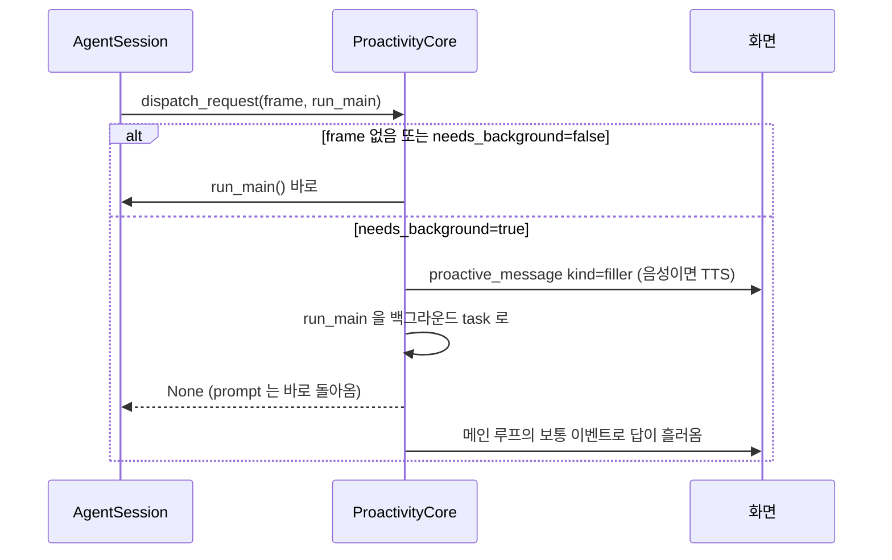
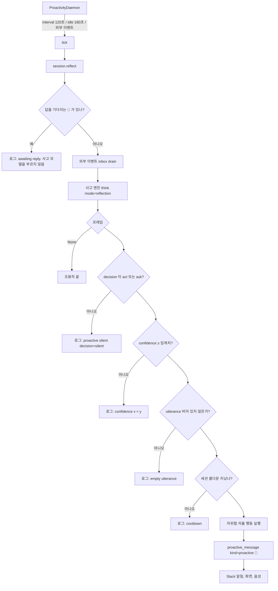
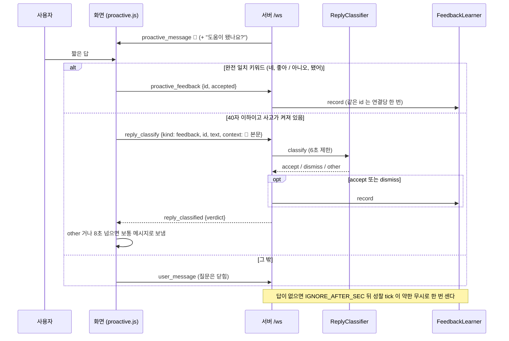
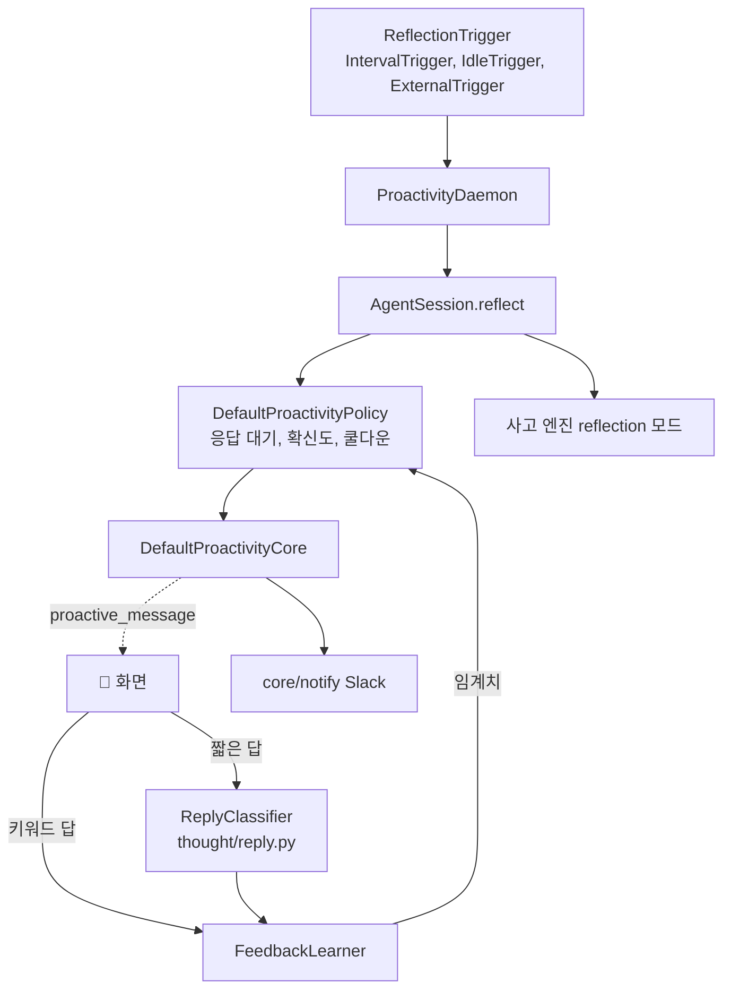

import FigureProactive from '@site/src/figures/proactive.svg';
import FigureExpProactive from '@site/src/figures/exp-proactive.svg';

# Proactive Dialogue

<figure className="paper-fig">
  <FigureProactive />
  <figcaption><b>Figure 1.</b> (a) 성찰 한 번이 먼저 말하기까지 지나는 다섯 게이트. 하나라도 막히면 침묵하고 이유만 로그에 남긴다. (b) 🔔 에 대한 반응으로 확신도 임계치 θ 를 옮긴다. (c) 오래 걸릴 요청이면 filler 를 먼저 말하고 메인 응답은 뒤에서 돌린다.</figcaption>
</figure>

JARVIS 는 사고 프레임을 바탕으로 사용자가 묻기 전에 움직인다. 요청이 오면 **Dual channel** 로 짧은 말을 먼저 한다. 요청이 없을 때는 **성찰**을 거쳐 먼저 말을 건다(**Proactive Dialogue**). 그 말에 대한 사용자의 반응은 **Process Pattern Analysis** 가 확신도 임계치에 반영한다.

가치가 분명하지 않으면 말하지 않는다. 고위험 행동은 스스로 실행하지 않는다.

## Dual channel

JARVIS 는 오래 걸릴 요청이면 "잠깐만요, 확인할게요" 같은 filler 를 먼저 말하고, 메인 응답은 뒤에서 돌린다.

사고 프레임의 filler 가 비어 있으면 내장 문구 셋을 돌아가며 쓴다. 사고가 늦게 끝났거나(`race` 초과) 시점이 `after` 면 frame 이 없으므로 항상 즉시 모드로 답한다.

## 성찰과 먼저 건네는 말

- **daemon** (`daemon.py`): 트리거를 먼저 기다린 뒤 tick 한다. 그래서 기동 직후에는 말하지 않는다. Web 은 최근 활동 순으로 모든 세션을 성찰하고, TUI 는 현재 세션만 성찰한다
- **트리거** (`triggers.py`): `interval`(기본 120초), `idle`(마지막 입력 뒤 180초, 한 번 울리면 다음 활동까지 재장전), `both` 중 하나를 고른다. 외부 소스가 있으면 새 외부 이벤트도 트리거가 된다
- **응답 대기** (`policy.py`, `check_awaiting`): 먼저 건네는 말을 낸 세션은 사용자가 메시지나 피드백을 보낼 때까지 다시 말하지 않는다. 성찰 자체를 건너뛰므로 사고 모델도 부르지 않고, 외부 이벤트도 꺼내지 않고 남겨 둔다. 대기 상태는 메모리에만 있어 재시작하면 풀린다
- **성찰 프롬프트**: 사용자 입력 자리가 없고, 대신 `[외부 이벤트]` 와 `[최근에 먼저 건넨 말]`(세션의 최근 먼저 건넨 말 3개)이 있다. 프롬프트는 "지금 말하면 도움이 되는가" 와 그 확신도만 정직하게 내라고 하고, 말할 때의 기준(기한 임박, 사용자 일에 영향을 주는 이벤트)과 침묵할 때의 기준(한참 남은 일, 끝난 일, 무관한 알림, 이미 한 말)을 준다. 거르기는 정책의 임계치가 한다
- **게이트** (`policy.py`, `decide_proactive`): 응답 대기, 결정, 확신도, 빈 발화, 쿨다운 순서로 검사한다. 전부 지나야 발화 시각을 기록하고 응답 대기에 들어간다. 침묵 이유는 `[Thought] proactive silent: <이유>` 로그로 남는다
- **발화 내용**: 먼저 건네는 말은 `utterance` 만 쓴다. 해석문을 대신 내보내지 않는다

| 게이트 | 설정 | 기본 |
|---|---|---|
| 확신도 | `JARVIS_PROACTIVE__CONFIDENCE_THRESHOLD` | 0.85, 피드백으로 변함. decision model 을 쓰면 대신 아래 `DECISION_THRESHOLD` 를 쓴다 |
| decision model | `JARVIS_PROACTIVE__DECISION_MODEL` | 비어 있음. 지정하면 성찰의 결정과 확신도를 그 모델의 확률로 정한다 |
| decision 임계치 | `JARVIS_PROACTIVE__DECISION_THRESHOLD` | 0.6. decision model 을 쓸 때만 쓴다. 모델마다 확률 척도가 다르니 그 모델에 맞춘다 |
| 쿨다운 | `JARVIS_PROACTIVE__COOLDOWN_SEC` | 300초, 세션별 |
| 무응답 판정 | `JARVIS_PROACTIVE__IGNORE_AFTER_SEC` | 600초. 먼저 건넨 말 뒤 이만큼 답이 없으면 한 번 약한 무시 |
| 주기 | `JARVIS_PROACTIVE__DAEMON_INTERVAL_SEC` | 120초 |
| 유휴 | `JARVIS_PROACTIVE__DAEMON_IDLE_SEC` | 180초 |

## 저위험 자율 행동

JARVIS 는 성찰이 발화 게이트를 전부 지났을 때만, 프레임의 `proactive_actions` 중 다음 조건을 모두 만족하는 행동을 실행한다.

1. `risk == "low"`, `kind == "tool"`, `tool_name` 있음
2. 화이트리스트: `read_file`, `glob`, `grep`, `list_dir`, `web_search`, `web_fetch`
3. 샌드박스가 승인을 요구하지 않는 도구

결과는 `(미리 해둠) 결과1 / 결과2` 꼴로 먼저 건네는 말 뒤에 붙는다. 요청 시점에는 자율 행동을 하지 않는다.

:::note

고위험 행동은 분류만 되고 실행도 노출도 되지 않는다. 승인이 필요한 도구는 화이트리스트에 있어도 자율 행동으로 실행하지 않는다.

:::

## 피드백 학습

Process Pattern Analysis 는 먼저 건넨 말이 도움이 됐는지에 따라 확신도 임계치를 움직인다(`feedback.py`).

- 임계치는 수락이면 −0.05, 무시면 +0.05, 무응답이면 +0.025 만큼 움직인다. 범위는 0.3 에서 0.95 다
- 무응답은 먼저 건넨 말 뒤 `IGNORE_AFTER_SEC` 동안 아무 답이 없을 때 그 발화 하나에 한 번만 센다. 자리를 비웠을 수도 있어 무시의 절반만 반영한다. 판정은 성찰 tick 에서 하므로, `idle` 트리거만 쓰면(다음 활동 전까지 tick 이 없다) 무응답을 세지 않는다
- 앱에 하나인 `FeedbackLearner` 를 모든 세션의 정책이 공유한다
- 입력: TUI 는 `Ctrl+Y`(도움됨), `Ctrl+G`(무시)로 받는다. Web 은 먼저 건넨 말 뒤에 "도움이 됐나요?" 를 붙이고 다음 짧은 답을 읽는다. `네`, `좋아`, `고마워` 류는 수락, `아니오`, `됐어`, `무시` 류는 무시로 바로 처리한다. 그 밖의 40자 이하 답("응 그걸로 해줘", "지금은 됐어")은 사고 모델에 한 번 물어(`agent_layer/thought/reply.py`) accept, dismiss, other 로 나누고, other 면 보통 메시지로 흘러간다. gemma4:e2b 로 잰 실측에서는 11문장을 모두 맞혔고 중앙값은 0.3초였다

:::warning

학습된 임계치, 쿨다운, 응답 대기 상태는 프로세스 메모리에만 있다. 재시작하면 피드백으로 움직인 임계치가 기본값으로 돌아간다.

:::

## 외부 알림

JARVIS 는 열린 화면이 없어도 먼저 건네는 말과 스케줄 결과를 Slack incoming webhook 으로 보낸다. 주소는 `JARVIS_NOTIFY__SLACK_WEBHOOK_URL`, 보낼 종류는 `JARVIS_NOTIFY__KINDS`(`reminder`, `proactive`)로 정한다. filler 는 보내지 않는다. 재시도는 하지 않고, 실패는 로그에 남긴다.

## 성능 실험

### 게이팅 정책(LLM 없음)

사고 프레임을 직접 주고 정책(응답 대기, 확신도, 쿨다운)만 잰다. 11사례 모두 맞았다(precision 1.00, recall 1.00, 오경보 0). 사례마다 정책을 새로 만들고 시계를 고정해 같은 입력은 늘 같은 결과를 낸다. 재현: `python -m jarvis.core.proactive.eval --suite policy`.

### 상황에서 말할지 정하기: 지시문과 decision model

말해야 할 상황(마감 임박, 회의 변경, 사용자가 기다리는 빌드의 실패, 지난 약속 등)과 침묵해야 할 상황(잡담, 이미 처리한 일, 광고, 한참 남은 마감, 사용자가 무시하라고 한 알림 등)을 성찰 사고에 넣고 정책 판정까지 끝까지 돌렸다. 사고의 [지금] 은 2026-01-01 09:00 으로 고정했다. 사례는 세 묶음이다.

| 묶음 | 사례 | 쓰임 |
|---|---|---|
| 개발용 | 12 | 지시문을 고치고 임계치를 고를 때 본다 |
| hold-out | 12 | 지시문을 쓰기 전에 만들어 봤기 때문에 오염됐다. 참고로만 남긴다 |
| 블라인드 시험 | 20 | 지시문, 문서, 기존 사례를 보지 못하게 한 별도 에이전트가 만들었다. 최종 비교는 이것으로 한다 |

세 구성을 비교했다. 옛 지시문, 새 지시문, 그리고 사고 프레임의 결정과 확신도를 decision model 확률로 바꾸는 구성(사고 모델 gpt-4o-mini)이다. 임계치는 구성마다 개발용 사례에서 골라 블라인드 시험에 그대로 썼다. 옛 지시문에도 개발용에서 오경보가 가장 낮은 임계치를 줬다(gpt-4o-mini 는 어느 임계치에서도 나아지지 않아 0.6, e2b 0.9, e4b 0.85). 모두 3회씩이다. 재현: `uv run python -m scripts.experiments.proactive_situation --model gpt-4o-mini [--decision tev1] [--cases scripts/experiments/datasets/situation_test.jsonl]`. 결과에는 임계치 0.3~0.9 각각의 recall 과 오경보가 함께 나온다.

<figure className="paper-fig">
  <FigureExpProactive />
  <figcaption><b>Figure 2.</b> (a) 블라인드 시험에서 새 지시문은 gpt-4o-mini 의 recall 을 0.63 에서 0.77 로, e2b 를 0.47 에서 0.83 으로 올렸지만, 말을 하는 구성은 모두 어려운 침묵 사례에 0.2~0.3 의 오경보를 냈다(옛 지시문의 gpt-4o-mini 와 tev1:0.8b 는 오경보 0 이지만 그만큼 덜 말했다). decision model tev1 과 nimble 은 놓친 것이 없는 대신 오경보가 0.3 이다. (b) 짧은 답 분류는 세 모델 모두 0.9 를 넘는다.</figcaption>
</figure>

- **옛 지시문의 문제**: gpt-4o-mini 는 말해야 할 상황을 사고 단계에서 스스로 `silent` 로 정했다(블라인드 시험에서 놓친 11번 모두, 개발용 15번 모두). 지시문이 "확신이 없으면 반드시 silent, 애매하면 말하지 마라" 로 침묵을 거듭 밀었고, 정책에도 확신도 임계치가 있어 침묵이 이중으로 걸렸다. 임계치를 낮춰도 recall 이 오르지 않았다
- **새 지시문**: 사고는 "지금 말하면 도움이 되는가" 와 확신도만 정직하게 내고, 거르기는 정책 임계치가 한다. 말할 때와 침묵할 때의 기준을 적었다. gpt-4o-mini 의 recall 이 개발용 0.17 에서 0.89(임계치 0.85), 블라인드 0.63 에서 0.77 로 올랐다. 대가로 블라인드 오경보가 0 에서 0.23 이 됐다
- **개발용 결과는 일반화되지 않았다**: 개발용에서 오경보가 0 이 되던 임계치(gpt-4o-mini, e4b 0.85)가 블라인드에서는 0.2 대였다. e2b 는 개발용에서도 0.9 에서 오경보 0.17 이 남았다. 기본 임계치 0.85 는 이 개발용 결과로 정했으므로, 실제로는 피드백 학습이 임계치를 사용자에 맞춰 움직이는 것을 전제로 한다
- **어려운 침묵 사례**: 임계치 0.6 기준으로 여러 구성이 공통으로 말을 건 것은 "1월 15일 마감인 연말정산"(7개 구성), "할인 광고 메일"(7), "이미 수락된 오후 면담"(6), "이미 확인한 리마인더"(4), "재택인데 오후 눈 예보"(4) 다. 고른 임계치에서의 사례별 결과는 남기지 않았다. 연말정산과 오후 면담은 사람에 따라 알려 주는 편이 낫다고 볼 수도 있는 사례다. 이미 처리됐거나 한참 남은 일을 구분하는 것이 남은 과제다
- **decision model**: [TypeSafe 의 Jev](https://insiderllm.com/guides/what-is-jev-typesafe-explained-local/) 같은 decision model 은 글을 쓰지 않고 선택지의 확률만 낸다. Ollama 의 System One API(`/v1/systemone`)로 `tev1`(4B), `nimble`, `tev1:0.8b` 를 붙였다. tev1 과 nimble 은 블라인드에서 recall 1.00, 오경보 0.30 으로, 사고 모델만 쓸 때보다 놓치는 것이 적고 오경보는 조금 많다. tev1:0.8b 는 확률을 낮게 내 0.6 에서는 아무것도 말하지 않았고, 0.3 에서도 recall 0.5 에 오경보 0.3 이었다
- **비용**: 블라인드에서 사례당 시간은 gpt-4o-mini 2.3초, tev1 을 붙이면 2.8초다. decision model 은 호스트에 Ollama 와 모델(tev1 4.4GB)이 있어야 한다
- 말을 건 경우의 기대 낱말 포함은 블라인드에서 gpt-4o-mini 30/30, e4b 27/29, e2b 23/29 다
- 짧은 답 분류에서 gpt-4o-mini 가 틀린 것은 세 번 모두 "이미 보냈어" 를 수락으로 읽은 것이다(무시가 정답이다). 지연 중앙값은 e2b 0.21초, e4b 0.38초, gpt-4o-mini 0.67초다
- 한계: 사례가 개발용 12, 블라인드 20 으로 작다. 블라인드 사례도 사람이 아니라 LLM 이 만들었다

## 설계 노트

### 정책과 코어를 세션에서 떼어 냈다

먼저 말을 거는 판단은 확신도 임계치, 세션별 쿨다운, 응답 대기, 위험도로 이뤄진다. 이것을 세션 안에 두지 않고 `DefaultProactivityPolicy` 와 `DefaultProactivityCore` 라는 독립 클래스로 만들었다. 협력자(정책, push, spawn)는 모두 생성자로 주입해 세션과 UI 를 import 하지 않는다. 덕분에 위의 정책 평가는 LLM 도 화면도 없이 사례 파일만으로 돈다. 처음에는 배선하지 않은 코어만 넣고 테스트로 확인한 뒤 세션에 연결했다.

### 판단과 거르기를 나눴다

처음 성찰 지시문은 사고에게 "애매하면 말하지 마라" 고 시켰다. 그런데 정책에도 확신도 임계치가 있어서, 같은 거르기가 지시문과 정책에 두 번 들어 있었다. 지시문 쪽 거르기는 모델마다 다르게 작동했다. gpt-4o-mini 는 거의 다 침묵했고 gemma4 는 덜 따랐다. 그래서 역할을 나눴다. 사고는 도움이 되는지와 그 확신만 낸다. 거르기는 임계치 하나가 하고, 그 임계치를 피드백 학습이 움직인다. 조절할 값이 하나라서 모델을 바꾸면 임계치만 다시 맞추면 된다. 다만 블라인드 시험에서 보듯, 이미 처리된 일처럼 사고 자체가 잘못 판단한 사례는 임계치로 다 걸러지지 않는다.

### decision model 은 엔진을 감싼다

decision model 은 `DecisionGatedEngine` 으로 사고 엔진을 감싼다. 요청 사고는 그대로 두고, 성찰 사고만 decision model 확률로 결정과 확신도를 바꾼다. 확률이 0.3 보다 낮으면 바로 침묵하고, 그 위에서 말하기로 했는데 사고 프레임에 건넬 말이 비어 있으면 그때만 사고 모델로 한두 문장을 만든다. decision model 호출이 실패하면 원래 프레임을 그대로 쓴다. `JARVIS_PROACTIVE__DECISION_MODEL` 이 비어 있으면 감싸지 않으므로, 이 기능이 없을 때와 동작이 같다.

### 말할 거리가 없으면 해석문을 내보내지 않는다

성찰 프레임에 건넬 말(`utterance`)이 비어 있으면 침묵한다. 해석문(`interpretation`)을 대신 내보내면 "사용자는 쉬고 있는 것으로 보인다" 같은 혼잣말이 🔔 로 나간다. 침묵할 때마다 이유(`cooldown`, `confidence`, `empty utterance`, `decision=silent`)를 로그에 남겨, 왜 말하지 않았는지 사람이 볼 수 있게 했다.

## 구현 위치

왼쪽이 사용자와 화면, 가운데가 코드 모듈, 오른쪽이 저장소다. 화살표는 호출이나 데이터의 방향이다.

- 구현: `core/proactive/`
- 핵심 모듈: `core/proactive/daemon.py`, `core/proactive/policy.py`, `core/proactive/feedback.py`, `agent_layer/thought/reply.py`, `core/proactive/core.py`
- 저장: 프로세스 메모리(쿨다운, 응답 대기, 임계치). 재시작하면 기본값으로 돌아간다
