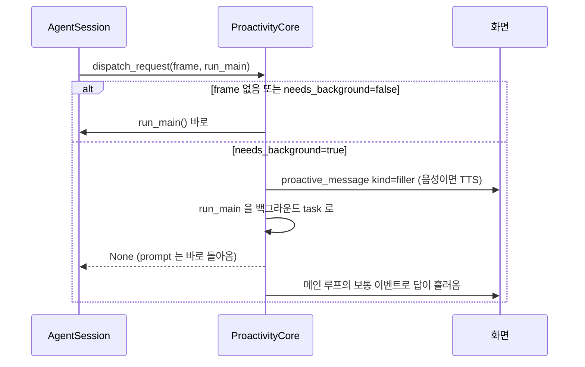
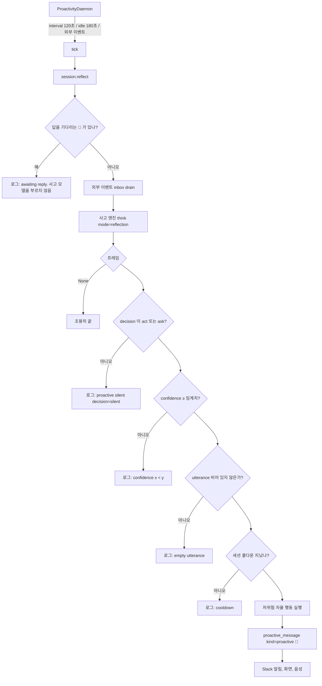
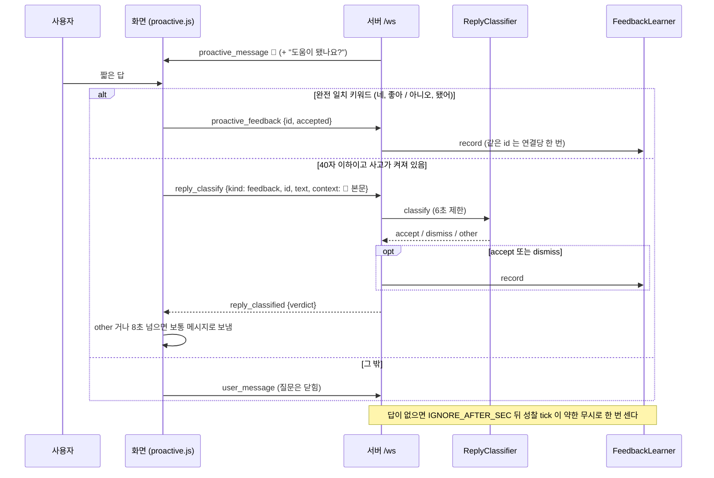
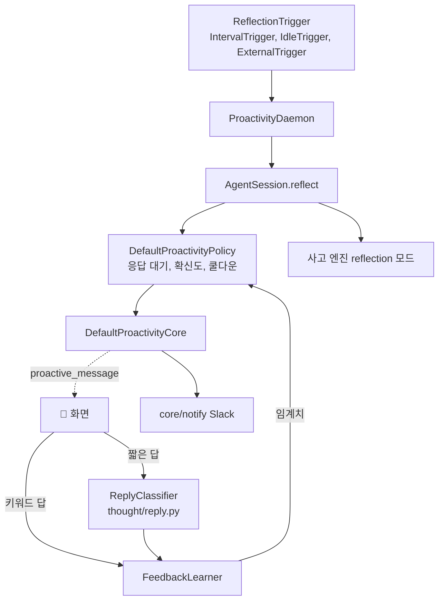

import FigureProactive from '@site/src/figures/proactive.svg';
import FigureExpProactive from '@site/src/figures/exp-proactive.svg';

# 먼저 행동하기 (Proactive)

<figure className="paper-fig">
  <FigureProactive />
  <figcaption><b>Figure 1.</b> (a) 성찰 한 번이 먼저 말하기까지 지나는 다섯 게이트. 하나라도 막히면 침묵하고 이유만 로그에 남긴다. (b) 🔔 에 대한 반응으로 확신도 임계치 θ 를 옮긴다. (c) 오래 걸릴 요청이면 filler 를 먼저 말하고 메인 응답은 뒤에서 돌린다.</figcaption>
</figure>

JARVIS 는 사고 프레임을 바탕으로 사용자가 묻기 전에 움직인다. 요청 시점에는 **dual channel** 로 짧은 말을 먼저 하고, 요청이 없을 때는 **성찰** 끝에 먼저 건네는 말을 보내며, 그 말에 대한 반응으로 **피드백 학습**을 한다.

가치가 분명하지 않으면 말하지 않는 것이 기본이다. 고위험 행동은 스스로 실행하지 않는다.

## Dual channel

JARVIS 는 오래 걸릴 요청이면 "잠깐만요, 확인할게요" 같은 filler 를 먼저 말하고, 메인 응답은 뒤에서 돌린다.

사고 프레임의 filler 가 비어 있으면 내장 문구 셋을 돌아가며 쓴다. 사고가 늦게 끝났거나(`race` 초과) 시점이 `after` 면 frame 이 없으므로 항상 즉시 모드로 답한다.

## 성찰과 먼저 건네는 말

- **daemon** (`daemon.py`): 트리거를 먼저 기다린 뒤 tick 한다. 그래서 기동 직후에는 말하지 않는다. Web 은 최근 활동 순으로 모든 세션을 성찰하고, TUI 는 현재 세션만 성찰한다
- **트리거** (`triggers.py`): `interval`(기본 120초), `idle`(마지막 입력 뒤 180초, 한 번 울리면 다음 활동까지 재장전), `both` 중 하나를 고른다. 외부 소스가 있으면 새 외부 이벤트도 트리거가 된다
- **응답 대기** (`policy.py`, `check_awaiting`): 먼저 건네는 말을 낸 세션은 사용자가 메시지나 피드백을 보낼 때까지 다시 말하지 않는다. 성찰 자체를 건너뛰므로 사고 모델도 부르지 않고, 외부 이벤트도 꺼내지 않고 남겨 둔다. 대기 상태는 메모리에만 있어 재시작하면 풀린다
- **성찰 프롬프트**: 사용자 입력 자리가 없고, 대신 `[외부 이벤트]` 와 `[최근에 먼저 건넨 말]`(세션의 최근 먼저 건넨 말 3개)이 있다. 프롬프트는 "확신이 없으면 반드시 silent", "이미 한 말과 같은 취지면 표현을 바꿔도 silent" 를 지시한다
- **게이트** (`policy.py`, `decide_proactive`): 응답 대기, 결정, 확신도, 빈 발화, 쿨다운 순서로 검사한다. 전부 지나야 발화 시각을 기록하고 응답 대기에 들어간다. 침묵 이유는 `[Thought] proactive silent: <이유>` 로그로 남는다
- **발화 내용**: 먼저 건네는 말은 `utterance` 만 쓴다. 해석문을 대신 내보내지 않는다

| 게이트 | 설정 | 기본 |
|---|---|---|
| 확신도 | `JARVIS_PROACTIVE__CONFIDENCE_THRESHOLD` | 0.6, 피드백으로 변함 |
| 쿨다운 | `JARVIS_PROACTIVE__COOLDOWN_SEC` | 300초, 세션별 |
| 무응답 판정 | `JARVIS_PROACTIVE__IGNORE_AFTER_SEC` | 600초. 먼저 건넨 말 뒤 이만큼 답이 없으면 한 번 약한 무시 |
| 주기 | `JARVIS_PROACTIVE__DAEMON_INTERVAL_SEC` | 120초 |
| 유휴 | `JARVIS_PROACTIVE__DAEMON_IDLE_SEC` | 180초 |

## 저위험 자율 행동

JARVIS 는 성찰이 발화 게이트를 전부 지났을 때만, 프레임의 `proactive_actions` 중 다음 조건을 모두 만족하는 행동을 실행한다.

1. `risk == "low"`, `kind == "tool"`, `tool_name` 있음
2. 화이트리스트: `read_file`, `glob`, `grep`, `list_dir`, `web_search`, `web_fetch`
3. 샌드박스가 승인을 요구하지 않는 도구

결과는 `(미리 해둠) 결과1 / 결과2` 꼴로 먼저 건네는 말 뒤에 붙는다. 요청 시점에는 자율 행동을 하지 않는다.

:::note

고위험 행동은 분류만 되고 실행도 노출도 되지 않는다. 승인이 필요한 도구는 화이트리스트에 있어도 자율 행동으로 실행하지 않는다.

:::

## 피드백 학습

JARVIS 는 먼저 건넨 말이 도움이 됐는지에 따라 확신도 임계치를 움직인다(`feedback.py`).

- 임계치는 수락이면 −0.05, 무시면 +0.05, 무응답이면 +0.025 만큼 움직인다. 범위는 0.3 에서 0.95 다
- 무응답은 먼저 건넨 말 뒤 `IGNORE_AFTER_SEC` 동안 아무 답이 없을 때 그 발화 하나에 한 번만 센다. 자리를 비웠을 수도 있어 무시의 절반만 반영한다. 판정은 성찰 tick 에서 하므로, `idle` 트리거만 쓰면(다음 활동 전까지 tick 이 없다) 무응답을 세지 않는다
- 앱에 하나인 `FeedbackLearner` 를 모든 세션의 정책이 공유한다
- 입력: TUI 는 `Ctrl+Y`(도움됨), `Ctrl+G`(무시)로 받는다. Web 은 먼저 건넨 말 뒤에 "도움이 됐나요?" 를 붙이고 다음 짧은 답을 읽는다. `네`, `좋아`, `고마워` 류는 수락, `아니오`, `됐어`, `무시` 류는 무시로 바로 처리한다. 그 밖의 40자 이하 답("응 그걸로 해줘", "지금은 됐어")은 사고 모델에 한 번 물어(`agent_layer/thought/reply.py`) accept, dismiss, other 로 나누고, other 면 보통 메시지로 흘러간다. gemma4:e2b 로 잰 실측에서는 11문장을 모두 맞혔고 중앙값은 0.3초였다

:::warning

학습된 임계치, 쿨다운, 응답 대기 상태는 프로세스 메모리에만 있다. 재시작하면 피드백으로 움직인 임계치가 기본값으로 돌아간다.

:::

## 외부 알림

JARVIS 는 열린 화면이 없어도 먼저 건네는 말과 스케줄 결과를 Slack incoming webhook 으로 보낸다. 주소는 `JARVIS_NOTIFY__SLACK_WEBHOOK_URL`, 보낼 종류는 `JARVIS_NOTIFY__KINDS`(`reminder`, `proactive`)로 정한다. filler 는 보내지 않는다. 재시도는 하지 않고, 실패는 로그에 남긴다.

## 성능 실험

### 게이팅 정책(LLM 없음)

사고 프레임을 직접 주고 정책(응답 대기, 확신도, 쿨다운)만 잰다. 11사례 모두 맞았다(precision 1.00, recall 1.00, 오경보 0). 사례마다 정책을 새로 만들고 시계를 고정해 같은 입력은 늘 같은 결과를 낸다. 재현: `python -m jarvis.core.proactive.eval --suite policy`.

### 상황에서 말할지 정하기(사고 엔진부터 게이팅까지)

말해야 할 상황 6개(마감 10분 전, 회의 5분 전, 사용자 브랜치의 CI 실패, 지난 약속, 디스크 97%, 프로덕션 오류 급증)와 침묵해야 할 상황 6개(잡담, 끝난 일, 광고, 다음 달 말 약속 등)를 성찰 사고에 넣고 끝까지 돌렸다. 사고의 [지금] 은 2026-01-01 09:00 으로 고정하고, 사례의 시각도 그에 맞췄다. 모델마다 3회, 36번씩이다. 짧은 답 분류기는 🔔 뒤의 키워드가 아닌 답 12개를 수락, 무시, 다른 말로 나눈다. 재현: `uv run python -m scripts.experiments.proactive_situation --model gemma4:e2b-it-qat`, `uv run python -m scripts.experiments.reply_classifier --model gemma4:e2b-it-qat --repeat 3`.

<figure className="paper-fig">
  <FigureExpProactive />
  <figcaption><b>Figure 2.</b> (a) 로컬 gemma4 는 말해야 할 때 모두 말했지만 오경보가 있고, gpt-4o-mini 는 오경보가 없지만 말해야 할 때 대부분 침묵했다. (b) 짧은 답 분류는 세 모델 모두 0.9 를 넘는다.</figcaption>
</figure>

- 두 계열의 성향이 반대다. gemma4 두 모델은 다음 달 말 약속에도 세 번 다 말을 걸었다. gpt-4o-mini 는 한 번도 잘못 말을 걸지 않았지만 마감 10분 전, 회의 5분 전, CI 실패, 지난 약속을 세 번 다 놓쳤다
- 침묵의 원인을 따로 봤다. 말해야 할 상황에서 gpt-4o-mini 가 침묵한 8번은 모두 사고가 스스로 `silent` 로 정한 것이고, 확신도 임계치에 걸린 것은 0번이었다(2회 반복). 그래서 임계치를 낮춰도 gpt-4o-mini 의 recall 은 오르지 않는다. 사고 지시문이나 모델을 바꿔야 한다. 반대로 gemma4 의 오경보는 사고가 말하기로 정한 뒤 임계치를 통과한 것이라, 임계치와 피드백 학습으로 줄일 수 있는 쪽이다
- 말을 건 경우의 내용도 따로 봤다. 기대 낱말("보고", "회의", "디스크" 등)이 들어간 비율은 e2b 16/18, e4b 16/18, gpt-4o-mini 3/3 이다. 말했는지와 낱말을 따로 세는 것은 측정을 고치며 넣은 규칙이다. 처음에는 "프로덕션" 이라고 말해도 기대 낱말 "prod" 가 없으면 놓친 것으로 셌다. 기대 낱말은 아직 "prod" 라서, 남은 낱말 누락은 모두 이 프로덕션 사례에서 나왔다
- 짧은 답 분류에서 gpt-4o-mini 가 틀린 것은 세 번 모두 "이미 보냈어" 를 수락으로 읽은 것이다(무시가 정답이다). 지연 중앙값은 e2b 0.21초, e4b 0.38초, gpt-4o-mini 0.67초다
- 한계: 12사례는 작고 직접 만든 것이다. 모델 사이의 방향 차이를 보는 용도다

## 설계 노트

### 정책과 코어를 세션에서 떼어 냈다

먼저 말을 거는 판단은 확신도 임계치, 세션별 쿨다운, 응답 대기, 위험도로 이뤄진다. 이것을 세션 안에 두지 않고 `DefaultProactivityPolicy` 와 `DefaultProactivityCore` 라는 독립 클래스로 만들었다. 협력자(정책, push, spawn)는 모두 생성자로 주입해 세션과 UI 를 import 하지 않는다. 덕분에 위의 정책 평가는 LLM 도 화면도 없이 사례 파일만으로 돈다. 처음에는 배선하지 않은 코어만 넣고 테스트로 확인한 뒤 세션에 연결했다.

### 말할 거리가 없으면 해석문을 내보내지 않는다

성찰 프레임에 건넬 말(`utterance`)이 비어 있으면 침묵한다. 해석문(`interpretation`)을 대신 내보내면 "사용자는 쉬고 있는 것으로 보인다" 같은 혼잣말이 🔔 로 나간다. 침묵할 때마다 이유(`cooldown`, `confidence`, `empty utterance`, `decision=silent`)를 로그에 남겨, 왜 말하지 않았는지 사람이 볼 수 있게 했다.

## 구현 위치

왼쪽이 사용자와 화면, 가운데가 코드 모듈, 오른쪽이 저장소다. 화살표는 호출이나 데이터의 방향이다.

- 구현: `core/proactive/`
- 핵심 모듈: `core/proactive/daemon.py`, `core/proactive/policy.py`, `core/proactive/feedback.py`, `agent_layer/thought/reply.py`, `core/proactive/core.py`
- 저장: 프로세스 메모리(쿨다운, 응답 대기, 임계치). 재시작하면 기본값으로 돌아간다
