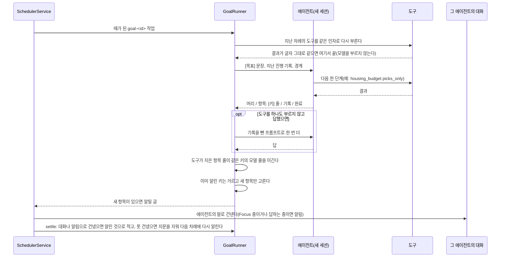

# Goals

목표는 사용자가 계속 맡기는 일이다. "조건 및 가장 좋은 원리금 납부액을 추천하는 공고만 알려줘" 처럼 한 번 맡기면, 대화가 없는 동안에도 에이전트가 정해진 때마다 한 단계씩 진행하고 목표가 알리라고 한 것만 대화로 알린다. 일정(`/schedule`)이 정한 시각에 정한 일을 하는 것이라면, 목표는 에이전트가 매 차례 무엇을 할지 스스로 정한다.

```text
/goal 조건 및 가장 좋은 원리금 납부액을 추천하는 공고만 알려줘   # 지금 세션의 에이전트에게 맡긴다
/goal                                                    # 맡은 목표 목록
/goal stop 원리금                                         # 문장 일부로 멈춘다
```

말로도 맡긴다. "~만 알려줘", "~ 나오면 알려줘", "앞으로 ~" 처럼 말하면 에이전트가 `goal` 도구로 맡고 짧게 답한다. 같은 목표를 다시 맡겨도 하나로 남는다. 이런 말이 오면 세션이 그 턴의 시스템 프롬프트 끝(속생각 뒤)에 "계속 챙길 일이면 바로 찾기 전에 goal 로 맡는다" 는 규칙을 붙인다(`goals/tool.py` 의 `standing_rule`). goal 도구가 있는 에이전트에만 붙고, 지금 한 번 묻는 말인지는 모델이 가른다.

## 한 차례



- 때: 목표마다 cron 하나. 기본은 매일 9~21시 매시 정각(`0 9-21 * * *`)이다. 맡기면 첫 차례는 바로 돈다
- 세션: 차례마다 새 세션이다. 대화 기록이 쌓여 비용이 늘지 않게, 이어 갈 것은 `기록` 한 줄로만 넘긴다(최근 5줄을 보인다)
- 답의 꼴: 에이전트는 `머리:`(한 문장), `항목: [키] 한 줄`(알릴 것마다), `기록:`, `완료:` 로만 답한다. 머리표를 빼고 `[키] 줄` 만 써도 받는다
- 도구가 지은 항목: 도구 결과에 `항목: [키] 줄` 이 있으면 모델이 옮겼는지와 상관없이 그 줄을 그대로 항목으로 받는다. 같은 키면 도구 줄이 이긴다. 허락이나 값을 구하는 항목의 키는 `ask-` 로 시작하고, 묻기만 할 때는 머리를 붙이지 않는다
- 건너뛰기: 차례가 끝나면 모델이 부른 도구(이름, 인자)와 결과 글의 지문을 목표에 적는다(`last_calls`, `seen`). 다음 차례는 그 도구를 모델 없이 같은 인자로 먼저 부르고, 지문이 같으면 모델을 부르지 않고 끝낸다. 같은 결과면 판단도 같아서다. 결과가 바뀌었거나, 도구가 오류이거나, 지금 쓸 수 없는 도구이거나, 지난 차례의 항목을 건네지 못했으면 모델이 돈다. 답이 없거나 도구 오류가 난 차례는 지문을 남기지 않는다
- 기록: 도구를 부르지 않은 차례와 묻기만 한 차례의 `기록` 은 남기지 않는다. 도구를 하나도 부르지 않고 답하면 기록을 빼고 한 번 더 돌린다
- 거르기: 에이전트는 지금 기준으로 알릴 것을 전부 항목으로 쓰고, 이미 알렸는지는 코드가 키로 가린다. 키가 없는 항목("새 소식은 없어요")은 알리지 않는다
- 전하기: 그 에이전트와 최근 대화한 세션에 에이전트의 말로 건넨다. 대화 기록에 남아 이어 물을 수 있고, 밖으로는 💭 푸시로 간다. 열린 대화가 없으면(재시작 뒤) 저장된 마지막 대화(스케줄 실행, 위임, 집중, 시험 세션 제외)를 다시 열어 건네고, 그것도 없으면 새 대화를 만든다. 사용자가 답하는 중이거나 집중 중이라 건네지 못하면 스케줄 알림(화면, 푸시, Discord)으로 간다
- 알린 것으로 적기: 항목은 건넨 뒤에야 알린 것으로 적는다(`GoalRunner.settle`). 대화도 알림도 못 건넸으면 다음 차례에 다시 온다
- 저장: 목표는 `~/.jarvis/goals/<id>.json`, 차례 작업은 `~/.jarvis/schedules/goal-<id>.yaml` 이다. id 는 (에이전트, 공백과 대소문자를 정리한 목표 문장)의 해시다

## 경계

에이전트 정의 파일의 `boundaries` 가 스스로 할 때의 경계다. 적지 않은 도구는 혼자 해도 된다.

```yaml
# team/karen.yaml
boundaries:
  ask: [housing_profile]   # 스스로 하지 않는다. 필요하면 허락을 구하는 말을 항목으로 쓴다
  never: []                # 어디서도 쓰지 않는다(도구 목록에서 빠진다)
```

| 상황 | `never` | `ask` |
|---|---|---|
| 대화(사용자가 직접 시킨 일) | 안 보인다 | 쓴다. 사용자가 시킨 일은 이미 물은 것으로 본다 |
| 목표 차례 | 안 보인다 | 안 보인다. 프롬프트의 "먼저 물어야 하는 일" 에 적힌다 |
| 스케줄 작업(`kind: task`) | 안 보인다 | 안 보인다 |
| 먼저 해 두기(proactive 자율 행동) | 안 보인다 | 하지 않는다 |

- 목표 차례는 새 목표와 새 일정을 만들지 않는다(`goal`, `schedule` 은 늘 "먼저 물어야 하는 일")
- 도구가 `user_only_params` 로 표시한 인자(돈, 조건처럼 사용자만 정할 값)는 목표 차례에서 버리고 저장된 값으로 돈다. `housing_budget` 은 현금, 월 여유자금, 총액, 조건, 금리, 기간이 그렇다. 사용자가 쓴 지시가 있는 스케줄 작업에서는 버리지 않는다

## KAREN 의 추천 공고 목표

"조건 및 가장 좋은 원리금 납부액을 추천하는 공고만 알려줘" 를 맡기면 KAREN 은 차례마다 이렇게 한다.

1. `housing_budget` 을 `picks_only=true` 로 부른다. 금액은 주거 프로필의 보유 현금과 월 여유자금이다
2. 도구가 분양, 임대 추천 1순위를 `항목: [공고 id] 공고명, 주택형 대출 상품 금액 + 현금, 월 부담 최대, 마감, 링크` 로 지어 준다. 계산은 대출을 쓰는 경우까지 펼쳐 월 부담이 가장 작은 경우를 고른다. 신청 가능성이 '확인 필요'면 줄 끝에 "자격은 공고문 확인이 필요해요" 가 붙는다
3. KAREN 은 그 줄을 그대로 옮긴다. 이미 알린 공고는 거르고, 1순위가 바뀌면 바뀐 것만 알린다
4. 프로필에 보유 현금이 없으면 도구가 `항목: [ask-money] …` 줄을 주고, 그 항목으로 한 번만 묻는다. 대화로 "현금 1억, 월 150만원이야" 라고 하면 KAREN 이 `housing_profile` 로 저장하고 다음 차례부터 계산한다

이 목표를 켜면서 `housing_watch` 스케줄(새 공고를 전부 알리던 4개)은 껐다. 목표가 "추천하는 공고만" 이라서다. 다시 켜려면 AGENDA 카드에서 켜거나 파일의 `enabled` 를 지운다.

## 성능 실험

### 저장소

`scripts/experiments/goal_store.py`. 임시 디렉터리에서 목표 수를 늘리며 잰다(M4 Pro).

| 목표 수 | 맡기기 중앙값 | 맡기기 최대 | 하나 읽기 | 목록 | 두 번 맡긴 뒤 수 |
|---|---|---|---|---|---|
| 10 | 0.14ms | 0.23ms | 0.03ms | 0.3ms | 10 |
| 100 | 0.13ms | 0.27ms | 0.02ms | 2.2ms | 100 |
| 1,000 | 0.14ms | 4.0ms | 0.03ms | 21.3ms | 1,000 |

### KAREN 목표 한 차례

`python -m scripts.experiments.goal_karen` 을 백엔드 컨테이너에서 돌린다. 실제 LH 게시판과 KAREN 모델(gpt-4o)로 돌리고, 정답은 같은 프로필로 `housing_budget` 을 직접 불러 얻은 추천 1순위다. 사용자 프로필은 비어 있어 가정한 조건(보유 현금 1억 5천, 월 여유자금 200만원, 서울과 경기)을 메모리 안 프로필에 두었다. 2026-10-28 결과(`results.json` 의 `goal_karen*`).

| 시나리오 | 시도 | 결과 |
|---|---|---|
| 처음 맡김, 3차례 | 2번(6차례) | 첫 차례에 1순위 2건을 모두 알렸다(정답 일치). 2, 3차례는 아무것도 보내지 않았다. 링크는 정답과 글자까지 같았다 |
| 1순위 하나는 이미 알림 | 3번 | 3번 모두 나머지 1건만 알렸다 |
| 보유 현금 모름, 2차례 | 8번(마지막 코드로 3번) | 8번 모두 첫 차례에 한 번 묻고, 다음 차례는 묻지 않았다 |
| 보유 현금 모름, 2차례(2026-10-29 다시) | 5번 | 5번 모두 첫 차례에 한 번 묻고, 다음 차례는 묻지 않았다. 고치기 전 코드로는 7번 중 0번(모델이 키 없이 말만 썼다) |
| 현금 모름 2차례 뒤 저장, 4차례(2026-10-29) | 5번 | 5번 모두 1차례에 묻고, 저장 뒤 3차례에 1순위를 알리고(정답 일치, 링크 일치), 4차례는 보내지 않았다 |

| 지표 | 값 |
|---|---|
| 꼴을 지킨 답 | 마지막 코드로 계산한 차례 9/9. 이미 현금을 물은 뒤의 차례 중 일부는 꼴 없이 답해 아무것도 알리지 않았다(알릴 것이 없어 맞는 결과) |
| 한 차례 시간 | 25~29초(그중 `housing_budget` 21~24초, LH 상세와 공고문을 받는 시간) |
| 한 차례 토큰 | 입력 10.5k, 출력 200~350. `picks_only` 전에는 입력 18.1k |
| 하루 비용(13차례) | 약 0.39달러(gpt-4o 기준). `picks_only` 전에는 약 0.62달러 |
| 결과가 그대로인 차례 | 모델 호출 0, `housing_budget` 한 번(약 21초). 같은 프로필로 70초 간격 두 번 부른 결과가 글자까지 같았다(2026-10-30). 결과에 날짜 기준 말(남은 일수 등)이 없다 |

실험에서 찾아 고친 것. 처음부터 맞았던 것이 아니라 아래를 거쳐 위 결과가 됐다.

- 알릴 것이 없을 때 "새 공고는 없어요" 를 보냈다(3차례 중 2번). 키 없는 말은 알리지 않게 했다
- 이미 알린 키를 모델에게 보여 주고 거르게 하자, 새 공고까지 빼거나 저장된 현금이 있는데 현금을 물었다(3번 중 3번). 거르기를 코드로 옮겼다
- 모델이 키에 주택형 글을 다르게 써(`20B`, `20B (원)계 16A형`) 같은 공고를 두 번 알렸다. 키를 공고 id 로, 항목 줄은 도구가 짓게 바꿨다
- 모델이 항목을 지으면 링크의 쿼리를 잘라 버리고 "자격은 공고문 확인이 필요해요" 를 빠뜨렸다. 도구가 줄을 짓고 모델은 옮긴다
- 프로필에 현금이 없는데 시스템 프롬프트의 예시 금액(1억 5천, 200만원)을 넣어 계산한 적이 있다(18번 중 1번). 목표 차례에서는 그 인자를 버린다
- (2026-10-29) 라이브 목표에 "현금을 몰라" 기록이 세 줄 쌓인 뒤 현금을 저장했는데, 12시 차례가 도구 결과를 무시하고 다시 물었다. 같은 기록으로 재현하면 5번 중 5번 도구도 부르지 않았다. 프롬프트 규칙만 더하면 5번 중 2번, 도구 없는 차례를 다시 돌려도 8번 중 5번이었다. 묻기만 한 차례와 도구 없는 차례의 기록을 남기지 않게 고쳤다
- (2026-10-29) 같은 날 현금을 모르는 첫 차례가 7번 중 0번 물었다(모델이 `[ask-money]` 키를 빼고 말만 썼다). 도구가 묻는 항목 줄을 짓고, 러너가 도구 결과의 항목 줄을 그대로 받게 했다
- 알림 채널이 없는 실행에서는 대화로도 건네지 않았다. 대화 전달은 알림 채널 없이도 가게 고쳤다

### 말로 맡기기

KAREN 에게 말로 맡긴 결과(라이브 서버, 시험 세션마다 새 대화).

| 날짜, 조건 | 말 | 시도 | `goal` 을 불렀다 |
|---|---|---|---|
| 10-28 | 조건 및 가장 좋은 원리금 납부액을 추천하는 공고만 알려줘 | 10 | 0. 바로 `housing_budget` 으로 찾았다 |
| 10-28 | 앞으로 조건 및 가장 좋은 원리금 납부액을 추천하는 공고만 알려줘 | 3 | 3 |
| 10-29, 규칙 없음 | 조건 및 가장 좋은 원리금 납부액을 추천하는 공고만 알려줘 | 5 | 0 |
| 10-29, 규칙 있음 | 계속 챙길 말 4가지(위 문장, "서울에 새 행복주택 공고 나오면 알려줘", "월 부담 100만원 안쪽 공고 생기면 알려줘", "앞으로 추천 1순위 바뀌면 알려줘") | 8 | 8 |
| 10-29, 규칙 있음 | 한 번 묻는 말 4가지("지금 올라온 공고 중 서울 것만 알려줘", "현금 1억, 월 150으로 맞는 공고 찾아줘", "가장 추천하는 게 뭐야?", "동탄 행복주택 마감일만 알려줘") | 8 | 0(맞음) |

원인은 속생각이었다. 같은 프롬프트, 도구, 회상 기억으로 첫 응답만 보면(`scripts/experiments/goal_nl.py`) 규칙 없이도 12번 중 12번 맡았는데, 라이브에서는 속생각이 "추천 순위로 공고를 전달합니다" 를 선택지로 시스템 프롬프트에 붙여 바로 찾는 쪽으로 기울었다. 규칙을 속생각 뒤에 붙여 고쳤다. 확실히 맡기려면 여전히 `/goal` 이 있다.

## 한계

- 건넨 직후 알린 것으로 적기 전에 서버가 죽으면 다음 차례에 같은 항목이 한 번 더 온다(놓치는 것보다 낫다, `# idempotent` 표시)
- 결과가 바뀌어 모델이 도는 차례는 도구를 두 번 부른다(다시 부르기 한 번, 모델이 한 번). 공고가 바뀌는 날에만 생겨 그대로 둔다
- 목표 차례는 사용자 기억을 읽지 않는다(새 세션, 빈 메모리 체인). 조건은 주거 프로필처럼 도구가 읽는 곳에 있어야 한다
- 말로 맡기기는 모델 판단이다. 위 표의 말 밖에서는 재지 않았다
- 목표가 끝났는지(`완료: 예`)는 에이전트가 정한다. KAREN 의 추천 목표는 끝나지 않는다

## 구현 위치

- `core/goals/`: `types.py`(목표, 답 해석, 거르기), `store.py`(파일 저장소), `runner.py`(한 차례, 경계 도구 창), `tool.py`(`goal` 도구)
- `core/slash/goal_cmd.py`(`/goal`), `core/scheduler/scheduler_service.py`(`kind: goal`, 경계), `app/agent_registry.py`(`boundaries`)
- 실험: `scripts/experiments/goal_store.py`, `scripts/experiments/goal_karen.py`
