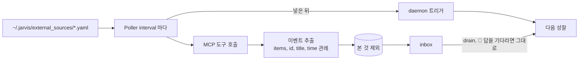
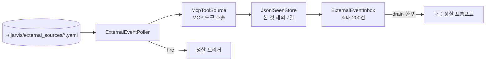

import InfoMcp from '@site/src/figures/info-mcp.svg';
import FigureMcp from '@site/src/figures/mcp.svg';
import FigureExpMcp from '@site/src/figures/exp-mcp.svg';

# MCP Events

MCP Events는 외부 MCP 도구를 주기적으로 불러, 새로 생긴 항목을 성찰의 재료로 넣는 기능이다. 캘린더나 메일 같은 소스에 새 항목이 생기면 사용자가 묻기 전에 JARVIS 가 먼저 알릴 수 있게 하는 입구 역할을 한다. 이벤트를 받아 말할지 정하는 일은 [Proactive Dialogue](./proactive.md) 의 성찰이 맡고, MCP Events 는 그 성찰에 무엇을 넣을지와 한 이벤트가 한 번만 전해지도록 하는 데까지를 다룬다.

<figure className="info-fig">
  <InfoMcp />
</figure>

## MCP Events가 주목한 점

오후 내내 코드를 보고 있는 사이 캘린더에 회의가 새로 잡히고 거래처 메일이 들어왔다고 해 보자. 기존의 Agent는 MCP 도구를 붙여 두어도 사용자가 부를 때만 쓰기 때문에, "새 메일 있어?" 라고 묻기 전까지는 아무도 알려 주지 않는다. 흔한 대처는 들어오는 항목마다 알림을 띄우는 것이지만, 그러면 같은 일을 여러 번 듣거나 급하지 않은 일로 작업이 자꾸 끊긴다. Jarvis-Agent는 외부 이벤트를 곧바로 알리지 않고 성찰의 재료로 넣어, 급하고 관련이 분명한 것만 골라 먼저 말하도록 했다. 서버 하나가 멈추거나 성찰이 말할 기회를 놓쳐도 이벤트를 잃지 않게 하는 것이 이 기능이 가장 신경 쓴 부분이다.

### 어떤 기능을 가지고 있나요?

#### 서버 하나가 전체를 막지 않게

- MCP 서버마다 시간 제한(기본 30초)을 따로 걸어, 늦는 서버만 건너뛰고 나머지는 계속 불러온다. 도구 호출에도 같은 시간 제한을 건다. 원격 서버의 인증 토큰은 `Authorization: Bearer` 로 붙이고, 직접 적은 헤더가 우선한다.
- 대안으로는 예전처럼 모든 서버가 응답할 때까지 시작을 기다리는 방식이 있었다.
- 그 방식에서는 응답하지 않는 서버 하나가 시작 전체를 막았다. 도구 호출에 시간 제한이 없으면 멈춘 서버 때문에 에이전트 루프가 무한히 기다린다.

#### 내장 도구와 같은 자리에 둔다

- MCP 도구를 내장 도구와 같은 레지스트리에 등록한다. 승인, 플러그인 훅, 결과 저장이 모두 같은 경로를 탄다. `JARVIS_SECURITY__REQUIRE_APPROVAL_FOR` 에 이름을 넣으면 내장 도구처럼 실행 전에 승인을 받는다(기본 목록에는 없다).
- 대안으로는 MCP 도구만 따로 부르는 통로를 만드는 방식이 있었다.
- 통로가 하나면 승인과 훅을 MCP 도구에 다시 만들 필요가 없다. 대신 이름이 같으면 MCP 도구가 내장 도구를 덮어쓰므로 이름이 겹치지 않게 고른다.

#### 말하지 못한 이벤트는 되돌린다

- 성찰이 말했거나 사고가 말할 거리가 아니라고 본 경우만 이벤트를 소비한 것으로 치고, 나머지는 꺼낸 순서대로 inbox 앞에 되돌린다. 되돌린 이벤트가 더 오래된 것이라 상한을 넘으면 그쪽부터 버린다.
- 대안으로는 inbox 에서 꺼낸 순간 소비한 것으로 치는 방식이 있었다.
- 그러면 inbox 를 비운 성찰이 게이트에 막혀 말하지 못했을 때 그 이벤트는 영영 전해지지 않는다. [아래 실험](#외부-이벤트를-끝내-전하지-못한-비율)에서 이 수정으로 사고 실패에 따른 손실이 0% 가 됐다.

## 세부 동작

### 한 눈에 보기

<figure className="paper-fig">
  <FigureMcp />
  <figcaption><b>Figure 1.</b> Poller 가 소스마다 MCP 도구를 불러(1, 2) 결과에서 이벤트를 뽑고(3), 처음 보는 항목만(4) 틱당 20건까지 inbox 에 넣은 뒤(5) 성찰을 깨운다(6). 다음 성찰이 inbox 를 한 번에 다 비우므로(7) 이벤트마다 발화는 많아야 한 번이다. 답을 기다리는 🔔 가 있으면 그 성찰은 inbox 를 그대로 둔다.</figcaption>
</figure>

1. Poller 가 소스마다 `interval_sec` 간격으로 MCP 도구를 부른다. 기동 직후 첫 틱에서 모든 소스를 한 번 부른다
2. 응답에서 이벤트를 뽑고, 본 것을 뺀 새 항목만 틱당 20건까지 inbox 에 넣는다. 그래서 다음 조회에 같은 항목이 와도 다시 말하지 않는다
3. 넣은 뒤 성찰을 깨운다
4. 다음 성찰이 inbox 를 한 번에 비워 사고에 넣는다. 사용자가 다른 🔔 에 아직 답하지 않았으면 inbox 를 그대로 둔다
5. 말했거나 말할 거리가 아니라고 보면 이벤트는 끝난다. 집중 중이라 화면에 못 보내는 등 말하지 못했으면 버리지 않고 inbox 앞에 되돌려 다음 성찰로 미룬다

### 소스 정의와 이벤트 규칙

- 소스 정의: `name`, `server`(mcp_servers 의 이름), `tool`, `args`, `interval_sec`(300), `enabled` 키로 쓴다. `server` 는 `mcp_servers`(환경변수 `JARVIS_MCP_SERVERS`, [Extension](../extension.md))에 적은 서버 이름이어야 하고, 맞는 서버가 없는 소스는 빠진다. 소스가 하나도 없으면 Poller 를 띄우지 않는다
- 기동 직후 첫 틱에서 모든 소스를 한 번 부르고, 그 뒤로는 소스마다 `interval_sec` 간격으로 부른다
- 응답 해석은 벤더 중립 관례를 따른다. 목록은 `items`, `events`, `messages`, `results`, `data` 필드에서 읽는다. id 는 `id`, `uid`, `eventId`, `messageId`, `threadId` 에서 찾고, 없으면 본문 해시를 쓴다. 제목은 `title`, `summary`, `subject`, `name`, `description` 에서 찾는다
- 본 것은 `~/.jarvis/external_seen.jsonl` 에 TTL(7일)로 기억한다. Poller 는 틱당 최대 20건을 넣는다. 본 것으로 적는 것도 그 20건뿐이라, 넘친 항목은 소스가 다음 조회 때 다시 주면 그때 들어온다. inbox 는 200건까지 담는다. 성찰은 drain 때 inbox 를 전부 비운다
- 꺼낸 세션이 말했거나 사고가 말할 거리가 아니라고 보면(임계치 미달, 빈 말) 이벤트는 그걸로 끝난다. 사고가 실패했거나, 게이트(쿨다운, 답 대기, 집중 중이나 답하는 중이라 화면에 못 보냄)에 막혔거나, 사고가 이벤트 대신 지난 말을 되풀이하면 꺼낸 순서대로 inbox 앞에 되돌려 다음 성찰이 다시 본다. 되돌릴 때 200건을 넘으면 되돌린 쪽(오래된 것)부터 버린다
- 이벤트는 한 세션만 소비하므로 여러 세션이 성찰해도 이벤트당 발화는 한 번이다. 요청 시점 사고는 외부 이벤트를 받지 않는다
- 성찰 프롬프트에는 기본으로 제목만 싣는다. 메일 본문 같은 원문(500자까지 자름)은 `JARVIS_EXTERNAL__STORE_DETAIL_IN_LOG=true` 일 때만 실어, 사고 로그에 원문이 쌓이지 않게 한다
- 성찰 프롬프트는 이벤트를 "말하라는 명령이 아니라 사실" 로 다루고, 긴급성과 관련성이 분명할 때만 말한다

### 한계

- 틱당 20건을 넘은 항목은 본 것으로 적지 않으므로, 소스가 다음 조회 때 다시 주지 않으면 들어오지 않는다
- 되돌린 이벤트는 전할 때까지 성찰마다 다시 오른다. 되돌린 횟수에는 상한이 없다
- inbox 는 프로세스 메모리에 있다. 200건을 넘으면 오래된 것부터 버린다
- 요청 시점 사고는 외부 이벤트를 받지 않는다. 이벤트는 성찰에서만 다룬다

### 구현 위치

왼쪽이 사용자와 화면, 가운데가 코드 모듈, 오른쪽이 저장소다. 화살표는 호출이나 데이터의 방향이다.

- 핵심 모듈: `core/external/`(되돌리기는 `inbox.py` 의 `put_back`, 소비 판단은 `core/session.py` 의 성찰)
- 저장: `external_seen.jsonl`

## Performance Experiments

상한을 넘는 이벤트와 사고 실패가 겹칠 때 이벤트를 얼마나 잃는지를, 두 번의 수정 전후로 비교했다.

### 외부 이벤트를 끝내 전하지 못한 비율

- **질문**: 한 주기에 상한(20건)보다 많은 이벤트가 오거나 사고 모델이 실패할 때, 이벤트가 먼저 건네는 말에 끝내 실리지 못하는 비율은 얼마인가. #196, #197 전후로 어떻게 달라지나
- **설정**: 실제 `ExternalEventPoller`(상한 20), `ExternalEventInbox`, `InMemorySeenStore`, 실제 `AgentSession.reflect()` 와 기본 게이트(임계치 0.5, 쿨다운 0)를 썼다. 시계는 흉내 냈다(조회 300초, 성찰 120초마다). 소스는 최근 항목만 돌려주는 가짜 목록이고, 사고 엔진은 확률 q 로 실패하고 아니면 확신도 0.9 로 말하는 가짜다. 사용자는 말할 때마다 바로 답한다고 두었다. 2시간 동안 이벤트가 오고 이어서 2시간 동안 남은 것을 비운다. 시나리오마다 시드 10개, 사고 실패율 0%, 20%, 50% 를 쟀다. "전했다" 는 그 이벤트가 실린 성찰이 말하기로 끝났다는 뜻이다
- **결과**:

<figure className="paper-fig">
  <FigureExpMcp />
  <figcaption><b>Figure 2.</b> #196 은 상한을 넘은 이벤트를 잃던 문제(b)를, #197 은 사고 실패로 잃던 문제(a, b)를 없앤다. 소스가 상한보다 빠르게 계속 쌓이는 (c) 에서는 23.6% 가 소스 목록에서 밀려나 사고 실패율과 상관없이 남는다.</figcaption>
</figure>

| 시나리오 | 사고 실패율 | #196 전 | #196 뒤 | #197 뒤 (지금) |
|---|---|---|---|---|
| 주기마다 5건 (1,200건) | 0% | 0.0% | 0.0% | 0.0% |
| | 20% | 21.7% | 21.7% | 0.0% |
| | 50% | 48.3% | 48.3% | 0.0% |
| 첫 주기에 50건 (500건) | 0% | 60.0% | 0.0% | 0.0% |
| | 20% | 64.0% | 16.0% | 0.0% |
| | 50% | 84.0% | 46.0% | 0.0% |
| 주기마다 30건 (7,200건) | 0% | 33.3% | 23.6% | 23.6% |
| | 20% | 47.8% | 39.4% | 23.6% |
| | 50% | 65.6% | 60.4% | 23.6% |

- **해석**: 두 번의 수정은 각자 다른 손실을 없앴다. #196 은 상한을 넘은 이벤트를 본 것으로 적지 않아 다음 조회 때 다시 받게 했고, #197 은 사고가 실패한 이벤트를 inbox 에 되돌렸다. 같은 이벤트를 두 번 말한 경우는 모든 조건에서 0건이다. 대신 사고 실패가 잦을수록 재시도로 사고 호출이 늘었다(주기마다 5건에서 평균 24회, 25.5회, 27.3회)
- **한계**: 소스의 목록 크기와 사용자가 늘 바로 답한다는 가정은 실험이 정했다. 실제 사고 모델의 판단(침묵, 낮은 확신도)과 여러 세션은 넣지 않았다. inbox 상한 200건에는 닿지 않았다
- **재현**: `uv run python scripts/experiments/external_delivery.py --label <코드 이름>`
