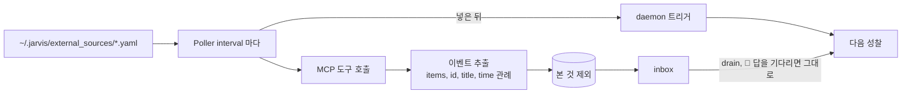
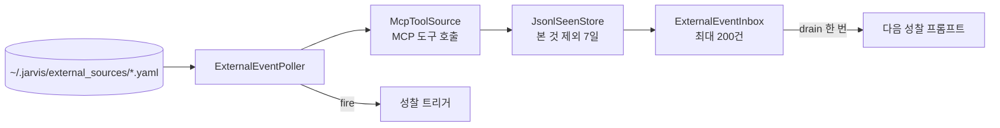

import FigureMcp from '@site/src/figures/mcp.svg';

# MCP Events

<figure className="paper-fig">
  <FigureMcp />
  <figcaption><b>Figure 1.</b> Poller 가 소스마다 MCP 도구를 불러 처음 보는 항목을 틱당 20건까지 inbox 에 넣고 성찰을 깨운다. 다음 성찰이 inbox 를 한 번에 다 비우므로 이벤트마다 발화는 많아야 한 번이다. 답을 기다리는 🔔 가 있으면 그 성찰은 inbox 를 그대로 둔다.</figcaption>
</figure>

JARVIS 는 MCP 도구를 주기적으로 불러 새 항목을 성찰의 재료로 넣는다. 이 기능으로 캘린더나 메일 같은 소스의 새 항목을 JARVIS 가 먼저 알린다.

- 소스 정의: `name`, `server`(mcp_servers 의 이름), `tool`, `args`, `interval_sec`(300), `enabled` 키로 쓴다. `server` 는 `mcp_servers`(환경변수 `JARVIS_MCP_SERVERS`, [Extension](../extension.md))에 적은 서버 이름이어야 하고, 맞는 서버가 없는 소스는 빠진다. 소스가 하나도 없으면 Poller 를 띄우지 않는다
- 기동 직후 첫 틱에서 모든 소스를 한 번 부르고, 그 뒤로는 소스마다 `interval_sec` 간격으로 부른다
- 응답 해석은 벤더 중립 관례를 따른다. 목록은 `items`, `events`, `messages`, `results`, `data` 필드에서 읽는다. id 는 `id`, `uid`, `eventId`, `messageId`, `threadId` 에서 찾고, 없으면 본문 해시를 쓴다. 제목은 `title`, `summary`, `subject`, `name`, `description` 에서 찾는다
- 본 것은 `~/.jarvis/external_seen.jsonl` 에 TTL(7일)로 기억한다. Poller 는 틱당 최대 20건을 넣고, inbox 는 200건까지 담는다. 성찰은 drain 때 inbox 를 전부 비운다
- drain 은 한 번만 일어나므로 여러 세션이 성찰해도 이벤트당 발화는 한 번이다. 요청 시점 사고는 외부 이벤트를 받지 않는다
- 성찰 프롬프트에는 기본으로 제목만 싣는다. 메일 본문 같은 원문(500자까지 자름)은 `JARVIS_EXTERNAL__STORE_DETAIL_IN_LOG=true` 일 때만 실어, 사고 로그에 원문이 쌓이지 않게 한다
- 성찰 프롬프트는 이벤트를 "말하라는 명령이 아니라 사실" 로 다루고, 긴급성과 관련성이 분명할 때만 말한다

## 설계 노트

### 서버 하나가 전체를 막지 않게

응답하지 않는 MCP 서버 하나가 시작 전체를 막던 문제가 있었다. 서버마다 시간 제한(기본 30초)을 따로 걸어, 늦는 서버만 건너뛰고 나머지는 계속 불러온다. 도구 호출에도 같은 시간 제한을 걸어, 멈춘 서버 때문에 에이전트 루프가 무한히 기다리지 않는다. 원격 서버의 인증 토큰은 `Authorization: Bearer` 로 붙이고, 직접 적은 헤더가 우선한다.

### 내장 도구와 같은 자리에 둔다

MCP 도구는 따로 부르는 통로를 만들지 않고 내장 도구와 같은 레지스트리에 등록한다. 승인, 플러그인 훅, 결과 저장이 모두 같은 경로를 탄다. MCP 도구도 `JARVIS_SECURITY__REQUIRE_APPROVAL_FOR` 에 이름을 넣으면 내장 도구처럼 실행 전에 승인을 받는다(기본 목록에는 없다). 이름이 같으면 MCP 도구가 내장 도구를 덮어쓰므로 이름이 겹치지 않게 고른다.

## 구현 위치

왼쪽이 사용자와 화면, 가운데가 코드 모듈, 오른쪽이 저장소다. 화살표는 호출이나 데이터의 방향이다.

- 핵심 모듈: `core/external/`
- 저장: `external_seen.jsonl`
