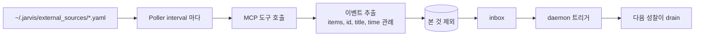
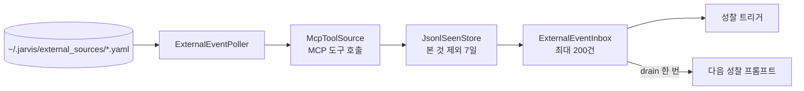

# MCP연동

JARVIS 는 MCP 도구를 주기적으로 불러 새 항목을 성찰의 재료로 넣는다. 캘린더나 메일 같은 소스를 비서가 먼저 보고 말하게 하는 길이다.

- 소스 정의: `name`, `server`(mcp_servers 의 이름), `tool`, `args`, `interval_sec`(300), `enabled` 키로 쓴다
- 응답 해석은 벤더 중립 관례를 따른다. 목록은 `items`, `events`, `messages`, `results`, `data` 필드에서 읽는다. id 는 `id`, `uid`, `eventId`, `messageId`, `threadId` 에서 찾고, 없으면 본문 해시를 쓴다. 제목은 `title`, `summary`, `subject`, `name`, `description` 에서 찾는다
- 본 것은 `~/.jarvis/external_seen.jsonl` 에 TTL(7일)로 기억한다. 틱당 최대 20건을 가져오고, inbox 는 200건까지 담는다
- drain 은 한 번만 일어나므로 여러 세션이 성찰해도 이벤트당 발화는 한 번이다. 요청 시점 사고는 외부 이벤트를 받지 않는다
- 성찰 프롬프트는 이벤트를 "말하라는 명령이 아니라 사실" 로 다루고, 긴급성과 관련성이 분명할 때만 말한다

## 구현 위치

왼쪽이 사용자와 화면, 가운데가 코드 모듈, 오른쪽이 저장소다. 화살표는 호출이나 데이터의 방향이다.

- 핵심 모듈: `core/external/`
- 저장: `external_seen.jsonl`
