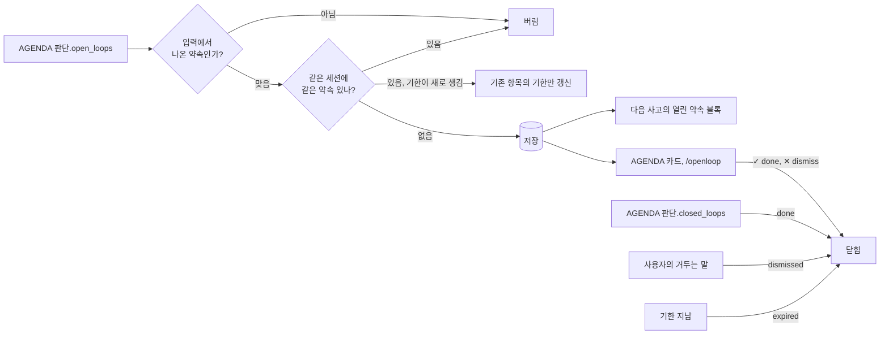
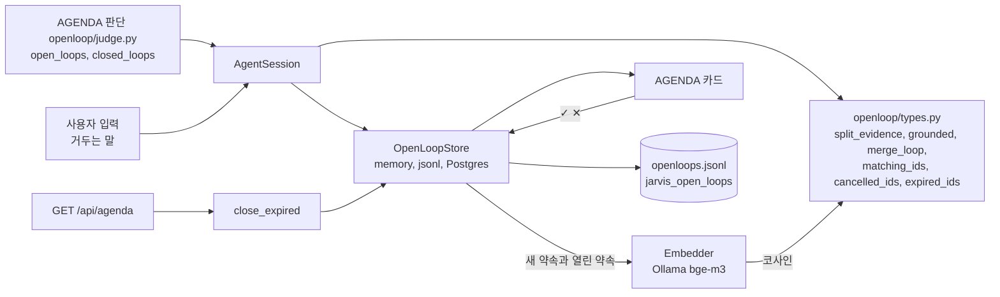

import FigureOpenLoop from '@site/src/figures/open-loop.svg';
import FigureExpOpenLoop from '@site/src/figures/exp-open-loop.svg';

# Open Loop

<figure className="paper-fig">
  <FigureOpenLoop />
  <figcaption><b>Figure 1.</b> (a) AGENDA 판단이 적은 약속은 입력 근거 검사와 같은 약속 검사를 지나야 새로 저장된다. 같은 약속 판정의 임베딩은 저장소가 Ollama bge-m3 로 계산한다. (b) 열린 약속은 AGENDA 판단의 closed_loops 나 ✓ 로 done, 거두는 말이나 ✕ 로 dismissed, 기한이 지나면 expired 로 닫힌다.</figcaption>
</figure>

JARVIS 는 대화에서 흘린 약속(open loop)과 미완 작업을 기억했다가 성찰 때 다시 보고, Web HUD 의 AGENDA 카드에 보여 준다. 정한 시각에 도는 일은 [Scheduling](./scheduling.md), MCP 도구로 가져오는 외부 이벤트는 [MCP Events](./mcp.md) 에서 다룬다.



- 약속은 요청마다 내적 사고와 따로 도는 AGENDA 판단(`agent_layer/openloop/judge.py`)이 잡고 닫는다. 응답과 함께 돌아 응답을 늦추지 않고, [Thought Router](../architecture/inner-thought.md#thought-router) 가 사고를 건너뛴 요청에서도 돈다. 응답보다 늦게 끝나 약속이 바뀌면 화면에 `agenda_changed` 를 보낸다. 성찰은 약속을 보기만 하고, 만들지도 닫지도 않는다
- 새 약속은 사용자 입력에서 나온 것만 저장한다. 판정 방법은 [약속 판정](#약속-판정)에 있다
- AGENDA 판단과 내적 사고에는 열린 약속이 최신순으로 `[1] 설명 (기한 ...)` 처럼 번호와 함께 보인다
- 기한: AGENDA 판단이 약속 끝에 ` @YYYY-MM-DD HH:MM` 을 붙이면 `due_ms` 로 저장한다. 다음 판단과 사고에는 `설명 (기한 2026-10-12 10:00)` 으로 보인다
- 같은 약속이 다시 오면 새로 만들지 않는다. 기한이 새로 붙었을 때만 기존 항목의 기한을 갱신한다. 같은 약속인지는 [약속 판정](#약속-판정)으로 정한다
- 약속은 다음 경우에 저절로 닫힌다.
  - AGENDA 판단의 `closed_loops`: 이번 입력으로 끝났거나, 하지 말라고 했거나, 취소된 약속의 번호(또는 문구)를 판단이 짚으면 `done` 으로 닫는다
  - 사용자의 거두는 말: 입력에 `취소`, `안 해도`, `하지 마`, `그만해`, `필요 없`, `안 챙겨` 같은 말이 있고 그 입력이 열린 약속을 가리키면(짧은 쪽 기준 bigram 겹침 0.5 이상) 판단이 놓쳐도 `dismissed` 로 닫는다. 완료 표현("보냈어", "다 했어")은 질문과 구분이 안 되므로 코드로 닫지 않고 AGENDA 판단으로만 닫는다
  - 같은 판단 결과에서 닫으라고 한 약속은 `open_loops` 에 다시 있어도 새로 열지 않는다
  - 기한: 판단과 사고 전, `GET /api/agenda` 때, 기한 뒤 `JARVIS_OPENLOOP__EXPIRE_AFTER_SEC`(6시간)가 지났거나 기한 없이 `JARVIS_OPENLOOP__MAX_AGE_SEC`(7일)보다 오래되면 `expired` 로 닫는다
- 상태는 `open`, `done`, `dismissed`, `expired` 넷이다
- 저장소: `~/.jarvis/openloops.jsonl`(append 로그, id 기준 마지막이 이긴다), Postgres `jarvis_open_loops`, 메모리
- 조작: `/openloop`, `/openloop done <id>`, `/openloop dismiss <id>`, `POST /api/openloops/{id}` 로 약속을 보고 닫는다

## 약속 판정

AGENDA 판단이 적어 낸 약속 하나는 두 번 판정을 거친다. 판정 규칙은 모두 `agent_layer/openloop/types.py` 의 순수 함수이고, 임베딩 호출만 저장소(`OpenLoopStore`)가 경계에서 한다.

AGENDA 판단은 약속마다 기한과 근거를 붙여 낸다.

```text
보고서 보내기 @2026-10-16 15:00 (근거: 내일 오후 3시까지 보고서 보내야 해)
```

**저장할 약속인가** (`grounded`). 작은 사고 모델은 회상된 기억 속 다른 약속을 이번에 새로 흘린 것처럼 옮겨 적는다. 그런 항목은 입력과 글자 겹침이 0 이었다. 그래서 아래 둘 중 하나를 만족해야 저장한다.

| 순서 | 조건 | 왜 |
|---|---|---|
| 먼저 | 근거의 글자 bigram 중 50% 이상이 사용자 입력에 있다 | 근거는 입력을 옮긴 문장이다. 약속 문구를 "결과 공유" 처럼 바꿔 말해도 근거가 입력에 있으면 받는다. 기억에서 지어낸 근거는 입력에 없다 |
| 근거가 없거나 어긋나면 | 약속 문구의 글자 bigram 중 20% 이상이 사용자 입력에 있다 | 사고가 근거를 빠뜨려도 입력을 거의 그대로 옮긴 약속은 받는다 |

gemma4:e2b-it-qat 에 입력 5개를 두 번씩 넣었을 때 약속을 낸 9번 모두 입력을 그대로 옮긴 근거를 붙였다.

**이미 있는 약속인가** (`same_loop`). 같은 세션의 열린 약속과 하나씩 비교해 아래 중 하나면 같은 약속이다.

| 조건 | 예 |
|---|---|
| 공백과 대소문자를 정리하면 같다 | "배포 결과 공유" 와 "배포  결과 공유" |
| 짧은 쪽(6자 이상)이 긴 쪽에 통째로 들어간다 | "로그 확인해줘" 와 "내일 배포 전에 로그 확인해줘" |
| 임베딩 코사인이 0.85 이상이다 | "참석자 목록 확정" 과 "참석자들의 최종 리스트 확정" (bge-m3 0.92) |
| 공백을 뺀 글자 bigram 의 Jaccard 가 0.4 이상이다 | 단어 일부만 바꾼 중복 (실측 0.43~0.85) |

문턱 0.85 는 bge-m3 로 잰 값에서 골랐다. 바꿔 말한 같은 약속은 0.87~0.95, 같은 주제의 다른 약속은 0.80 이하였다(가장 높은 쌍이 "PR 리뷰 해주기" 와 "PR 머지하기"). 다른 약속을 하나로 합치면 약속이 사라지므로, 같은 약속을 조금 놓치더라도 잘못 합치지 않는 쪽으로 잡았다.

임베딩 설정이 없거나 Ollama 호출이 실패하면 임베딩 조건만 빠지고 나머지 세 조건으로 판정한다. 대화는 막히지 않는다.

## 임베딩 켜기

약속 판정은 메모리 의미 검색과 같은 `JARVIS_MEMORY__EMBEDDING_*` 설정을 쓴다. 하나를 켜면 둘 다 켜진다.

1. 호스트 Ollama 에 임베딩 모델을 받는다.

   ```bash
   ollama pull bge-m3
   ```

2. `.env` 에 설정을 넣는다. 컨테이너에서는 호스트 Ollama 주소를 적는다.

   ```bash
   JARVIS_MEMORY__EMBEDDING_PROVIDER=ollama
   JARVIS_MEMORY__EMBEDDING_MODEL=bge-m3
   JARVIS_MEMORY__EMBEDDING_DIMENSIONS=1024
   JARVIS_MEMORY__EMBEDDING_BASE_URL=http://host.docker.internal:11434
   ```

3. 백엔드를 다시 띄운다.

   ```bash
   docker compose up -d --build jarvis-backend
   ```

4. 이미 저장된 메모리 항목에 벡터를 채운다. Web HUD 나 TUI 에서 `/remember reembed` 를 입력한다. 열린 약속은 판정 때마다 다시 임베딩하므로 따로 채울 것이 없다.

:::warning[nomic-embed-text 는 한국어 약속을 구분하지 못한다]
ollama 기본값인 nomic-embed-text 는 한국어 문장끼리 코사인이 0.68~0.97 로 몰렸다. "PR 리뷰 해주기" 와 "PR 머지하기" 가 0.93 이라 0.85 문턱에서 다른 약속이 합쳐진다. 한국어로 대화한다면 bge-m3 를 쓴다.
:::

## 한계

자동 닫힘과 중복 판정은 작은 사고 모델의 출력과 글자 겹침에 기댄다. 그래서 아래 경우는 사람이 ✓ / ✕ 로 정리해야 한다. 측정은 gemma4:e4b(ollama)로 "내일 오후 3시까지 분기 보고서 초안을 팀장님께 보내야 해" 뒤 "그건 취소됐어, 안 챙겨도 돼" 를 새 세션에서 반복한 것이다.

| 한계 | 왜 | 실측 또는 예 | 우회 |
|---|---|---|---|
| 뜻이 멀게 바꾼 같은 약속은 따로 쌓인다 | 임베딩 문턱 0.85 를 다른 약속을 합치지 않는 쪽으로 잡았다. 임베딩 설정이 없으면 글자 겹침만 본다 | bge-m3 에서 "운동 등록하기" 와 "헬스장 회원권 끊기" 0.55, "엄마 생신 선물 사기" 와 "어머니 생일 선물 구매" 0.75 | ✕ 로 하나를 닫는다 |
| 완료 표현으로는 코드가 닫지 않는다 | "보냈어", "다 했어" 는 "보냈어?" 같은 질문과 글자로 구분이 안 된다 | 완료는 AGENDA 판단의 `closed_loops` 로만 닫힌다 | ✓ 로 닫는다 |
| AGENDA 판단이 닫을 번호를 놓친다 | 작은 모델은 취소 턴에 `closed_loops` 를 비우거나 `[열린 약속]` 에 없는 문구를 적는다 | 번호 방식 전에는 문구가 맞지 않아 닫히지 않았다. 지금은 판단이 놓쳐도 거두는 말이 약속을 가리키면 닫힌다 | 거두는 말에 약속을 가리키는 낱말을 넣는다("보고서는 취소됐어") |
| 거두는 말이 약속을 가리키지 않으면 안 닫힌다 | 입력과 약속의 글자 겹침이 짧은 쪽 기준 0.5 미만이면 다른 약속으로 본다 | "그건 취소됐어" 만으로는 닫히지 않는다 | 약속 이름을 같이 말하거나 ✕ |
| 기한이 절반쯤 빠진다 | 사고 모델이 ` @YYYY-MM-DD HH:MM` 표기를 자주 빼먹는다 | 약속을 만든 7번 중 4번만 기한이 붙었다 | 기한 없는 약속은 `MAX_AGE_SEC`(7일)에 닫힌다 |
| 약속이 생기지 않거나 취소 턴에 생긴다 | 사고 모델이 약속을 놓쳤다가 다음 턴에 적는다 | 한 번은 첫 턴에 약속이 없고 "취소됐어" 턴에 생겼다. 같은 프레임에서 닫으라고 한 것은 열지 않지만 이 경우는 막지 못한다 | ✕ |
| 근거 없이 바꿔 말한 새 약속은 버려진다 | 사고가 `(근거: ...)` 를 빠뜨리면 약속 문구와 입력의 글자 겹침 20% 로만 본다 | "배포 끝나면 알려줄게" 를 근거 없이 "결과 공유" 로만 적으면 버려진다 | 다시 말한다 |
| 닫힘이 답보다 늦을 수 있다 | AGENDA 판단은 응답과 함께 돌아 응답보다 늦게 끝날 수 있다 | 측정 전(이 표의 다른 수치는 약속 판단이 사고 안에 있을 때 잰 것이다) | 없음. 약속이 바뀌면 `agenda_changed` 로 AGENDA 가 다시 불린다 |
| 잘못 닫힌 약속을 되살릴 수 없다 | 닫기만 있고 `open` 으로 되돌리는 API 와 화면이 없다 | | 다시 말하면 새 약속으로 생긴다 |
| 기한은 서버 시간대로 계산한다 | `[지금]` 과 기한 해석 모두 프로세스 로컬 시각이다 | 컨테이너 `TZ=Asia/Seoul` | 컨테이너 `TZ` 를 사용자 시간대로 맞춘다 |

## 성능 실험

### 임베딩 모델별 같은 약속 가르기

바꿔 말한 같은 약속 8쌍과, 주제는 같지만 다른 약속 10쌍(예: "팀장님께 분기 보고서 보내기" 와 "팀장님께 휴가 신청서 보내기")의 코사인을 재고, 실제 판정 함수 `same_loop` 로 같은 약속인지 판정했다. 재현: `uv run python -m scripts.experiments.loop_embedding --embedder bge-m3`.

<figure className="paper-fig">
  <FigureExpOpenLoop />
  <figcaption><b>Figure 2.</b> 세 임베딩 모두 같은 약속(●)과 다른 약속(◆)이 겹친다. bge-m3 는 0.85 문턱 오른쪽에 다른 약속이 없어 잘못 합침이 0 이고, nomic-embed-text 는 다른 약속이 문턱 오른쪽으로 몰려 다섯 쌍을 합쳤다.</figcaption>
</figure>

- 코사인 문턱 하나로는 어느 임베딩도 완전히 가를 수 없다. 그래서 문턱은 다른 약속을 합치지 않도록 높게 잡았다. 놓친 중복은 사람이 ✕ 로 닫으면 되지만, 잘못 합친 약속은 하나가 조용히 사라지기 때문이다
- 판정 정확도는 bge-m3 0.83, nomic-embed-text 0.61, text-embedding-3-small 0.56, 임베딩 없이 글자 규칙만 쓰면 0.56 이다(`--embedder none`)
- OpenAI 임베딩은 같은 약속끼리도 코사인이 낮아(평균 0.64) 0.85 문턱에서는 임베딩이 없는 것과 같다. 쓰려면 문턱을 0.6 근처로 따로 잡아야 한다(이 데이터에서 0.58 일 때 0.72)
- 한계: 18쌍은 작은 표본이고 직접 만든 문장이다. "운동하러 헬스 끊기" 처럼 뜻이 갈릴 수 있는 문장도 섞여 있다. 권장값(bge-m3, 0.85)을 고르는 근거로만 쓴다

## 설계 노트

### 판정은 순수 함수 하나, 저장소는 셋

같은 약속인지, 저장할 만한 약속인지는 `openloop/types.py` 의 순수 함수(`same_loop`, `merge_loop`)가 정한다. 메모리, JSONL, Postgres 세 저장소가 이 함수를 그대로 쓴다. 저장소마다 판정을 따로 두면 같은 대화가 저장소에 따라 다른 AGENDA 를 만든다. 임베딩은 판정 함수 안에서 부르지 않고 저장소가 경계에서 계산해 넘긴다. 그래서 판정은 테스트에서 네트워크 없이 돌고, 임베딩 호출이 실패해도 글자 규칙으로 계속 판정한다.

### 작은 사고 모델의 실수를 규칙으로 받친다

약속을 만들고 닫는 일은 사고 모델의 출력에 기댄다. 그런데 로컬 소형 모델(gemma4:e2b)은 회상된 기억 속 약속을 이번 입력의 약속처럼 옮겨 적거나, 취소 턴에 닫을 약속을 놓쳤다. 모델을 키우는 대신 규칙으로 받쳤다.

- 사용자 입력과 글자가 거의 겹치지 않는 새 약속은 저장하지 않는다. 바꿔 말한 진짜 약속까지 버려지는 문제는, AGENDA 판단이 약속 끝에 입력 구절을 `(근거: ...)` 로 인용하게 해서 풀었다
- 닫을 약속은 문구가 아니라 번호(`[1]`, `[2]`)로 받는다. 문구로 받을 때는 작은 모델이 문구를 조금씩 바꿔 적어 닫히지 않았다
- AGENDA 판단이 놓쳐도 사용자가 "취소", "안 해도" 같은 말로 약속을 가리키면 코드가 닫는다

## 구현 위치

왼쪽이 사용자와 화면, 가운데가 코드 모듈, 오른쪽이 저장소다. 화살표는 호출이나 데이터의 방향이다.



- 핵심 모듈: `agent_layer/openloop/`
- 저장: `openloops.jsonl` 또는 Postgres
