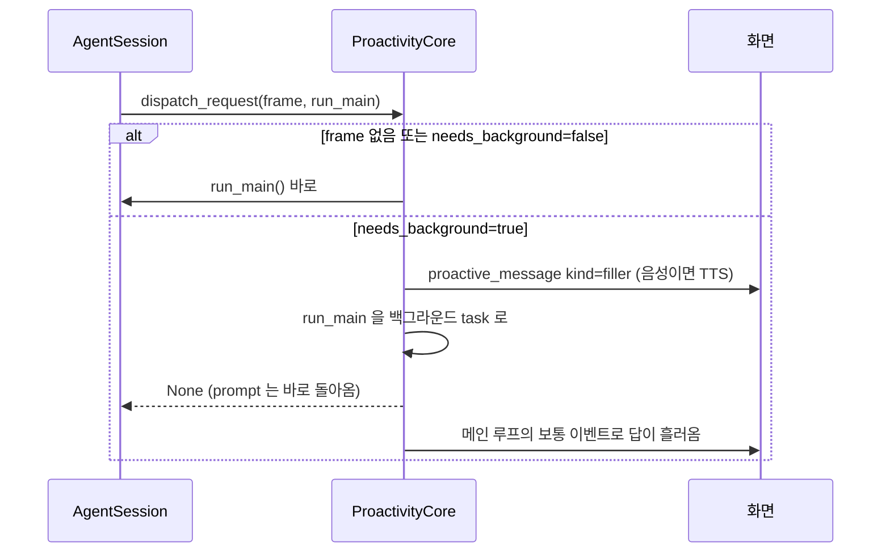
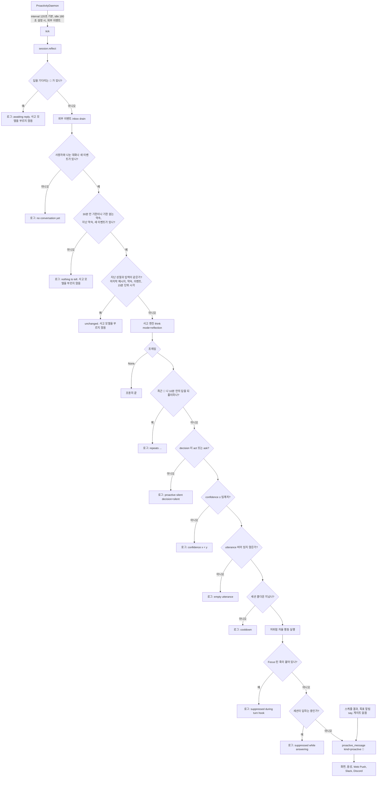
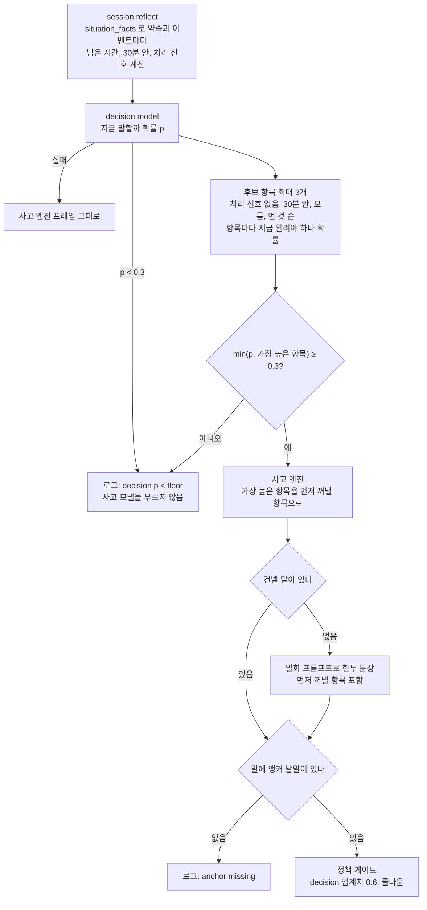
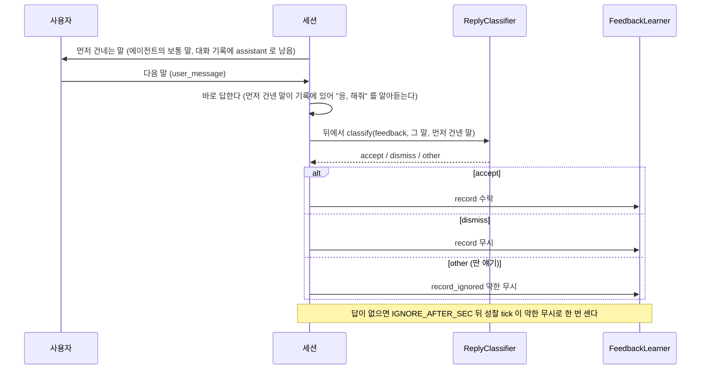
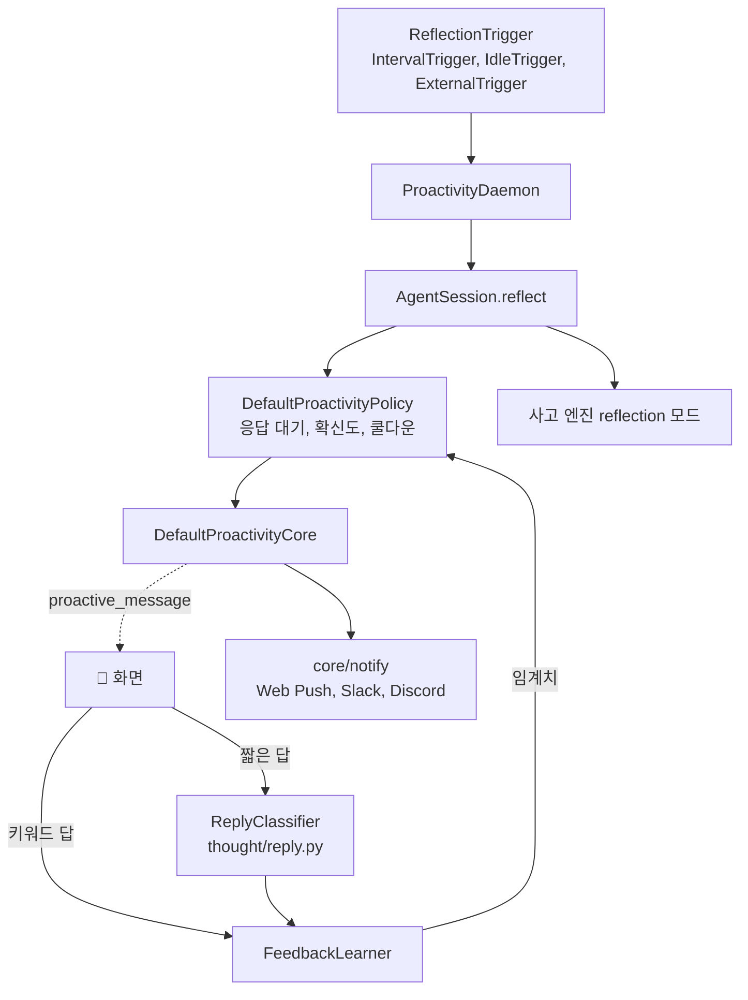

import InfoProactive from '@site/src/figures/info-proactive.svg';
import FigureProactive from '@site/src/figures/proactive.svg';
import FigureExpProactive from '@site/src/figures/exp-proactive.svg';
import FigureExpProactiveGate from '@site/src/figures/exp-proactive-gate.svg';

# Proactive Dialogue

Proactive Dialogue는 사용자가 묻기 전에 에이전트가 먼저 말을 건네는 기능이다. JARVIS 는 [Inner Thought](./inner-thought.md) 가 남긴 사고 프레임을 바탕으로, 요청이 오면 **Dual channel** 로 짧은 말을 먼저 하고, 요청이 없을 때는 **성찰**을 거쳐 먼저 말을 건다(**Proactive Dialogue**). 먼저 건네는 말은 알림처럼 따로 보이지 않고 에이전트가 대화 중에 꺼낸 말처럼 보이고 들리며, 대화 기록에도 그 에이전트의 말로 남는다. 그 말에 대한 사용자의 반응은 **Process Pattern Analysis** 가 확신도 임계치에 반영해, 다음에 말을 걸지 말지의 기준이 사용자에 맞춰 움직인다.

가치가 분명하지 않으면 말하지 않고, 고위험 행동은 스스로 실행하지 않는다. Conversation 전체에서 이 기능은 사용자가 입력하지 않는 동안에도 대화를 이어 가는 쪽을 맡는다.

<figure className="info-fig">
  <InfoProactive />
</figure>

## Proactive Dialogue가 주목한 점

오후 3시까지 보내기로 한 보고서를 사용자가 잊고 있다면, 2시 반쯤 묻기 전에 먼저 알려 주는 편이 낫다. 하지만 기존의 Chatbot은 사용자가 물어야만 움직이기 때문에 이런 순간을 그냥 지나치고, 오래 걸리는 요청에는 답이 올 때까지 아무 말이 없다. 주기적으로 말을 걸게 만드는 것이 흔한 우회 방안이지만, 그러면 할 말이 없을 때도 말을 걸어 소음이 된다. 실제로 근거 없이 성찰을 돌렸을 때는 "안녕하세요! 더 궁금한 점…" 같은 인사나 방금 한 답을 지어 건넸다. Jarvis-Agent는 오래 걸리는 요청에는 짧은 말을 먼저 건네고, 요청이 없을 때는 말할 가치가 분명한 경우에만 먼저 말하며, 그 말에 대한 사용자의 반응으로 다음 발화 기준을 스스로 조절하는 방식을 택했다.

### 어떤 기능을 가지고 있나요?

#### 정책과 코어를 세션에서 떼어 낸다

- 확신도 임계치, 세션별 쿨다운, 응답 대기, 위험도 판단을 `DefaultProactivityPolicy` 와 `DefaultProactivityCore` 라는 독립 클래스로 만들었다. 협력자(정책, push, spawn)는 모두 생성자로 주입해 세션과 UI 를 import 하지 않는다.
- 대안으로는 판단을 세션 안에 두는 방식이 있었다.
- 떼어 내면 정책 평가가 LLM 도 화면도 없이 사례 파일만으로 돈다([게이팅 정책 실험](#게이팅-정책llm-없음)). 처음에는 배선하지 않은 코어만 넣고 테스트로 확인한 뒤 세션에 연결했다.

#### 판단과 거르기를 나눈다

- 사고는 도움이 되는지와 그 확신만 낸다. 거르기는 임계치 하나가 하고, 그 임계치를 피드백 학습이 움직인다.
- 대안으로는 처음 성찰 지시문처럼 사고에게도 "애매하면 말하지 마라" 고 시키는 방식이 있었다. 그때는 정책에도 확신도 임계치가 있어서, 같은 거르기가 지시문과 정책에 두 번 들어 있었다.
- 지시문 쪽 거르기는 모델마다 다르게 작동했다. gpt-4o-mini 는 거의 다 침묵했고 gemma4 는 덜 따랐다. 조절할 값이 하나라서 모델을 바꾸면 임계치만 다시 맞추면 된다. 다만 블라인드 시험에서 보듯, 이미 처리된 일처럼 사고 자체가 잘못 판단한 사례는 임계치로 다 걸러지지 않는다.

#### decision model 은 엔진을 감싼다

- decision model 은 `DecisionGatedEngine` 으로 사고 엔진을 감싼다. 요청 사고는 그대로 두고, 성찰 사고만 decision model 확률로 결정과 확신도를 바꾼다.
- 대안으로는 사고 모델의 결정과 확신도를 그대로 쓰는 방식이 있었다. `JARVIS_PROACTIVE__DECISION_MODEL` 이 비어 있으면 감싸지 않으므로, 이 기능이 없을 때와 동작이 같다.
- 확률이 0.3 보다 낮으면 사고 모델을 부르지 않고 침묵하고([판정을 사고보다 먼저 한다](#판정을-사고보다-먼저-한다)), 그 위에서 말하기로 했는데 사고 프레임에 건넬 말이 비어 있으면 그때만 사고 모델로 한두 문장을 만든다. 이 보조 프롬프트에는 에이전트의 말투를 넘기고, 알릴 구체적인 것이 없으면 아무것도 쓰지 않게 했다. 빈 답이면 침묵한다. 빈 답을 허락하지 않았을 때는 "안녕하세요! 더 궁금한 점 있으시면 말씀해 주세요." 같은 인사가 🔔 로 나갔다. 그래서 성찰 지시문의 침묵 기준에도 "건넬 말이 인사, 안부뿐이다" 를 넣었다. decision model 호출이 실패하면 원래 프레임을 그대로 쓴다.

#### 판정을 사고보다 먼저 한다

- decision model 을 쓰면 성찰은 decision model 의 "지금 말할까" 확률을 먼저 묻는다. 0.3 보다 낮으면 사고 모델을 부르지 않고 침묵한다. 넘을 때만 사고 프레임과 건넬 말을 만든다.
- 대안으로는 예전 순서처럼 사고를 먼저 돌리고 그 뒤 decision model 로 결정과 확신도를 바꾸는 방식이 있었다. 그러면 침묵할 성찰에도 사고 LLM 을 매번 한 번 부르고, 사고가 지어낸 해석이 판단보다 앞선다.
- [Do Proactive Agents Need an LLM to Decide When to Act?](https://arxiv.org/abs/2605.30152) 은 "언제 나설지" 를 생성 모델이 아닌 가벼운 판정기에 맡기고 생성은 판정을 넘은 뒤에만 하는 구성이, 생성 모델이 직접 정하는 구성보다 순위 AUC 가 높고 훨씬 빠르다고 보고했다. [Thinking Inertia](https://arxiv.org/abs/2610.11765) 는 모델이 "생각하지 말라" 는 지시를 받아도 답 앞에 추론을 쓰는 경향을 보였다. 그래서 판단과 생성을 한 호출에 섞지 않고 순서를 나눴다. decision model 이 없을 때의 동작은 바꾸지 않았다.

#### 계산은 코드가, 판단은 decision model 이 한다

- 성찰마다 약속과 외부 이벤트 한 줄씩에 대해 코드가 남은 시간("1시간 뒤", "8분 전", "14일 뒤"), 30분 안인지, 처리 신호(수락, 완료, 취소, 확인)를 계산해 decision model 에 붙인다(`core/proactive/situation_facts.py`). 그 위에서 항목마다 "아직 처리되지 않았고 지금 알려야 하는가" 를 따로 묻고, 전체 확률과 가장 높은 항목 확률 중 작은 쪽을 확신도로 쓴다.
- 대안으로는 decision model 이나 사고 모델이 이벤트 글을 읽고 시각을 직접 빼게 하는 방식이 있었다. 작은 모델은 4분 남은 기한을 "14분 남았습니다" 로 읽거나, 수락된 초대를 다시 알렸다.
- 외부 이벤트 글은 신뢰하지 않는 입력이라 정규식과 순수 함수로만 읽는다. 날짜를 못 읽으면 "unknown" 으로 두고, 그것만으로 침묵시키지 않는다. 처리 신호나 먼 기한으로 항목을 버리지도 않고, 항목별 질문을 던질 순서와 상한(3개)만 정한다. 그래서 성찰 한 번의 decision model 호출은 4번을 넘지 않는다.
- [Thinking Inertia](https://arxiv.org/abs/2610.11765) 는 답의 형태(바로 답, 짧은 답)가 모델이 하는 일을 바꾼다고 보였고, [Do Proactive Agents Need an LLM to Decide When to Act?](https://arxiv.org/abs/2605.30152) 은 "언제" 를 먼저 좁히고 "무엇" 을 나중에 정한다. 여기서는 그 둘을 계산할 수 있는 사실은 코드가 먼저 계산하고, 모델에게는 예와 아니오로 답할 질문만 던지는 형태로 옮겼다.

#### 근거 항목을 짚지 않은 말은 보내지 않는다

- decision model 이 항목마다 낸 확률 중 가장 높은 항목을 앵커로 골라 사고 프롬프트와 발화 프롬프트에 `[먼저 꺼낼 항목]` 으로 넣고, 그 항목을 인용해 말하게 한다. 만든 말에 앵커의 숫자, 이름, 핵심 낱말이 하나도 없으면 침묵하고 `anchor missing` 을 남긴다.
- 대안으로는 말의 내용은 사고 모델에 맡기고 결정만 decision model 이 하는 방식이 있었다. 그러면 decision model 이 말하라고 했을 때 사고 모델이 엉뚱한 인사나 방금 한 답을 건넸다.
- 확인은 순수 함수(`agent_layer/thought/anchor_check.py`)로 관대하게 한다. 숫자는 쉼표와 띄어쓰기를 무시하고, "10:00" 은 "10시" 로도 맞추고, 한글 낱말은 조사를 떼고 앞 두 글자로도 맞춘다. 근거를 다른 말로 바꿔 쓴 알림("1,284,300원" 을 "128만원" 으로)은 막힐 수 있다.
- 근거는 [Do Proactive Agents Need an LLM to Decide When to Act?](https://arxiv.org/abs/2605.30152) 의 routing 이다. 판정기가 고른 대상에 생성을 묶어, 판정과 발화가 다른 것을 가리키지 않게 한다.

#### 3단 라벨과 AUC 로 잰다

- 상황 사례에 `must`(말해야 함), `can`(어느 쪽이든), `must_not`(말하면 소음) 라벨을 달고, recall 은 must 에서, 오경보는 must_not 에서만, AUC 는 must 대 must_not 을 확신도로 잰다. 라벨은 지시문과 문서를 보지 못한 별도 에이전트가 초안을 달고 사람 검수 시트로 남긴다.
- 대안으로는 예전처럼 말할지 말지 두 값으로 재는 방식이 있었다. 그러면 "사람에 따라 알려 주는 편이 낫다" 고 볼 수 있는 사례가 오경보로 잡혀, 임계치를 지나치게 올리게 된다.
- [Do Proactive Agents Need an LLM to Decide When to Act?](https://arxiv.org/abs/2605.30152) 의 must-fire, can-skip, must-skip 구분과 [ProactiveBench](https://github.com/thunlp/ProactiveAgent) 의 사람 주석 방식을 옮겼다. 먼저 건넨 말이 인사뿐인지, 사용자 분석문이 새어 나왔는지는 [Thinking Inertia](https://arxiv.org/abs/2610.11765) 의 블라인드 판정자처럼, 어느 구성이 만든 말인지 모르는 판정자가 라벨과 근거 구간을 함께 내게 했다. [Proactive Agent](https://arxiv.org/abs/2410.12361) 는 기성 LLM 판정자가 사람이 거절한 제안도 대부분 받아들인다고 보고했으므로(gpt-4o-mini 의 거절 사례 일치 33%), 사람 라벨과의 일치율을 재기 전에는 판정자 수치를 "검증 전" 으로 둔다.

#### 말할 거리가 없으면 해석문을 내보내지 않는다

- 성찰 프레임에 건넬 말(`utterance`)이 비어 있으면 침묵한다.
- 대안으로는 해석문(`interpretation`)을 대신 내보내는 방식이 있었다.
- 해석문을 내보내면 "사용자는 쉬고 있는 것으로 보인다" 같은 혼잣말이 🔔 로 나간다. 침묵할 때마다 이유(`cooldown`, `confidence`, `empty utterance`, `decision=silent`)를 로그에 남겨, 왜 말하지 않았는지 사람이 볼 수 있게 했다.

## 세부 동작

### 한 눈에 보기

<figure className="paper-fig">
  <FigureProactive />
  <figcaption><b>Figure 1.</b> (a) 성찰 한 번이 먼저 말하기까지 지나는 게이트. 왼쪽 열은 사고 모델을 부를지 정한다(답을 기다리는 말, 사용자와 나눈 대화가 있는지, 말할 근거, 지난번과 같은 입력). 말할 근거는 기한이 없거나 30분 안으로 다가왔거나 지난 약속, 그리고 새 외부 이벤트다. 오른쪽 열은 사고 결과를 거르고(되풀이, 결정, 확신도, 문장, 쿨다운) 답하는 중이거나 Focus 중이면 보내지 않는다. 쿨다운을 지나면 저위험 자율 행동을 실행한다. 스케줄 결과와 목표 알림은 이 게이트를 거치지 않고 `say()` 로 대화에 건넨다. 건넨 말은 에이전트의 보통 말로 대화 기록에 남는다. 하나라도 막히면 침묵하고 이유만 로그에 남긴다. (b) 묻지 않고 그 뒤 첫 말로 확신도 임계치 θ 를 옮긴다. (c) 오래 걸릴 요청이면 filler 를 먼저 말하고 메인 응답은 뒤에서 돌린다. router 를 쓰거나 시점이 after 면 돌지 않는다.</figcaption>
</figure>

기능은 세 경로로 나뉜다.

1. 요청이 오면 사고 프레임의 `needs_background` 를 보고 [Dual channel](#dual-channel) 로 filler 를 먼저 말할지 정한다.
2. 요청이 없을 때는 daemon 이 주기적으로 [성찰](#성찰과-먼저-건네는-말)을 돌리고, 게이트를 모두 지난 말만 🔔 로 건넨다. 게이트를 지나면 [저위험 자율 행동](#저위험-자율-행동)도 실행한다.
3. 🔔 뒤 사용자의 첫 말은 [피드백 학습](#피드백-학습)이 분류해 확신도 임계치를 옮긴다. 화면이 없으면 [외부 알림](#외부-알림)으로 보낸다.

### Dual channel

JARVIS 는 오래 걸릴 요청이면 "잠깐만요, 확인할게요" 같은 filler 를 먼저 말하고, 메인 응답은 뒤에서 돌린다.

사고 프레임의 filler 가 비어 있으면 내장 문구 셋을 돌아가며 쓴다. 사고가 늦게 끝났거나(`race` 초과) 시점이 `after` 거나 router 를 쓰면(사고 결과는 다음 턴에 들어간다) 이번 요청에는 frame 이 없으므로 항상 즉시 모드로 답한다.

### 성찰과 먼저 건네는 말

- **daemon** (`daemon.py`): 트리거를 먼저 기다린 뒤 tick 한다. 그래서 기동 직후에는 말하지 않는다. 최근 활동 순으로 모든 세션을 성찰한다
- **트리거** (`triggers.py`): `interval`(기본 120초), `idle`(마지막 입력 뒤 180초, 한 번 울리면 다음 활동까지 재장전), `both` 중 하나를 고른다. 외부 소스가 있으면 새 외부 이벤트도 트리거가 된다
- **응답 대기** (`policy.py`, `check_awaiting`): 먼저 건네는 말을 낸 세션은 사용자가 메시지나 피드백을 보낼 때까지 다시 말하지 않는다. 성찰 자체를 건너뛰므로 사고 모델도 부르지 않고, 외부 이벤트도 꺼내지 않고 남겨 둔다. 먼저 건넨 말과 그 말에 준 피드백은 세션 저장소에 남아서, 재시작한 뒤에도 그 말 이후에 사용자 메시지나 피드백이 없으면 대기 상태가 다시 걸린다
- **성찰 프롬프트**: 사용자 입력 자리가 없고, 대신 `[외부 이벤트]` 와 `[최근에 먼저 건넨 말]`(세션의 최근 먼저 건넨 말 3개)이 있다. 프롬프트는 "지금 말하면 도움이 되는가" 와 그 확신도만 정직하게 내라고 하고, 말할 때의 기준(기한 임박, 사용자 일에 영향을 주는 이벤트)과 침묵할 때의 기준(한참 남은 일, 끝난 일, 무관한 알림, 이미 한 말)을 준다. 거르기는 정책의 임계치가 한다
- **게이트** (`policy.py`, `decide_proactive`): 응답 대기, 결정, 확신도, 빈 발화, 쿨다운 순서로 검사한다. 전부 지나야 발화 시각을 기록하고 응답 대기에 들어간다. 침묵 이유는 `[Thought] proactive silent: <이유>` 로그로 남는다
- **발화 내용**: 먼저 건네는 말은 `utterance` 만 쓴다. 해석문을 대신 내보내지 않는다
- **말할 근거** (`session.py`, `reflect`): 근거가 되는 열린 약속도 새 외부 이벤트도 없으면 사고 모델을 부르지 않는다. 근거가 되는 약속은 기한이 없거나, 기한이 30분(`DUE_SOON_SEC`) 안으로 다가왔거나 지난 것이다. 며칠 남은 약속(추천 공고의 마감 사흘 전 같은)으로는 그 시각이 올 때까지 미리 말을 걸지 않는다. 성찰 지시문의 "먼저 말할 가치" 기준이 모두 약속과 이벤트에 걸려 있는데, 근거 없이 부르면 사고가 인사("안녕하세요! 더 궁금한 점…")나 방금 한 답을 지어 건넸다(2026-10-26 운영의 먼저 건넨 말 18건 대부분)
- **decision model 을 쓸 때** (`decision_gate.py`): 아래 [decision model 을 쓸 때의 순서](#decision-model-을-쓸-때의-순서)대로 사고 모델보다 decision model 을 먼저 묻는다. 위 그림의 "사고 엔진" 상자가 이 순서로 바뀐다
- **바뀐 것이 있을 때만** (`session.py`, `_reflect_input_key`): 마지막 메시지, 열린 약속, 외부 이벤트, 15분(`REFLECT_REFRESH_SEC`) 단위 시각이 지난 성찰과 같으면 다시 생각하지 않는다. 같은 대화를 30초마다 다시 판단해 하루 1,200번쯤 사고 모델을 부르고 모두 침묵하던 것을 없앤다. 시각을 넣은 것은 기한이 다가오는 약속을 15분마다 다시 보기 위해서다
- **되풀이 막기** (`session.py`, `reflect`): 사고는 최근 🔔 나 방금 끝난 답을 말만 바꿔 다시 고르곤 한다. 최근 🔔 3개와 같은 취지(`same_loop`)이거나, 10분(`REPEAT_ANSWER_SEC`) 안에 한 마지막 답과 겹치면(`refers_to`) 보내지 않는다. 10분이 지난 답은 보지 않으므로 며칠 뒤의 마감 알림은 막히지 않는다
- **답하는 중** (`session.py`, `_emit_proactive`): 세션이 요청을 처리하는 동안 생긴 🔔 는 버린다. 답과 엉뚱한 🔔 가 섞여 나가지 않게 한다. 💬 filler 와 뒤로 넘긴 답(`answer`)은 그대로 나간다. 버린 🔔 는 게이트를 통과 전으로 되돌린다(`withdraw`). 쿨다운이 걸리지 않고, 답을 기다리지 않으며, 무시로 세지 않아 임계치가 오르지 않는다. 결정 이유는 `suppressed` 다. Focus 작업처럼 세션에 턴 훅이 붙어 있는 동안에도 같은 이유로 🔔 를 보내지 않는다

| 게이트 | 설정 | 기본 |
|---|---|---|
| 확신도 | `JARVIS_PROACTIVE__CONFIDENCE_THRESHOLD` | 0.85, 피드백으로 변함. decision model 을 쓰면 대신 아래 `DECISION_THRESHOLD` 를 쓴다 |
| decision model | `JARVIS_PROACTIVE__DECISION_MODEL` | 비어 있음. 지정하면 성찰의 결정과 확신도를 그 모델의 확률로 정한다 |
| decision 임계치 | `JARVIS_PROACTIVE__DECISION_THRESHOLD` | 0.6. decision model 을 쓸 때만 쓴다. 모델마다 확률 척도가 다르니 그 모델에 맞춘다 |
| 사고 문턱 | 코드 상수 `UTTERANCE_FLOOR` | 0.3. decision model 확률(사실 계산을 쓰면 항목 확률과의 작은 쪽)이 이보다 낮으면 사고 모델을 부르지 않는다 |
| 항목별 질문 | 코드 상수 `MAX_ITEM_QUESTIONS` | 3. 성찰 한 번의 decision model 호출은 1 + 3 을 넘지 않는다 |
| 쿨다운 | `JARVIS_PROACTIVE__COOLDOWN_SEC` | 300초, 세션별 |
| 무응답 판정 | `JARVIS_PROACTIVE__IGNORE_AFTER_SEC` | 600초. 먼저 건넨 말 뒤 이만큼 답이 없으면 한 번 약한 무시 |
| 주기 | `JARVIS_PROACTIVE__DAEMON_INTERVAL_SEC` | 120초 |
| 유휴 | `JARVIS_PROACTIVE__DAEMON_IDLE_SEC` | 180초 |

### decision model 을 쓸 때의 순서

`JARVIS_PROACTIVE__DECISION_MODEL` 을 지정하면 성찰의 사고 엔진 자리에서 다음 순서로 돈다. 지정하지 않으면 사고 엔진만 돈다.

- 계산한 사실은 decision model 상태의 `computed_facts` 와 항목 질문의 `focus_item` 으로 들어간다. 한 항목은 `{"item", "time_left", "within_30_min", "handled_signal"}` 이고 모르는 값은 `"unknown"`, `"none"` 이다
- 시각은 "10:30", "오후 2시", "9시 반", 날짜는 "2026-01-02", "1월 3일", "오늘", "내일" 만 읽는다. 시각이 여러 개면 앞으로 올 시각 중 가장 가까운 것을, 없으면 가장 늦은 지난 시각을 쓴다("10:30 → 09:30" 이면 09:30). 약속은 저장된 기한을 그대로 쓴다
- 처리 신호는 실패, 부족, 지연, "여부 미확인" 같은 말이 함께 있으면 붙이지 않는다("결제 실패" 는 처리가 아니다)
- 항목 확률은 decision model 이 답하지 못한 항목을 빼고 쓴다. 모두 답하지 못하면 전체 확률만 쓴다
- 앵커 확인은 관대하다. 앵커에서 숫자(쉼표 없이), 영문 낱말, 조사를 뗀 한글 낱말을 뽑고, 말에 하나라도 있으면 지난다. "10:00" 은 "10시" 로도, 세 글자 넘는 한글 낱말은 앞 두 글자로도 맞춘다. 앵커에서 뽑을 낱말이 없으면 막지 않는다

### 저위험 자율 행동

JARVIS 는 성찰이 발화 게이트를 전부 지났을 때만, 프레임의 `proactive_actions` 중 다음 조건을 모두 만족하는 행동을 실행한다.

1. `risk == "low"`, `kind == "tool"`, `tool_name` 있음
2. 화이트리스트: `read_file`, `glob`, `grep`, `list_dir`, `web_search`, `web_fetch`
3. 샌드박스가 승인을 요구하지 않는 도구
4. 에이전트 정의(`team/<id>.yaml`)의 `boundaries.ask` 에 적히지 않은 도구

결과는 `(미리 해둠) 결과1 / 결과2` 꼴로 먼저 건네는 말 뒤에 붙는다. 요청 시점에는 자율 행동을 하지 않는다.

:::note

고위험 행동은 분류만 되고 실행도 노출도 되지 않는다. 승인이 필요한 도구는 화이트리스트에 있어도 자율 행동으로 실행하지 않는다.

:::

### 피드백 학습

Process Pattern Analysis 는 먼저 건넨 말이 도움이 됐는지에 따라 확신도 임계치를 움직인다(`feedback.py`).

먼저 건넨 말은 따로 표시하거나 "도움이 됐나요?" 라고 묻지 않는다. 사람이 말을 건네고 상대의 반응을 보듯, 그 뒤 사용자의 첫 말로 판단한다.

- 임계치는 수락이면 −0.05, 무시면 +0.05, 무응답이면 +0.025 만큼 움직인다. 범위는 0.3 에서 0.95 다
- 무응답은 먼저 건넨 말 뒤 `IGNORE_AFTER_SEC` 동안 아무 답이 없을 때 그 발화 하나에 한 번만 센다. 자리를 비웠을 수도 있어 무시의 절반만 반영한다. 판정은 성찰 tick 에서 하므로, `idle` 트리거만 쓰면(다음 활동 전까지 tick 이 없다) 무응답을 세지 않는다
- 앱에 하나인 `FeedbackLearner` 를 모든 세션의 정책이 공유한다
- 판단은 먼저 건넨 말 뒤 첫 말 하나만 한다. 분류는 사고 모델에 한 번 묻고(`agent_layer/thought/reply.py`, 6초 제한), 답을 늦추지 않게 뒤에서 돈다. 분류기는 gemma4:e2b 로 잰 실측에서 11문장을 모두 맞혔고 중앙값은 0.3초였다
- 딴 얘기를 약한 무시로 보는 것은 판단이다. 먼저 건넨 말을 듣고도 다른 것을 물었다면 그 말이 지금 필요하지 않았다고 본다
- 입력: 옛 화면이 보내는 `proactive_feedback`, `reply_classify` 도 받으며, 받으면 다음 말로 다시 학습하지 않는다

:::warning

학습된 임계치는 프로세스 메모리에만 있다. 재시작하면 피드백으로 움직인 임계치가 기본값으로 돌아간다. 응답 대기, 쿨다운(마지막으로 먼저 말한 시각부터), 최근에 먼저 건넨 말은 세션 저장소에서 되살린다.

:::

### 외부 알림

JARVIS 는 열린 화면이 없어도 먼저 건네는 말과 스케줄 결과를 Slack incoming webhook 이나 Discord 채널 webhook 으로 보낸다. 주소는 `JARVIS_NOTIFY__SLACK_WEBHOOK_URL`, `JARVIS_NOTIFY__DISCORD_WEBHOOK_URL` 이고 둘 다 있으면 둘 다 보낸다. Discord 로 보낼 때는 `@everyone` 같은 멘션이 사람을 부르지 않게 막고, webhook 하나로 보내되 메시지마다 보낸 에이전트의 이름(브랜드 워드마크)과 아바타(`JARVIS_NOTIFY__AVATAR_BASE_URL`/`<에이전트 id>.png`)를 붙여 에이전트마다 다른 봇처럼 보이게 한다. 아바타는 Web HUD 의 에이전트별 구체를 `scripts/capture_avatars.py` 로 찍어 `assets/avatars/` 에 둔다. 보낼 종류는 `JARVIS_NOTIFY__KINDS`(`reminder`, `proactive`, `spoken`)로 정한다. `spoken` 은 Web HUD 가 소리 내어 읽은 말(답변, 대기 안내, 승인 질문과 되읽기, 녹음 문구)을 읽은 그대로 보낸다. 화면이 읽기를 요청할 때 무엇을 읽는지(`source`)를 함께 보내고, 서버가 이미 보낸 🔔 와 ⏰ 는 빼서 두 번 가지 않게 한다. 읽은 말이 없으면(음성 모드가 꺼져 있으면) 보내지 않는다. 먼저 건넨 말의 대기 안내(filler)는 읽혔을 때만 `spoken` 으로 간다. 오래 걸린다고 뒤로 넘긴 작업이 끝나면 그 답을 `💬 <에이전트 이름>` 으로 보낸다(`proactive` 종류에 포함, 음성 모드와 상관없이). 음성 모드에서 화면이 그 답을 읽어도 다시 보내지 않는다. 스케줄 결과의 제목줄은 화면과 같은 아이콘을 쓴다(알림은 ⏰, 할 일을 실행한 작업 결과는 ⏱). 재시도는 하지 않고, 실패는 로그에 남긴다.

Discord 봇 설정(`JARVIS_NOTIFY__DISCORD_BOT_TOKEN`, `__DISCORD_GUILD_ID`, `__DISCORD_USER_ID`)이 셋 다 있으면, `JARVIS_NOTIFY__DISCORD_VOICE_KINDS`(기본 `reminder`, `proactive`)에 든 알림은 사용자가 들어가 있는 음성 채널에서 봇이 먼저 읽는다. 사용자가 음성 채널에 없거나 읽기에 실패하면 webhook 글로 보낸다. 300자보다 길면 앞부분만 읽고 전문은 글로도 남긴다. 읽는 목소리는 `JARVIS_NOTIFY__DISCORD_TTS_PROVIDER`(기본 `supertonic`)다.

모바일 앱에는 Web Push 로 보낸다(`JARVIS_NOTIFY__WEBPUSH_*`, 세션 저장소가 Postgres 일 때만). 푸시 제목은 Discord 처럼 보낸 에이전트를 보인다. 에이전트 메인 색에 가장 가까운 색 원 이모지와 이름(예: `🟢 K.A.R.E.N.`)이 제목이고, 🔔, ⏰ 같은 종류 표시와 스케줄 작업 이름은 본문 앞으로 간다. 아바타가 있으면 알림 아이콘(`icon`)으로 붙인다. 보일 글이 없으면 보내지 않는다. 빈 푸시를 받은 iOS 가 구독을 끊기 때문이다.

### 한계

- 학습된 임계치는 프로세스 메모리에만 있어 재시작하면 기본값으로 돌아간다.
- `idle` 트리거만 쓰면 무응답을 세지 않는다.
- 이미 처리됐거나 한참 남은 일처럼 사고 자체가 잘못 판단한 사례는 임계치로 다 걸러지지 않는다. decision model 에 계산한 사실을 붙이면 줄지만(시험용 오경보 0.42 에서 0.33, 임계치 0.6), "오늘 단 하루 할인" 같은 광고와 대화 쪽에서 처리된 리마인더는 남는다.
- 외부 알림은 재시도하지 않는다. Web Push 는 세션 저장소가 Postgres 일 때만 보낸다.
- 같은 대상의 이벤트(초대와 그 수락)를 서로 잇지 않는다. 줄마다 사실을 따로 계산하고, 둘을 함께 보는 것은 decision model 이다.
- 영문 날짜("Jan 3")와 "다음 주 화요일" 같은 상대 날짜는 읽지 않고 모름으로 둔다.
- 앵커 확인은 낱말 겹침이라, 근거를 다른 말로 바꿔 쓴 알림은 막고 근거 낱말만 끼워 넣은 엉뚱한 말은 지나칠 수 있다.

### 구현 위치

왼쪽이 사용자와 화면, 가운데가 코드 모듈, 오른쪽이 저장소다. 화살표는 호출이나 데이터의 방향이다.

- 구현: `core/proactive/`
- 핵심 모듈: `core/proactive/daemon.py`, `core/proactive/policy.py`, `core/proactive/feedback.py`, `agent_layer/thought/reply.py`, `core/proactive/proactive_core.py`, `core/proactive/situation_facts.py`, `agent_layer/thought/decision_gate.py`, `agent_layer/thought/anchor_check.py`
- 평가: `core/proactive/eval/label_metrics.py`(3단 라벨 지표), `core/proactive/eval/utterance_judge.py`(🔔 누출 판정자)
- 저장: 먼저 건넨 말과 그 피드백은 세션 저장소의 `type: proactive`, `proactive_ack` 엔트리에 남는다. 먼저 건넨 말은 대화 기록에도 assistant 메시지로 한 번 더 남는다. 임계치는 프로세스 메모리에만 있다. 재시작하면 임계치만 기본값으로 돌아간다

## Performance Experiments

먼저 말할지 정하는 정책, 성찰 지시문과 decision model, 성찰 순서(판정 먼저, 앵커, 사실 계산), 🔔 뒤 반응 분류가 각각 얼마나 맞게 동작하는지 측정했다.

### 게이팅 정책(LLM 없음)

- **질문**: 사고 프레임이 주어졌을 때 정책(응답 대기, 확신도, 쿨다운)이 말할지 말지를 맞게 가르는가.
- **설정**: 사고 프레임을 직접 주고 정책만 잰다. LLM 은 부르지 않는다. 사례마다 정책을 새로 만들고 시계를 고정해 같은 입력은 늘 같은 결과를 낸다.
- **결과**: 11사례 모두 맞았다(precision 1.00, recall 1.00, 오경보 0).
- **해석**: 정책은 주어진 프레임을 맞게 거른다. 그래서 아래 실험에서 생기는 오경보는 사고가 낸 결정과 확신도에서 온다.
- **한계**: 사고 모델이 프레임을 어떻게 내는지는 보지 않는다.
- **재현**: `python -m jarvis.core.proactive.eval --suite policy`.

### 상황에서 말할지 정하기: 지시문과 decision model

- **질문**: 성찰 지시문을 바꾸거나 decision model 을 붙이면, 말해야 할 상황은 놓치지 않고 침묵해야 할 상황에는 말을 덜 거는가.
- **설정**: 말해야 할 상황(마감 임박, 회의 변경, 사용자가 기다리는 빌드의 실패, 지난 약속 등)과 침묵해야 할 상황(잡담, 이미 처리한 일, 광고, 한참 남은 마감, 사용자가 무시하라고 한 알림 등)을 성찰 사고에 넣고 정책 판정까지 끝까지 돌렸다. 사고의 [지금] 은 2026-01-01 09:00 으로 고정했다. 사례는 세 묶음이다.

| 묶음 | 사례 | 쓰임 |
|---|---|---|
| 개발용 | 12 | 지시문을 고치고 임계치를 고를 때 본다 |
| hold-out | 12 | 지시문을 쓰기 전에 만들어 봤기 때문에 오염됐다. 참고로만 남긴다 |
| 블라인드 시험 | 20 | 지시문, 문서, 기존 사례를 보지 못하게 한 별도 에이전트가 만들었다. 최종 비교는 이것으로 한다 |

세 구성을 비교했다. 옛 지시문, 새 지시문, 그리고 사고 프레임의 결정과 확신도를 decision model 확률로 바꾸는 구성(사고 모델 gpt-4o-mini)이다. 임계치는 구성마다 개발용 사례에서 골라 블라인드 시험에 그대로 썼다. 옛 지시문에도 개발용에서 오경보가 가장 낮은 임계치를 줬다(gpt-4o-mini 는 어느 임계치에서도 나아지지 않아 0.6, e2b 0.9, e4b 0.85). 모두 3회씩이다.

- **결과**: Figure 2 (a).

<figure className="paper-fig">
  <FigureExpProactive />
  <figcaption><b>Figure 2.</b> (a) 블라인드 시험에서 새 지시문은 gpt-4o-mini 의 recall 을 0.63 에서 0.77 로, e2b 를 0.47 에서 0.83 으로 올렸지만, 말을 하는 구성은 모두 어려운 침묵 사례에 0.2~0.3 의 오경보를 냈다(옛 지시문의 gpt-4o-mini 와 tev1:0.8b 는 오경보 0 이지만 그만큼 덜 말했다). decision model tev1 과 nimble 은 놓친 것이 없는 대신 오경보가 0.3 이다. (b) 짧은 답 분류는 세 모델 모두 0.9 를 넘는다.</figcaption>
</figure>

- **옛 지시문의 문제**: gpt-4o-mini 는 말해야 할 상황을 사고 단계에서 스스로 `silent` 로 정했다(블라인드 시험에서 놓친 11번 모두, 개발용 15번 모두). 지시문이 "확신이 없으면 반드시 silent, 애매하면 말하지 마라" 로 침묵을 거듭 밀었고, 정책에도 확신도 임계치가 있어 침묵이 이중으로 걸렸다. 임계치를 낮춰도 recall 이 오르지 않았다
- **새 지시문**: 사고는 "지금 말하면 도움이 되는가" 와 확신도만 정직하게 내고, 거르기는 정책 임계치가 한다. 말할 때와 침묵할 때의 기준을 적었다. gpt-4o-mini 의 recall 이 개발용 0.17 에서 0.89(임계치 0.85), 블라인드 0.63 에서 0.77 로 올랐다. 대가로 블라인드 오경보가 0 에서 0.23 이 됐다
- **decision model**: [TypeSafe 의 Jev](https://insiderllm.com/guides/what-is-jev-typesafe-explained-local/) 같은 decision model 은 글을 쓰지 않고 선택지의 확률만 낸다. Ollama 의 System One API(`/v1/systemone`)로 `tev1`(4B), `nimble`, `tev1:0.8b` 를 붙였다. tev1 과 nimble 은 블라인드에서 recall 1.00, 오경보 0.30 으로, 사고 모델만 쓸 때보다 놓치는 것이 적고 오경보는 조금 많다. tev1:0.8b 는 확률을 낮게 내 0.6 에서는 아무것도 말하지 않았고, 0.3 에서도 recall 0.5 에 오경보 0.3 이었다
- **비용**: 블라인드에서 사례당 시간은 gpt-4o-mini 2.3초, tev1 을 붙이면 2.8초다. decision model 은 호스트에 Ollama 와 모델(tev1 4.4GB)이 있어야 한다
- 말을 건 경우의 기대 낱말 포함은 블라인드에서 gpt-4o-mini 30/30, e4b 27/29, e2b 23/29 다

- **해석**: 판단과 거르기를 나눈 새 지시문을 쓴다. 다만 개발용에서 고른 임계치는 블라인드에 그대로 일반화되지 않았고, 어려운 침묵 사례가 남았다.

- **개발용 결과는 일반화되지 않았다**: 개발용에서 오경보가 0 이 되던 임계치(gpt-4o-mini, e4b 0.85)가 블라인드에서는 0.2 대였다. e2b 는 개발용에서도 0.9 에서 오경보 0.17 이 남았다. 기본 임계치 0.85 는 이 개발용 결과로 정했으므로, 실제로는 피드백 학습이 임계치를 사용자에 맞춰 움직이는 것을 전제로 한다
- **어려운 침묵 사례**: 임계치 0.6 기준으로 여러 구성이 공통으로 말을 건 것은 "1월 15일 마감인 연말정산"(7개 구성), "할인 광고 메일"(7), "이미 수락된 오후 면담"(6), "이미 확인한 리마인더"(4), "재택인데 오후 눈 예보"(4) 다. 고른 임계치에서의 사례별 결과는 남기지 않았다. 연말정산과 오후 면담은 사람에 따라 알려 주는 편이 낫다고 볼 수도 있는 사례다. 이미 처리됐거나 한참 남은 일을 구분하는 것이 남은 과제다

- **한계**: 사례가 개발용 12, 블라인드 20 으로 작다. 블라인드 사례도 사람이 아니라 LLM 이 만들었다.
- **재현**: `uv run python -m scripts.experiments.proactive_situation --model gpt-4o-mini [--decision tev1] [--cases scripts/experiments/datasets/situation_test.jsonl]`. 결과에는 임계치 0.3~0.9 각각의 recall 과 오경보가 함께 나온다.

### 성찰 순서: 판정 먼저, 앵커, 사실 계산

- **질문**: decision model 을 사고보다 먼저 묻고, 근거 항목(앵커)에 발화를 묶고, 남은 시간과 처리 신호를 코드로 계산해 항목별로 묻으면, 말해야 할 상황을 놓치지 않으면서 오경보와 LLM 호출이 주는가.
- **설정**: 위 실험의 개발용 12사례와 블라인드 시험 20사례에, 같은 대상의 이벤트가 이어지는 사례(초대 뒤 수락, 자동이체 예정 뒤 출금, 빌드 실패 뒤 재실행 통과 등) 10건을 더했다. 이 10건도 지시문과 문서를 보지 못한 별도 에이전트가 만들었고, 개발용 4건과 시험용 6건으로 나눠 겹치지 않게 했다. 모든 사례에 3단 라벨을 달았다. 라벨은 상황만 보고 판단한 또 다른 블라인드 에이전트의 초안이고, must 와 must_not 은 기존 말하기 기대값과 모두 맞았고, `can` 4건은 기존에 침묵으로 적혀 있던 사례다. [Do Proactive Agents Need an LLM to Decide When to Act?](https://arxiv.org/abs/2605.30152) 의 must-fire, can-skip, must-skip 처럼 recall 은 must 에서, 오경보는 must_not 에서만 세고, AUC 는 must 대 must_not 을 최종 확신도로 잰다.

| 묶음 | 사례 | must | can | must_not |
|---|---|---|---|---|
| 개발용 | 16 | 7 | 2 | 7 |
| 시험용 | 26 | 12 | 2 | 12 |

비교군은 넷이다. 사고 모델은 gpt-4o-mini, decision model 은 tev1 이다. 임계치는 비교군마다 개발용에서 recall 빼기 오경보가 가장 큰 값을 골라 시험용에 그대로 썼다. 각 3회이고, LLM 과 decision model 답은 반복 번호와 입력으로 캐시해 다시 돌리면 같은 값이 나온다.

| 비교군 | 순서 |
|---|---|
| 현재 | 사고 모델로 프레임을 만든 뒤 decision model 로 결정과 확신도를 바꾼다(바꾸기 전 순서) |
| 판정 먼저 | decision model 을 먼저 묻고 0.3 아래면 사고 모델을 부르지 않는다 |
| + 앵커 | 항목마다 decision model 확률을 묻고 가장 높은 항목을 사고와 발화에 인용시킨다. 말에 앵커 낱말이 없으면 침묵 |
| + 사실 | 위에 더해 계산한 사실을 decision model 상태에 붙이고, 전체와 항목 확률 중 작은 쪽을 확신도로 쓴다(지금 기본값) |

- **결과**: Figure 3.

<figure className="paper-fig">
  <FigureExpProactiveGate />
  <figcaption><b>Figure 3.</b> (a) 시험용 26사례 × 3회. 앞의 세 비교군은 decision model 확률이 같아 recall 1.00, 오경보 0.42, AUC 0.80 으로 같다. 사실 계산과 항목 질문을 더하면 AUC 가 0.93 으로 오르고, 개발용에서 고른 임계치 0.7 에서 오경보가 0.25 로 줄지만 recall 이 0.89 로 내려간다. tev1 은 같은 입력에 같은 확률을 내서 반복 사이 폭이 없고, 0.89 의 폭은 앵커가 막은 말 하나에서 온다. (b) 판정 먼저는 사례당 사고와 발화 LLM 호출을 1.13 에서 0.90 으로 줄인다. 항목 질문은 decision model 호출을 사례당 1 에서 약 2.1 로 늘린다. (c) 시험용에서 건넨 🔔 를 블라인드 판정자(gpt-4o-mini)가 분류한 라벨. 사람 라벨과의 일치율을 재기 전이라 "검증 전" 이다.</figcaption>
</figure>

- **판정 먼저**: 결정과 확신도는 바꾸기 전과 같고(같은 decision model 확률), 침묵할 성찰에서 사고 모델을 부르지 않아 사례당 LLM 호출이 20% 줄었다(1.13 에서 0.90). 사례당 시간은 3.05초에서 2.55초다
- **앵커**: 결정은 그대로고 말의 내용이 바뀌었다. 판정자 라벨로 앞의 두 비교군에서는 54개 중 인사뿐 2개, 분석문 누출 1개가 나갔고("민지야, PR #317 리뷰 꼭 잊지 말고 진행할게!" 처럼 사용자 대신 다짐하는 말도 있었다), 앵커를 넣은 두 비교군에서는 인사뿐과 분석문 누출이 0 이었다. 앵커가 막은 말은 3회 전체에서 1개였고, 영문 이벤트("release/1.4 #77 failed: test_payment_refund")에 "빌드가 실패한 상태" 라고 한국어로 바꿔 말해 낱말이 겹치지 않은 must 사례였다. 막을 말이 아니었다
- **사실 계산과 항목 질문**: 사실을 붙이면 decision model 이 한참 남은 일과 끝난 일에 주는 확률이 내려간다("1월 15일 연말정산" 0.89 에서 0.71, "이미 낸 관리비" 0.75 에서 0.59, "이미 바꾼 비밀번호" 0.82 에서 0.65). 그래서 AUC 가 0.80 에서 0.93 으로 올랐다. 대신 must 인 "오늘 10:00 TLS 인증서 만료" 는 0.62 에 머물러 임계치 0.7 에서 세 번 모두 놓쳤다. 같은 프레임으로 임계치 0.6 이면 recall 0.97, 오경보 0.33 이고, 0.8 이면 recall 0.75, 오경보 0.08 이다
- **남은 오경보**: 사실을 붙여도 "무신사 오늘 단 하루 할인"(0.84), "1월 15일 연말정산"(0.71), "이미 확인한 회의 자료 리마인더"(0.71)는 0.7 을 넘었다. 할인 광고는 "오늘", "단 하루" 가 마감처럼 읽히고, 리마인더 확인은 처리 신호가 사용자의 대화 쪽에 있어 이벤트 줄의 사실로 잡히지 않는다
- **판정자 관대함**: ProactiveBench 의 reward 시험 데이터 중 과제를 제안한 60건(사람이 수락 30, 거절 30)을 같은 판정자에 넣으면, 수락한 제안의 70%, 거절한 제안의 73% 를 "구체 알림" 으로 봤다. 이 판정자의 라벨은 "구체적인가" 를 가를 뿐 "도움이 되는가" 를 가르지 않는다는 뜻이고, [Proactive Agent](https://arxiv.org/abs/2410.12361) 가 기성 LLM 판정자에서 본 것과 같은 방향이다. 라벨의 뜻이 달라 이 수치는 보조 점검으로만 쓴다

- **해석**: 판정 먼저는 결과를 바꾸지 않고 호출만 줄이므로 그대로 쓴다. 앵커는 결정은 바꾸지 않고 인사와 분석문이 🔔 로 나가는 것을 막았다. 사실 계산은 순위(AUC)를 가장 크게 올렸지만, 임계치를 정하는 개발용 사례가 쉬워(네 비교군 모두 개발용 recall 1.00, 오경보 0) 임계치 선택이 시험용에 맞게 일반화되지 않았다. 운영 기본 `DECISION_THRESHOLD` 는 0.6 그대로 두었고, 이 구성에서 0.6 은 recall 0.97, 오경보 0.33 이다.
- **한계**: 시험용이 26사례로 작고, 사례와 3단 라벨 모두 LLM 에이전트가 만들었다. 사람 검수 시트(`scripts/experiments/datasets/situation_label_review.csv`, 42건)는 아직 비어 있어 3단 라벨은 검증 전이다. 🔔 누출 라벨 시트(`scripts/experiments/datasets/utterance_label_review.csv`, 30건)는 사람 라벨이 concrete_notice 29건, greeting_only 1건이고, 판정자와 29건이 같았다(0.967). concrete_notice 는 30건 모두 맞혔지만 greeting_only 1건("필요한 자료가 있다면 말씀해 주세요")은 concrete_notice 로 보았다. 실제 발화가 한 라벨에 몰려 다른 라벨의 판정은 사람이 라벨마다 쓴 예시 시트(`utterance_label_synthetic.csv`)로 따로 잰다(작성 중). decision model 은 tev1 하나만 쟀다. 사례당 시간은 캐시에 남긴 첫 실행의 시간이다.
- **재현**: `uv run python -m scripts.experiments.proactive_decision_first [--arms think_first decision_first anchor anchor_facts] [--repeat 3]`. 캐시는 `~/.jarvis/benchmarks/proactive_gate/cache.json` 이고, ProactiveBench 점검은 `~/.jarvis/benchmarks/proactivebench/rm_test.jsonl`([thunlp/ProactiveAgent](https://github.com/thunlp/ProactiveAgent) 의 reward test 데이터)이 있을 때만 돈다. Ollama 없이 판정자 점검만 하려면 `--leniency-only`.

### 짧은 답 분류

- **질문**: 🔔 뒤 사용자의 짧은 답을 수락, 무시, 딴 얘기로 맞게 나누는가.
- **설정**: `ReplyClassifier` 에 짧은 답 사례를 넣고 gemma4:e2b, gemma4:e4b, gpt-4o-mini 를 비교한다.
- **결과**: Figure 2 (b). 세 모델 모두 0.9 를 넘는다.
- 짧은 답 분류에서 gpt-4o-mini 가 틀린 것은 세 번 모두 "이미 보냈어" 를 수락으로 읽은 것이다(무시가 정답이다). 지연 중앙값은 e2b 0.21초, e4b 0.38초, gpt-4o-mini 0.67초다
- **해석**: 분류는 답을 늦추지 않게 뒤에서 돌고(6초 제한), 세 모델 모두 지연 중앙값이 1초보다 짧다.
- **한계**: 사례가 작다. 무시를 수락으로 읽는 실수("이미 보냈어")는 임계치를 반대 방향으로 옮긴다.
- **재현**: `uv run python -m scripts.experiments.reply_classifier --model gemma4:e2b-it-qat`.

## 참고 문헌

- Dianqiao Lei, Kevin Qinghong Lin, Pan Lu, Philip Torr, James Zou. Thinking Inertia: LLMs Keep Thinking When Told Not To. [arXiv:2610.11765](https://arxiv.org/abs/2610.11765)
- Yaxi Lu 외. Proactive Agent: Shifting LLM Agents from Reactive Responses to Active Assistance. [arXiv:2410.12361](https://arxiv.org/abs/2410.12361)
- Xiaoze Liu 외. Do Proactive Agents Need an LLM to Decide When to Act? [arXiv:2605.30152](https://arxiv.org/abs/2605.30152)
- ProactiveBench 와 reward model 데이터. [thunlp/ProactiveAgent](https://github.com/thunlp/ProactiveAgent)
