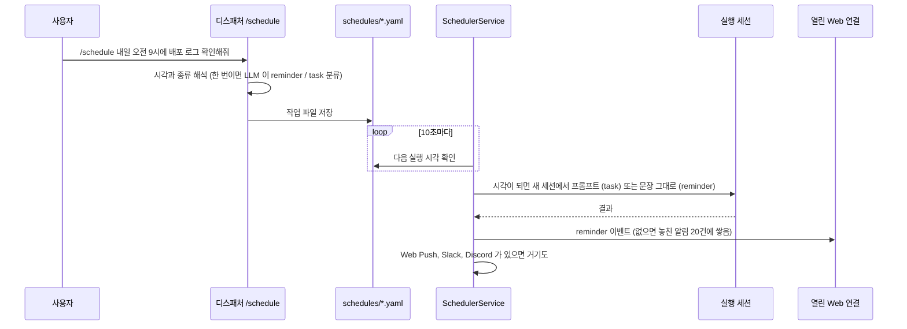
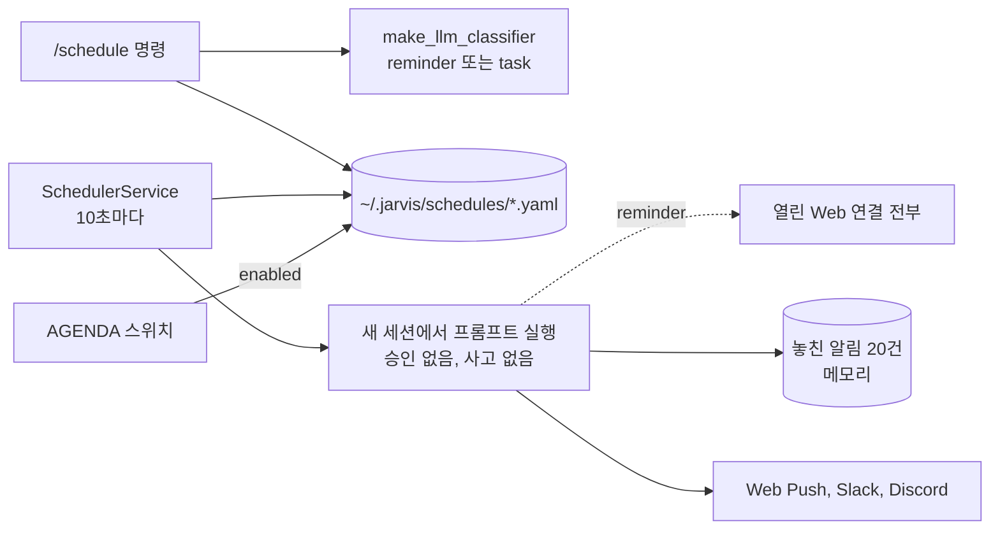

import FigureScheduling from '@site/src/figures/scheduling.svg';

# Scheduling

<figure className="paper-fig">
  <FigureScheduling />
  <figcaption><b>Figure 1.</b> /schedule 문장은 한 번, 마감까지 반복, cron 셋 중 하나로 해석되어 작업 파일로 남는다. SchedulerService 가 10초마다 깨어나 시각이 된 작업을 처리한다. reminder 는 문장을 그대로 알리고, task 는 승인 없는 새 세션에서 실행한 뒤 결과를 세 곳으로 보낸다.</figcaption>
</figure>

JARVIS 는 정한 시각에 알림이나 작업을 돌린다. 한 번, 마감까지 반복, cron 세 가지로 등록하고 AGENDA 카드에서 켜고 끈다.

```text
/schedule 내일 오전 9시에 배포 로그 확인해줘      # 한 번
/schedule 2026.10.20 오후 6시까지 보고서 초안 작성   # 마감까지 반복
/schedule 0 9 * * * date && uptime                  # cron
```



- 한 번 실행(`...에`): LLM 분류기에 `reminder`(그 문장을 그대로 알림)인지 `task`(프롬프트를 실행)인지 한 번 묻는다. 분류에 실패하면 reminder 로 둔다
- 마감까지 반복(`...까지`): 남은 시간으로 주기를 고른다. 7일 이상이면 매일 9시, 하루 이상이면 6시간마다, 1시간 이상이면 매시, 그 아래는 10분마다
- 말로 예약: 대화에서 "1분 뒤에 알려줘" 라고 하면 에이전트가 `schedule` 도구로 `/schedule` 과 같은 일정을 만든다. 같은 요청을 두 번 하면 알림도 두 개다
- 파일: 작업은 `~/.jarvis/schedules/<name>.yaml` 에 저장한다. 켜고 끄면 `enabled` 키만 바뀐다. 한 번 실행을 마친 작업은 스케줄러가 파일을 지우거나 `enabled: false` 로 바꾼다
- 실행: 스케줄러는 10초마다 깨어나 새 세션에서 프롬프트를 돌린다. 이 세션은 빈 메모리 체인을 쓰고 사고 엔진이 없다. 늦게 켜져 지난 일정은 기동 때 `delayed_sec` 를 달고 실행된다
- 에이전트: 작업 파일의 `agent` 가 main 이 아니면 그 에이전트의 모델, 시스템 프롬프트, 도구(정의의 `tools`)로 돈다. `tools_allowed` 는 그 도구 안에서 다시 고른다
- 도구 작업(`kind: tool`): 프롬프트 없이 `tool` 을 `args` 로 바로 부르고 그 글을 알린다. LLM 을 부르지 않는다. 도구가 빈 글을 주면 알리지 않는다. 파일로만 만든다
- 전하는 곳(`deliver`): `notice`(기본)는 아래 전달 방식대로 스케줄 알림으로, `conversation` 은 그 에이전트의 대화 세션에 에이전트의 말로 건넨다(아래 새 공고 예)
- 전달: 열린 Web 연결 전부에 `reminder` 이벤트를 보낸다. 아무도 없으면 최근 20건을 쌓아 두었다가 다음 접속 때 `missed: true` 로 보낸다. Web Push, Slack, Discord 가 있으면 거기에도 보낸다. 푸시 제목은 보낸 에이전트의 색 원과 이름이다(예: `🟢 K.A.R.E.N.`, 본문은 `⏰ 작업 이름` 다음 줄부터)

새 LH 공고를 매일 아침 알리는 도구 작업. KAREN 의 `housing_watch` 가 지역마다 본 공고를 기억해 새로 올라온 것 중 주거 프로필로 신청 가능성이 있는 것만 준다. 처음 한 번은 지금 공고중인 것 중 신청 가능성이 있는 것을 전부 알린다.

```yaml
# ~/.jarvis/schedules/housing-watch.yaml
name: housing-watch
description: 새 LH 공고
schedule: "0 9 * * *"
kind: tool
agent: karen
tool: housing_watch
args: {regions: "서울,경기", quiet: true}
prompt: ""
```

`regions` 를 빼면 주거 프로필의 관심 지역으로 찾는다.

공고는 하루 중에도 올라온다. LH 와 SH 는 새 공고를 밖으로 알려 주는 webhook 이나 RSS 가 없어서, 게시판을 자주 보는 것이 가장 빨리 잡는 방법이다. 한 번 보는 데 목록 요청 6번(LH 4, SH 2), 5초쯤 걸린다. 그래서 평일 근무 시간은 5분마다, 그 밖에는 매시 본다. 5분마다면 시간당 72번 요청이라 사람이 게시판을 새로고침하는 정도다.

작업들은 본 공고 기록(사용자와 지역이 키)을 같이 써서 한쪽이 알린 공고를 다른 쪽이 다시 알리지 않는다. 다만 같은 분에 둘이 함께 돌면 둘 다 새 공고로 볼 수 있어 시각이 겹치지 않게 나눈다. `quiet: true` 라 새 공고가 없으면 아무것도 보내지 않는다.

| 파일 | `schedule` | 언제 |
|---|---|---|
| `housing-daily.yaml` | `55 8 * * *` | 매일 아침 한 번(실시간 감시보다 5분 먼저) |
| `housing-realtime.yaml` | `*/5 9-18 * * 1-5` | 평일 9시~18시 55분, 5분마다 |
| `housing-evening.yaml` | `0 19-22 * * 1-5` | 평일 저녁 매시 |
| `housing-weekend.yaml` | `0 10-22 * * 0,6` | 주말 낮 매시 |

```yaml
# ~/.jarvis/schedules/housing-realtime.yaml
name: housing-realtime
description: 새 LH, SH 공고(평일 근무 시간 5분마다)
schedule: "*/5 9-18 * * 1-5"
kind: tool
agent: karen
tool: housing_watch
args: {regions: "서울,경기", quiet: true}
deliver: conversation
prompt: ""
```

`deliver: conversation` 이면 결과를 스케줄 알림이 아니라 KAREN 의 말로 건넨다. 사용자가 KAREN 과 가장 최근에 대화한 세션에 먼저 건네는 말로 들어가 대화 기록에 남으므로, 이어서 "그거 자세히 알려줘" 라고 물을 수 있다. 화면에는 KAREN 의 말로 보이고, 음성이면 하던 말이 끝난 뒤 읽고, Web Push 로도 간다. 사용자가 그 에이전트와 대화한 세션이 아직 없거나(재시작 직후 포함), Focus 중이거나, 답하는 중이 2분 넘게 이어지면 지금처럼 스케줄 알림(`reminder`)으로 보낸다.

:::danger

스케줄 실행 세션은 승인 없는 샌드박스를 쓴다. 스케줄 작업이 부르는 도구는 사람에게 묻지 않고 실행된다.

:::

:::warning

놓친 알림은 프로세스 메모리에만 쌓인다. 재시작하면 사라진다.

:::

## 설계 노트

### 한 번 실행 작업은 먼저 내리고 실행한다

정한 시각에 한 번 울리는 작업(`run_at`)은 실행하기 전에 목록과 저장 파일에서 먼저 내린다. 실행 도중 서버가 죽었다가 다시 뜨면, 실행 뒤에 내리는 순서에서는 같은 알림이 두 번 울린다. 먼저 내리면 최악의 경우 한 번도 안 울리지만, 알림을 두 번 받는 것보다 덜 거슬린다고 판단했다. 서버가 꺼져 있는 동안 지난 작업은 켜지는 즉시 보내고, 얼마나 늦었는지(`delayed_sec`)를 함께 넘긴다.

### 사용자가 쓴 파일은 지우지 않는다

실행이 끝난 작업 파일 중 스케줄러가 만든 것(`<name>.yaml`)은 지우고, 사람이 직접 쓴 파일은 지우지 않고 `enabled: false` 로만 바꾼다. 사람이 쓴 파일에는 주석이나 메모가 있을 수 있어서다.

### 결과는 화면이 없어도 간다

예전에는 cron 작업의 결과가 그 작업이 돈 세션에만 남고 화면에 오지 않았다. 결과를 알림 콜백 하나로 모아, 열린 화면 전부에 보내고, 열린 화면이 없으면 최근 20건을 쌓아 다음 접속 때 `missed` 로 보낸다. Web Push, Slack, Discord 가 설정돼 있으면 같은 결과가 그쪽으로도 간다.

## 구현 위치

왼쪽이 사용자와 화면, 가운데가 코드 모듈, 오른쪽이 저장소다. 화살표는 호출이나 데이터의 방향이다.



- 핵심 모듈: `core/scheduler/`
- 저장: `~/.jarvis/schedules/*.yaml`
