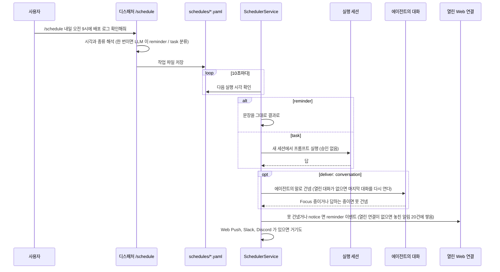
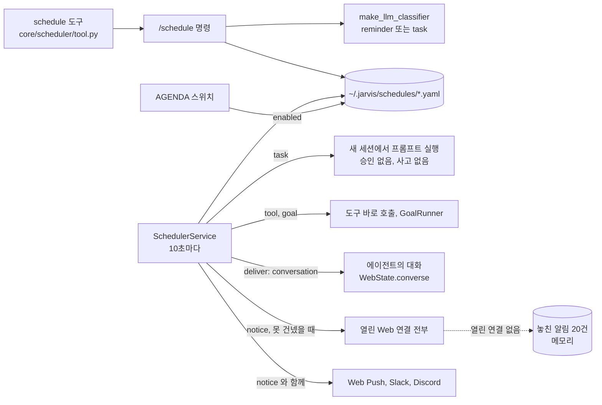

import FigureScheduling from '@site/src/figures/scheduling.svg';
import FigureExpScheduling from '@site/src/figures/exp-scheduling.svg';

# Scheduling

JARVIS 는 정한 시각에 알림이나 작업을 돌린다. 사용자가 화면 앞에 없어도 결과가 대화나 알림으로 닿게 해서, "내일 9시에 알려줘" 를 잊지 않고 지키게 한다.

<figure className="paper-fig">
  <FigureScheduling />
  <figcaption><b>Figure 1.</b> /schedule 문장(1)은 한 번(…에) 또는 마감까지 반복(…까지)으로 해석되어 작업 파일로 남는다(2). 대화 중에는 schedule 도구가 같은 길로 들어온다. cron 과 tool 작업은 파일에 직접 쓰고, goal 작업은 /goal 이 만든다. SchedulerService 가 10초마다 깨어나(3) 시각이 된 작업을 종류대로 처리한다. reminder 는 문장을 그대로, task 는 승인 없는 새 세션에서 실행한 답을, tool 은 도구 글을, goal 은 목표 한 차례의 결과를 낸다. `deliver: conversation` 이면 그 에이전트의 대화에 에이전트의 말로 건네고(4), 건네지 못하면 알림으로 보낸다. 알림은 열린 Web 연결 전부로 가고, 열린 연결이 없으면 놓친 알림으로 쌓이며, Web Push, Slack, Discord 가 설정돼 있으면 거기로도 간다.</figcaption>
</figure>

## 서비스 기능

### 풀려는 문제

"내일 오전 9시에 배포 로그 확인해줘" 라고 말해 두고 노트북을 닫는다. 다음 날 9시에 화면이 열려 있지 않으면 알림은 어디로 가야 할까. 새 LH 공고처럼 하루 중 언제 올라올지 모르는 것은, 사람이 게시판을 계속 새로고침하지 않고도 올라오자마자 알고 싶다.

### 무엇을 하나

`/schedule` 로는 한 번과 마감까지 반복 두 가지를 등록하고, cron 주기는 작업 파일에 직접 쓴다. AGENDA 카드에서 켜고 끈다.

```text
/schedule 내일 오전 9시에 배포 로그 확인해줘      # 한 번
/schedule 2026.10.20 오후 6시까지 보고서 초안 작성   # 마감까지 반복
```

| 상황 | JARVIS 가 하는 일 |
|---|---|
| "…에" 로 한 번 예약한다 | 그 시각에 문장을 그대로 알리거나, 프롬프트를 실행해 답을 알린다 |
| "…까지" 로 마감을 준다 | 남은 시간에 맞는 주기로 반복하다가 마감이 지나면 멈춘다 |
| 대화 중에 "1분 뒤에 알려줘" 라고 한다 | 에이전트가 같은 일정을 만든다 |
| 주기마다 도구 결과만 받고 싶다 | 모델 없이 도구를 바로 불러 그 글을 알린다(예: 새 LH 공고) |
| 결과를 에이전트와 이어 이야기하고 싶다 | 결과를 그 에이전트의 말로 대화에 넣어, 이어서 물을 수 있게 한다 |
| 화면이 닫혀 있다 | 놓친 알림으로 쌓았다가 다음 접속 때 보내고, Web Push, Slack, Discord 로도 보낸다 |
| 서버가 꺼져 있다가 켜진다 | 지난 한 번 실행 작업은 늦은 시간을 달고 바로 보낸다 |

### 핵심 결과

- 알림 채널이 실패해도 새 공고를 놓치지 않는다. 알림 실패율 10% 와 30% 에서 #197 전에는 공고의 9.6% 와 29.4% 를 끝내 알리지 못했고, 지금은 0% 다. 같은 공고를 두 번 알린 경우는 0건이다

## 세부 구현

### 동작 흐름



1. `/schedule` 이나 `schedule` 도구가 시각과 종류를 해석해 작업 파일을 쓴다
2. SchedulerService 가 10초마다 깨어나 시각이 된 작업을 고른다
3. 종류대로 글을 만든다(reminder 는 문장, task 는 새 세션의 답, tool 은 도구 글, goal 은 목표 한 차례의 결과)
4. `deliver` 대로 대화에 건네거나 알림으로 보낸다
5. 전달 결과를 받는 도구(`housing_watch`)와 목표에는 건넸는지를 알려(settle), 건넨 것만 처리한 것으로 적게 한다

### 설계 결정

#### 한 번 실행 작업은 먼저 내리고 실행한다

정한 시각에 한 번 울리는 작업(`run_at`)은 실행하기 전에 목록과 저장 파일에서 먼저 내린다. 실행 도중 서버가 죽었다가 다시 뜨면, 실행 뒤에 내리는 순서에서는 같은 알림이 두 번 울린다. 먼저 내리면 최악의 경우 한 번도 안 울리지만, 알림을 두 번 받는 것보다 덜 거슬린다고 판단했다. 서버가 꺼져 있는 동안 지난 작업은 켜지는 즉시 보내고, 얼마나 늦었는지(`delayed_sec`)를 함께 넘긴다.

#### 사용자가 쓴 파일은 지우지 않는다

실행이 끝난 작업 파일 중 스케줄러가 만든 것(`<name>.yaml`)은 지우고, 사람이 직접 쓴 파일은 지우지 않고 `enabled: false` 로만 바꾼다. 사람이 쓴 파일에는 주석이나 메모가 있을 수 있어서다.

#### 결과는 화면이 없어도 간다

예전에는 cron 작업의 결과가 그 작업이 돈 세션에만 남고 화면에 오지 않았다. 결과를 알림 콜백 하나로 모아, 열린 화면 전부에 보내고, 열린 화면이 없으면 최근 20건을 쌓아 다음 접속 때 `missed` 로 보낸다. Web Push, Slack, Discord 가 설정돼 있으면 같은 결과가 그쪽으로도 간다.

#### 본 것은 건넨 뒤에 적는다

`housing_watch` 가 도구를 부를 때 새 공고를 바로 본 것으로 적으면, 알림이 실패한 공고는 다시 오지 않는다. 그래서 스케줄러가 한 번 실행을 마치고 건넸는지(대화나 알림)를 도구에 알려 준 뒤에야 본 것으로 적는다. 못 건넸으면 버려 다음 차례에 다시 고른다. 적을 때는 그 사이 다른 작업이 적은 목록을 덮지 않게 지금 저장된 목록에 더한다.

### 작업 규칙

- 한 번 실행(`...에`): LLM 분류기에 `reminder`(그 문장을 그대로 알림)인지 `task`(프롬프트를 실행)인지 한 번 묻는다. 분류에 실패하면 reminder 로 둔다
- 마감까지 반복(`...까지`): 남은 시간으로 주기를 고른다. 7일 이상이면 매일 9시, 하루 이상이면 6시간마다, 1시간 이상이면 매시, 그 아래는 10분마다. 마감(`run_until`)이 지나면 스케줄러가 작업을 끄고 작업 파일의 `enabled` 도 `false` 로 바꾼다. 메모리에서만 끄면 재시작 때 다시 켜지기 때문이다
- 말로 예약: 대화에서 "1분 뒤에 알려줘" 라고 하면 에이전트가 `schedule` 도구로 `/schedule` 과 같은 일정을 만든다. 같은 요청을 두 번 하면 알림도 두 개다
- 파일: 작업은 `~/.jarvis/schedules/<name>.yaml` 에 저장한다. 켜고 끄면 `enabled` 키만 바뀐다. 한 번 실행을 마친 작업은 스케줄러가 파일을 지우거나 `enabled: false` 로 바꾼다
- 실행: 스케줄러는 10초마다 깨어나 새 세션에서 프롬프트를 돌린다. 이 세션은 빈 메모리 체인을 쓰고 사고 엔진이 없다. 서버가 꺼져 있는 동안 지난 한 번 실행 작업은 켜지는 즉시 `delayed_sec` 를 달고 실행된다. cron 작업은 직전 슬롯이 60초 안일 때만 돌므로, 꺼져 있던 동안의 슬롯은 건너뛴다
- 에이전트: 작업 파일의 `agent` 가 main 이 아니면 그 에이전트의 모델, 시스템 프롬프트, 도구(정의의 `tools`)로 돈다. `tools_allowed` 는 그 도구 안에서 다시 고른다
- 도구 작업(`kind: tool`): 프롬프트 없이 `tool` 을 `args` 로 바로 부르고 그 글을 알린다. LLM 을 부르지 않는다. 도구가 빈 글을 주면 알리지 않는다. 파일로만 만든다
- 목표 작업(`kind: goal`): `/goal` 이나 `goal` 도구가 만든다. 그 목표를 한 차례 진행하고 새로 알릴 것이 있을 때만 알린다([Goals](./goals.md))
- 경계: 에이전트 정의의 `boundaries.ask` 도구는 사람이 없는 작업(`task`, `goal`)에서 빠진다. 물을 사람이 없어서다
- 위험 명령: 사람이 없는 작업에도 위험 명령 패턴 검사는 그대로 걸린다. 승인 대상만 비워 두었다. 도구 작업의 호출이 위험 명령으로 보이면 실행하지 않고 알리지도 않는다
- 전하는 곳(`deliver`): `notice`(기본)는 아래 전달 방식대로 스케줄 알림으로, `conversation` 은 그 에이전트의 대화 세션에 에이전트의 말로 건넨다(아래 새 공고 예)
- 전달: 열린 Web 연결 전부에 `reminder` 이벤트를 보낸다. 아무도 없으면 최근 20건을 쌓아 두었다가 다음 접속 때 `missed: true` 로 보낸다. Web Push, Slack, Discord 가 있으면 거기에도 보낸다. 푸시 제목은 보낸 에이전트의 색 원과 이름이다(예: `🟢 K.A.R.E.N.`, 본문은 `⏰ 작업 이름` 다음 줄부터)

:::danger

스케줄 실행 세션은 승인 없는 샌드박스를 쓴다. 스케줄 작업이 부르는 도구는 사람에게 묻지 않고 실행된다.

:::

### 예: 새 LH 공고 알리기

새 LH 공고를 매일 아침 알리는 도구 작업. KAREN 의 `housing_watch` 가 지역마다 본 공고를 기억해 새로 올라온 것 중 주거 프로필로 신청 가능성이 있는 것만 준다. 처음 한 번은 지금 공고중인 것 중 신청 가능성이 있는 것을 전부 알린다.

```yaml
# ~/.jarvis/schedules/housing-watch.yaml
name: housing-watch
description: 새 LH 공고
schedule: "0 9 * * *"
kind: tool
agent: karen
tool: housing_watch
args: {regions: "서울,경기", quiet: true}
prompt: ""
```

`regions` 를 빼면 주거 프로필의 관심 지역으로 찾는다.

공고는 하루 중에도 올라온다. LH 와 SH 는 새 공고를 밖으로 알려 주는 webhook 이나 RSS 가 없어서, 게시판을 자주 보는 것이 가장 빨리 잡는 방법이다. 한 번 보는 데 목록 요청 6번(LH 4, SH 2), 5초쯤 걸린다. 그래서 평일 근무 시간은 5분마다, 그 밖에는 매시 본다. 5분마다면 시간당 72번 요청이라 사람이 게시판을 새로고침하는 정도다.

작업들은 본 공고 기록(사용자와 지역이 키)을 같이 써서 한쪽이 알린 공고를 다른 쪽이 다시 알리지 않는다. 다만 같은 분에 둘이 함께 돌면 둘 다 새 공고로 볼 수 있어 시각이 겹치지 않게 나눈다. `quiet: true` 라 새 공고가 없으면 아무것도 보내지 않는다. 새 공고는 알림이나 대화로 건넨 뒤에야 본 것으로 적는다. 알림 채널이 실패하면 다음 차례에 같은 공고를 다시 알린다.

| 파일 | `schedule` | 언제 |
|---|---|---|
| `housing-daily.yaml` | `55 8 * * *` | 매일 아침 한 번(실시간 감시보다 5분 먼저) |
| `housing-realtime.yaml` | `*/5 9-18 * * 1-5` | 평일 9시~18시 55분, 5분마다 |
| `housing-evening.yaml` | `0 19-22 * * 1-5` | 평일 저녁 매시 |
| `housing-weekend.yaml` | `0 10-22 * * 0,6` | 주말 낮 매시 |

```yaml
# ~/.jarvis/schedules/housing-realtime.yaml
name: housing-realtime
description: 새 LH, SH 공고(평일 근무 시간 5분마다)
schedule: "*/5 9-18 * * 1-5"
kind: tool
agent: karen
tool: housing_watch
args: {regions: "서울,경기", quiet: true}
deliver: conversation
prompt: ""
```

`deliver: conversation` 이면 결과를 스케줄 알림이 아니라 KAREN 의 말로 건넨다. 사용자가 KAREN 과 가장 최근에 대화한 세션에 먼저 건네는 말로 들어가 대화 기록에 남으므로, 이어서 "그거 자세히 알려줘" 라고 물을 수 있다. 화면에는 KAREN 의 말로 보이고, 음성이면 하던 말이 끝난 뒤 읽고, Web Push 로도 간다. 지금 열린 대화가 없으면(재시작 직후 포함) 저장된 마지막 대화를 다시 열어 건네고, 그것도 없으면 새 대화를 만든다. Focus 중이거나 답하는 중이 2분 넘게 이어지면 스케줄 알림(`reminder`)으로 보낸다.

### 한계

:::warning

놓친 알림은 프로세스 메모리에만 쌓인다. 재시작하면 사라진다.

:::

- 한 번 실행 작업은 먼저 내리고 실행하므로, 실행 도중 서버가 죽으면 그 알림은 한 번도 울리지 않을 수 있다
- cron 작업은 서버가 꺼져 있던 동안의 슬롯을 건너뛴다
- 말로 같은 예약을 두 번 하면 알림도 두 개다
- 같은 분에 도는 두 `housing_watch` 작업은 같은 공고를 둘 다 새 공고로 볼 수 있다. 그래서 시각을 나눠 둔다

### 구현 위치

왼쪽이 사용자와 화면, 가운데가 코드 모듈, 오른쪽이 저장소다. 화살표는 호출이나 데이터의 방향이다.



- 핵심 모듈: `core/scheduler/`
- 저장: `~/.jarvis/schedules/*.yaml`

## 성능 비교실험

### 알림이 실패할 때 놓친 공고

- **질문**: 알림 채널이 일정 확률로 실패할 때, 새 공고 중 끝내 사용자에게 가지 않는 것이 얼마나 되나
- **설정**: 실제 `SchedulerService` 의 도구 작업과 실제 `HousingWatchTool`, `SeenStore`(임시 디렉터리), 실제 자격 규칙을 썼다. LH 게시판은 하루 0~2건의 국민임대 공고를 올리고 14일 뒤 마감하는 가짜다. 프로필은 연소득 3,600만 원 1인 가구, 알림은 확률 p 로 예외를 던진다. 60일 동안 공고를 올리고 14일을 더 돌려 하루 한 번 실행했다. 시드 20개, 공고 1,198건이다. 공고 생성과 알림 실패는 따로 난수를 써서 두 코드가 같은 공고를 본다. 본 것으로 먼저 적던 #197 전 코드(b3b2b0b)와 지금 코드를 비교했다
- **결과**:

<figure className="paper-fig">
  <FigureExpScheduling />
  <figcaption><b>Figure 2.</b> #197 전에는 놓친 공고 비율이 알림 실패율을 거의 그대로 따라간다. 지금은 실패한 알림의 공고가 본 것으로 적히지 않아 다음 날 다시 가므로 0% 다.</figcaption>
</figure>

| 알림 실패율 | #197 전 놓친 공고 | 지금 놓친 공고 | 알림 실패 횟수(전, 지금) |
|---|---|---|---|
| 0% | 0 / 1,198 | 0 / 1,198 | 0, 0 |
| 10% | 115 (9.6%) | 0 | 73, 73 |
| 30% | 352 (29.4%) | 0 | 234, 264 |

- **해석**: 놓치는 원인은 알리기 전에 본 것으로 적는 순서 하나였다. 순서를 건넨 뒤로 옮기자 실패한 알림이 다음 차례에 다시 시도되고, 두 번 알리는 일도 생기지 않았다
- **한계**: 게시판, 알림, 프로필은 가짜이고 실패는 서로 독립인 동전 던지기다. 한 번에 새 공고가 10건을 넘지 않아 목록 자르기(`MAX_LISTED`)는 일어나지 않았다. 대화에서 `housing_watch` 를 부르는 경로는 지금도 바로 본 것으로 적고, 이 실험에 넣지 않았다
- **재현**: `uv run python scripts/experiments/housing_delivery.py --label <코드 이름>`
