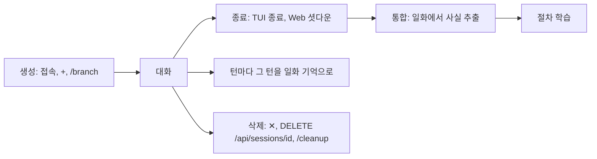
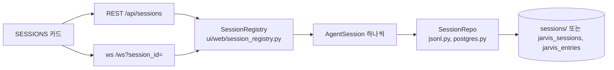

import FigureSessions from '@site/src/figures/sessions.svg';

# Sessions

<figure className="paper-fig">
  <FigureSessions />
  <figcaption><b>Figure 1.</b> (a) 세션은 에이전트 하나의 대화 한 줄기다. 분기는 부모의 메시지(U 사용자, A 어시스턴트, T 도구)를 복사한 새 세션을 만든다. Web 의 ⑂ 는 jsonl 저장소에서만 복사하고, 다른 저장소면 parent_id 없는 빈 새 세션을 연다. 턴마다 그 턴이 일화 기억이 되고, 종료 때 통합이 일화에서 사실을 뽑는다. (b) 사용자 메시지는 턴 시작 때, 나머지는 루프가 끝난 뒤 한꺼번에 저장된다.</figcaption>
</figure>

세션은 JARVIS 가 대화 한 줄기를 묶어 저장하는 단위다. 세션은 만들 때 에이전트가 정해지고, 그 뒤로 바뀌지 않는다.

`agent_layer/session/` 의 저장소 프로토콜(`create`, `list`, `get_messages`, `append`, `delete`, `create_branch`) 위에 두 구현이 있다.

| 백엔드 | 설정 | 저장 |
|---|---|---|
| JSONL (기본) | `JARVIS_SESSION__PERSISTENCE_BACKEND=jsonl`, `SESSIONS_DIR` | `~/.jarvis/sessions/<id>.jsonl` 에 append, `<id>.meta.json` 에 메타 |
| Postgres | `postgres`, `POSTGRES_DSN` | `jarvis_sessions`, `jarvis_entries`(세션 삭제 시 cascade). 테이블과 컬럼은 기동 때 `IF NOT EXISTS` 로 맞춘다. 기록은 `timestamp, seq` 순으로 읽는다. 한 턴의 tool_result 와 다음 응답이 같은 ms 에 저장되므로 삽입 순번(`seq`)이 순서를 정한다 |

`create` 는 멱등하다. 같은 id 로 두 번 만들어도 세션은 하나다. 사용자 메시지는 턴 시작 때 바로 저장되고, 어시스턴트와 도구 메시지는 루프가 끝난 뒤 한꺼번에 저장된다.

:::warning
어시스턴트와 도구 메시지는 루프가 끝나야 저장된다. 루프 도중에 프로세스가 죽으면 그 턴의 사용자 메시지만 남는다.
:::

## 한 세션에 한 요청

세션은 요청을 하나씩 처리한다. 처리 중에 온 요청은 "이전 요청을 아직 처리 중입니다" 로 거절한다(중단하려면 abort). 화면은 `agent_end` 를 받자마자 다음 말을 보낼 수 있는데, 그때 세션은 대화 저장 같은 마무리를 하는 중일 수 있다(수백 ms). 그래서 바로 거절하지 않고 마무리를 최대 3초(`BUSY_GRACE_SEC`) 기다렸다가 받는다. 그 안에 끝나지 않는 긴 작업이면 그때 거절한다.

## 분기

분기는 `/branch [session_id]`, TUI 의 `Ctrl+F`, Web 의 ⑂ 로 만든다. 분기는 부모의 메시지를 전부 복사한 새 세션을 만들고 `parent_id` 를 남긴다. 포인터가 아니라 복사이므로 이후 변경은 서로 전파되지 않는다. `/branch` 는 jsonl 과 Postgres 모두에서 복사한다. Web 의 ⑂(`POST /api/sessions/{id}/branch`)는 jsonl 에서만 복사하고, 다른 저장소면 같은 에이전트의 빈 새 세션을 열고 `parent_id` 를 null 로 돌려준다.

Web 의 SESSIONS 카드는 지금 프로세스가 띄운 세션만 보여준다. 다른 세션은 `/sessions` 나 `jarvis --list-sessions` 로 본다.

## 생애

Web 의 `DELETE /api/sessions/{id}` 는 메모리 세션, 샌드박스, 승인 브로커, 저장소를 같이 지운다. 붙어 있는 연결이 있으면 409 를 돌려준다. 없는 세션을 지워도 200 을 돌려준다.

:::danger
세션 삭제는 저장소의 기록까지 지우므로 되돌릴 수 없다. 남겨 둘 대화는 먼저 `/export md|json` 으로 내보낸다.
:::

## 서브 에이전트 세션

멀티 에이전트의 서브 에이전트도 세션을 가진다. 세션 id 는 정의의 `memory.stm` 에 따라 정해진다.

| 정책 | 세션 id | 뜻 |
|---|---|---|
| `per_parent_session`(기본) | `agent_<name>__<부모 세션>` | 부모 세션마다 하나 |
| `per_task` | `agent_<name>__task_<id>` | 호출 뒤 삭제 |
| `per_agent` | `agent_<name>` | 에이전트당 하나, 영속 |

## 세션 관련 명령

- `/sessions`: 세션 목록을 보여준다. 분기한 세션에는 `← parent` 가 붙는다
- `/export md|json`: 지금 세션을 `~/.jarvis/exports/` 로 내보낸다
- `/cost`: 토큰 사용량과 모델별 추정 비용을 보여준다
- `/compact`: 지금까지의 대화를 요약해 장기 기억에 저장한다
- `/cleanup`: 옛 서브 에이전트 세션, 옛 STM 테이블, 시험 흔적을 보여주고, `agents confirm`, `stm confirm`, `tests confirm` 으로 지운다

## 시험 세션

실험, 라이브 점검, 스모크 테스트가 여는 세션은 `test-` 로 시작한다(예전 것은 `live-`, `probe-`, `exp-` 등. 목록은 `agent_layer/session/protocol.py` 의 `TEST_SESSION_PREFIXES`). 시험 세션은 이렇게 다르다.

- 먼저 건네는 말이 밖(푸시, Discord)으로 가지 않는다. 라이브 점검이 사용자 폰에 실제 알림을 보낸 일이 있어서다
- 목표와 스케줄 결과를 건넬 대화를 고를 때 빠진다
- `/cleanup tests confirm` 이 세션과 그 세션이 남긴 장기 기억, 작업 기억을 함께 지운다. 기억을 먼저 지워 중간에 죽어도 다시 실행하면 남은 것만 지운다

## 설계 노트

### tool_call 과 결과는 늘 짝으로 남긴다

LLM 프로바이더는 "도구 호출이 있으면 바로 뒤에 그 결과가 있어야 한다" 를 엄격하게 검사한다. 짝이 하나라도 어긋난 기록으로는 그 세션을 다시 열 수 없다(OpenAI 400, Anthropic 400). 이 규칙을 지키려고 세 번 고쳤다.

| 시기 | 깨진 경우 | 고친 방법 |
|---|---|---|
| 초기 | 루프가 마지막 응답만 저장해, 재개하면 앞 턴의 도구 호출이 결과 없이 남았다 | 루프가 쌓은 메시지(호출, 결과, 응답)를 전부 저장한다 |
| 초기 | 최대 턴 소진, 중단, 실행기 없음으로 루프가 끊기면 호출만 남았다 | 루프가 끝날 때 결과 없는 호출에 오류 결과를 붙여 닫는다 |
| 최근 | Postgres 에서 한 턴의 메시지가 같은 ms 에 저장돼, `timestamp` 정렬만으로는 조회 때마다 순서가 섞였다. 병렬 도구 호출 둘의 결과 사이에 다음 응답이 끼면서 400 이 났다 | `seq` 삽입 순번 칼럼을 `ADD COLUMN IF NOT EXISTS` 로 더하고 `timestamp, seq` 로 읽는다 |

마지막 문제는 앞선 턴은 잘 열리다가 어느 순간 깨져서 찾기 어려웠다. 같은 ms 의 행들이 우연히 바른 순서로 읽히는 동안에는 드러나지 않았기 때문이다. 고친 직후 문제의 세션을 다시 읽어 보니 메시지 29개의 호출과 결과가 모두 짝이 맞았고, 기존 행은 물리 순서대로 순번을 받아 손으로 고칠 것이 없었다.

### 만들기는 멱등, 분기는 복사

`create` 는 같은 id 로 두 번 불러도 세션이 하나다. 화면이 재접속하며 같은 세션을 다시 만들어도 중복이 생기지 않는다. 분기는 부모를 가리키는 포인터가 아니라 메시지 복사다. 포인터로 두면 부모를 지우거나 고칠 때 분기가 함께 바뀐다. 저장 공간을 더 쓰는 대신 분기를 독립적으로 만들었다.

## 구현 위치

왼쪽이 사용자와 화면, 가운데가 코드 모듈, 오른쪽이 저장소다. 화살표는 호출이나 데이터의 방향이다.

- 핵심 모듈: `agent_layer/session/`
- 저장: jsonl 또는 Postgres
