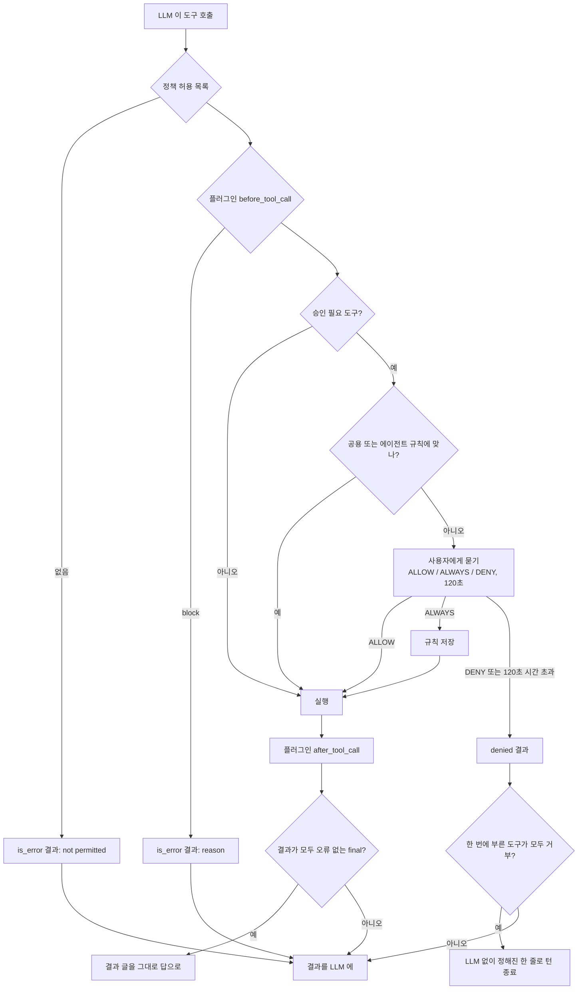
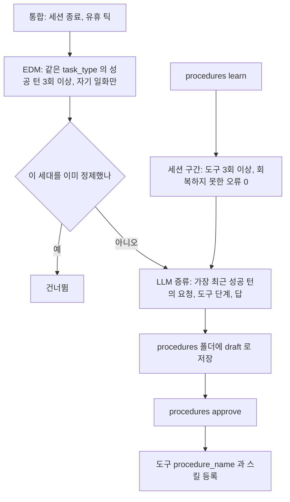
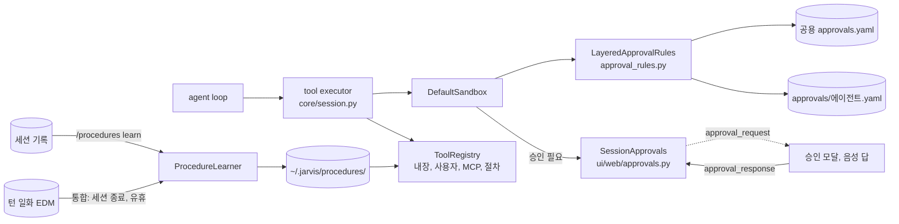

import FigureToolsAndApproval from '@site/src/figures/tools-and-approval.svg';
import FigureExpApproval from '@site/src/figures/exp-approval.svg';

# Tool & Approve System

<figure className="paper-fig">
  <FigureToolsAndApproval />
  <figcaption><b>Figure 1.</b> 도구 호출 한 번은 허용 목록, 플러그인, 승인 순으로 검사한다. 승인이 필요하면 공용 또는 에이전트별 규칙을 먼저 보고, 맞는 규칙이 없을 때만 사람에게 묻는다. ALWAYS 는 지금 에이전트의 규칙 파일에 패턴을 남긴다. 허용 목록과 플러그인의 거부는 is_error 결과로 LLM 에 돌아가고 루프가 이어진다. 사람이 거부했거나 시간이 지나 한 번에 부른 도구가 모두 거부되면 LLM 을 다시 부르지 않고 정해진 한 줄로 턴을 끝낸다. 결과가 모두 오류 없는 final 이면 그 글을 그대로 답으로 쓴다.</figcaption>
</figure>

에이전트는 도구로만 파일, 셸, 웹에 접근한다. 도구는 `core/tools/` 의 레지스트리에 모이고, 위험할 수 있는 도구는 실행 전에 `core/policy/sandbox.py` 가 사람에게 승인을 묻는다.

## 내장 도구

| 도구 | 하는 일 | 승인 |
|---|---|---|
| `bash` | 셸 명령. 기본 타임아웃 30초 | 필요 |
| `write_file` | 파일 쓰기. 부모 디렉토리 생성, 덮어쓰기 | 필요 |
| `edit_file` | 문자열 정밀 교체 | 필요 |
| `read_file` | 라인 범위 읽기 | |
| `glob` | 패턴으로 파일 찾기, 최근 수정순 | |
| `grep` | 정규식 검색, 바이너리 건너뜀 | |
| `list_dir` | 디렉토리 나열 | |
| `web_search` | Brave(키 있으면) 또는 DuckDuckGo | |
| `web_fetch` | URL 본문을 텍스트로 | |

`lh_notice`, `sh_notice`, `housing_loan`, `housing_budget` 은 에이전트만 쓰는 도구다. 앱 레지스트리에 넣지 않고, 에이전트 정의의 `tools` 에 이름을 적은 에이전트만 받는다([청약 공고와 대출 계산](../../agents/karen/housing.md)).

`remember_task_pattern` 과 `recall_episodes` 는 모든 에이전트가 쓰는 메모리 도구다. 앞의 것은 사용자가 알려 준 작업 방식을 도구를 부른 에이전트의 작업 패턴으로 저장하고([Memory Management → 작업 패턴](../memory.md#작업-패턴)), 뒤의 것은 그 에이전트의 지난 턴 일화를 조건으로 골라 읽는다.

실행 중에 동적으로 더해지는 도구도 있다. `orchestrate` 와 `agent_<name>`(에이전트 정의가 있을 때), `procedure_<name>`(승인된 절차), MCP 서버의 도구, `~/.jarvis/tools/` 의 사용자 도구가 그렇다. 사용자 도구와 MCP 도구는 같은 이름의 내장 도구를 덮어쓴다. 도구 목록은 턴마다 레지스트리에서 다시 읽으므로, 실행 중에 등록된 도구(승인된 절차 등)는 재시작 없이 보인다. `~/.jarvis/tools/` 에 파일을 더한 경우는 기동 때만 읽으므로 재시작한다.

## 도구 호출 한 번



거부는 예외로 처리하지 않는다. 한 번의 호출에서 요청한 도구가 모두 승인을 받지 못하면, 루프는 LLM 에 다시 묻지 않고 정해진 한 줄로 턴을 끝낸다. 다시 물으면 모델이 "터미널에서 직접 이렇게 하세요" 처럼 방법 안내로 빠지기 때문이다. 일부만 거부됐으면 LLM 이 나머지 결과로 답을 이어 간다.

같은 자리에서 도구가 결과를 `final` 로 표시하면, 한 번에 부른 결과가 모두 오류 없는 `final` 일 때 루프는 LLM 에 다시 묻지 않고 그 결과 글을 그대로 답으로 쓴다. 긴 계산표를 작은 모델이 옮겨 적다 줄과 링크를 떨어뜨리는 도구를 위한 것이고, 지금은 `housing_budget` 만 쓴다. 다른 도구 결과와 섞이면 LLM 이 받아 정리한다.

| 경우 | 응답 | ACTIVITY |
|---|---|---|
| `DENY` 를 눌렀거나 음성으로 거부 | 승인이 거부되어 bash 실행을 멈췄습니다. 필요하면 다시 요청해 주세요. | `⚡ approval · …` |
| 120초 동안 답이 없음 | 승인 요청에 시간 안에 답이 없어 bash 실행을 멈췄습니다. 필요하면 다시 요청해 주세요. | `⚡ approval · 시간 초과로 거부` |

시간 초과는 WS `approval_resolved` 에 `timeout: true` 로 실려 열린 모든 창의 모달이 닫힌다. 같은 요청을 다시 하면 승인을 다시 묻는다.

승인이 필요한 도구가 있으면 매 턴 시스템 프롬프트에 규칙을 덧붙인다. 사용자가 실행을 요청하면 도구를 직접 호출하고, 앞에서 거부됐어도 새 요청이면 다시 호출해 승인을 구하라는 내용이다. 도구 루프는 최대 20턴까지 돈다.

## 승인 기억

승인 기억은 사용자가 한 번 허용한 패턴을 규칙으로 남겨 다음부터 묻지 않게 하는 기능이다. 규칙 파일은 두 겹이고, 둘 중 하나라도 맞으면 묻지 않는다.

| 파일 | 누가 쓰나 | 누구에게 적용 |
|---|---|---|
| `~/.jarvis/approvals.yaml` (공용) | 사람이 직접 고친다 | 모든 에이전트 |
| `~/.jarvis/approvals/<agent_id>.yaml` | 승인 화면의 **항상 허용** | 그 에이전트만 |

승인 화면에서 **항상 허용**(TUI `a`, Web `ALWAYS`)을 고르면 서버가 제안한 패턴이 지금 세션의 에이전트 파일에 남는다. 그래서 KAREN 에서 허용한 명령이 JARVIS 로 번지지 않는다. 공용 파일에 이미 있는 규칙이면 아무 파일도 건드리지 않는다. 규칙은 사용자가 그 버튼을 눌렀을 때만 생기고, 모델이 스스로 만들지는 않는다.

:::danger
**항상 허용** 으로 남긴 패턴은 그 뒤로 묻지 않고 실행된다. `bash` 는 앞 두 단어만 맞으면 뒤에 붙는 인자가 무엇이든 통과한다. 되돌리려면 `~/.jarvis/approvals/<agent_id>.yaml` 에서 그 규칙 줄을 지운다. 규칙 파일은 기동 때 읽으므로 지운 뒤 서버를 다시 띄운다.
:::

| 도구 | 제안 패턴 | 대조 |
|---|---|---|
| `bash` | 명령의 앞 두 단어 (`git status`) | 토큰 접두. `git status --short` 는 통과, `git stash` 는 다시 묻는다 |
| `write_file`, `edit_file` | 경로의 디렉토리 (`src/app/*`) | glob |
| 그 외 | `*` | 도구 전체 |

```yaml
# ~/.jarvis/approvals/main.yaml  손으로 고쳐도 된다. 쓰기는 임시 파일 뒤 교체라 중간에 죽어도 깨지지 않는다
rules:
  - {tool: bash, pattern: uv run}
  - {tool: write_file, pattern: "docs/*"}
```

승인이 필요한 도구 목록은 `JARVIS_SECURITY__REQUIRE_APPROVAL_FOR` 로 정한다(기본 `bash`, `write_file`, `edit_file`). 규칙 파일 하나를 앱 전체가 공유한다.

## 에이전트의 경계

승인은 사용자가 대화 중에 있는 일이다. 사람이 없는 차례(목표, 스케줄 작업, 먼저 해 두기)에는 물을 사람이 없어, 에이전트 정의의 `boundaries` 로 미리 정한다. `ask` 도구는 그런 차례에서 빠지고, `never` 도구는 어디서도 보이지 않는다. 자세한 표는 [Goals](./goals.md#경계)에 있다.

## Web 에서의 승인

세션마다 승인 브로커(`ui/web/approvals.py`)가 하나 있다. 승인 요청은 그 세션에 붙은 모든 연결로 가고, 브로커는 먼저 온 답을 쓴다. 기다리는 중에 새로 붙은 탭에도 요청을 보여주고, 답이 정해지면 `approval_resolved` 로 나머지 모달을 닫는다. 연결이 하나도 없으면 바로 거부한다. TUI 에서는 다이얼로그에서 `y`, `a`, `n` 으로 답한다.

## 절차 학습

절차 학습은 여러 번 성공한 작업을 다시 쓸 수 있는 절차로 증류한다. 구현은 `core/procedures/` 에 있다. 자동 학습은 장기 기억의 턴 일화(EDM)에서 정제한다.



- **EDM 정제**: 턴 일화는 그 턴에서 성공한 도구 호출(이름과 인자, 인자 값은 200자까지)을 남긴다. 같은 에이전트의 같은 작업 종류(처음 부른 도구)가 3번 성공하면 후보가 된다. 실패한 턴, 도구를 쓰지 않은 대화(`chat`), 다른 에이전트의 일화는 세지 않는다
- **세대**: 성공 3회마다 한 세대이고 출처가 `edm:<에이전트>:<작업 종류>:<세대>` 다. 같은 세대는 다시 증류하지 않으므로 통합을 몇 번 돌려도 초안은 하나다. 성공이 6회가 되면 새 세대의 초안이 따로 생기고, 옛 초안은 그대로 남는다
- **승인**: 초안의 frontmatter 에 정제한 에이전트(`agent`)가 남는다. 승인하면 모든 에이전트의 도구가 된다(PDM 읽기 정책 밖)
- **세션 구간 학습**: 한 세션에서 도구를 3회 이상 쓴 구간을 바로 배우는 방식은 `/procedures learn` 으로 직접 부를 때만 돈다. 자동으로는 한 번의 성공으로 절차를 만들지 않는다
- 실패한 도구 호출 뒤에 같은 도구가 성공했으면 회복으로 보고 배운다. 실패한 호출은 절차에서 빼고 성공한 경로만 남긴다. 회복하지 못한 오류가 있는 구간은 배우지 않는다
- 같은 구간은 두 번 배우지 않는다. 세션 종료 훅을 다시 돌려도 파일이 늘지 않는다
- 이름이 겹치면 해시 접미사가 붙는다
- 증류할 때 입력(`inputs`)만 채우면 그대로 다시 돌릴 수 있는 도구 호출 순서(`plan`)도 받는다. 학습한 작업에서 쓴 도구와 선언한 입력만 쓰는 계획만 남기고, 아니면 버린다
- 계획이 있고 입력이 다 오면 절차 도구가 단계를 차례로 실행한다. 단계마다 세션의 도구 실행기를 거치므로 권한, 플러그인, 승인 검사를 그대로 받는다(절차 안의 bash 도 승인을 묻는다). 실패하거나 승인이 거절되면 그 단계에서 멈춘다
- 계획이 없거나 입력이 빠졌으면 레시피를 돌려주고 에이전트가 따른다. 지시문에는 "단계를 건너뛰지 말고 각 도구 호출을 실제로 실행하라" 가 들어 있다
- 도구 목록을 정의에 적은 에이전트(KAREN 등)도 승인된 절차를 세션을 다시 열지 않고 바로 본다. 다만 절차의 단계는 그 에이전트의 도구 목록 안에서만 실행된다

```markdown
---
name: list-md-files-and-read-readme-summary
description: 마크다운 파일 목록을 보고 README 앞부분을 요약하는 절차
status: approved
source: default#32
tools: [glob, read_file, bash]
parameters: '1. 파일 검색 패턴, 2. 주요 파일 경로, 3. 읽을 최대 줄 수'
---
요청 예: 현재 디렉토리의 md 파일 목록을 보고 README.md 앞 20줄을 읽고 echo done 을 실행해서 요약해줘
이번 입력: {{args}}

절차:
1. glob 으로 파일 목록 검색
2. read_file 로 README.md 20줄
3. bash echo done
```

## 스킬, 플러그인, MCP

- **스킬**: `~/.jarvis/skills/*.md` 에 둔다. `/name args` 가 본문으로 펼쳐져 LLM 프롬프트가 된다. 기동 때 한 번 읽는다
- **플러그인**: `~/.jarvis/plugins/*.py` 에 둔다. 실제로 불리는 훅은 `before_agent_start`, `before_tool_call`(block 가능), `after_tool_call`(관찰만, 반환값은 무시), `on_message_end`(응답 교체 가능)다. `transform_context` 는 선언만 되어 있고 호출되지 않는다. 플러그인 하나의 오류는 격리된다
- **MCP**: `mcp_servers` 설정의 서버에서 도구를 발견해 등록한다. `stdio` 와 `http`(SSE) 를 지원하고, 호출마다 새 연결을 연다. 서버 하나가 실패해도 다른 서버는 막히지 않는다. 쓰려면 `uv sync --extra mcp` 로 설치한다

:::warning
파일 감시(`JARVIS_PLUGIN__WATCH_FILES`)는 설정에 있지만 현재 아무것도 감시하지 않는다. 도구, 스킬, 플러그인을 더했으면 재시작한다.
:::

## 보안 파이프라인

모든 입력은 검증, 인증, 정책 순으로 지난다.

- **검증**: 빈 입력, `JARVIS_SECURITY__INPUT_MAX_LENGTH`(10,000자) 초과, `<script>`, `javascript:`, `on*=` 패턴을 막는다. 통과한 입력은 NFC 정규화와 HTML 이스케이프를 거친다
- **인증**: TUI 는 로컬 사용자로 본다. Web 은 `JARVIS_SECURITY__API_KEYS` 가 있을 때만 키를 요구한다. 키의 `name` 이 메모리 범위와 요청 제한의 사용자 id 가 된다
- **정책**: 현재는 모든 도구를 허용하는 정책이 배선되어 있다. 역할 기반 정책 클래스는 있지만 쓰이지 않는다

:::danger
위험 명령 정규식(`JARVIS_SECURITY__DANGEROUS_COMMANDS`)은 설정에 있지만 도구 호출 경로에서는 검사되지 않는다. 지금의 안전장치는 승인 모달과 승인 규칙뿐이다.
:::

## 성능 실험

두 실험을 했다. 준수 실험은 승인이 필요한 요청(`chmod 000 exp_probe.md`, `chmod 600 …`, 파일 쓰기)을 보내 승인을 거부하고, 이어서 "다시 해 줘" 를 보낸다. 분류기 실험은 음성 승인 답 12개(허용 4, 항상 2, 거부 4, 애매 2)를 키워드 단계 없이 분류기에만 넣어 모델마다 3회 돌린다. 실제 화면에서는 이 중 4개("실행해도 돼", "앞으로도 계속 해도 돼", "아직 하지 말고 기다려", "운영 DB 면 절대 안 돼")를 키워드 단계가 먼저 판정하므로, (b) 는 분류기 단독 성능이다. 재현: `uv run python -m scripts.experiments.agent_turns approval --n 3`(백엔드가 떠 있어야 한다), `uv run python -m scripts.experiments.reply_classifier --model gemma4:e2b-it-qat --repeat 3`.

<figure className="paper-fig">
  <FigureExpApproval />
  <figcaption><b>Figure 2.</b> (a) 프롬프트 규칙은 재요청 때 다시 묻게는 했지만, 거부 직후의 방법 안내는 막지 못했다. 거부 시 루프를 끝내자 두 모델 모두 세 단계를 다 지켰다. (b) 세 모델 모두 위험한 허용은 0 이고, 실수는 허용을 거부로 보는 쪽이다.</figcaption>
</figure>

- 고치기 전 단계는 실제 사용 기록이다. 재요청 기록은 남아 있지 않다. "프롬프트 규칙만" 단계는 요청 한 번에 거부가 두 번(첫 요청, "다시 해 줘") 있어 분모가 다르다
- 거부 직후는 코드가 모델을 부르지 않으므로 모델과 상관없이 같은 결과가 나온다
- 라벨 정확도(e2b 0.78, e4b 0.75, gpt-4o-mini 0.64)는 결정 정확도보다 낮다. 거부를 `unclear` 로 본 오답은 결정이 같기 때문이다. e4b 는 라벨 오답 9개가 모두 이런 경우였고, e2b 는 8개 중 5개, gpt-4o-mini 는 13개 중 4개였다
- gpt-4o-mini 는 "그거 돌려", "어 써", "앞으로도 계속 해도 돼" 를 세 번 모두 애매하다고 봐서 허용 18번 중 9번 놓쳤다. 다만 "돌려" 는 "되돌려" 로도 읽힐 수 있어 라벨 자체가 애매하다. 놓친 경우 사용자는 한 번 더 말하거나 버튼을 누르면 된다

## 설계 노트

### 결정은 한 함수, 이유는 세 갈래

승인 여부는 `sandbox.decide` 한 곳에서 정한다. 승인 불필요 도구인가, 기억된 규칙에 맞나, 사람에게 물어 어떤 답이 왔나를 이 순서로 본다. 결과는 허용, 거부, 시간 초과 셋이다. 처음에는 참/거짓 하나였는데, 120초 동안 답이 없어 거부된 것과 사용자가 거부한 것이 같은 문구로 보여 "승인했는데 왜 거부됐지" 를 설명할 수 없었다. 거부의 이유를 결정 값에 실어 응답 문구와 ACTIVITY 로그를 나눴다.

### 규칙은 사람이 눌러야만 생긴다

승인 기억을 만들 때 가장 경계한 것은 허용 범위가 저절로 넓어지는 일이다. 그래서 규칙은 사용자가 **항상 허용** 을 눌렀을 때만 생기고, 모델이나 코드가 먼저 만들지 않는다. 패턴은 서버가 제안하되 좁게 잡는다. `bash` 는 앞 두 단어의 토큰 접두라 `git status --short` 는 통과하지만 `git stash` 는 다시 묻는다. 에이전트가 늘어난 뒤에는 규칙을 공용과 에이전트별로 나눴다. KAREN 에서 허용한 명령이 JARVIS 로 번지지 않게 하려는 것이다.

### 거부 뒤에 모델에게 다시 묻지 않는다

거부 결과가 `Execution of 'bash' was denied` 한 줄뿐이던 때, 모델은 이것을 "이 도구는 못 쓴다" 로 읽었다. 거부 직후의 응답은 도구 대신 "터미널에서 직접 chmod 000 을 입력하세요" 라는 안내였다. 시스템 프롬프트에 "승인이 필요한 도구도 직접 호출하라, 거부됐어도 새 요청이면 다시 호출하라" 를 넣자 재요청 때 승인을 다시 묻게는 됐다. 하지만 거부 직후 응답은 여전히 방법 안내였다(gpt-4o-mini, 같은 요청 두 번).

프롬프트로 막히지 않는 것은 코드로 막았다. 한 호출의 도구가 모두 거부되면 루프가 모델을 다시 부르지 않고 정해진 한 줄로 턴을 끝낸다. 일부만 거부됐으면 모델이 나머지 결과로 답을 이어 간다.

### 승인 요청은 세션의 모든 창에 간다

처음에는 승인 요청을 연결(어댑터)마다 따로 다뤘다. 그런데 승인은 연결이 아니라 세션의 일이다. 같은 세션을 탭 둘에서 보든, 기다리는 중에 새로고침하든 답할 수 있어야 한다. 그래서 세션마다 승인 브로커 하나를 두고, 열린 연결 전부에 보내고, 먼저 온 답을 쓰고, 끝나면 나머지 모달을 닫는다. 기다리는 중에 새로 붙은 탭에도 요청을 다시 보여 준다.

### 음성 승인은 거부 쪽으로 기운다

말로 받은 승인 답은 오인식의 비용이 비대칭이다. 거부를 허용으로 잘못 들으면 위험한 명령이 실행되고, 허용을 거부로 잘못 들으면 한 번 더 말하면 된다. 그래서 부정어가 하나라도 있으면 분류 없이 거부하고, 키워드로 판정이 안 되는 말만 사고 모델에 묻고, 그 답이 분명한 허용일 때만 허용한다. gemma4:e2b 로 승인 답 11문장을 돌렸을 때 허용하면 안 되는 말을 허용한 경우는 0건, 판정 중앙값은 0.28초였다.

나중에 드러난 문제는 듣기 쪽에 있었다. 질문을 읽은 뒤 딱 한 번만 들어서, 인식이 몇 초 만에 끝나면 "승인해" 라는 답이 어디에도 닿지 않고 120초 뒤 거부됐다. 지금은 승인 창이 열려 있는 동안 읽기가 끝날 때마다, 인식이 말 없이 끝날 때마다 다시 듣는다(최대 20번).

## 구현 위치

왼쪽이 사용자와 화면, 가운데가 코드 모듈, 오른쪽이 저장소다. 화살표는 호출이나 데이터의 방향이다.



- 핵심 모듈: `core/tools/`, `core/policy/`, `core/procedures/`
- 저장: `approvals.yaml`(공용), `approvals/<agent_id>.yaml`, `procedures/`
