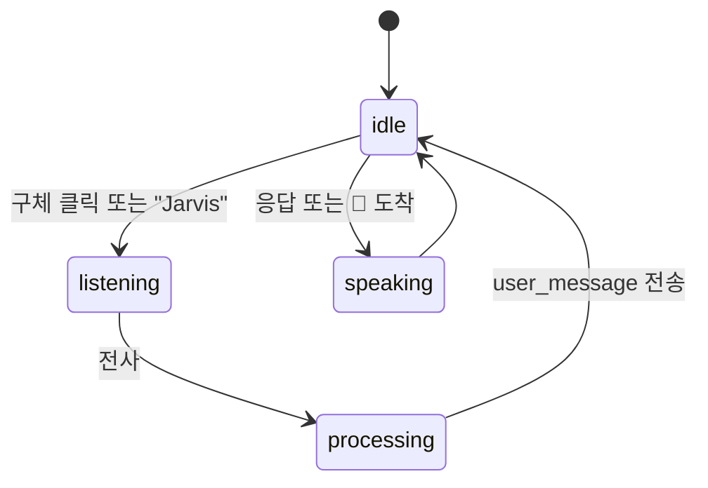
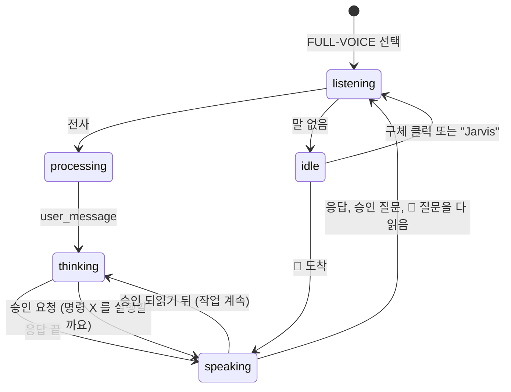
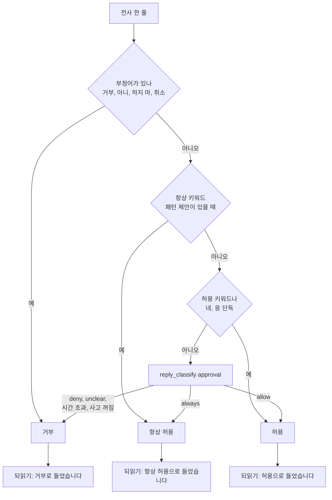
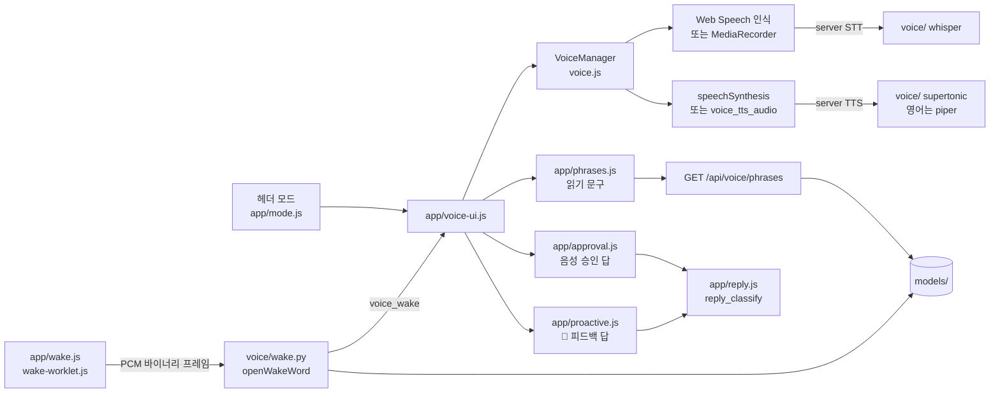

import FigureVoice from '@site/src/figures/voice.svg';
import FigureExpVoice from '@site/src/figures/exp-voice.svg';

# Voice Interface

<figure className="paper-fig">
  <FigureVoice />
  <figcaption><b>Figure 1.</b> (a) STT 와 TTS 는 브라우저가 기본이고 서버(faster-whisper, supertonic)로 바꿀 수 있다. 영어 문장만 Piper 음성 모델로 따로 읽게 할 수 있다. (b) Full-voice 는 듣기, 처리, 생각, 말하기를 돈다. (c) 음성 승인 답은 번호 순서로 해석하고, 애매하면 거부한다.</figcaption>
</figure>

Web HUD 나 TUI 에서 JARVIS 에게 말로 묻고 응답을 소리로 듣는다. 음성 인식(STT)과 음성 합성(TTS)을 브라우저에서 할지 서버에서 할지는 설정으로 정한다.

| | `browser`(기본) | 서버 |
|---|---|---|
| STT | Web Speech API 가 브라우저에서 인식 | `whisper`: 브라우저가 MediaRecorder 로 녹음해 `voice_stt_submit` 으로 보내고 faster-whisper 가 전사 |
| TTS | Web Speech API 가 합성 | `supertonic`: ONNX 합성 결과를 WAV 로 돌려준다 |
| 영어 TTS | `TTS` 와 같은 프로바이더 | `piper`: Piper 음성 모델 하나로 영어 문장만 합성한다. `qwen`: Mac 호스트의 Qwen3-TTS 합성 서버에 맡긴다 |

whisper 와 supertonic 을 쓰려면 `uv sync --extra voice` 로 설치한다. Docker 의 web 이미지에는 들어 있지 않다. piper 는 `--extra piper` 이고 web 이미지에 들어 있다.

## 영어 문장은 Piper 음성으로

`JARVIS_VOICE__ENGLISH_TTS_PROVIDER=piper` 를 두면 영어로만 된 문장은 Piper 음성 모델이 읽고, 나머지는 `TTS_PROVIDER` 가 읽는다. 한글, 가나, 한자가 한 글자라도 섞이면 영어로 보지 않는다. Piper 모델이 영어 전용이라 한국어 문장을 넣으면 발음이 무너지기 때문이다.

```bash
JARVIS_VOICE__ENGLISH_TTS_PROVIDER=piper
JARVIS_VOICE__PIPER_MODEL=~/.jarvis/voices/en-voice.onnx
```

Piper 음성 모델(`.onnx`, `.onnx.json`)을 받아 `~/.jarvis/voices/` 에 같은 이름으로 나란히 둔다. 모델은 레포에 넣지 않는다.

Docker 에서는 `~/.jarvis` 가 `jarvis_data` 볼륨이다. 호스트에 받은 파일을 `docker compose cp` 로 넣고 백엔드를 다시 띄운다.

```bash
docker compose exec jarvis-backend mkdir -p /root/.jarvis/voices
docker compose cp en-voice.onnx jarvis-backend:/root/.jarvis/voices/
docker compose cp en-voice.onnx.json jarvis-backend:/root/.jarvis/voices/
docker compose restart jarvis-backend
```

:::warning

실존 인물의 목소리를 흉내 낸 모델은 쓰기 전에 그 모델의 라이선스와 용도 제한을 확인한다.

:::

모델 파일이 없거나 piper 가 설치되지 않았으면 서버 음성이 통째로 꺼지고 브라우저가 모두 읽는다. 백엔드 로그에 `[Voice] 서버 음성 비활성화` 가 남는다.

## Qwen3-TTS 로 JARVIS 목소리 복제

`JARVIS_VOICE__ENGLISH_TTS_PROVIDER=qwen` 이면 영어 문장을 Qwen3-TTS 1.7B 가 JARVIS 의 녹음 한 클립(`reference.wav`, 4~12초)을 따라 합성한다. Piper 파인튜닝 음성은 기계음이 심했다(UTMOS 2.6~2.9, 사람 녹음 4.1). 같은 48문장에서 Qwen 복제는 UTMOS 4.07, WER 0.017, 화자 유사도 0.965 로 목소리는 그대로이고 소리가 사람에 가깝다(llmclick 레시피 `tts_qwen` 측정).

모델은 MLX 로 Apple GPU(Metal)에서 돈다. Docker 는 Mac 위의 리눅스 VM 이라 GPU 를 못 써서, 합성 서버(`services/qwen_tts`)를 Mac 에서 따로 띄우고 백엔드가 `host.docker.internal:8770` 으로 부른다. Ollama 와 같은 구조다. 서버에 닿지 않거나 실패하면 `PIPER_MODEL` 로 읽어 소리가 끊기지 않는다(로그 `[Voice] qwen 합성 서버에 닿지 않아 Piper 로 읽는다`).

```bash
services/qwen_tts/setup.sh            # 잠긴 버전(mlx-audio 0.6.2, mlx 0.32.4)으로 환경을 맞춘다. 다시 실행해도 같다
mkdir -p ~/.jarvis/voices/qwen        # voice.json(모델, 버전, 기준 녹음 대본)과 reference.wav 를 둔다
services/qwen_tts/run.sh              # 127.0.0.1:8770. GET /health, POST /tts {"text"} -> WAV(24kHz)
services/qwen_tts/install-launchd.sh  # 로그인할 때 띄우고 죽으면 다시 띄운다(로그 ~/.jarvis/logs/qwen-tts.log)
```

- 모델(bf16 4.2GB)은 서버가 뜰 때 한 번 읽고 첫 문장으로 데운다. 메모리를 그만큼 계속 쓴다
- 요청은 한 번에 하나씩 합성한다(MLX 모델은 동시에 두 번 생성하지 못한다). 매 요청 같은 seed 라 같은 문장은 같은 소리다
- 서버는 127.0.0.1 에만 연다. Docker Desktop 의 `host.docker.internal` 은 호스트의 루프백에 닿는다
- 기준 녹음은 손대지 않는다. 잡음 제거를 걸면 오히려 나빠졌다(UTMOS 4.07 에서 3.90)
- Apple silicon Mac 에서만 된다. 리눅스 서버로 옮기면 이 방식은 쓸 수 없다

## JARVIS 가 하는 말은 모두 JARVIS 목소리로

JARVIS 의 답은 한국어라 그대로 두면 한국어 TTS(supertonic)가 읽는다. `JARVIS_VOICE__SPEAK_ENGLISH=true` 를 두면 JARVIS 가 소리 내는 한국어 글(답, 🔔, filler, 앞으로 생길 종류 모두)을 소리로만 짧은 영어 구어체로 옮겨 Piper(JARVIS 목소리)로 읽는다. 화면에 쓰는 글은 한국어 그대로다.

- 옮기기는 메인 모델에 한 번 묻는다. 두 문장, 45단어 안으로 줄이고 이름, 숫자, 날짜는 그대로 둔다
- 8초 안에 못 옮기거나 영어가 아닌 답이 오면 한국어 원문을 다른 목소리로 읽지 않고 "Sir, I've put it on your screen." 을 읽는다
- KAREN 등 다른 에이전트의 말은 옮기지 않고 원문 그대로 읽는다
- 영어 TTS(`ENGLISH_TTS_PROVIDER`)가 없으면 켜도 아무 일도 하지 않는다

재시작 직후 첫 번역은 모델 연결을 여느라 8초를 넘길 수 있다. 그때는 위 고정 문장이 나온다.

## 잘 못 알아들으면 다시 묻는다

whisper 로 인식할 때 결과가 비었거나, 말소리가 없다는 확률(`no_speech_prob`)이 0.6 을 넘거나, 평균 로그 확률이 -1.0 보다 낮으면 잘 못 들은 것으로 본다. 이때는 받아 적은 말을 에이전트에 넘기지 않고 `voice_stt_result` 에 `unclear: true` 를 실어 보낸 뒤 되묻는 말을 읽는다.

| 에이전트 | 되묻는 말 | 목소리 |
|---|---|---|
| JARVIS | I'm sorry, sir. I didn't catch that. | Piper(JARVIS 목소리) |
| 그 밖 | 잘 못 들었어요. 한 번 더 말씀해 주세요. | 한국어 TTS |

직전 발화가 JARVIS 목소리였는데 되묻는 말만 다른 목소리로 나오지 않게 하려는 것이다. 판정 값은 `voice/service.py` 의 `NO_SPEECH_MAX`, `AVG_LOGPROB_MIN` 이다. 백엔드 로그의 `[Voice] stt` 줄에 두 값과 판정이 남는다.

## JARVIS 음성 모델

JARVIS 전용으로 학습한 모델 세 가지를 레포의 `models/` 폴더에 두고 쓴다. 이 폴더는 `.gitignore` 에 있어 GitHub 에 올라가지 않는다. 모델이 비상업 라이선스이기 때문이다.

| 모델 | 파일 | 하는 일 |
|---|---|---|
| TTS | `models/tts/voice.onnx`, `voice.onnx.json` | 영어 문장을 JARVIS 목소리로 읽는다. Piper 음성이라 위의 `PIPER_MODEL` 로 지정한다. `qwen` 을 쓰면 서버에 닿지 않을 때만 읽는다 |
| 읽기 문구 | `models/tts/phrases/phrases.json`, wav 9개 | 정해진 순간에 합성 대신 녹음한 문구를 읽는다 |
| 웨이크워드 | `models/wakeword/jarvis.onnx`, `melspectrogram.onnx`, `embedding_model.onnx` | 모드와 상관없이 기다리는 동안 "Jarvis" 를 들으면 듣기를 연다 |

학습 결과 폴더에서 체크포인트(`model.ckpt`, 846MB)만 빼고 복사한다. `rsync -a` 라 다시 실행해도 같은 상태가 된다.

```bash
rsync -a --exclude model.ckpt --exclude archive ~/Desktop/jarvis-agent-models/ models/
```

Docker 는 `./models` 를 `/app/models` 로 읽기 전용 마운트한다. `.env` 에 경로를 두고 백엔드를 다시 띄운다. 웨이크워드는 `wake` extra 가 필요하고 web 이미지에 들어 있다.

```bash
JARVIS_VOICE__ENGLISH_TTS_PROVIDER=piper
JARVIS_VOICE__PIPER_MODEL=/app/models/tts/voice.onnx
JARVIS_VOICE__PHRASES_DIR=/app/models/tts/phrases
JARVIS_VOICE__WAKE_MODEL_DIR=/app/models/wakeword
JARVIS_VOICE__WAKE_THRESHOLD=0.5
```

경로를 비우거나 파일이 없으면 그 기능만 꺼진다. 웨이크워드가 꺼지면 백엔드 로그에 `[Voice] 웨이크워드 비활성화` 와 빠진 파일이 남는다.

### 읽기 문구

음성으로 일하는 중(Full-voice, 또는 음성으로 시작한 요청)에만 읽는다.

| 순간 | 문구 |
|---|---|
| 웨이크워드를 들음 | At your service, sir. |
| `web_search` 도구 시작 | Searching Reference. |
| `remember_task_pattern` 도구 시작 | Checking the Pattern. |
| 💬 filler(오래 걸리는 요청을 뒤로 넘김) | Processing Long Task. filler 문장은 화면에만 쓰고 읽지 않는다 |
| `/focus` 로 Focus 를 켜고 끔 | Activate Focus mode. / Deactivate Focus mode. |
| Focus 분석 갱신 시작 | Target. Analysis. |
| 에이전트 칩으로 KAREN, JARVIS 전환 | Change to KAREN. / Change to JARVIS. |

접속할 때 서버가 되살리는 Focus 는 문구를 읽지 않는다. 사용자가 보낸 `/focus` 로 바뀐 경우만 읽는다. wav 는 `GET /api/voice/phrases/{name}` 으로 처음 읽을 때 한 번 받는다.

### 웨이크워드

Default, Full-voice 모두 기다리는 동안 브라우저가 마이크 소리를 16kHz PCM 으로 WebSocket 바이너리 프레임에 실어 보낸다. 서버는 연결마다 openWakeWord 감지기를 하나 두고 80ms 마다 점수를 매긴다. 점수가 임계치를 넘으면 `voice_wake` 를 보내고, 화면은 "At your service, sir." 를 읽은 뒤 바로 듣는다. 듣기, 읽기, 응답, 승인 중에는 보내지 않는다. Default 에서 깨워 보낸 요청은 응답을 읽어 주고, 다 읽은 뒤 다시 듣지는 않는다.

- 웨이크워드가 켜져 있으면 Default 에서도 마이크가 계속 열려 있어 브라우저의 녹음 표시가 꺼지지 않는다. 닫으려면 `JARVIS_VOICE__WAKE_MODEL_DIR` 를 비운다
- 영어 발음 "Jarvis" 만 알아듣는다. 한국어로 "자비스" 라고 부르면 깨지 않는다
- 이름 끝 무렵 여러 프레임이 연달아 임계치를 넘으므로, 첫 프레임에서 한 번 깨고 그 뒤 1초는 무시한다
- 모델은 합성 음성으로만 학습했다. "Jars", "Garbage" 처럼 비슷한 소리에 깨어날 수 있다

:::note

openwakeword 는 리눅스에서 `tflite-runtime` 을 요구하지만 arm64 휠이 없어 Apple Silicon 의 Docker 에서 설치가 깨진다. onnx 로만 돌리므로 `pyproject.toml` 의 `override-dependencies` 로 뺐다.

:::

:::warning

TTS 와 읽기 문구는 영화 속 인물의 목소리를 흉내 낸 모델이라 개인, 비상업 용도로만 쓴다. 웨이크워드의 특징 모델(openWakeWord)도 CC BY-NC-SA 4.0 이다.

:::

## Web HUD



### Full-voice

헤더에서 `FULL-VOICE` 를 고르면 응답, 승인 요청, 먼저 건네는 말을 읽어 주고 답을 듣는다. 마이크 스트림은 Default 로 돌아갈 때까지 잡아 둔다. 듣기와 읽기 사이에 블루투스 헤드셋이 프로필을 바꾸지 않게 하려는 것이다.



Default 모드라도 음성으로 시작한 요청에서 승인이 필요하면 똑같이 되묻고 듣는다. 음성으로 묻는 동안은 화면을 가리는 모달 대신 아래쪽에 작은 띠로 명령과 버튼을 보여 준다. 승인 창이 열려 있을 때 들은 말은 대화로 보내지 않고 승인 답으로 쓴다. 브라우저 인식은 몇 초 말이 없으면 끝나기 때문에, 답을 들을 때까지 다시 듣는다(최대 20번). 읽는 동안에는 듣지 않는다.

음성으로 받은 승인 답은 애매하면 거부 쪽으로 해석한다.



- 구체를 클릭하면 음성 모드가 켜지고 꺼진다. 읽는 중에 클릭하면 읽기만 멈춘다. 켜져 있으면 응답과 먼저 건네는 말, 스케줄 알림을 읽어 준다. 놓친 알림은 읽지 않는다
- 서버 TTS 는 `voice_tts_request` 로 요청하고 `voice_tts_audio` 로 받는다. `data` 가 비어 오면 브라우저가 직접 읽는다
- 읽기 전에 서버가 마크다운 기호를 지운다. `**`, `#`, 목록 기호, 표의 `|` 는 읽지 않고, 코드 블록과 URL 은 건너뛰고, 링크는 글자만 읽는다. TUI 도 같은 함수를 거친다
- 읽는 중에 `Esc` 를 누르거나 구체를 클릭하면 멈춘다. 합성을 기다리는 중이어도 멈추고, 늦게 도착한 오디오는 버린다. Full-voice 라도 멈춘 뒤에는 다시 듣지 않는다
- `포커스 모드 <작업>`, `포커스 종료` 는 `/focus` 명령으로 보낸다. 인식이 키워드를 틀리거나 앞을 잘라도 받는 규칙은 [Focus Mode](../mode/focus-mode.md#켜고-끄기) 에 있다
- 브라우저 STT 는 Chrome 계열에서 동작한다. 지원하지 않는 브라우저에서는 SYS 에러가 한 줄 뜬다

:::note

서버가 `voice_tts_request` 에 응답하지 않으면 화면이 "음성 처리 중" 에 멈춘다. 그래서 서버는 빈 응답이라도 돌려준다.

:::

## TUI

TUI 에서 음성을 쓰려면 다음 환경변수를 설정한다.

```bash
JARVIS_VOICE__TUI_ENABLED=true
JARVIS_VOICE__STT_PROVIDER=whisper
JARVIS_VOICE__TTS_PROVIDER=supertonic
JARVIS_VOICE__TUI_RECORD_SECONDS=5
```

| 키 | 동작 |
|---|---|
| `Ctrl+T` | 응답 읽어 주기 토글 |
| `Ctrl+R` | 녹음 → 전사 → 입력창에 채움. 자동 전송하지 않는다 |

시스템 오디오 도구가 필요하다. 재생에는 afplay, paplay, aplay, ffplay 중 하나가, 녹음에는 sox 나 arecord 가 있어야 한다. 없으면 안내 메시지를 띄우고 음성이 꺼진다.

## 알아 둘 것

- `JARVIS_VOICE__WHISPER_MODEL_SIZE`, `SUPERTONIC_MODEL`, `STT_LANG` 은 설정에 있지만 현재 프로바이더가 읽지 않는다. whisper 언어는 한국어로 고정돼 있다
- Full-voice 모드(헤더의 `FULL-VOICE`)는 응답, 승인 요청(아래쪽 띠), 먼저 건네는 말의 피드백 질문을 읽고 답을 듣는다. 승인은 음성으로 시작한 요청이면 Default 에서도 같다. 승인 답에 부정어가 있으면 거부하고, 분명한 긍정이면 허용한다. 그 밖의 말("그거 돌려")은 사고 모델에 물어 `allow`/`always` 일 때만 허용하고 나머지는 거부한다. gemma4:e2b 로 실측했을 때 승인 답 11문장 중 허용하면 안 되는 말을 허용한 경우는 0건이었다

## 성능 실험

### Piper 영어 음성 합성 속도

백엔드 컨테이너(aarch64, 14코어, CPU 만)에서 Piper 모델(high 품질, `noise_scale` 0.4)로 길이가 다른 영어 문장 넷을 합성했다. 재현: `scripts/experiments/piper_speed.py` 를 컨테이너에서 실행한다.

<figure className="paper-fig">
  <FigureExpVoice />
  <figcaption><b>Figure 2.</b> 합성 시간은 음성 길이의 0.19~0.22배다. 110자 문장(6.1초 분량)도 1.3초에 합성된다.</figcaption>
</figure>

문장 하나를 통째로 합성한 뒤 보내므로, 듣기 시작까지는 합성 시간만큼 기다린다. 긴 답이면 1초 남짓이다.

### Qwen3-TTS 합성 속도: Mac GPU 와 Docker CPU

같은 모델(1.7B bf16), 같은 기준 녹음, 같은 seed 로 영어 문장 다섯을 합성했다(첫 호출은 빼고 잰다). M4 Pro, Docker 는 14코어 23GB. 재현: `services/qwen_tts/bench.py <voice 디렉터리> <출력 디렉터리>`.

| 문장(소리 길이) | Mac GPU | Docker CPU |
|---|---|---|
| 모델 로드 | 3.0초 | 18.8초 |
| Yes, sir? (0.6초) | 0.48초 | 185.7초 |
| Sir, I've put it on your screen. (2.3초) | 1.22초 | 재지 않음 |
| Sir, your meeting with the team starts in ten minutes. (3.4초) | 1.69초 | 재지 않음 |
| 16단어 문장(5.7초) | 2.65초 | 재지 않음 |

Mac GPU 는 합성 시간이 소리 길이의 0.5배 안팎이라 대화에 쓸 수 있다. Piper(0.2배)보다는 2배쯤 느리다. Docker 안에서는 mlx 의 CPU 빌드가 설치되고 돌지만 두 단어에 3분이 걸렸고, 14코어 중 하나만 썼다. 그래서 합성 서버를 Docker 밖에 두었다.

### 실제 전사 기록에서 Focus 키워드 해석

Chrome 음성 인식(ko-KR)으로 Focus 를 켜고 끄려 한 실제 시도 다섯 번의 전사문을, 키워드 해석을 고치기 전과 후로 다시 돌렸다.

| 의도 | 실제 전사문 | 고치기 전 | 고친 뒤 |
|---|---|---|---|
| 시작 | 버스 모드 | 대화로 감 | `/focus`(현황 보기) |
| 시작 | 다음 주 회의 아젠다 만들어 줘 | 대화로 감 | 대화로 감 |
| 시작 | Please make the meeting timer for next week | 대화로 감 | 대화로 감 |
| 종료 | 동요 | 대화로 감 | `/focus stop` |
| 종료 | 종료 | 대화로 감 | `/focus stop` |

- 종료는 두 번 모두 잡게 됐다. Focus 중일 때만 "종료" 한마디를 받으므로, Focus 가 아닐 때의 같은 말은 대화로 간다
- 시작은 여전히 어렵다. 인식이 키워드를 통째로 잘라 버리면(두 번째) 문장에서 되살릴 정보가 없고, 영어로 인식된 경우(세 번째)도 마찬가지다. 그래서 키워드를 문장 끝에 두는 방법("…, 포커스 모드로")을 안내한다
- 다섯 번은 작은 표본이다. 고친 규칙이 잘못 켜는 경우("버스 시간 알려줘", "종료 시간 알려줘")는 따로 단위 검사로 확인했다

## 설계 노트

### 기호를 지우는 곳은 서버 한 곳

마크다운 기호를 읽지 않게 하는 정리는 화면이 아니라 서버의 `speech_text` 한 함수가 한다. 음성은 서버 합성(Supertonic, Piper)과 브라우저 합성 두 길로 나가고, TUI 도 따로 읽는다. 화면에서 지우면 TUI 와 서버 합성이 빠진다. 함수는 두 번 거쳐도 결과가 같게 만들었다.

### 멈춤은 "지금 재생" 과 "오는 중" 을 함께 끊는다

`Esc` 를 눌렀을 때 재생 중인 소리만 끊으면, 합성을 기다리던 요청의 오디오가 몇 초 뒤 도착해 다시 말하기 시작한다. 그래서 읽기 요청마다 `id` 를 붙이고 서버가 결과에 그대로 돌려주게 했다. 멈춘 시점까지의 요청은 결과가 와도 버린다.

### 승인은 "들을 때까지" 듣는다

음성 승인을 처음 만들 때는 질문을 읽은 뒤 한 번만 들었다. 실제로는 인식이 몇 초 만에 말 없이 끝나거나, 다른 읽기가 끼어들어 "다 읽으면 듣기" 설정을 지워서, 사용자의 "승인해" 가 어디에도 닿지 않고 120초 뒤 거부됐다. 지금은 승인 창이 열려 있는 동안 읽기가 끝날 때와 인식이 끝날 때마다 다시 듣는다(최대 20번). 읽는 동안에는 듣지 않는다. 듣고 있으면 질문 자체("허용, 항상, 거부")를 답으로 알아듣기 때문이다.

## 구현 위치

- 구현: `voice/`(서버 프로바이더, `service.py` 의 영어 판정, `speech_text.py` 의 기호 지우기, `wake.py` 의 웨이크워드 감지, `phrases.py` 의 읽기 문구), `ui/web/router/voice_router.py`(문구 wav), `ui/web/static/voice.js`(브라우저 상태 기계), `app/wake.js` 와 `wake-worklet.js`(마이크 캡처), `app/phrases.js`(문구 받기), `ui/tui/`(터미널)

왼쪽이 사용자와 화면, 가운데가 코드 모듈, 오른쪽이 저장소다. 화살표는 호출이나 데이터의 방향이다.



- 핵심 모듈: `ui/web/static/voice.js`, `voice/`
- 저장: 없음. 모델은 `models/`(git 밖)에서 읽기만 한다
