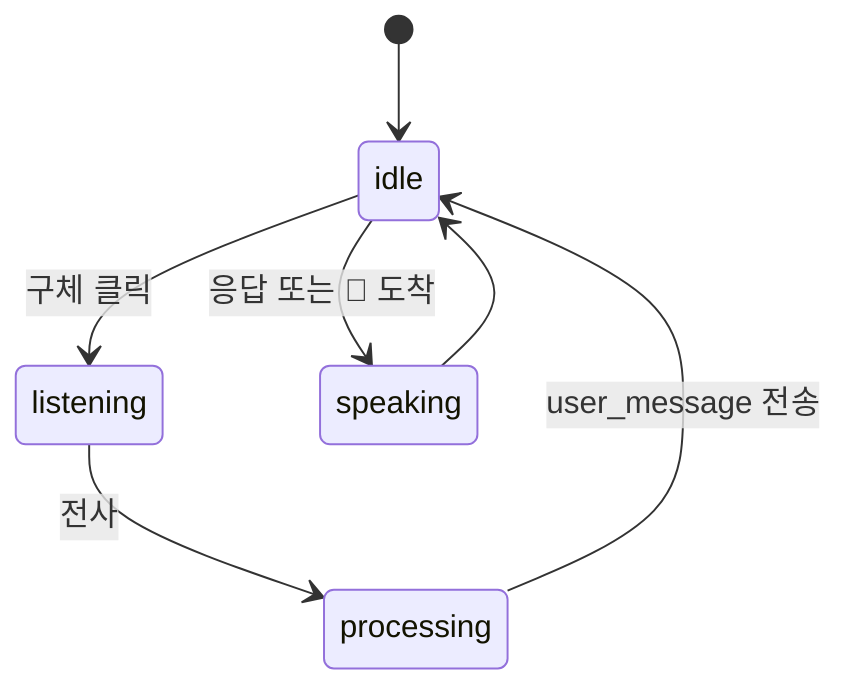
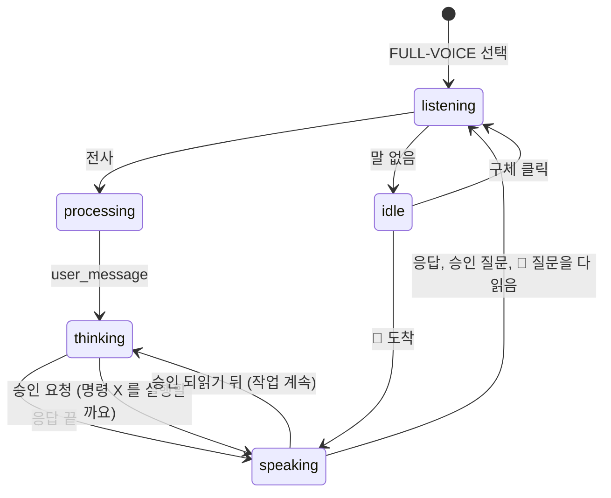
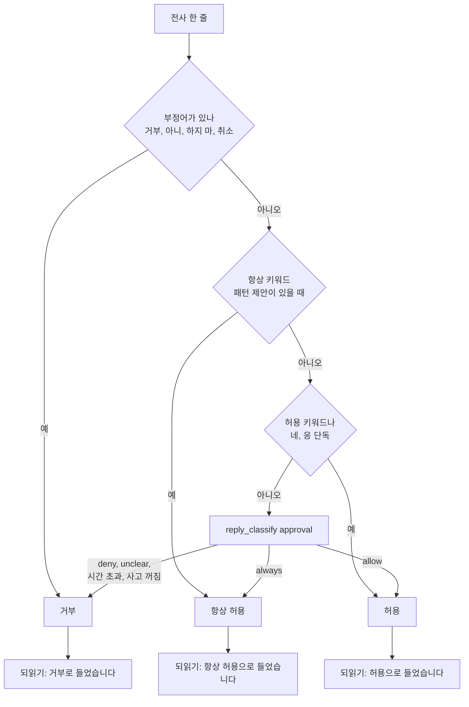
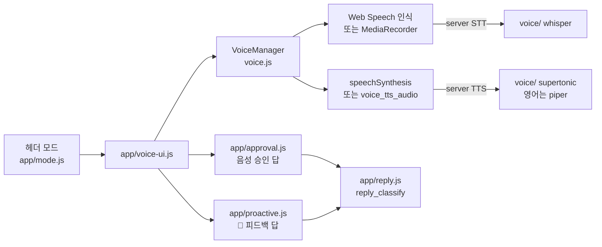

import FigureVoice from '@site/src/figures/voice.svg';

# Voice Interface

<figure className="paper-fig">
  <FigureVoice />
  <figcaption><b>Figure 1.</b> (a) STT 와 TTS 는 브라우저가 기본이고 서버(faster-whisper, supertonic)로 바꿀 수 있다. 영어 문장만 Piper 음성 모델로 따로 읽게 할 수 있다. (b) Full-voice 는 듣기, 처리, 생각, 말하기를 돈다. (c) 음성 승인 답은 번호 순서로 해석하고, 애매하면 거부한다.</figcaption>
</figure>

Web HUD 나 TUI 에서 JARVIS 에게 말로 묻고 응답을 소리로 듣는다. 음성 인식(STT)과 음성 합성(TTS)을 브라우저에서 할지 서버에서 할지는 설정으로 정한다.

| | `browser`(기본) | 서버 |
|---|---|---|
| STT | Web Speech API 가 브라우저에서 인식 | `whisper`: 브라우저가 MediaRecorder 로 녹음해 `voice_stt_submit` 으로 보내고 faster-whisper 가 전사 |
| TTS | Web Speech API 가 합성 | `supertonic`: ONNX 합성 결과를 WAV 로 돌려준다 |
| 영어 TTS | `TTS` 와 같은 프로바이더 | `piper`: Piper 음성 모델 하나로 영어 문장만 합성한다 |

whisper 와 supertonic 을 쓰려면 `uv sync --extra voice` 로 설치한다. Docker 의 web 이미지에는 들어 있지 않다. piper 는 `--extra piper` 이고 web 이미지에 들어 있다.

## 영어 문장은 Piper 음성으로

`JARVIS_VOICE__ENGLISH_TTS_PROVIDER=piper` 를 두면 영어로만 된 문장은 Piper 음성 모델이 읽고, 나머지는 `TTS_PROVIDER` 가 읽는다. 한글, 가나, 한자가 한 글자라도 섞이면 영어로 보지 않는다. Piper 모델이 영어 전용이라 한국어 문장을 넣으면 발음이 무너지기 때문이다.

```bash
JARVIS_VOICE__ENGLISH_TTS_PROVIDER=piper
JARVIS_VOICE__PIPER_MODEL=~/.jarvis/voices/en-voice.onnx
```

Piper 음성 모델(`.onnx`, `.onnx.json`)을 받아 `~/.jarvis/voices/` 에 같은 이름으로 나란히 둔다. 모델은 레포에 넣지 않는다.

Docker 에서는 `~/.jarvis` 가 `jarvis_data` 볼륨이다. 호스트에 받은 파일을 `docker compose cp` 로 넣고 백엔드를 다시 띄운다.

```bash
docker compose exec jarvis-backend mkdir -p /root/.jarvis/voices
docker compose cp en-voice.onnx jarvis-backend:/root/.jarvis/voices/
docker compose cp en-voice.onnx.json jarvis-backend:/root/.jarvis/voices/
docker compose restart jarvis-backend
```

:::warning

실존 인물의 목소리를 흉내 낸 모델은 쓰기 전에 그 모델의 라이선스와 용도 제한을 확인한다.

:::

모델 파일이 없거나 piper 가 설치되지 않았으면 서버 음성이 통째로 꺼지고 브라우저가 모두 읽는다. 백엔드 로그에 `[Voice] 서버 음성 비활성화` 가 남는다.

## Web HUD



### Full-voice

헤더에서 `FULL-VOICE` 를 고르면 응답, 승인 요청, 먼저 건네는 말을 읽어 주고 답을 듣는다. 마이크 스트림은 Default 로 돌아갈 때까지 잡아 둔다. 듣기와 읽기 사이에 블루투스 헤드셋이 프로필을 바꾸지 않게 하려는 것이다.



Default 모드라도 음성으로 시작한 요청에서 승인이 필요하면 똑같이 되묻고 듣는다. 음성으로 묻는 동안은 화면을 가리는 모달 대신 아래쪽에 작은 띠로 명령과 버튼을 보인다. 승인 창이 열려 있을 때 들은 말은 대화로 보내지 않고 승인 답으로 쓴다.

음성으로 받은 승인 답은 애매하면 거부 쪽으로 해석한다.



- 구체를 클릭하면 음성 모드가 켜지고 꺼진다. 켜져 있으면 응답과 먼저 건네는 말, 스케줄 알림을 읽어 준다. 놓친 알림은 읽지 않는다
- 서버 TTS 는 `voice_tts_request` 로 요청하고 `voice_tts_audio` 로 받는다. `data` 가 비어 오면 브라우저가 직접 읽는다
- 읽기 전에 서버가 마크다운 기호를 지운다. `**`, `#`, 목록 기호, 표의 `|` 는 읽지 않고, 코드 블록과 URL 은 건너뛰고, 링크는 글자만 읽는다. TUI 도 같은 함수를 거친다
- 읽는 중에 `Esc` 를 누르거나 구체를 클릭하면 멈춘다. 합성을 기다리는 중이어도 멈추고, 늦게 도착한 오디오는 버린다. Full-voice 라도 멈춘 뒤에는 다시 듣지 않는다
- 브라우저 STT 는 Chrome 계열에서 동작한다. 지원하지 않는 브라우저에서는 SYS 에러가 한 줄 뜬다

:::note

서버가 `voice_tts_request` 에 응답하지 않으면 화면이 "음성 처리 중" 에 멈춘다. 그래서 서버는 빈 응답이라도 돌려준다.

:::

## TUI

TUI 에서 음성을 쓰려면 다음 환경변수를 설정한다.

```bash
JARVIS_VOICE__TUI_ENABLED=true
JARVIS_VOICE__STT_PROVIDER=whisper
JARVIS_VOICE__TTS_PROVIDER=supertonic
JARVIS_VOICE__TUI_RECORD_SECONDS=5
```

| 키 | 동작 |
|---|---|
| `Ctrl+T` | 응답 읽어 주기 토글 |
| `Ctrl+R` | 녹음 → 전사 → 입력창에 채움. 자동 전송하지 않는다 |

시스템 오디오 도구가 필요하다. 재생에는 afplay, paplay, aplay, ffplay 중 하나가, 녹음에는 sox 나 arecord 가 있어야 한다. 없으면 안내 메시지를 띄우고 음성이 꺼진다.

## 알아 둘 것

- `JARVIS_VOICE__WHISPER_MODEL_SIZE`, `SUPERTONIC_MODEL`, `STT_LANG` 은 설정에 있지만 현재 프로바이더가 읽지 않는다. whisper 언어는 한국어로 고정돼 있다
- Full-voice 모드(헤더의 `FULL-VOICE`)는 응답, 승인 모달, 먼저 건네는 말의 피드백 질문을 읽고 답을 듣는다. 승인 답에 부정어가 있으면 거부하고, 분명한 긍정이면 허용한다. 그 밖의 말("그거 돌려")은 사고 모델에 물어 `allow`/`always` 일 때만 허용하고 나머지는 거부한다. gemma4:e2b 로 실측했을 때 승인 답 11문장 중 허용하면 안 되는 말을 허용한 경우는 0건이었다

## 구현 위치

- 구현: `voice/`(서버 프로바이더, `service.py` 의 영어 판정, `speech_text.py` 의 기호 지우기), `ui/web/static/voice.js`(브라우저 상태 기계), `ui/tui/`(터미널)

왼쪽이 사용자와 화면, 가운데가 코드 모듈, 오른쪽이 저장소다. 화살표는 호출이나 데이터의 방향이다.



- 핵심 모듈: `ui/web/static/voice.js`, `voice/`
- 저장: 없음
