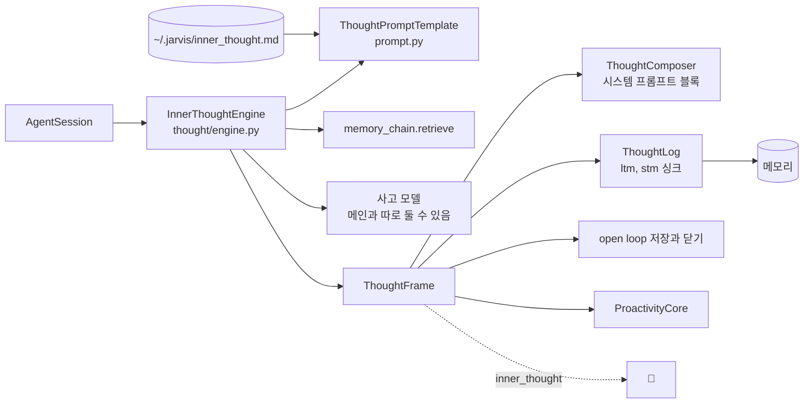

# 내적 사고

사용자 입력마다 메인 응답과 별개로 한 번 더 LLM 을 불러 **구조화된 판단**을 만든다. 이 판단이 proactive 기능 전체의 입력이다.

## 사고 프레임

`ThoughtFrame` 은 JSON 이다. 키 이름은 고정이고 사용자는 프롬프트 템플릿으로 채워지는 방식만 조율한다.

| 필드 | 뜻 |
|---|---|
| `observation` | 무엇이 들어왔는가(사실) |
| `interpretation` | 의도, 감정, 숨은 요구. 사용자를 3인칭으로 분석한 문장 |
| `recalled` | 회상한 기억 요약 |
| `options` | 가능한 대응 후보 |
| `proactive_actions` | 미리 해 두면 좋을 행동. `kind`(suggest, tool, remember, schedule), `tool_name`, `args`, `risk`(low, high) |
| `decision` | `act`, `ask`, `silent`. 확신 없으면 silent |
| `confidence` | 0 에서 1 |
| `rationale` | 결정 근거 |
| `utterance` | 사용자에게 실제로 건넬 말. 비어 있으면 침묵 |
| `needs_background`, `filler` | 오래 걸릴 작업이면 true 와 즉답 문구 |
| `open_loops` | 이번 입력에서 새로 감지한 약속과 미완 작업. 기한이 분명하면 끝에 ` @YYYY-MM-DD HH:MM` |
| `closed_loops` | [열린 약속] 중 이번 입력으로 끝났거나 취소된 것의 번호. 세션이 그 약속을 done 으로 닫는다 |

`utterance` 와 `interpretation` 을 분리한 이유: 해석문은 "사용자가 불안해한다" 같은 문장이라 그대로 말하면 안 된다. 먼저 건네는 말은 `utterance` 만 쓴다.

## 흐름

```mermaid
flowchart LR
  IN[사용자 입력] --> R[템플릿 렌더]
  OL[(open loops)] --> R
  UM[(사용자 모델)] --> R
  MEM[(회상 5건)] --> R
  HIS[최근 8턴 x 240자] --> R
  R --> LLM[사고 모델 호출<br/>JSON 스키마 강제]
  LLM --> P{파싱}
  P -- 유효 --> F[ThoughtFrame]
  P -- 행동 후보만 틀림 --> F2[후보 버리고 프레임 유지]
  P -- 전체 틀림 --> N[None, 로그]
  F --> E[inner_thought 이벤트 💭]
  F --> S[open loop 저장과 닫기<br/>요청 모드만]
  F --> C[composer → 시스템 프롬프트 블록]
  F --> D[dual channel 판단]
```

구현은 `agent_layer/thought/engine.py` 의 `InnerThoughtEngine.think`.

1. 회상: 메모리 체인에서 입력과 관련된 기억을 `recall_limit`(5)만큼 가져온다
2. 렌더: 요청 템플릿(`~/.jarvis/inner_thought.md`, 없으면 내장 기본)에 `now`, `open_loops`, `recalled_memories`, `history`, `user_input`, `user_model` 을 채운다. 히스토리는 최근 `history_turns`(8) 턴, 턴당 `history_chars`(240) 자
3. 호출: 도구 없이 한 번. Ollama 프로바이더는 프레임의 JSON 스키마를 `format` 으로 넘겨 형식을 강제한다
4. 파싱: 첫 `{` 부터 마지막 `}` 까지 잘라 검증한다. `proactive_actions` 만 틀리면 그 항목만 버리고 프레임을 살린다. `recalled`, `options`, `open_loops`, `closed_loops` 에 객체가 와도 글자만 건진다
5. 기록: `inner_thought` 이벤트, 사고 로그 싱크(`ltm` 이면 일화 기억으로, `stm` 이면 작업 메모로)

## 사고 결과가 가는 곳

- **composer**: `[내적 사고] 해석: ... 회상: ... 고려한 대응: ...` 블록을 만들어 메인 호출의 시스템 프롬프트 끝에 붙인다. 히스토리에는 남지 않는다. `interpretation_only` 로 바꾸면 해석 한 줄만
- **dual channel**: `needs_background` 면 filler 를 먼저 말하고 메인은 뒤에서 돈다. [먼저 행동하기](./proactive.md)
- **open loop**: 요청 모드에서만 저장하고 닫는다. 성찰 모드는 기존 약속을 볼 뿐 새로 쌓지도 닫지도 않는다. 바꿔 말한 같은 약속이 쌓이는 것과, 사용자 말 없이 약속이 사라지는 것을 막기 위해서다. 자세한 규칙은 [약속, 스케줄, 외부 이벤트](./agenda.md)
- **화면**: 💭 한 줄(decision, 확신도). 클릭하면 해석 전문

## 시점: before, race, after

사고와 메인 응답을 어떤 순서로 돌릴지는 `JARVIS_THOUGHT__REQUEST_TIMING` 이 정한다.

```mermaid
gantt
  dateFormat X
  axisFormat %s
  section before
  사고        :a1, 0, 10
  메인 응답    :a2, 10, 30
  section race (wait 3초)
  사고        :b1, 0, 10
  메인 응답    :b2, 3, 25
  section after
  메인 응답    :c1, 0, 20
  사고        :c2, 20, 30
```

- `before`: 사고를 끝내고 응답. 해석이 이번 응답에 섞인다
- `race`(기본): `wait_sec` 까지만 기다린다. 늦으면 응답을 먼저 시작하고 사고는 뒤에서 끝나 💭, open loop, 피드백 학습에만 쓰인다
- `after`: 응답이 끝난 뒤 사고. 사고와 메인이 같은 GPU 를 나눠 쓰는 로컬 Ollama 에서는 이게 가장 빠르다

늦은 사고는 세션이 task 로 들고 있다가 끝나면 기록과 이벤트를 남긴다. 실패는 `[Thought] request thought failed` 로그.

## 사고 모델

메인과 분리할 수 있다. `JARVIS_THOUGHT__MODEL`, `__PROVIDER`, `__API_KEY`, `__BASE_URL` 중 지정한 것만 바뀌고 나머지는 메인 값을 상속한다. temperature 와 max_tokens 는 항상 메인 값.

## 템플릿 직접 쓰기

`~/.jarvis/inner_thought.md` 와 `~/.jarvis/inner_thought_reflection.md`. 자리표시자는 `{{now}}`, `{{open_loops}}`, `{{external_events}}`, `{{recalled_memories}}`, `{{history}}`, `{{user_input}}`, `{{user_model}}`, `{{recent_proactive}}`(성찰 전용, 최근 🔔). 없는 값은 빈 문자열이 된다. 외부 이벤트나 최근 🔔 가 있는데 자리가 없으면 끝에 덧붙여 조용히 사라지지 않게 한다. 프레임 키 중 `utterance` 가 빠지면 먼저 말하는 기능이 꺼진 것과 같다.

## 구현 위치

왼쪽이 사용자와 화면, 가운데가 코드 모듈, 오른쪽이 저장소다. 화살표는 호출이나 데이터의 방향이다.

- 핵심 모듈: `agent_layer/thought/engine.py`
- 저장: 사고 로그(일화 기억 또는 작업 메모)
