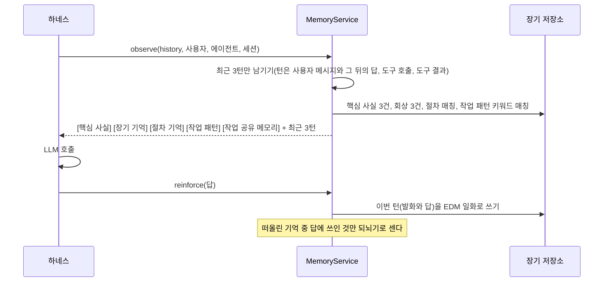
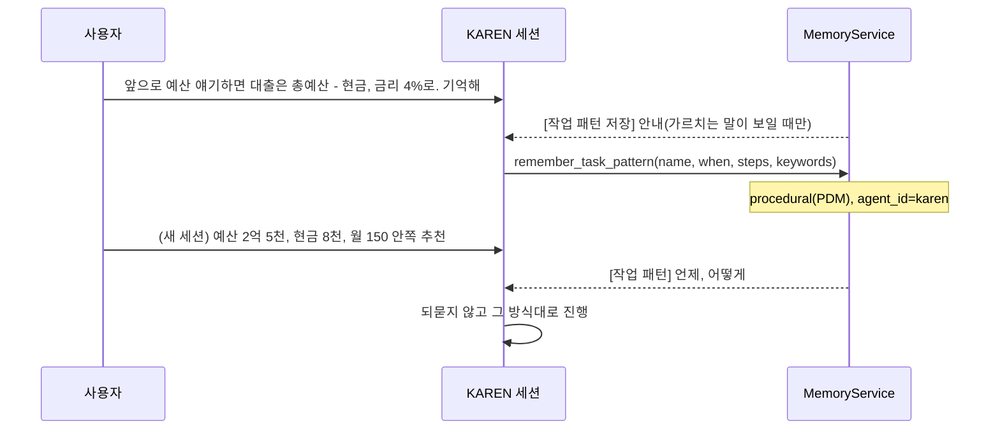
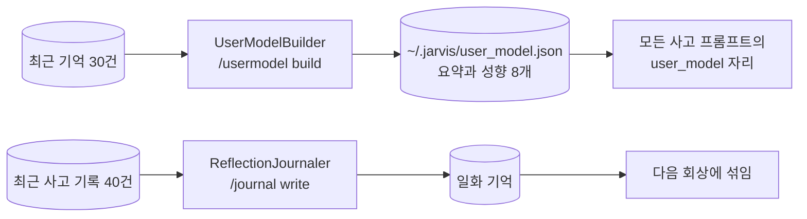
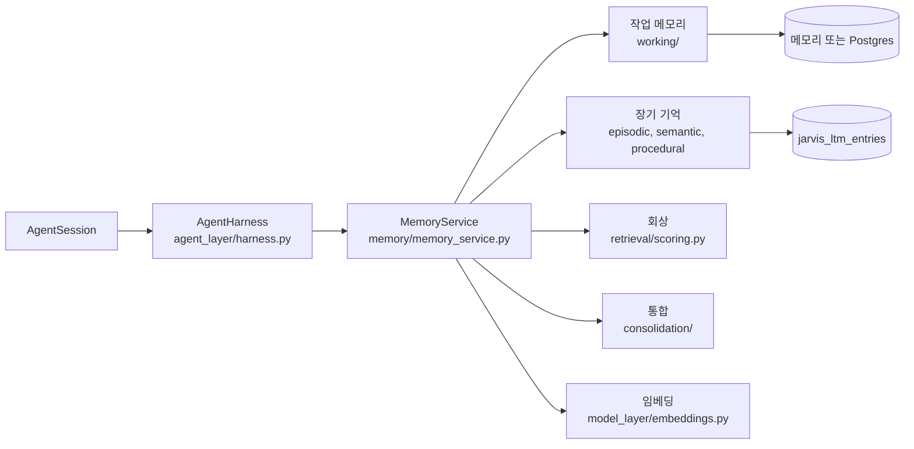

import FigureMemory from '@site/src/figures/memory.svg';
import FigureExpMemory from '@site/src/figures/exp-memory.svg';
import FigureExpMemoryRecall from '@site/src/figures/exp-memory-recall.svg';

# Memory Management

<figure className="paper-fig">
  <FigureMemory />
  <figcaption><b>Figure 1.</b> (a) 매 턴 히스토리의 최근 3턴만 두고, 장기 기억에서 회상한 블록을 앞에 붙여 LLM 에 넣는다. 창 안의 턴은 회상 블록에 다시 넣지 않는다. [절차 기억] 은 장기 기억이 아니라 스킬 레지스트리에서 읽는다. (b) 턴이 끝날 때마다 그 턴을 일화(EDM)로 쓰고, 그 밖에는 정해진 경로로만 쓴다.</figcaption>
</figure>

Memory Management 는 JARVIS 가 지난 대화와 사용자에 대한 사실을 기억해 매 턴의 프롬프트에 넣는 기능이다. 작업 기억과 장기 기억 두 층으로 나뉜다. 모델에는 최근 3턴만 넣고, 턴이 끝날 때마다 그 턴을 장기 기억의 일화(EDM)로 쓴다. 3턴 밖의 대화는 회상으로 돌아온다.

`memory/` 의 `MemoryService` 가 두 기억을 가진다. 하네스가 턴마다 `observe` 로 기억을 프롬프트에 넣고, 답이 나오면 `reinforce` 로 답에 쓰인 기억을 강하게 한다.

기억을 읽고 쓰는 모든 호출은 범위(`MemoryScope`: 사용자, 에이전트, 세션)를 인자로 받는다. 숨은 전역 값에서 사용자를 꺼내지 않는다. 화면은 슬래시 명령에 접속한 사용자의 범위를 넘기고, 세션은 도구와 사고 엔진에 자기 범위를 넘기며, 위임이나 에이전트 사이 대화로 불린 세션은 부른 쪽 범위(`caller_scope`)에서 사용자를 받는다.

## 계층

| 계층 | 무엇 | 어디 |
|---|---|---|
| 작업 기억 | 세션 히스토리 위의 메타데이터. 되뇌기 횟수, 메모(최대 50). 옛 창 모드(`stm_turns=0`)에서는 요약과 요약이 덮는 메시지 수도 | 메모리 또는 Postgres `jarvis_working_memory` |
| 장기 기억 | `MemoryItem`. 종류는 의미(semantic), 일화(episodic), 절차(procedural) | 메모리 또는 Postgres `jarvis_ltm_entries`(pgvector 선택) |
| 절차 기억 | 스킬은 저장하지 않고 스킬 레지스트리를 그대로 읽는다 | |
| 작업 패턴 | 사용자가 알려 준 작업 방식. 장기 기억의 절차(procedural) 항목으로, 저장한 에이전트만 본다 | 장기 기억과 같은 곳 |

세션 히스토리 자체의 정본은 세션 저장소다. 모델에 넣는 창은 그 이력의 최근 3턴이다.

## 턴마다 일어나는 일



- **창**: 최근 `stm_turns`(3) 턴만 넣는다. 턴 단위로 자르므로 도구 호출과 결과 쌍이 갈라지지 않는다. 컴팩션(LLM 요약)은 하지 않는다
- **턴 기록**: 답이 나오면 그 턴의 사용자 발화와 답을 각각 1,000자까지 `turn` 일화로 쓴다. 도구 결과는 남기지 않는다. metadata 에 작업 종류(`task_type`: 그 턴에서 처음 부른 도구, 없으면 `chat`), 성패(`outcome`: 도구 오류나 모델 오류가 있으면 `failure`), 부른 도구 목록을 남긴다. (사용자, 에이전트, 세션, 턴 번호)가 자연 키라 같은 턴을 다시 돌려도 항목은 하나다. 턴마다 임베딩이 한 번 돈다
- **창 안의 턴**: 지금 창에 있는 같은 세션의 턴 일화는 회상 블록에 넣지 않는다. 같은 내용이 두 번 들어가지 않게 하기 위해서다. 뺄 몫만큼 후보를 더 받으므로 회상 자리는 줄지 않는다
- **사고 로그 제외**: 회상 블록은 사고 로그(`thought`)를 후보에서 뺀다. 사고 로그는 턴마다 사용자 말을 다시 적어서, 같은 낱말로 턴 일화보다 많이, 더 최근에 걸린다. 실서버에서 5턴 전의 사실을 물었을 때 턴 일화는 6위로 밀렸고 답은 사고 로그 덕에 맞았다. 사고 로그는 지우지 않고 저장소에 남는다
- **골라 떠올리기**: 에이전트는 `recall_episodes(query, task_type, outcome, since, until)` 도구로 자기 일화를 조건으로 골라 읽는다("지난주에 실패한 대출 계산"). 날짜는 이날 포함이고, 읽기 정책 안에서만 찾는다. 모든 에이전트에게 붙는다
- **옛 창**: `stm_turns=0` 이면 예전처럼 최근 `window_size`(50) 메시지와 컴팩션(`compaction_threshold` 100,000자를 넘으면 앞부분을 `auto_summary` 로 요약)을 쓰고, 세션 종료 때 `session_end` 요약을 남긴다. 되돌릴 때만 쓰고 정리 단계에서 지운다
- **회상 질의**: 마지막 사용자 발화 200자로 검색한다. 발화에 "그거", "아까", "그 방식" 같은 상대 지칭이 있거나 8자보다 짧으면 직전 주고받음을 질의 앞에 붙인다(`memory/working/deixis.py`). 메인 모델에 넣는 최근 메시지는 바꾸지 않는다
- **회상 후보**: 키워드(부분 문자열, Postgres 는 ILIKE) 또는 벡터(코사인 ≥ 0.3)에 걸린 항목을 최신순, 중요도순, 벡터 거리순으로 각각 모아 합친다. 질의 낱말 앞뒤의 문장부호와 끝의 조사는 떼고 찾는다("서울에서?" 로 "거주지: 서울" 이 걸린다). 조사는 목록 휴리스틱이라 "~도" 로 끝나는 명사를 자르기도 하지만(중요도 → 중요), 실제 대화와 기억 4천여 건에서 명사를 자른 비율은 0.02% 였다
- **점수**: 최신성, 중요도, 관련성, 단서 겹침의 가중합이고, 종류마다 가중치가 다르다(의미 기억은 관련성 0.6, 일화는 최신성 0.4). 되뇌기 횟수가 많을수록 중요도가 덜 식는다
- **섬광 기억 자리**: 저장된 중요도가 0.8 이상이고 질의 낱말의 절반 이상이 내용에 있는 항목 하나는 나이와 무관하게 결과에 남긴다. 일화는 최신성 비중이 커서, 같은 낱말의 어제 일화 몇 개가 몇 달 전의 큰 사건을 늘 밀어내기 때문이다
- **되뇌기**: 질의에 걸린 항목만 `last_accessed` 가 갱신된다. 되뇌기 횟수는 그중 답에 쓰인 항목만 오른다(항목 낱말의 절반 이상이 답에 나오면 쓰였다고 본다). 핵심 사실 블록에 들어갔다는 이유만으로는 세지 않는다

## 장기 기억에 쓰이는 순간

| 출처 | 층 | 언제 |
|---|---|---|
| `explicit` | 사용자 프로필(의미) | `/remember <text>`. 중요도 0.8 로 저장한다. 내용에 상대 지칭("그거 기억해")이 있으면 직전 주고받음을 `metadata.referent` 로 같이 남긴다 |
| `extracted` | 사용자 프로필(의미) | 통합(consolidation)이 일화에서 뽑은 사실 |
| `housing_profile` | 사용자 프로필(의미) | KAREN 의 `housing_profile(action=set)`. 사용자마다 고정 id 하나로 덮어쓴다 |
| `turn` | EDM(일화) | 턴이 끝날 때마다. 발화와 답 |
| `manual_compact` | EDM(일화) | `/compact` |
| `auto_summary`, `session_end` | EDM(일화) | 옛 창 모드(`stm_turns=0`)의 압축과 세션 종료 요약 |
| `thought`, `journal` | EDM(일화) | 사고 로그, 저널 |
| `delegation` | EDM(일화) | 멀티 에이전트 위임 기록과 오케스트레이션 결과. 위임한 쪽 범위에 남는다 |
| `promoted` | EDM(일화) | 블랙보드 `--promote` 결과. 승격한 부모 에이전트 범위에 남는다 |
| `task_pattern` | PDM(절차) | 에이전트가 `remember_task_pattern` 도구로 사용자가 알려 준 방식을 저장할 때 |

표에 없는 출처는 EDM 으로 쓴다. 사용자 프로필에는 사용자에 대한 사실만 들어가고, 에이전트가 한 일은 섞이지 않는다.

## 읽기 권한

읽기 권한은 층마다 정한다. 쓴 쪽의 가시성(`visibility`)은 읽기에 쓰지 않는다.

| 층 | 누가 읽나 |
|---|---|
| 사용자 프로필(의미) | 같은 사용자의 모든 에이전트 |
| EDM(일화) | 쓴 에이전트, 그리고 정책에 그 에이전트를 적은 에이전트 |
| PDM(절차) | 쓴 에이전트, 그리고 정책에 그 에이전트를 적은 에이전트 |

정책은 에이전트 정의 파일(`team/<id>.yaml`)의 `memory.read` 에 둔다. 적지 않으면 자기 것만 읽는다. 다른 에이전트의 대화는 기본으로 막고, 절차는 적은 에이전트에게만 연다.

```yaml
# team/karen.yaml
memory:
  read:
    edm: [self]          # 기본값. self 는 이 에이전트 자신
    pdm: [self, main]    # JARVIS 의 작업 패턴도 읽는다
```

- 권한은 한쪽 방향이다. KAREN 이 main 을 적어도 JARVIS 는 KAREN 의 기억을 읽지 못한다
- 모르는 키(`memory.write` 같은 오타)가 있으면 그 정의 파일을 거부한다
- JARVIS(main)와 서브 에이전트는 정의 파일이 없어 기본 정책, 즉 자기 것만 읽는다
- 저장소가 강제한다. Postgres 는 사용자 경계를 먼저 보고, 층마다 `agent_id = ANY(...)` 로 거른다(`memory/access.py`, `stores/postgres.py`)

의미 기억이 "주제: 값" 꼴이면 주제 태그가 붙는다. 같은 주제의 이전 사실은 `superseded_by` 로 가려질 뿐 지워지지 않는다. 주제가 다른데 값이 비슷하면 간섭 후보로 표시만 한다.

## 작업 패턴

사용자가 "앞으로 비슷한 요청이 오면 이렇게 해, 기억해" 처럼 일하는 방식을 알려 주면, 에이전트는 그 방식을 작업 패턴으로 저장하고, 다음에 같은 종류의 요청이 오면 그대로 따른다. 사용자에 대한 사실(`/remember`, 사용자 프로필)과 달리 작업 패턴은 **에이전트마다 따로** 기억한다. 같은 "예산 추천" 이라도 KAREN 과 JARVIS 가 하는 일이 다르기 때문이다.



- **저장**: 에이전트가 `remember_task_pattern(name, when, steps, keywords)` 도구(`core/tools/task_pattern.py`)로 저장한다. 모든 에이전트가 이 도구를 쓰고, 정의의 `tools` 에 적지 않아도 붙는다. 패턴은 도구를 부른 세션의 에이전트 범위로 저장된다
- **저장 안내**: 사용자 말에 "기억해", "앞으로", "다음부터", "이 방식" 같은 말이 있으면 메모리가 `[작업 패턴 저장]` 안내 블록을 붙인다. 저장할지는 모델이 정한다
- **자연 키**: (사용자, 에이전트, 이름)이 키다. 같은 이름으로 다시 저장하면 그 항목을 고치므로, 몇 번을 저장해도 하나만 남는다
- **회상**: 요청 글에 패턴의 키워드가 들어 있으면 가장 많이 걸린 패턴 2개까지 `[작업 패턴]` 블록으로 넣는다. 부분 문자열로 대조하므로 조사가 붙어도 걸린다. 일반 회상 블록(`[장기 기억]`)에는 넣지 않는다
- **격리**: 작업 패턴은 PDM 이고 `agent_id` 가 저장한 에이전트다. 다른 에이전트의 회상이나 `/patterns` 에는 그 에이전트의 `memory.read.pdm` 에 저장한 에이전트가 있을 때만 나온다
- **보기와 지우기**: `/patterns` 는 지금 에이전트의 패턴 목록을 보여주고, `/patterns forget <이름>` 은 그 패턴을 지운다
- 구현: `memory/long_term/task_pattern.py`(순수 함수), `MemoryService.remember_pattern`, `task_patterns`, `forget_pattern`

:::note
저장 안내 블록은 실서버에서 관찰한 모델 한계 때문에 넣었다. 모델이 "기억하겠습니다" 라고 말만 하고 아무것도 남기지 않는 일이 있었다.
:::

## 통합 (consolidation)

통합은 일화에서 오래 가는 사실을 뽑아 의미 기억으로 올리는 일이다. 여러 번 돌려도 결과가 같다(멱등하다).

1. `turn`, `manual_compact`, `session_end`, `auto_summary` 일화 중 아직 통합되지 않은 것을 최근 50건까지 본다. 턴 일화는 세션별로 턴 순서대로 묶어 LLM 을 한 번만 부른다. 턴 일화는 사용자 발화만 넘긴다. 답까지 넘기면 JARVIS 가 추천한 메뉴("저녁 메뉴: 볶음밥")가 사용자 사실로 뽑혔다
2. LLM 이 `{key, value, importance}` 목록을 낸다. 중요도 0.5 미만은 버린다
3. `extracted` 사실로 저장하고, 원래 일화에 통합됨 표시를 남긴다
4. 작업 기억의 되뇌기 횟수를 항목으로 옮긴다
5. 같은 작업 종류의 성공 턴이 3회 쌓였으면 절차 초안으로 정제한다([Tool & Approve System → 절차 학습](./conversation/tools-and-approval.md#절차-학습)). 승인하면 PDM 절차가 된다

통합은 세션 종료(TUI 종료, Web 셧다운) 때 항상 돈다. 유휴 때는 `JARVIS_MEMORY__CONSOLIDATE_ON_IDLE` 가 켜져 있고 daemon 트리거가 `idle` 또는 `both` 일 때만 돈다. 기본 트리거가 `interval` 이므로 기본 설정에서는 유휴 통합이 꺼져 있다.

## 임베딩

`JARVIS_MEMORY__EMBEDDING_PROVIDER` 를 `openai`(text-embedding-3-small, 1536), `ollama`(nomic-embed-text, 768), `vllm`(모델과 차원 필수) 중 하나로 두면 의미 검색이 켜진다. Postgres 는 pgvector 확장을 만들고 HNSW 인덱스를 시도한다. 확장이 없으면 키워드 검색으로 내려간다. 벡터가 없는 항목은 `/remember reembed` 로 채운다.

한국어 대화라면 ollama 에서 `bge-m3`(1024)를 쓴다. 기본값 nomic-embed-text 는 한국어 문장끼리 코사인이 0.68~0.97 로 몰려서 다른 내용도 구분하지 못했다. [Open loop](./conversation/open-loop.md)의 약속 중복 판정도 같은 임베딩 설정을 쓴다.

## 성능 실험

### 기능 스위트

`python -m jarvis.memory.eval --suite all` 의 결과다. 7개 스위트 51사례가 가짜 임베더에서 통과한다(재현율 1.00, 다른 범위로 새는 비율 0.00). bge-m3 로는 회상 품질 개선 전의 49사례까지만 쟀다.

| 스위트 | 사례 | 재는 것 |
|---|---|---|
| isolation | 8 | 다른 사용자, 다른 에이전트, 다른 세션의 기억이 새지 않는가 |
| semantic | 15 | 같은 주제의 새 사실이 옛 사실을 대체하는가, 조사가 붙은 질의에도 걸리는가 |
| episodic | 7 | 최근 일화가 먼저 떠오르는가, 오래된 큰 사건이 새 일화에 묻히지 않는가 |
| procedural | 5 | 절차가 이름과 별칭으로만 떠오르는가 |
| paraphrase | 6 | 바꿔 말한 질문에도 떠오르는가 |
| working | 7 | 옛 창 모드에서 컴팩션 뒤에도 작업 기억이 이어지는가 |
| faithfulness | 3 | 요약 뒤에 심어 둔 사실이 남는가 |
| retention | 5 | 사실을 말하고 2, 5, 20, 60 턴 뒤에 물어도 모델 컨텍스트에 있는가 |
| episode_filter | 5 | 작업 종류, 성패, 기간 조건에 맞는 일화만 고르는가(`recall_episodes`) |

episode_filter 는 5/5 다. 옛 저장소는 일화 metadata 가 없어 조건을 걸지 못하고 0/5 다. retention 은 3턴 창과 턴 기록에서 5/5, 질문 턴 컨텍스트 합계 14,129자다. 옛 50 메시지 창은 60턴 뒤 질문을 놓쳐 4/5 이고 117,786자다(`--target store`).

공개 벤치마크(LongMemEval, LoCoMo)로 재려면 `--benchmark longmemeval|locomo` 를 쓴다. 이 문서의 수치에는 아직 포함하지 않았다.

모두 만점이라 모델 비교에는 쓸 수 없다. 사례가 작고 직접 만든 것이라, 구조를 바꿀 때 깨지지 않았는지 보는 회귀 검사로 쓴다.

### 오래된 큰 기억과 상대 지칭을 회상하는가

회상 후보 선정, 섬광 기억 자리, 조사 처리, 상대 지칭 처리를 넣기 전(이전 코드)과 후(지금)를 같은 시나리오로 쟀다. 저장소는 메모리, 임베더는 없음이고, 지연만 pgvector 컨테이너에서 쟀다. 시나리오는 결정적이라 반복하지 않았다. 재현: `uv run python -m scripts.experiments.memory_recall --label after --postgres`(이전 코드는 그 커밋을 `git worktree` 로 받아 `PYTHONPATH=<worktree>/src` 로 같은 명령을 `--label before` 로 돌린다).

<figure className="paper-fig">
  <FigureExpMemoryRecall />
  <figcaption><b>Figure 3.</b> (a) 이전 코드는 같은 낱말의 새 일화가 3개만 쌓여도 200일 전의 큰 사건을 떠올리지 못했다. 지금은 40개가 쌓여도 떠올린다. (b) 핵심 사실은 새 의미 사실이 12개 쌓이면 고정 블록에서 빠졌다. (c) 조사 붙은 질의, "그거 다시 해줘" 뒤의 회상, "그거 기억해" 로 남긴 기억이 0.00 또는 0.12 에서 1.00 이 됐다. 느슨하게 닮은 질의에 큰 사건이 끼어드는 비율은 전후 모두 0 이다. (d) 무관한 턴에도 쌓이던 되뇌기가 없어졌다. (e) 대신 회상 지연이 2.3 ms 에서 7.3 ms 로 늘었다.</figcaption>
</figure>

<details>
<summary>그래프의 수치</summary>

| 지표 | 이전 코드 | 지금 |
|---|---|---|
| (a) 큰 사건 회상, 뒤에 쌓인 일화 0 / 3 / 6 / 9 / 12 / 20 / 40개 | 100 / 0 / 0 / 0 / 0 / 0 / 0% | 모두 100% |
| (b) 핵심 사실 유지, 뒤에 쌓인 사실 0 / 4 / 8 / 12 / 20 / 40개 | 100 / 100 / 100 / 0 / 0 / 0% | 모두 100% |
| (c) 조사 붙은 질의 | 0% | 100% |
| (c) "그거 다시 해줘" 뒤 회상 | 0% | 100% |
| (c) "그거 기억해" 로 남긴 기억 | 12% | 100% |
| (c) 엉뚱한 질의에 끼어듦 | 0% | 0% |
| (d) 무관한 10턴 동안 고정 사실 하나의 되뇌기 | 10회 | 0회 |
| (e) recall p50 / p95 | 2.3 / 3.0 ms | 7.3 / 8.8 ms |
| (e) fixed_facts p50 | 0.7 ms | 2.1 ms |

</details>

- **원인 (a)**: 두 가지가 겹쳐 있었다. 저장소가 후보를 최신순 12개로 먼저 잘랐고, 후보에 들더라도 일화 가중치(최신성 0.4, 중요도 0.2)에서는 어제 일화가 0.707, 200일 전 큰 사건이 0.368 이었다. 후보를 최신, 중요도, 거리 세 갈래로 모으고 섬광 기억 자리를 둔 것이 각각을 고친다
- **원인 (b)**: 핵심 사실 후보도 최신순 12개였다. 중요도순 후보를 더했다
- **원인 (c)**: 키워드 검색이 공백으로만 낱말을 나눠 "서울에서" 가 "서울" 에 닿지 않았다. 지칭만 있는 발화("그거 다시 해줘")에는 찾을 낱말이 없었고, "그거 기억해" 로 남긴 기억에는 주제 낱말이 없었다. 이전 코드의 0.12 는 "그 계획 기억해" 의 "계획" 이 질의와 우연히 겹친 한 건이다
- **측정이 찾은 빈틈**: 처음 구현은 "그거", "이거" 같은 대명사만 지칭으로 봐서 "그 방식 기억해" 를 놓쳤다(지칭으로 남긴 기억 0.88). 띄어 쓴 관형사 "그", "이", "저" 를 더해 1.00 이 됐다
- **비용 (e)**: 하위 쿼리 셋이 각각 키워드 일치 행을 훑는다. 두 번씩 더 잰 결과도 2.6~3.1 ms 대 5.7~8.0 ms 로 같은 경향이었다. LLM 호출 한 번(수백 ms 이상)에 비하면 작아서 받아들였다
- **한계**: 시나리오는 직접 만든 51개(주제 8개를 쌓인 수마다 반복한 (a) 와 (b), 조사 10, 지칭 8, 지칭으로 남긴 기억 8, 과잉일반화 8, 되뇌기 1)이고 임베더 없이 쟀다. 실제 임베딩 모델과 공개 벤치마크(LongMemEval, LoCoMo)로는 재지 않았다. 일화의 중요도는 아직 저장할 때 매기지 않아(기본 0.5), 섬광 기억 자리는 지금 `/remember`(0.8)와 통합이 뽑은 중요한 사실에만 실제로 작동한다

### 컴팩션 요약이 사실과 대화 언어를 지키는가

한국어 대화 셋에 심어 둔 사실 12개(이름, 요일, 금액, 결정 사항)가 요약에 남는지, 요약이 대화 언어로 쓰이는지를 쟀다. 요약 모델만 바꾸고 판정 모델은 gpt-4o-mini 하나로 고정했다. 모델마다 3회다. 재현: `uv run python -m scripts.experiments.compaction_faithfulness --model gemma4:e2b-it-qat`.

<figure className="paper-fig">
  <FigureExpMemory />
  <figcaption><b>Figure 2.</b> 예전 요약 지시문은 한국어 대화도 대부분 영어로 요약했다(27번 중 20번, gpt-4o-mini 는 9번 모두, e2b 는 한국어 5번). 요약 언어를 코드가 정해 지시문에 못 박자 세 모델 모두 9번 다 한국어로 썼고, 이름과 숫자가 원문 표기 그대로 남았다. 사실 보존은 전후 모두 1.00 이다.</figcaption>
</figure>

- **문제**: 요약 지시문이 영어("You are a summarization assistant")였다. 요약은 장기 기억으로도 저장되는데, 임베딩 없이 낱말 겹침으로 찾을 때 한국어 질문이 영어 요약("Bori", "12 million KRW")에 닿지 않을 수 있다(재지는 않았다)
- **첫 시도의 회귀**: 지시문을 한국어로 바꾸고 "대화에 주로 쓰인 언어로 쓴다" 고만 적자, 이번에는 gpt-4o-mini 와 e4b 가 영어 대화를 한국어로 요약했다(영어 대화 1개를 각 2번 요약해 확인했고, 그때 출력은 저장하지 않았다). 한국어 지시문에 끌린 것으로 보인다(추정)
- **지금**: 언어는 코드가 대화 본문의 글자(한글과 라틴)를 세어 정하고(`conversation_language`), 지시문 끝에 "반드시 한국어로" 또는 "in English only" 를 붙인다. 어시스턴트 메시지의 JSON 키는 세지 않고, 한글 한 글자를 라틴 글자 열 개만큼으로 쳐서 코드가 섞인 한국어 대화도 한국어로 본다. 한국어 대화 2개, 영어 대화 2개, 코드가 섞인 한국어 대화 1개를 세 모델이 두 번씩 요약했을 때 모두 대화 언어로 썼다(10/10, `scripts/experiments/summary_language_check.py`)
- 세 모델 모두 사실 보존이 1.00 이라 이 실험으로는 모델을 가를 수 없다. 사실 12개짜리 대화 셋은 요약이 잃을 만큼 길지 않다
- 측정을 고친 내역: 처음에는 요약한 모델이 자기 요약을 판정했고, 판정 지시문이 "사실을 담고 있는가" 를 물었다. 사실 칸이 단서 낱말("화요일")이라 gpt-4o-mini 는 요약에 그대로 있어도 no 라고 했다. 그때의 보존율(요약 모델별 3회 평균 0.44~0.75)은 대부분 판정 오류였다. 지금 판정기는 단서가 가리키는 정보를 언어와 표기를 넘어 묻고, 지시문의 예시는 시험 단서와 겹치지 않는 낱말(서울, 오백만원, 3시)이다. 정답 예시 16개에서 gpt-4o-mini 와 gemma4:e4b 모두 16/16 이다(`scripts/experiments/judge_check.py`)
- 한계: 대화 셋, 사실 12개, 언어 확인 대화 5개로 작다. 이미 저장된 영어 요약은 다시 만들지 않았다

## 설계 노트

### 평가 실행기를 기능보다 먼저 만들었다

메모리 모듈은 처음에 범위와 종류를 정의하고 기능별 평가 실행기부터 만들었다. 그다음 단계마다(범위 키 데이터 모델, 작업 기억, 장기 기억 정책, 서브 에이전트 범위 상속) 스위트를 늘리며 통과를 확인했다. 기억은 "잘 되는 것 같다" 로 판단하기 쉬운 기능이라, 무엇이 새고 무엇이 남아야 하는지를 사례로 먼저 못 박았다.

### 기억의 종류마다 다른 규칙

장기 기억을 한 저장소, 한 점수로 다루면 사실이 쌓여 서로 모순된다. 그래서 종류별로 정책을 나눴다. 의미 기억(사실)은 같은 주제의 옛 사실을 `superseded_by` 로 대체하고, 일화는 사건 시각으로 최근 것이 먼저 떠오르고, 절차는 스킬 레지스트리를 읽기 전용으로 본다. 검색은 최근성, 중요도, 관련도, 단서 겹침을 합친 점수다. 최근성과 중요도는 반감기로 줄고, 핵심 사실만은 감쇠 없이 원래 값으로 고른다.

### 상대 지칭은 회상 질의에서만 푼다

"그거 해줘" 를 LLM 이 먼저 풀어 쓴 지시문으로 바꾸고 최근 메시지는 빼는 방식도 검토했다. 하지 않은 이유는 셋이다. 지칭을 풀려면 어차피 최근 메시지를 읽어야 하고, 잘못 풀면 원문이 없는 메인 모델이 고칠 길이 없고, 매 턴 호출이 하나 늘어 음성 응답이 느려진다. 메인 모델은 최근 창 안에서 지칭을 스스로 푼다. 단서가 없어 막히는 곳은 장기 기억 회상뿐이라, 거기에만 직전 주고받음을 붙인다. LLM 으로 고쳐 쓰는 단계는 이 방식으로 회상이 실패하는 사례가 평가에서 나오면 넣는다.

## 사용자 모델과 저널



- **사용자 모델** (`agent_layer/usermodel/`): LLM 이 최근 기억 30건을 요약과 성향(최대 8개)으로 증류한다. `/usermodel build` 로 만들고 `~/.jarvis/user_model.json` 에 덮어쓴다. 모든 사고 프롬프트의 `{{user_model}}` 에 들어간다. 자동으로는 만들지 않는다
- **저널** (`agent_layer/journal/`): 최근 사고 기록 40건을 보고 1 에서 3 문장의 메타 성찰을 쓴다. `/journal write` 로 실행한다. 일화 기억으로 저장되어 회상에 섞여 들어온다

## 구현 위치

왼쪽이 사용자와 화면, 가운데가 코드 모듈, 오른쪽이 저장소다. 화살표는 호출이나 데이터의 방향이다.



- 구현: `memory/memory_service.py`. 하네스가 턴 앞에서 `observe`, 답 뒤에서 `reinforce` 를 부른다
- 핵심 모듈: `memory/`
- 저장: 메모리 또는 Postgres
