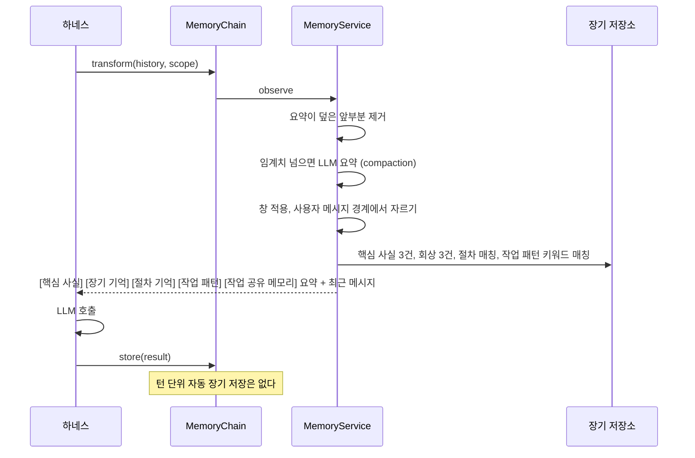
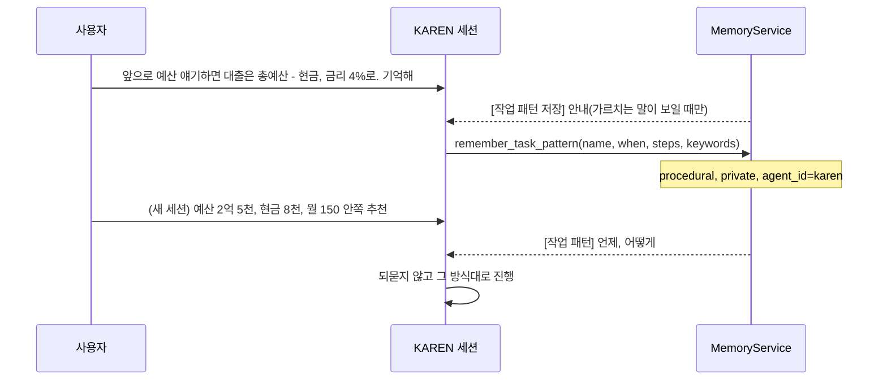
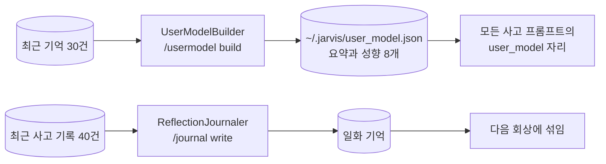
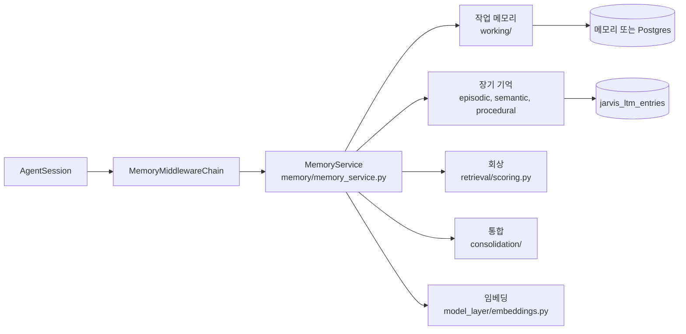

# Memory Management

메모리는 JARVIS 가 지난 대화와 사용자에 대한 사실을 기억해 매 턴의 프롬프트에 넣는 기능이다. 작업 기억과 장기 기억 두 층으로 나뉘고, 장기 기억에는 정해진 순간에만 쓴다. 매 턴의 대화를 자동으로 장기 기억에 저장하지는 않는다.

`memory/` 의 `MemoryService` 가 두 기억을 가진다. 기억은 턴마다 `agent_layer/memory/chain.py` 의 미들웨어 체인을 통해 프롬프트에 들어간다.

## 계층

| 계층 | 무엇 | 어디 |
|---|---|---|
| 작업 기억 | 세션 히스토리 위의 메타데이터. 요약, 요약이 덮는 메시지 수, 되뇌기 횟수, 메모(최대 50) | 메모리 또는 Postgres `jarvis_working_memory` |
| 장기 기억 | `MemoryItem`. 종류는 의미(semantic), 일화(episodic), 절차(procedural) | 메모리 또는 Postgres `jarvis_ltm_entries`(pgvector 선택) |
| 절차 기억 | 스킬은 저장하지 않고 스킬 레지스트리를 그대로 읽는다 | |
| 작업 패턴 | 사용자가 알려 준 작업 방식. 장기 기억의 절차(procedural) 항목으로, 저장한 에이전트만 본다 | 장기 기억과 같은 곳 |

세션 히스토리 자체의 정본은 세션 저장소다. 작업 기억은 그 위에 "어디까지 요약했나" 를 얹을 뿐이다.

## 턴마다 일어나는 일

- **창**: 최근 `window_size`(50) 메시지만 넣는다. 도구 호출과 결과 쌍이 갈라지지 않도록 첫 사용자 메시지가 나올 때까지 더 잘라낸다
- **압축**: 요약되지 않은 꼬리가 `keep_recent`(10) 보다 길고 글자 수가 `compaction_threshold`(100,000) 를 넘으면 LLM 이 앞부분을 요약한다. 요약은 `auto_summary` 일화로 저장되므로 같은 부분을 다시 요약하지 않는다
- **회상**: 마지막 사용자 발화 200자로 검색한다. 키워드(부분 문자열, Postgres 는 ILIKE) 후보와 벡터(코사인 ≥ 0.3) 후보를 합쳐 점수를 다시 매긴다. 점수는 최신성, 중요도, 관련성, 단서 겹침의 가중합이고, 종류마다 가중치가 다르다(의미 기억은 관련성 0.6, 일화는 최신성 0.4). 되뇌기 횟수가 많을수록 중요도가 덜 식는다
- **되뇌기**: 회상된 항목은 `last_accessed` 가 갱신되고 되뇌기 횟수가 오른다

## 장기 기억에 쓰이는 순간

| 출처 | 종류 | 가시성 | 언제 |
|---|---|---|---|
| `explicit` | 의미 | shared | `/remember <text>` |
| `extracted` | 의미 | shared | 통합(consolidation)이 일화에서 뽑은 사실 |
| `usermodel` | 의미 | shared | 사용자 모델 |
| `auto_summary`, `manual_compact`, `session_end` | 일화 | private | 압축, `/compact`, 세션 종료 |
| `thought`, `journal` | 일화 | private | 사고 로그, 저널 |
| `delegation` | 일화 | private | 멀티 에이전트 위임 기록 |
| `task_pattern` | 절차 | private | 에이전트가 `remember_task_pattern` 도구로 사용자가 알려 준 방식을 저장할 때 |

가시성 규칙은 이렇다. 같은 사용자의 항목 중에서 같은 에이전트가 쓴 것이나 shared 인 것만 읽는다. 그래서 서브 에이전트는 사용자의 `/remember` 사실은 보지만 부모의 private 요약은 보지 못한다.

의미 기억이 "주제: 값" 꼴이면 주제 태그가 붙는다. 같은 주제의 이전 사실은 `superseded_by` 로 가려질 뿐 지워지지 않는다. 주제가 다른데 값이 비슷하면 간섭 후보로 표시만 한다.

## 작업 패턴

사용자가 "앞으로 비슷한 요청이 오면 이렇게 해, 기억해" 처럼 일하는 방식을 알려 주면, 에이전트는 그 방식을 작업 패턴으로 저장한다. 그리고 다음에 같은 종류의 요청이 오면 그 방식을 그대로 따른다. 사용자에 대한 사실(`/remember`, shared)과 달리 작업 패턴은 **에이전트마다 따로** 기억한다. 같은 "예산 추천" 이라도 KAREN 과 JARVIS 가 하는 일이 다르기 때문이다.

- **저장**: 에이전트가 `remember_task_pattern(name, when, steps, keywords)` 도구(`core/tools/task_pattern.py`)로 저장한다. 모든 에이전트가 이 도구를 쓰고, 정의의 `tools` 에 적지 않아도 붙는다. 패턴은 도구를 부른 세션의 에이전트 범위로 저장된다
- **저장 안내**: 사용자 말에 "기억해", "앞으로", "다음부터", "이 방식" 같은 말이 있으면 메모리가 `[작업 패턴 저장]` 안내 블록을 붙인다. 저장할지는 모델이 정한다
- **자연 키**: (사용자, 에이전트, 이름)이 키다. 같은 이름으로 다시 저장하면 그 항목을 고치므로, 몇 번을 저장해도 하나만 남는다
- **회상**: 요청 글에 패턴의 키워드가 들어 있으면 가장 많이 걸린 패턴 2개까지 `[작업 패턴]` 블록으로 넣는다. 부분 문자열로 대조하므로 조사가 붙어도 걸린다. 일반 회상 블록(`[장기 기억]`)에는 넣지 않는다
- **격리**: 작업 패턴은 private 이고 `agent_id` 가 저장한 에이전트다. 다른 에이전트의 회상이나 `/patterns` 에는 나오지 않는다
- **보기와 지우기**: `/patterns` 는 지금 에이전트의 패턴 목록을 보여주고, `/patterns forget <이름>` 은 그 패턴을 지운다
- 구현: `memory/long_term/task_pattern.py`(순수 함수), `MemoryService.remember_pattern`, `task_patterns`, `forget_pattern`

:::note
저장 안내 블록은 실서버에서 관찰한 모델 한계 때문에 넣었다. 모델이 "기억하겠습니다" 라고 말만 하고 아무것도 남기지 않는 일이 있었다.
:::

## 통합 (consolidation)

통합은 일화에서 오래 가는 사실을 뽑아 의미 기억으로 올리는 일이다. 여러 번 돌려도 결과가 같다(멱등하다).

1. `session_end`, `auto_summary`, `manual_compact` 일화 중 아직 통합되지 않은 것을 최근 50건까지 본다
2. LLM 이 `{key, value, importance}` 목록을 낸다. 중요도 0.5 미만은 버린다
3. `extracted` 사실로 저장하고, 원래 일화에 통합됨 표시를 남긴다
4. 작업 기억의 되뇌기 횟수를 항목으로 옮긴다

통합은 세션 종료(TUI 종료, Web 셧다운) 때 항상 돈다. 유휴 때는 `JARVIS_MEMORY__CONSOLIDATE_ON_IDLE` 가 켜져 있고 daemon 트리거가 `idle` 또는 `both` 일 때만 돈다. 기본 트리거가 `interval` 이므로 기본 설정에서는 유휴 통합이 꺼져 있다.

## 임베딩

`JARVIS_MEMORY__EMBEDDING_PROVIDER` 를 `openai`(text-embedding-3-small, 1536), `ollama`(nomic-embed-text, 768), `vllm`(모델과 차원 필수) 중 하나로 두면 의미 검색이 켜진다. Postgres 는 pgvector 확장을 만들고 HNSW 인덱스를 시도한다. 확장이 없으면 키워드 검색으로 내려간다. 벡터가 없는 항목은 `/remember reembed` 로 채운다.

한국어 대화라면 ollama 에서 `bge-m3`(1024)를 쓴다. 기본값 nomic-embed-text 는 한국어 문장끼리 코사인이 0.68~0.97 로 몰려서 다른 내용도 구분하지 못했다. 같은 임베딩 설정을 [AGENDA](./conversation/open-loop.md)의 약속 중복 판정도 쓴다.

## 평가

`python -m jarvis.memory.eval --suite all` 은 격리, 의미, 일화, 절차, 바꿔 말하기, 작업 기억, 충실도를 LLM 없이 잰다. 공개 벤치마크로 재려면 `--benchmark longmemeval|locomo` 를 쓴다.

## 사용자 모델과 저널

- **사용자 모델** (`agent_layer/usermodel/`): LLM 이 최근 기억 30건을 요약과 성향(최대 8개)으로 증류한다. `/usermodel build` 로 만들고 `~/.jarvis/user_model.json` 에 덮어쓴다. 모든 사고 프롬프트의 `{{user_model}}` 에 들어간다. 자동으로는 만들지 않는다
- **저널** (`agent_layer/journal/`): 최근 사고 기록 40건을 보고 1 에서 3 문장의 메타 성찰을 쓴다. `/journal write` 로 실행한다. 일화 기억으로 저장되어 회상에 섞여 들어온다

## 구현 위치

왼쪽이 사용자와 화면, 가운데가 코드 모듈, 오른쪽이 저장소다. 화살표는 호출이나 데이터의 방향이다.

- 구현: `memory/memory_service.py`, `agent_layer/memory/chain.py`
- 핵심 모듈: `memory/`
- 저장: 메모리 또는 Postgres
