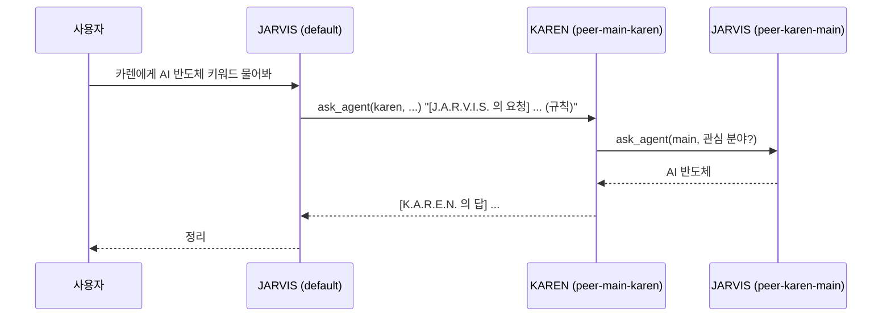
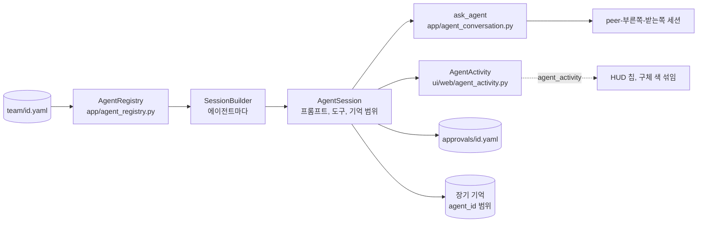

import FigureMultiAgentOrchestration from '@site/src/figures/multi-agent-orchestration.svg';
import FigureExpTeam from '@site/src/figures/exp-team.svg';

# Multi agent Orchestration

<figure className="paper-fig">
  <FigureMultiAgentOrchestration />
  <figcaption><b>Figure 1.</b> 최상위 에이전트는 세션, 일화 기억과 작업 패턴, 목표와 약속(open loop), 승인 규칙, 경계(boundaries 의 ask, never 도구), 모델과 도구, 메인 색을 따로 갖고, 사용자 모델, 사용자에 대한 사실, 공용 승인 규칙, AGENDA 를 함께 쓴다. 서로 일을 맡길 때는 ask_agent 를 쓰고, 되묻기는 A → B → A 까지만 허용한다. 받은 일을 그 일을 보낸 에이전트에게 되돌리는 요청은 거절한다.</figcaption>
</figure>

Multi agent Orchestration 은 JARVIS 와 같은 층에 목적이 다른 최상위 에이전트를 더 두는 기능이다. 전체를 총괄하는 첫 에이전트가 JARVIS(id `main`)이고, 정보 수집을 맡는 KAREN(id `karen`)처럼 에이전트를 정의 파일 하나로 늘린다.

최상위 에이전트는 [Orchestration Pattern](./orchestration-pattern.md)의 서브 에이전트와 다르다. 서브 에이전트는 부모 턴 안에서 잠깐 도는 도구이고, 최상위 에이전트는 자기 세션, 기억, 약속(open loop), 승인 규칙, 브랜드를 가진다. 구현은 `app/agent_registry.py` 에 있다.

## 지금 팀

| id | 이름 | 맡은 일 | 메인 색 | 정의 |
|---|---|---|---|---|
| `main` | J.A.R.V.I.S. | 전체 총괄. 사용자의 기본 대화 상대 | <span className="agent agent--jarvis">JARVIS</span> `#5fc8e2` | env(`JARVIS_BRAND__*`) |
| `karen` | K.A.R.E.N. | 특정 분야 정보 수집과 출처 있는 요약. LH, SH 청약 공고 조회, 예산에 맞는 공고 추천, 대출 계산([청약 공고와 대출 계산](../../agents/karen/housing.md)) | <span className="agent agent--karen">KAREN</span> `#97BC62` | `team/karen.yaml` |

메인 색(`palette.primary`)은 HUD 의 링, 입자 구, 패널, 에이전트 칩, 세션 표식, AGENDA 라벨에 쓰인다. 두 에이전트가 함께 일하면 입자 구가 두 메인 색(시안과 녹색)으로 섞인다. 세션을 다른 에이전트로 바꾸면 화면 전체가 약 0.9초에 걸쳐 그 에이전트 색으로 섞인다. 색을 바꾸려면 정의 파일의 `palette.primary` 를 고치고 서버를 다시 띄운다.

## 정의 파일

`JARVIS_TEAM__DIR`(기본 `~/.jarvis/team`, docker 는 저장소의 `team/`)의 `<id>.yaml` 하나가 에이전트 하나다. 파일 이름이 id 이고, 비운 항목은 JARVIS 설정을 이어받는다.

```yaml
# team/karen.yaml
name: K.A.R.E.N.              # 워드마크이자 다른 에이전트가 부르는 이름
description: 정보 수집 담당      # 다른 에이전트가 누구에게 맡길지 고를 때 읽는다
quote: Eyes on everything
palette: { primary: "#97BC62", accent: "#ffd166" }
system_prompt: |
  당신은 K.A.R.E.N. 입니다 ...
model: null                   # 모델 이름만 바꾼다. 프로바이더와 키는 JARVIS 것
tools: [lh_notice, web_search, read_file]   # 비우면 앱 레지스트리 전체
proactive: false              # 비우면 JARVIS 의 proactive 설정
memory:                       # 비우면 자기 기억만 읽는다
  read: { edm: [self], pdm: [self] }
```

- id 는 `^[a-z][a-z0-9_-]{0,31}$` 를 따라야 한다. `main.yaml` 은 무시한다. JARVIS 의 정본은 env(`JARVIS_BRAND__*`, `JARVIS_LLM__*`)다
- 잘못된 파일은 로그만 남기고 그 파일만 건너뛴다
- `tools` 에는 에이전트만 쓰는 도구(`lh_notice`, `sh_notice`, `housing_loan`, `housing_budget`)도 적을 수 있다. 이 도구는 `tools` 가 빈 JARVIS 에게는 보이지 않는다
- `ask_agent`, `remember_task_pattern`, `recall_episodes` 는 `tools` 에 적지 않아도 모든 에이전트에게 붙는다. 작업 패턴은 에이전트마다 따로 기억한다([Memory Management → 작업 패턴](../memory.md#작업-패턴))
- `memory.read` 는 층별로 더 읽을 에이전트를 적는다([Memory Management → 읽기 권한](../memory.md#읽기-권한)). 모르는 키가 있으면 그 파일을 건너뛴다
- 사고 설정은 JARVIS 것을 같이 쓰고, proactive 피드백 학습기는 에이전트마다 따로 둔다

## 무엇을 공유하나

| 항목 | 규칙 |
|---|---|
| 사용자 모델 | 공유. 파일 하나를 모든 에이전트가 읽는다 |
| 사용자 프로필(의미 기억) | 공유. 같은 사용자의 모든 에이전트가 읽는다 |
| EDM(일화), PDM(절차) | 쓴 에이전트 전용. 정의 파일의 `memory.read` 에 적은 에이전트의 것만 더 읽는다 |

어느 층에 쓰는지는 쓰기 경로가 정하고(`memory_service.WRITE_RULES`), 누가 읽는지는 층과 정책이 정한다. `/remember`, 사용자 모델 증류, 일화에서 뽑은 사실은 사용자 프로필로, 나머지는 일화나 절차로 쓴다. 기억 범위의 `agent_id` 는 세션의 에이전트 id 다.

범위를 도입하기 전의 옛 행은 Postgres 저장소가 열릴 때 main 행으로 채운다. 종류(kind)는 출처로 정한다. 저장소를 두 번 열어도 결과가 같다.

## 세션은 한 에이전트의 것

세션은 만들 때 에이전트가 정해지고 바뀌지 않는다(`jarvis_sessions.agent_id`, jsonl 은 `.meta.json` 의 `agent_id`). 에이전트가 정해지기 전에 만든 세션은 main 이다.

- Web: `POST /api/sessions {"agent": "karen"}` 이나 `/ws?session_id=..&agent=karen` 으로 에이전트를 정한다. 이미 있는 세션은 저장된 에이전트로 열리고 `agent` 는 무시한다. 모르는 에이전트를 주면 400 을 돌려주고, ws 는 close `4404` 로 닫는다
- TUI: `jarvis --agent karen` 은 `default-karen` 세션으로 시작한다. `--session ID` 는 그 세션을 만든 에이전트로 연다
- 분기한 세션은 부모와 같은 에이전트를 쓴다
- 스케줄: 작업 YAML 의 `agent: karen` 이면 그 에이전트의 모델, 시스템 프롬프트, 기억 범위로 돈다. `/schedule` 로 만든 작업은 명령을 친 세션의 에이전트가 들어간다
- 성찰 daemon 은 열린 세션 전부를 돈다. proactive 가 꺼진 에이전트(KAREN 기본값)의 세션은 성찰을 건너뛴다

## 승인 규칙은 두 겹

공용 `~/.jarvis/approvals.yaml` 은 모든 에이전트가 읽고 사람이 고친다. 승인 화면의 **항상 허용** 은 그 세션 에이전트의 `~/.jarvis/approvals/<id>.yaml` 에만 쌓인다(`LayeredApprovalRules`). 에이전트를 나누기 전 `approvals.yaml` 에 쌓인 규칙은 그대로 공용이 된다. 대조 방식과 규칙 파일 형식은 [Tool & Approve System → 승인 기억](../conversation/tools-and-approval.md#승인-기억)에 있다.

## AGENDA 는 모두의 것

AGENDA 카드는 모든 에이전트의 스케줄과 약속을 한 목록에 보여주고, 항목마다 에이전트 이름 라벨을 그 에이전트의 primary 색으로 단다. 약속의 에이전트(`OpenLoop.agent_id`)는 약속을 감지한 세션의 에이전트이고, 스케줄의 에이전트는 작업의 `agent` 다. 약속을 닫는 판정(사고 프레임의 closed_loops, 취소하는 말)은 그 약속을 만든 세션에서만 한다.

## HUD 에서 에이전트 고르기

에이전트가 둘 이상이면 SESSIONS 카드 위에 에이전트 칩이 생긴다. 칩을 누르면 그 에이전트의 열린 세션으로 옮기고, 열린 세션이 없으면 새 세션을 만들어 옮긴다. 붙은 세션의 에이전트에 맞춰 워드마크, 명언, 링, 입자 구, 패널 색이 바뀐다. 세션 목록의 표식 색과 AGENDA 라벨 색도 에이전트의 primary 다. SYSTEM 의 TOOLS 는 그 에이전트가 쓰는 도구만 보여준다.

## 에이전트끼리 대화

에이전트가 둘 이상이면 `ask_agent` 도구가 생긴다(`app/agent_conversation.py`). 모든 에이전트가 쓰고, 정의의 `tools` 에 적지 않아도 붙는다. 도구 설명에 팀 명단(id, 이름, 설명, JARVIS 는 "팀 총괄")이 들어가 LLM 이 누구에게 맡길지 고른다.



- 받는 쪽은 에이전트 쌍마다 세션 하나(`peer-<부른 쪽>-<받는 쪽>`)에서 답한다. 같은 쌍은 앞 대화를 이어 가고, 그 세션은 HUD 세션 목록에 보인다
- 받는 쪽 세션은 사용자를 부른 쪽 범위에서 받는다. 기억은 받는 쪽 에이전트 범위로 남는다
- 요청 끝에 규칙 한 줄(`PEER_REQUEST_RULE`)이 붙는다. 받은 일이니 필요하면 가진 도구를 먼저 부르고, 도구 결과에 있는 것만 답하라는 내용이다
- 받는 쪽 도구의 승인 요청은 부른 세션의 화면에 뜬다
- 깊이는 A → B → A 까지만 허용한다. 그보다 깊으면 도구가 거절하고 지금 아는 것으로 답하게 한다
- 받은 일을 보낸 쪽에 되돌리지 못한다. 받은 요청과 글자가 거의 같은(bigram Jaccard 0.4 이상) 일을 그 요청을 보낸 에이전트에게 다시 맡기면 도구가 거절한다. 되묻기("관심 분야가 뭐야?")처럼 다른 질문은 맡길 수 있다
- 받는 쪽이 같은 쌍의 다른 질문에 답하는 중이면 "다른 일을 하고 있다" 는 오류 결과를 돌려준다. 300초 안에 답이 없으면 시간 초과가 된다
- 받는 쪽이 Dual channel 로 백그라운드 답을 하면 끝날 때까지 기다렸다가 저장된 마지막 답을 돌려준다

:::note
요청 끝 규칙과 되돌리기 금지는 실서버에서 관찰한 모델 한계 때문에 넣었다. gemma4:e4b 는 위임받은 세션에서만 도구를 부르지 않고 조회한 척 답했다. 또 도구 설명의 지시를 무시하고 받은 일을 그대로 되돌려 두 에이전트가 서로 미뤘다.
:::

## 함께 일할 때의 구체

서버는 세션마다 루프의 시작과 끝을 세어 일하는 에이전트가 바뀔 때 `agent_activity{active}` 를 열린 HUD 전부에 보낸다(`ui/web/agent_activity.py`). 둘 이상이 일하면 HUD 구체의 입자가 두 에이전트의 primary 로 흐르는 띠처럼 섞이고, 일하는 에이전트 칩이 빛난다. 끝나면 지금 에이전트 색으로 돌아온다.

## 성능 실험

### JARVIS 가 KAREN 에게 맡기기

새 JARVIS 세션에 "KAREN 에게 서울 SH 청약 공고 최근 것 하나만 찾아 달라고 맡겨 줘" 를 보내, JARVIS 가 `ask_agent` 로 맡기는지, KAREN 이 자기 도구를 부르는지, 끝까지 얼마나 걸리는지 쟀다. 두 에이전트가 같은 모델을 쓴다. 재현: `uv run python -m scripts.experiments.agent_turns delegate --n 3`.

<figure className="paper-fig">
  <FigureExpTeam />
  <figcaption><b>Figure 2.</b> 두 모델 모두 세 번 다 위임하고 KAREN 이 도구로 답했다. 위임 한 번에 LLM 호출이 최소 네 번 일어나 로컬 모델에서는 30초를 넘는다.</figcaption>
</figure>

- KAREN 의 도구 호출은 스크립트가 아니라 받는 쪽 세션(`peer-main-karen`) 기록을 직접 열어 확인했다. 여섯 번 모두 KAREN 이 도구를 먼저 부르고 도구 결과로 답했다. 요청 끝 규칙(`PEER_REQUEST_RULE`)을 넣기 전, gemma4:e4b 가 위임받은 세션에서 도구 없이 "조회한 척" 답하던 문제가 이 조건에서는 나오지 않았다
- 같은 기록에서, 한 번은 KAREN 이 "청약" 이라는 제목 키워드로 걸러 결과가 0건이었고, 지어내지 않고 "조건에 맞는 공고가 없다" 고 답했다
- LLM 호출 네 번은 JARVIS 판단, KAREN 판단, KAREN 정리, JARVIS 정리다

## 설계 노트

### 세션은 한 에이전트의 것

에이전트를 고르는 단위를 세션으로 정했다. 세션은 만들 때 에이전트가 정해지고 바뀌지 않는다. 대화 중간에 에이전트를 바꾸게 하면 앞의 대화를 누구의 기억으로, 어떤 승인 규칙으로 다룰지가 모호해진다. 기존 세션은 모두 `main` 으로 이어지고, Postgres 에는 `agent_id` 칼럼을 `ADD COLUMN IF NOT EXISTS` 로 더해 재실행해도 안전하게 옮겼다.

### 맡긴 대화도 세션으로 남긴다

`ask_agent` 의 받는 쪽은 에이전트 쌍마다 세션 하나(`peer-<부른 쪽>-<받는 쪽>`)에서 답한다. 맡길 때마다 새 세션을 만들면 KAREN 은 JARVIS 가 앞서 무엇을 물었는지 모른다. 쌍마다 이어지는 세션이라 앞 대화를 기억하고, HUD 세션 목록에서 그 대화를 사람이 열어 볼 수 있다. 받는 쪽 도구의 승인 요청은 받는 쪽이 아니라 부른 세션의 화면으로 보낸다. 사람이 보고 있는 곳이 그쪽이기 때문이다.

### 서로 미루기를 막는 두 규칙

실서버에서 gemma4 두 에이전트가 같은 일을 서로에게 되돌려 맡기는 것을 봤다. 도구 설명에 "되돌리지 마라" 를 적어도 무시했다. 그래서 규칙을 도구 코드에 넣었다. 깊이는 A → B → A 까지만 허용하고, 받은 요청과 글자가 거의 같은 일(bigram Jaccard 0.4 이상)을 보낸 쪽에 다시 맡기면 도구가 거절한다. "관심 분야가 뭐야?" 같은 되묻기는 다른 질문이라 통과한다.

## 구현 위치

왼쪽이 사용자와 화면, 가운데가 코드 모듈, 오른쪽이 저장소다. 화살표는 호출이나 데이터의 방향이다.



- 핵심 모듈: `app/agent_registry.py`, `app/agent_conversation.py`, `ui/web/agent_activity.py`
- 저장: `team/`, `jarvis_sessions.agent_id`, `approvals/<agent_id>.yaml`
