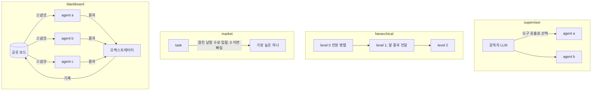
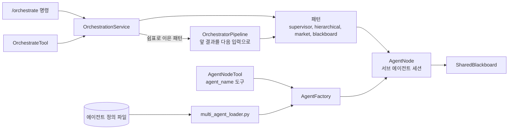

import FigureOrchestrationPattern from '@site/src/figures/orchestration-pattern.svg';

# Orchestration Pattern

<figure className="paper-fig">
  <FigureOrchestrationPattern />
  <figcaption><b>Figure 1.</b> 서브 에이전트에게 일을 나누는 네 패턴. (a) 감독자 LLM 이 도구 호출로 맡길 에이전트를 고른다. (b) 레벨 순서대로 돌고 같은 레벨은 병렬이다. (c) 작업 낱말과 이름, capabilities 가 겹친 수가 점수이고, 가장 높은 하나가 맡는다. 0 이면 입찰하지 않고, capabilities 가 없는 에이전트는 늘 입찰한다. (d) 에이전트들은 공유 보드의 스냅샷을 맥락으로 받아 병렬로 돌고, 오케스트레이터가 결과를 보드에 쓴다. 패턴을 쉼표로 이으면(`hierarchical,blackboard`) 앞 단계 결과가 다음 단계의 입력이 된다.</figcaption>
</figure>

Orchestration Pattern 은 JARVIS 가 한 작업을 여러 서브 에이전트에게 나눠 맡기고 결과를 모으는 기능이다. 서브 에이전트는 부모 턴 안에서 잠깐 도는 도구이고, 사용자와 직접 대화하는 에이전트가 아니다. 자기 세션, 약속, 승인 규칙, 브랜드를 가진 에이전트가 필요하면 [Multi agent Orchestration](./index.md)을 쓴다.

`~/.jarvis/agents/*.yaml` 에 에이전트를 선언하면 각 에이전트가 `agent_<name>` 도구가 된다. 패턴을 고르는 `orchestrate` 도구와 `/orchestrate` 명령도 함께 생긴다. 구현은 `core/multi_agent/` 에 있다.

## 서브 에이전트는 무엇인가

서브 에이전트는 보통의 `AgentSession` 이고, 세 가지가 다르다.

- 정의의 `system_prompt` 와 `tools` 부분집합을 쓴다. `model_override` 는 모델 이름만 바꾼다
- 부모의 사용자 범위를 상속한다(`inherit_scope`). 그래서 사용자 프로필(`/remember` 사실)은 보이고 부모의 일화와 절차는 보이지 않는다
- Inner Thought 와 Proactive Dialogue 가 없다

부모 LLM 에게 서브 에이전트 호출은 `agent_<name>` 도구의 결과로 보인다. 내용과 맥락이 같으면 `task_id`(해시)가 같으므로 다시 돌지 않는다. 부모는 "위임: ..." 을 일화로 기억한다.

## 패턴



| 패턴 | 동작 |
|---|---|
| `supervisor` | 감독자 세션이 `agent_*` 도구를 들고 LLM 이 위임을 결정한다. 감독자 프롬프트는 `JARVIS_AGENTS__SUPERVISOR_PROMPT`(문자열 또는 파일 경로) |
| `hierarchical` | `level` 순서대로 돌고, 같은 레벨은 병렬로 돈다. 앞 레벨 결과가 뒤 레벨의 컨텍스트와 작업 공유 메모리로 간다 |
| `market` | 에이전트가 `capabilities` 로 입찰하고 점수가 가장 높은 하나가 맡는다 |
| `blackboard` | 전원이 공유 보드 스냅샷을 보고 병렬로 돌고, 결과를 취합한다. `--promote` 면 결과를 부모 에이전트의 일화로 남긴다 |

패턴을 쉼표로 이으면 파이프라인이 된다. 앞 결과가 다음 작업의 입력이 되고, 하나라도 실패하면 멈춘다.

## 작업 공유 메모리

오케스트레이션 한 번은 `task` 범위의 작업 기억을 가진다. 에이전트 사이의 결과는 여기로 공유되어 다음 에이전트 프롬프트에 `[작업 공유 메모리]` 블록으로 들어간다. 이 메모리는 오케스트레이션이 끝나면 지워진다. 남겨야 할 결과는 `blackboard` 의 `--promote` 로 장기 기억에 올린다.

## 호출

```text
/orchestrate hierarchical 분기 보고서 작성
/orchestrate blackboard --agents a,b --promote 시장 분석
/orchestrate supervisor,blackboard 조사 후 정리
/orchestrate list
```

메인 에이전트도 `orchestrate` 도구로 같은 일을 한다. 작업이 여러 전문가나 단계를 요구한다고 판단하면 LLM 이 패턴과 참여자를 고른다.

## 알아 둘 것

- 서브 에이전트의 이벤트는 부모 세션 구독자에게 전달되지 않는다. 화면에는 부모의 `agent_<name>` 도구 호출 시작과 끝만 보인다
- Web 모드에서 서브 에이전트가 승인이 필요한 도구를 부르면 승인 콜백이 없어 거부된다. 그래서 서브 에이전트에는 승인이 필요 없는 도구만 준다

## 설계 노트

### 패턴이 실제로 결과를 주고받게 했다

처음 만든 네 패턴은 이전 결과와 블랙보드 내용을 작업 객체의 `context` 에만 넣었고, 하위 에이전트 프롬프트에는 `content` 만 넘겼다. 그래서 Hierarchical 과 Blackboard 에서 하위 에이전트가 상위 결과를 전혀 보지 못하고 각자 따로 돌았다. 결과를 작업 범위의 공유 메모리(`[작업 공유 메모리]` 블록)로 넘기도록 고쳐, 앞 결과가 하위 에이전트 프롬프트에 들어가게 했다.

### 위임은 한 노드로

오케스트레이터가 노드를 직접 부르던 길과 도구로 위임하던 길이 따로 있어, 한쪽에서는 기억 범위 상속과 위임 기록이 빠졌다. 위임을 `LazyAgentNode` 하나로 모았다. 자식 세션은 작업에 실린 부모 범위(`caller_scope`)에서 사용자를 받고, 부모 범위에 무엇을 맡겼는지 기록한다. 예전에는 위임하는 동안 전역 contextvar 를 자식 범위로 바꿨다가 되돌렸는데, 지금은 범위를 인자로만 넘긴다.

## 구현 위치

왼쪽이 사용자와 화면, 가운데가 코드 모듈, 오른쪽이 저장소다. 화살표는 호출이나 데이터의 방향이다.



- 핵심 모듈: `core/multi_agent/`
- 저장: 작업 공유 메모리(blackboard)
