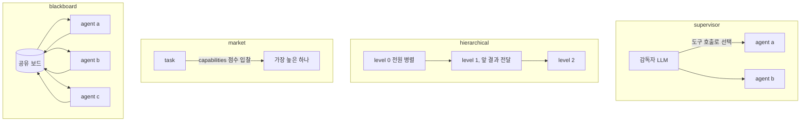
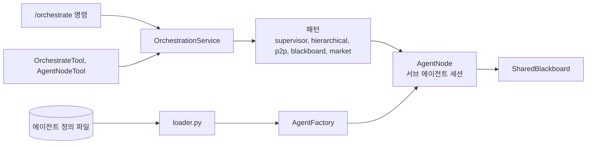

# 멀티 에이전트

`~/.jarvis/agents/*.yaml` 에 에이전트를 선언하면 각 에이전트가 `agent_<name>` 도구가 되고, 패턴을 고르는 `orchestrate` 도구와 `/orchestrate` 명령이 생긴다. 구현은 `core/multi_agent/`.

## 서브 에이전트는 무엇인가

보통의 `AgentSession` 이다. 다른 점은 셋.

- 정의의 `system_prompt` 와 `tools` 부분집합을 쓴다. `model_override` 는 모델 이름만 바꾼다
- 부모의 사용자 범위를 상속한다(`inherit_scope`). 사용자의 `/remember` 사실은 보이고 부모의 private 요약은 안 보인다
- 사고 엔진과 proactive 가 없다

호출은 부모 LLM 에게 `agent_<name>` 도구의 결과로 보인다. 같은 내용과 맥락이면 `task_id`(해시)가 같아 다시 돌지 않는다. 부모는 "위임: ..." 을 일화로 기억한다.

## 패턴



| 패턴 | 동작 |
|---|---|
| `supervisor` | 감독자 세션이 `agent_*` 도구를 들고 LLM 이 위임을 결정한다. 감독자 프롬프트는 `JARVIS_AGENTS__SUPERVISOR_PROMPT`(문자열 또는 파일 경로) |
| `hierarchical` | `level` 순서대로, 같은 레벨은 병렬. 앞 레벨 결과가 뒤 레벨의 컨텍스트와 작업 공유 메모리로 |
| `market` | 에이전트가 `capabilities` 로 입찰하고 점수가 가장 높은 하나가 맡는다 |
| `blackboard` | 전원이 공유 보드 스냅샷을 보고 병렬로 돌고 결과를 취합. `--promote` 면 결과를 shared 장기 기억으로 올린다 |

쉼표로 이으면 파이프라인이다. 앞 결과가 다음 작업의 입력이 되고 하나라도 실패하면 멈춘다.

## 작업 공유 메모리

오케스트레이션 한 번은 `task` 범위의 작업 기억을 가진다. 에이전트 간 결과는 여기로 공유되어 다음 에이전트 프롬프트에 `[작업 공유 메모리]` 블록으로 들어가고, 끝나면 지워진다.

## 호출

```text
/orchestrate hierarchical 분기 보고서 작성
/orchestrate blackboard --agents a,b --promote 시장 분석
/orchestrate supervisor,blackboard 조사 후 정리
/orchestrate list
```

메인 에이전트도 `orchestrate` 도구로 같은 일을 한다. 작업이 여러 전문가나 단계를 요구한다고 판단하면 LLM 이 패턴과 참여자를 고른다.

## 알아 둘 것

- 서브 에이전트의 이벤트는 부모 세션 구독자에게 전달되지 않는다. 화면에는 부모의 `agent_<name>` 도구 호출 시작과 끝만 보인다
- Web 모드에서 서브 에이전트가 승인 필요 도구를 부르면 승인 콜백이 없어 거부된다. 서브 에이전트에는 승인이 필요 없는 도구를 주는 것이 맞다

## 구현 위치

왼쪽이 사용자와 화면, 가운데가 코드 모듈, 오른쪽이 저장소다. 화살표는 호출이나 데이터의 방향이다.



- 핵심 모듈: `core/multi_agent/`
- 저장: 작업 공유 메모리(blackboard)
