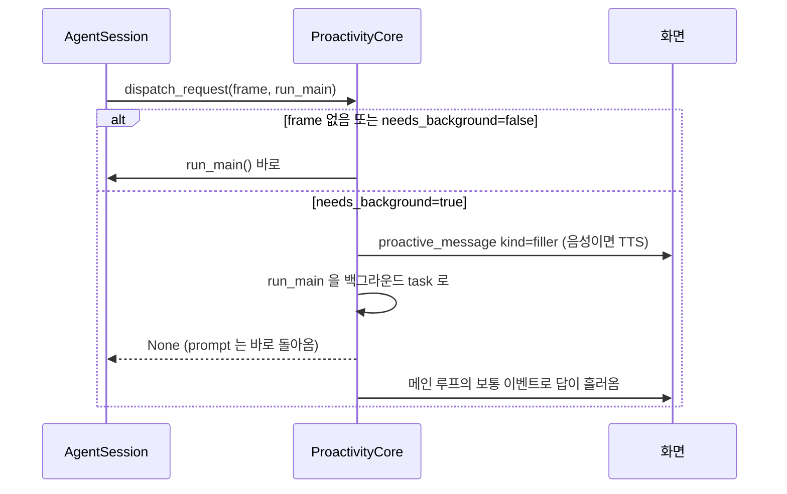
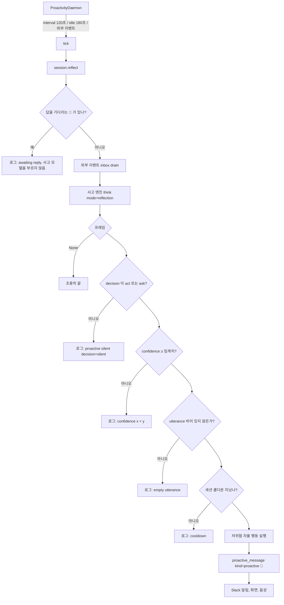
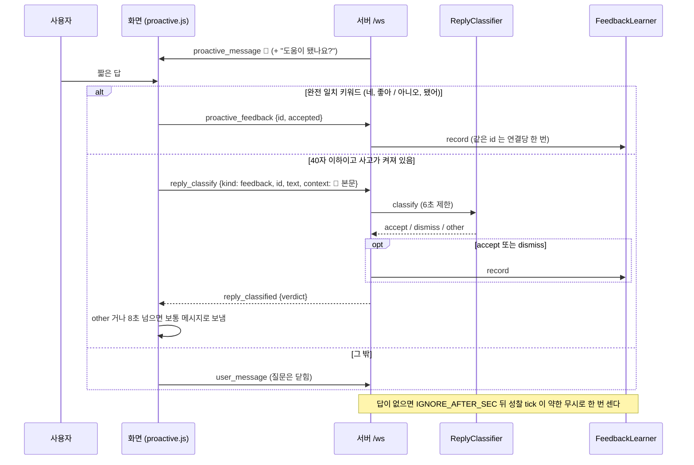
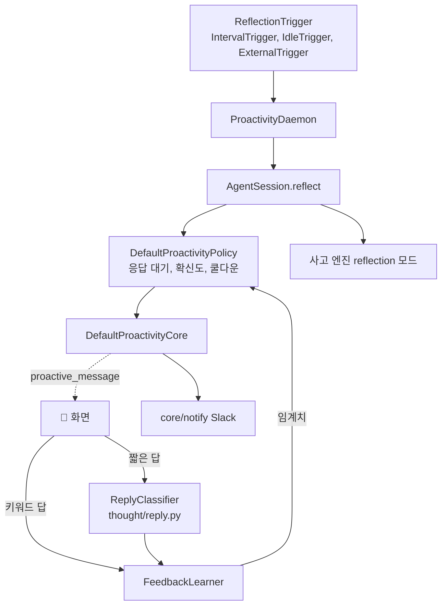

# 먼저 행동하기

사고 프레임을 바탕으로 세 가지를 한다. 요청 시점의 **dual channel**, 요청이 없을 때의 **자율 성찰과 먼저 말 걸기**, 그리고 **피드백 학습**. 구현은 `core/proactive/`.

## Dual channel

오래 걸릴 요청이면 "잠깐만요, 확인할게요" 를 먼저 말하고 메인 응답은 뒤에서 돈다.

filler 가 비어 있으면 내장 문구 셋을 돌아가며 쓴다. 사고가 늦게 끝났거나(`race` 초과) `after` 시점이면 frame 이 없으므로 항상 즉시 모드다.

## 자율 성찰과 🔔

- **daemon** (`daemon.py`): 트리거를 먼저 기다리고 tick 한다. 기동 직후에는 말하지 않는다. Web 은 최근 활동 순으로 모든 세션을 성찰하고, TUI 는 현재 세션만
- **트리거** (`triggers.py`): `interval`(기본 120초), `idle`(마지막 입력 뒤 180초, 한 번 울리면 다음 활동까지 재장전), `both`. 외부 소스가 있으면 새 이벤트도 트리거가 된다
- **응답 대기** (`policy.py`, `check_awaiting`): 🔔 를 낸 세션은 사용자가 메시지나 피드백을 보낼 때까지 다시 말하지 않는다. 성찰 자체를 건너뛰어 사고 모델도 부르지 않고, 외부 이벤트도 꺼내지 않고 남겨 둔다. 대기 상태는 메모리에만 있어 재시작하면 풀린다
- **성찰 프롬프트**: 사용자 입력 자리가 없고 대신 `[외부 이벤트]` 와 `[최근에 먼저 건넨 말]`(세션의 최근 🔔 3개)이 있다. "확신이 없으면 반드시 silent", "이미 한 말과 같은 취지면 표현을 바꿔도 silent"
- **게이트** (`policy.py`, `decide_proactive`): 순서대로 응답 대기, 결정, 확신도, 빈 발화, 쿨다운. 전부 지나야 발화 시각을 기록하고 응답 대기에 들어간다. 침묵 이유는 `[Thought] proactive silent: <이유>` 로그로 남는다
- **발화 내용**: `utterance` 만. 해석문을 대신 내보내지 않는다

| 게이트 | 설정 | 기본 |
|---|---|---|
| 확신도 | `JARVIS_PROACTIVE__CONFIDENCE_THRESHOLD` | 0.6, 피드백으로 변함 |
| 쿨다운 | `JARVIS_PROACTIVE__COOLDOWN_SEC` | 300초, 세션별 |
| 무응답 판정 | `JARVIS_PROACTIVE__IGNORE_AFTER_SEC` | 600초. 🔔 뒤 이만큼 답이 없으면 한 번 약한 무시 |
| 주기 | `JARVIS_PROACTIVE__DAEMON_INTERVAL_SEC` | 120초 |
| 유휴 | `JARVIS_PROACTIVE__DAEMON_IDLE_SEC` | 180초 |

## 저위험 자율 행동

성찰이 발화 게이트를 전부 지났을 때만, 프레임의 `proactive_actions` 중 다음을 모두 만족하는 것을 실행한다.

1. `risk == "low"`, `kind == "tool"`, `tool_name` 있음
2. 화이트리스트: `read_file`, `glob`, `grep`, `list_dir`, `web_search`, `web_fetch`
3. 샌드박스가 승인을 요구하지 않는 도구

결과는 `(미리 해둠) 결과1 / 결과2` 꼴로 🔔 뒤에 붙는다. 고위험 행동은 분류만 되고 실행도 노출도 되지 않는다. 요청 시점에는 자율 행동을 하지 않는다.

## 피드백 학습

🔔 가 도움이 됐는지에 따라 확신도 임계치를 움직인다(`feedback.py`).

- 수락: 임계치 −0.05, 무시: +0.05, 무응답: +0.025. 범위 0.3 에서 0.95
- 무응답은 🔔 뒤 `IGNORE_AFTER_SEC` 동안 아무 답이 없을 때 그 발화 하나에 한 번만 센다. 자리를 비웠을 수도 있어 무시의 절반만 반영한다. 판정은 성찰 tick 에서 하므로 `idle` 트리거 단독이면(다음 활동 전까지 tick 이 없다) 세지 않는다
- 앱에 하나인 `FeedbackLearner` 를 모든 세션의 정책이 공유한다. 메모리에만 있어 재시작하면 기본값으로 돌아간다
- 입력: TUI 는 `Ctrl+Y`(도움됨), `Ctrl+G`(무시). Web 은 🔔 뒤에 "도움이 됐나요?" 를 붙이고 다음 짧은 답을 읽는다. `네`, `좋아`, `고마워` 류는 수락, `아니오`, `됐어`, `무시` 류는 무시로 바로 처리한다. 그 밖의 40자 이하 답("응 그걸로 해줘", "지금은 됐어")은 사고 모델에 한 번 물어(`agent_layer/thought/reply.py`) accept, dismiss, other 로 나누고, other 면 보통 메시지로 흘러간다. 실측(gemma4:e2b): 11문장 모두 맞음, 중앙값 0.3초

## 외부 알림

열린 화면이 없어도 🔔 와 스케줄 결과를 Slack incoming webhook 으로 보낸다. `JARVIS_NOTIFY__SLACK_WEBHOOK_URL`, 종류는 `JARVIS_NOTIFY__KINDS`(`reminder`, `proactive`). filler 는 보내지 않는다. 재시도는 없고 실패는 로그.

## 평가

`python -m jarvis.core.proactive.eval`. `policy.jsonl` 은 프레임을 직접 주어 게이팅만, `situation.jsonl` 은 상황을 주어 사고 엔진까지(`--engine llm`) 잰다. 사례마다 정책을 새로 만들고 시계를 고정해 같은 입력은 같은 결과를 낸다.

## 구현 위치

왼쪽이 사용자와 화면, 가운데가 코드 모듈, 오른쪽이 저장소다. 화살표는 호출이나 데이터의 방향이다.

- 핵심 모듈: `core/proactive/daemon.py`, `core/proactive/policy.py`, `core/proactive/feedback.py`, `agent_layer/thought/reply.py`, `core/proactive/core.py`
- 저장: 프로세스 메모리(쿨다운, 응답 대기, 임계치). 재시작하면 기본값으로 돌아간다
