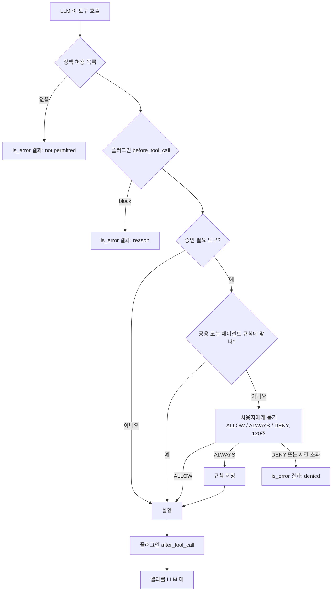
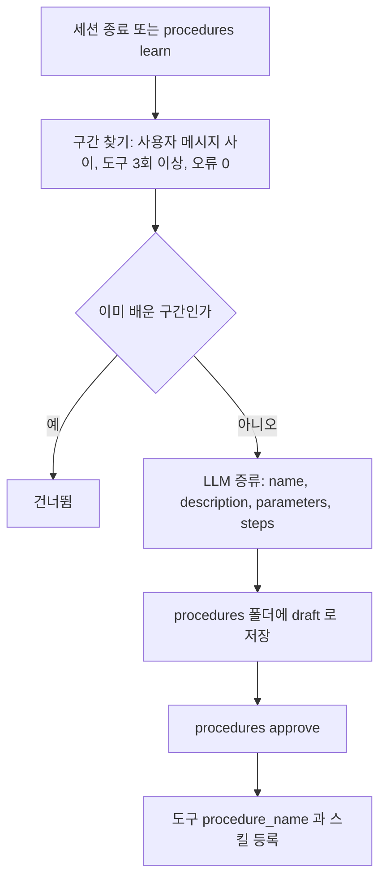
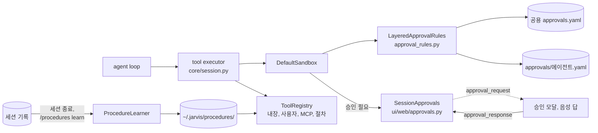

# 도구와 승인

도구는 에이전트가 파일, 셸, 웹 같은 바깥 세상에 손을 대는 유일한 길이고, 위험할 수 있는 도구는 실행 전에 사람의 승인을 받는다.

도구는 `core/tools/` 의 레지스트리에 모인다. 승인이 필요한 도구는 `core/policy/sandbox.py` 가 실행 전에 사람에게 묻는다.

## 내장 도구

| 도구 | 하는 일 | 승인 |
|---|---|---|
| `bash` | 셸 명령. 기본 타임아웃 30초 | 필요 |
| `write_file` | 파일 쓰기. 부모 디렉토리 생성, 덮어쓰기 | 필요 |
| `edit_file` | 문자열 정밀 교체 | 필요 |
| `read_file` | 라인 범위 읽기 | |
| `glob` | 패턴으로 파일 찾기, 최근 수정순 | |
| `grep` | 정규식 검색, 바이너리 건너뜀 | |
| `list_dir` | 디렉토리 나열 | |
| `web_search` | Brave(키 있으면) 또는 DuckDuckGo | |
| `web_fetch` | URL 본문을 텍스트로 | |

`lh_notice`, `sh_notice`, `housing_loan`, `housing_budget` 은 에이전트만 쓰는 도구다. 앱 레지스트리에 넣지 않고, 에이전트 정의의 `tools` 에 이름을 적은 에이전트만 받는다([청약 공고와 대출 계산](../agents/karen/housing.md)).

`remember_task_pattern` 은 모든 에이전트가 쓰는 메모리 도구다. 사용자가 알려 준 작업 방식을 도구를 부른 에이전트의 작업 패턴으로 저장한다([메모리 → 작업 패턴](./memory.md#작업-패턴)).

실행 중에 동적으로 더해지는 도구도 있다. `orchestrate` 와 `agent_<name>`(에이전트 정의가 있을 때), `procedure_<name>`(승인된 절차), MCP 서버의 도구, `~/.jarvis/tools/` 의 사용자 도구가 그렇다. 사용자 도구와 MCP 도구는 같은 이름의 내장 도구를 덮어쓴다. 도구 목록은 턴마다 다시 읽으므로 새로 등록된 도구가 재시작 없이 보인다.

## 도구 호출 한 번



거부는 예외가 아니다. LLM 은 "denied" 결과를 보고 다른 길을 찾거나 사용자에게 말한다. 도구 루프는 최대 20턴까지 돈다.

## 승인 기억

승인 기억은 사용자가 한 번 허용한 패턴을 규칙으로 남겨 다음부터 묻지 않게 하는 기능이다. 규칙 파일은 두 겹이고, 둘 중 하나라도 맞으면 묻지 않는다.

| 파일 | 누가 쓰나 | 누구에게 적용 |
|---|---|---|
| `~/.jarvis/approvals.yaml` (공용) | 사람이 직접 고친다 | 모든 에이전트 |
| `~/.jarvis/approvals/<agent_id>.yaml` | 승인 화면의 **항상 허용** | 그 에이전트만 |

승인 화면에서 **항상 허용**(TUI `a`, Web `ALWAYS`)을 고르면 서버가 제안한 패턴이 지금 세션의 에이전트 파일에 남는다. 그래서 KAREN 에서 허용한 명령이 JARVIS 로 번지지 않는다. 공용 파일에 이미 있는 규칙이면 아무 파일도 건드리지 않는다. 규칙은 사용자가 그 버튼을 눌렀을 때만 생기고, 모델이 스스로 만들지는 않는다.

:::danger
**항상 허용** 으로 남긴 패턴은 그 뒤로 묻지 않고 실행된다. `bash` 는 앞 두 단어만 맞으면 뒤에 붙는 인자가 무엇이든 통과한다. 되돌리려면 `~/.jarvis/approvals/<agent_id>.yaml` 에서 그 규칙 줄을 지운다. 규칙 파일은 기동 때 읽으므로 지운 뒤 서버를 다시 띄운다.
:::

| 도구 | 제안 패턴 | 대조 |
|---|---|---|
| `bash` | 명령의 앞 두 단어 (`git status`) | 토큰 접두. `git status --short` 는 통과, `git stash` 는 다시 묻는다 |
| `write_file`, `edit_file` | 경로의 디렉토리 (`src/app/*`) | glob |
| 그 외 | `*` | 도구 전체 |

```yaml
# ~/.jarvis/approvals/main.yaml  손으로 고쳐도 된다. 쓰기는 임시 파일 뒤 교체라 중간에 죽어도 깨지지 않는다
rules:
  - {tool: bash, pattern: uv run}
  - {tool: write_file, pattern: "docs/*"}
```

승인이 필요한 도구 목록은 `JARVIS_SECURITY__REQUIRE_APPROVAL_FOR` 로 정한다(기본 `bash`, `write_file`, `edit_file`). 규칙 파일 하나를 앱 전체가 공유한다.

## Web 에서의 승인

세션마다 승인 브로커(`ui/web/approvals.py`)가 하나 있다. 승인 요청은 그 세션에 붙은 모든 연결로 가고, 브로커는 먼저 온 답을 쓴다. 기다리는 중에 새로 붙은 탭에도 요청을 보여주고, 답이 정해지면 `approval_resolved` 로 나머지 모달을 닫는다. 연결이 하나도 없으면 바로 거부한다. TUI 에서는 다이얼로그에서 `y`, `a`, `n` 으로 답한다.

## 절차 학습

절차 학습은 여러 도구를 써서 성공으로 끝난 작업을 다시 쓸 수 있는 절차로 증류한다. 구현은 `core/procedures/` 에 있다.



- 구간에 도구 오류가 하나라도 있으면 배우지 않는다. 실패했다가 회복한 구간도 제외한다
- 같은 구간은 두 번 배우지 않는다. 세션 종료 훅을 다시 돌려도 파일이 늘지 않는다
- 이름이 겹치면 해시 접미사가 붙는다
- 절차 도구는 직접 실행하지 않고 레시피를 돌려준다. 에이전트가 그 레시피를 따른다. 지시문에는 "단계를 건너뛰지 말고 각 도구 호출을 실제로 실행하라" 가 들어 있다

```markdown
---
name: list-md-files-and-read-readme-summary
description: 마크다운 파일 목록을 보고 README 앞부분을 요약하는 절차
status: approved
source: default#32
tools: [glob, read_file, bash]
parameters: '1. 파일 검색 패턴, 2. 주요 파일 경로, 3. 읽을 최대 줄 수'
---
요청 예: 현재 디렉토리의 md 파일 목록을 보고 README.md 앞 20줄을 읽고 echo done 을 실행해서 요약해줘
이번 입력: {{args}}

절차:
1. glob 으로 파일 목록 검색
2. read_file 로 README.md 20줄
3. bash echo done
```

## 스킬, 플러그인, MCP

- **스킬**: `~/.jarvis/skills/*.md` 에 둔다. `/name args` 가 본문으로 펼쳐져 LLM 프롬프트가 된다. 기동 때 한 번 읽는다
- **플러그인**: `~/.jarvis/plugins/*.py` 에 둔다. 실제로 불리는 훅은 `before_agent_start`, `before_tool_call`(block 가능), `after_tool_call`(관찰만, 반환값은 무시), `on_message_end`(응답 교체 가능)다. `transform_context` 는 선언만 되어 있고 호출되지 않는다. 플러그인 하나의 오류는 격리된다
- **MCP**: `mcp_servers` 설정의 서버에서 도구를 발견해 등록한다. `stdio` 와 SSE 를 지원하고, 호출마다 새 연결을 연다. 서버 하나가 실패해도 다른 서버는 막히지 않는다. 쓰려면 `uv sync --extra mcp` 로 설치한다

:::warning
파일 감시(`JARVIS_PLUGIN__WATCH_FILES`)는 설정에 있지만 현재 아무것도 감시하지 않는다. 도구, 스킬, 플러그인을 더했으면 재시작한다.
:::

## 보안 파이프라인

모든 입력은 검증, 인증, 정책 순으로 지난다.

- **검증**: 빈 입력, `JARVIS_SECURITY__INPUT_MAX_LENGTH`(10,000자) 초과, `<script>`, `javascript:`, `on*=` 패턴을 막는다. 통과한 입력은 NFC 정규화와 HTML 이스케이프를 거친다
- **인증**: TUI 는 로컬 사용자로 본다. Web 은 `JARVIS_SECURITY__API_KEYS` 가 있을 때만 키를 요구한다. 키의 `name` 이 메모리 범위와 요청 제한의 사용자 id 가 된다
- **정책**: 현재는 모든 도구를 허용하는 정책이 배선되어 있다. 역할 기반 정책 클래스는 있지만 쓰이지 않는다

:::danger
위험 명령 정규식(`JARVIS_SECURITY__DANGEROUS_COMMANDS`)은 설정에 있지만 도구 호출 경로에서는 검사되지 않는다. 지금의 안전장치는 승인 모달과 승인 규칙뿐이다.
:::

## 구현 위치

왼쪽이 사용자와 화면, 가운데가 코드 모듈, 오른쪽이 저장소다. 화살표는 호출이나 데이터의 방향이다.



- 핵심 모듈: `core/tools/`, `core/policy/`, `core/procedures/`
- 저장: `approvals.yaml`(공용), `approvals/<agent_id>.yaml`, `procedures/`
