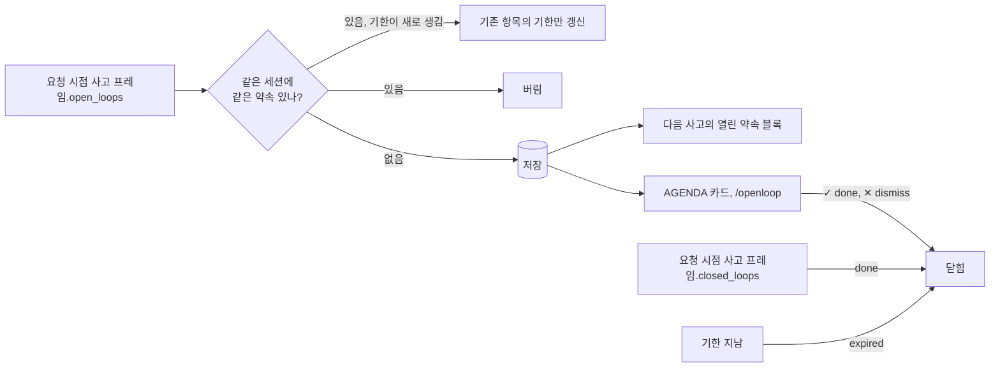
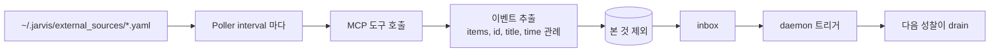

# 약속, 스케줄, 외부 이벤트

Web HUD 의 AGENDA 카드에 모이는 세 가지. 각각 저장소와 흐름이 다르다.

## Open loop: 흘린 약속 추적

대화에서 나온 약속과 미완 작업을 기억했다가 성찰 때 다시 본다.



- 저장은 요청 모드 사고에서만. 성찰은 보기만 하고 닫지도 않는다
- 새 약속은 사용자 입력에서 나온 것만 저장한다(`grounded`: 약속 글자 bigram 의 20% 이상이 입력에 있어야 한다). 작은 사고 모델(gemma4:e4b)은 회상된 기억 속 다른 약속을 새로 흘린 것처럼 옮겨 적는데, 그런 항목은 입력과 겹침이 0 이었다
- 사고에는 열린 약속이 최신순으로 `[1] 설명 (기한 ...)` 처럼 번호와 함께 보인다
- 기한: 사고가 약속 끝에 ` @YYYY-MM-DD HH:MM` 을 붙이면 `due_ms` 로 저장한다. 다음 사고에는 `설명 (기한 2026-10-12 10:00)` 으로 보인다
- 같은 약속 판정(`openloop/types.py` 의 `same_loop`): 공백 정리와 소문자로 정규화해 같거나, 짧은 쪽(6자 이상)이 긴 쪽에 통째로 들어가거나, 공백을 뺀 글자 bigram 의 Jaccard 가 0.4 이상이면 같은 것. 실제로 쌓였던 바꿔 말한 중복은 0.43 에서 0.85, 서로 다른 약속은 0.21 이하였다. 단어를 통째로 바꾼 약속("참석자 목록 확정" 과 "참석자들의 최종 리스트 확정")은 여전히 따로 쌓인다
- 같은 약속이 다시 오면 새로 만들지 않는다. 기한이 새로 붙었을 때만 기존 항목의 기한을 갱신한다
- 저절로 닫힘:
  - 사고의 `closed_loops`: 이번 입력으로 끝났거나, 하지 말라고 했거나, 취소된 약속의 번호(또는 문구)를 사고가 짚으면 `done`
  - 사용자의 거두는 말: 입력에 `취소`, `안 해도`, `하지 마`, `그만해`, `필요 없`, `안 챙겨` 같은 말이 있고 그 입력이 열린 약속을 가리키면(짧은 쪽 기준 bigram 겹침 0.5 이상) 사고가 놓쳐도 `dismissed`. 완료 표현("보냈어", "다 했어")은 질문과 구분이 안 돼 사고에만 맡긴다
  - 같은 사고 결과에서 닫으라고 한 약속은 `open_loops` 에 다시 있어도 새로 열지 않는다
  - 기한: 사고 전과 `GET /api/agenda` 때, 기한 뒤 `JARVIS_OPENLOOP__EXPIRE_AFTER_SEC`(6시간)가 지났거나 기한 없이 `JARVIS_OPENLOOP__MAX_AGE_SEC`(7일)보다 오래되면 `expired`
- 상태는 `open`, `done`, `dismissed`, `expired`
- 저장소: `~/.jarvis/openloops.jsonl`(append 로그, id 기준 마지막이 이긴다), Postgres `jarvis_open_loops`, 메모리
- 조작: `/openloop`, `/openloop done <id>`, `/openloop dismiss <id>`, `POST /api/openloops/{id}`

## 스케줄

```text
/schedule 내일 오전 9시에 배포 로그 확인해줘      # 한 번
/schedule 2026.10.20 오후 6시까지 보고서 초안 작성   # 마감까지 반복
/schedule 0 9 * * * date && uptime                  # cron
```

- 한 번 실행(`...에`): LLM 분류기가 `reminder`(그 문장을 그대로 알림)인지 `task`(프롬프트를 실행)인지 한 번 묻는다. 분류 실패면 reminder
- 마감까지 반복(`...까지`): 남은 시간으로 주기를 고른다. 7일 이상이면 매일 9시, 하루 이상이면 6시간마다, 1시간 이상이면 매시, 그 아래는 10분마다
- 파일: `~/.jarvis/schedules/<name>.yaml`. 켜고 끄기는 `enabled` 키만 바뀐다. 한 번 실행한 작업은 파일을 지우거나 `enabled: false` 로
- 실행: 스케줄러는 10초마다 깨어나 새 세션에서 프롬프트를 돌린다. 이 세션은 승인 없는 샌드박스와 빈 메모리 체인을 쓰고 사고 엔진이 없다. 늦게 켜져 지난 일정은 기동 때 `delayed_sec` 를 달고 실행된다
- 전달: 열린 Web 연결 전부에 `reminder` 이벤트. 아무도 없으면 최근 20건을 쌓아 다음 접속 때 `missed: true` 로 보낸다(프로세스 메모리라 재시작하면 사라진다). Slack 이 있으면 거기도

## 외부 이벤트

MCP 도구를 주기적으로 불러 새 항목을 성찰에 먹인다. 캘린더나 메일 같은 소스를 비서가 먼저 보고 말하게 하는 길이다.



- 소스 정의: `name`, `server`(mcp_servers 의 이름), `tool`, `args`, `interval_sec`(300), `enabled`
- 응답 해석은 벤더 중립 관례다. 목록 필드 `items`, `events`, `messages`, `results`, `data`. id 는 `id`, `uid`, `eventId`, `messageId`, `threadId` 없으면 본문 해시. 제목은 `title`, `summary`, `subject`, `name`, `description`
- 본 것은 `~/.jarvis/external_seen.jsonl` 에 TTL(7일)로 기억한다. 틱당 최대 20건, inbox 는 200건
- drain 은 한 번만이라 여러 세션이 성찰해도 이벤트당 발화는 한 번이다. 요청 시점 사고는 외부 이벤트를 받지 않는다
- 성찰 프롬프트는 이벤트를 "말하라는 명령이 아니라 사실" 로 다루고 긴급성과 관련성이 분명할 때만 말한다

## 사용자 모델과 저널

- **사용자 모델** (`agent_layer/usermodel/`): 최근 기억 30건을 LLM 이 요약과 성향(최대 8개)으로 증류한 것. `/usermodel build` 로 만들고 `~/.jarvis/user_model.json` 에 덮어쓴다. 모든 사고 프롬프트의 `{{user_model}}` 에 들어간다. 자동으로는 안 돈다
- **저널** (`agent_layer/journal/`): 최근 사고 기록 40건을 보고 1 에서 3 문장의 메타 성찰을 쓴다. `/journal write`. 일화 기억으로 저장되어 회상에 섞여 들어온다
