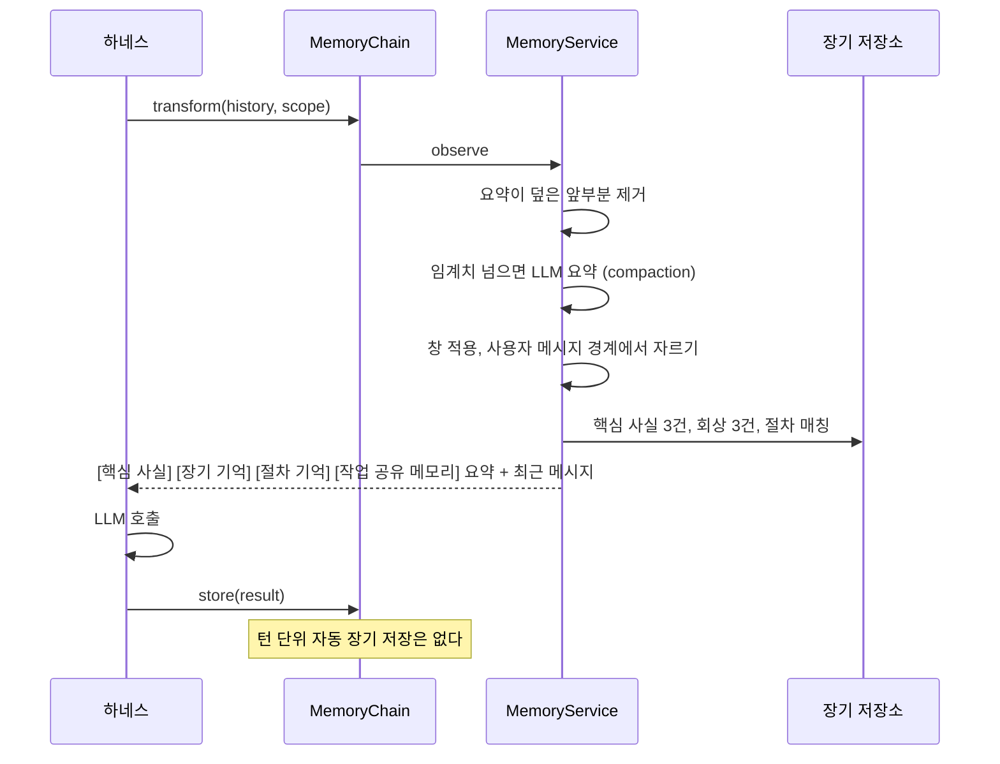

# 메모리

`memory/` 의 `MemoryService` 가 작업 기억과 장기 기억을 가진다. 턴마다 `agent_layer/memory/chain.py` 의 미들웨어 체인을 통해 주입되고, 장기 기억 쓰기는 명시적인 순간에만 일어난다.

## 계층

| 계층 | 무엇 | 어디 |
|---|---|---|
| 작업 기억 | 세션 히스토리 위의 메타데이터. 요약, 요약이 덮는 메시지 수, 되뇌기 횟수, 메모(최대 50) | 메모리 또는 Postgres `jarvis_working_memory` |
| 장기 기억 | `MemoryItem`. 종류는 의미(semantic), 일화(episodic), 절차(procedural) | 메모리 또는 Postgres `jarvis_ltm_entries`(pgvector 선택) |
| 절차 기억 | 저장하지 않는다. 스킬 레지스트리를 그대로 읽는다 | |

세션 히스토리 자체는 세션 저장소가 정본이다. 작업 기억은 그 위에 "어디까지 요약했나" 를 얹는다.

## 턴마다 일어나는 일

- **창**: 최근 `window_size`(50) 메시지. 도구 호출과 결과 쌍이 갈라지지 않게 첫 사용자 메시지까지 더 잘라낸다
- **압축**: 요약되지 않은 꼬리가 `keep_recent`(10) 보다 길고 글자 수가 `compaction_threshold`(100,000) 를 넘으면 앞부분을 LLM 이 요약한다. 요약은 `auto_summary` 일화로 저장되어 다시 요약하지 않는다
- **회상**: 마지막 사용자 발화 200자로 검색. 키워드(부분 문자열, Postgres 는 ILIKE)와 벡터(코사인 ≥ 0.3) 후보를 합쳐 다시 점수를 매긴다. 점수는 최신성, 중요도, 관련성, 단서 겹침의 가중합이고 종류별 가중치가 다르다(의미 기억은 관련성 0.6, 일화는 최신성 0.4). 되뇌기 횟수가 많을수록 중요도가 덜 식는다
- **되뇌기**: 회상된 항목은 `last_accessed` 가 갱신되고 되뇌기 횟수가 오른다

## 장기 기억에 쓰이는 순간

| 출처 | 종류 | 가시성 | 언제 |
|---|---|---|---|
| `explicit` | 의미 | shared | `/remember <text>` |
| `extracted` | 의미 | shared | 통합(consolidation)이 일화에서 뽑은 사실 |
| `usermodel` | 의미 | shared | 사용자 모델 |
| `auto_summary`, `manual_compact`, `session_end` | 일화 | private | 압축, `/compact`, 세션 종료 |
| `thought`, `journal` | 일화 | private | 사고 로그, 저널 |
| `delegation` | 일화 | private | 멀티 에이전트 위임 기록 |

가시성 규칙: 같은 사용자의 항목 중, 같은 에이전트의 것이거나 shared 인 것만 읽는다. 서브 에이전트는 사용자의 `/remember` 사실은 보고 부모의 private 요약은 못 본다.

의미 기억은 "주제: 값" 꼴이면 주제 태그가 붙고, 같은 주제의 이전 사실은 `superseded_by` 로 가려진다(지워지지 않는다). 주제가 다른데 값이 비슷하면 간섭 후보로 표시만 한다.

## 통합 (consolidation)

일화에서 오래 가는 사실을 뽑아 의미 기억으로 올린다. 멱등하다.

1. `session_end`, `auto_summary`, `manual_compact` 일화 중 아직 통합되지 않은 것을 최근 50건까지 본다
2. LLM 이 `{key, value, importance}` 목록을 낸다. 중요도 0.5 미만은 버린다
3. `extracted` 사실로 저장하고 일화에 통합됨 표시
4. 작업 기억의 되뇌기 횟수를 항목으로 옮긴다

언제: 세션 종료(TUI 종료, Web 셧다운) 때 항상. 유휴 때는 `JARVIS_MEMORY__CONSOLIDATE_ON_IDLE` 가 켜져 있고 daemon 트리거가 `idle` 또는 `both` 일 때만. 기본 트리거가 `interval` 이라 유휴 통합은 기본적으로 꺼져 있다.

## 임베딩

`JARVIS_MEMORY__EMBEDDING_PROVIDER` 를 `openai`(text-embedding-3-small, 1536), `ollama`(nomic-embed-text, 768), `vllm`(모델과 차원 필수) 중 하나로 두면 의미 검색이 켜진다. Postgres 는 pgvector 확장을 만들고 HNSW 인덱스를 시도한다. 확장이 없으면 키워드 검색으로 내려간다. 벡터가 없는 항목은 `/remember reembed` 로 채운다.

## 평가

`python -m jarvis.memory.eval --suite all` 로 격리, 의미, 일화, 절차, 바꿔 말하기, 작업 기억, 충실도를 LLM 없이 잰다. `--benchmark longmemeval|locomo` 도 있다.
