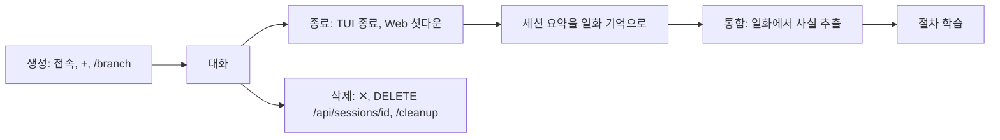

# 세션

대화 한 줄기가 세션이다. `agent_layer/session/` 의 저장소 프로토콜(`create`, `list`, `get_messages`, `append`, `delete`, `create_branch`) 위에 두 구현이 있다.

| 백엔드 | 설정 | 저장 |
|---|---|---|
| JSONL (기본) | `JARVIS_SESSION__PERSISTENCE_BACKEND=jsonl`, `SESSIONS_DIR` | `~/.jarvis/sessions/<id>.jsonl` 에 append, `<id>.meta.json` 에 메타 |
| Postgres | `postgres`, `POSTGRES_DSN` | `jarvis_sessions`, `jarvis_entries`(세션 삭제 시 cascade). 테이블은 기동 때 `IF NOT EXISTS` 로 만든다 |

`create` 는 멱등하다. 같은 id 를 두 번 만들어도 하나다. 사용자 메시지는 턴 시작 때 바로 저장되고, 어시스턴트와 도구 메시지는 루프가 끝난 뒤 한꺼번에 저장된다.

## 분기

`/branch [session_id]`, TUI `Ctrl+F`, Web 의 ⑂. 부모의 메시지를 전부 복사한 새 세션을 만들고 `parent_id` 를 남긴다. 포인터가 아니라 복사라 이후 변경은 서로 전파되지 않는다. Web 의 SESSIONS 카드는 프로세스가 띄운 세션만 보여주므로 다른 세션은 `/sessions` 나 `jarvis --list-sessions` 로 본다.

## 생애

Web 의 `DELETE /api/sessions/{id}` 는 메모리 세션, 샌드박스, 승인 브로커, 저장소를 같이 지운다. 붙어 있는 연결이 있으면 409. 없는 세션을 지워도 200.

## 서브 에이전트 세션

멀티 에이전트의 서브 에이전트도 세션이다. 정의의 `memory.stm` 에 따라 id 가 정해진다.

| 정책 | 세션 id | 뜻 |
|---|---|---|
| `per_parent_session`(기본) | `agent_<name>__<부모 세션>` | 부모 세션마다 하나 |
| `per_task` | `agent_<name>__task_<id>` | 호출 뒤 삭제 |
| `per_agent` | `agent_<name>` | 에이전트당 하나, 영속 |

## 세션 관련 명령

- `/sessions`: 목록. 분기는 `← parent` 표시
- `/export md|json`: `~/.jarvis/exports/` 로
- `/cost`: 토큰 사용량과 모델별 추정 비용
- `/compact`: 지금까지를 요약해 장기 기억에 저장
- `/cleanup`: 옛 서브 에이전트 세션과 옛 STM 테이블을 보여주고, `agents confirm`, `stm confirm` 으로 지운다
