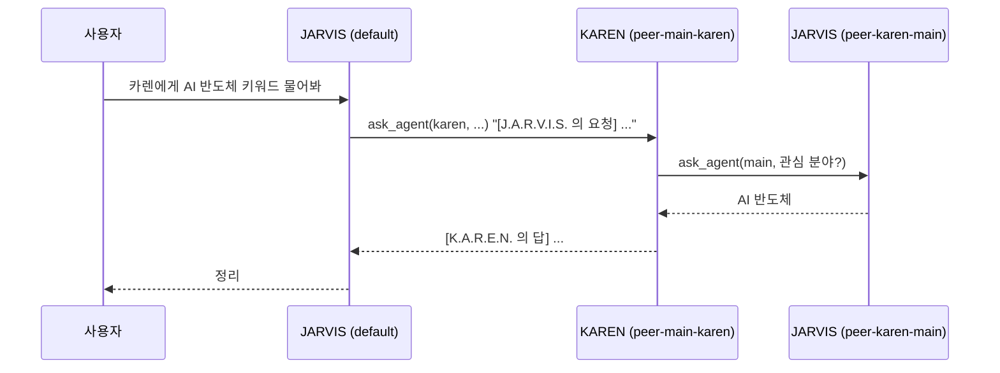

# 최상위 에이전트 팀

JARVIS 와 같은 층에 에이전트를 더 둔다. 첫 번째이자 전체를 총괄하는 에이전트가 JARVIS(id `main`)이고, 정보 수집을 맡는 KAREN(id `karen`)처럼 목적이 다른 에이전트를 파일 하나로 늘린다. 구현은 `app/agent_registry.py`.

[멀티 에이전트](./multi-agent.md)의 서브 에이전트와 다르다. 서브 에이전트는 부모 턴 안에서 잠깐 도는 도구이고, 최상위 에이전트는 자기 세션, 기억, 약속, 승인 규칙, 브랜드를 가진다.

## 정의 파일

`JARVIS_TEAM__DIR`(기본 `~/.jarvis/team`, docker 는 저장소의 `team/`)의 `<id>.yaml` 하나가 에이전트 하나다. 파일 이름이 id 이고, 비운 항목은 JARVIS 설정을 이어받는다.

```yaml
# team/karen.yaml
name: K.A.R.E.N.              # 워드마크이자 다른 에이전트가 부르는 이름
description: 정보 수집 담당      # 다른 에이전트가 누구에게 맡길지 고를 때 읽는다
quote: Eyes on everything
palette: { primary: "#97BC62", accent: "#ffd166" }
system_prompt: |
  당신은 K.A.R.E.N. 입니다 ...
model: null                   # 모델 이름만 바꾼다. 프로바이더와 키는 JARVIS 것
tools: [web_search, web_fetch, read_file]   # 비우면 전체
proactive: false              # 비우면 JARVIS 의 proactive 설정
```

- id 는 `^[a-z][a-z0-9_-]{0,31}$`. `main.yaml` 은 무시한다. JARVIS 는 env(`JARVIS_BRAND__*`, `JARVIS_LLM__*`)가 정본이다
- 잘못된 파일은 로그만 남기고 그 파일만 건너뛴다
- 사고 설정은 JARVIS 것을 같이 쓰고, proactive 피드백 학습기는 에이전트마다 따로 둔다

## 무엇을 공유하나

| 항목 | 규칙 |
|---|---|
| 사용자 모델 | 공유. 파일 하나를 모든 에이전트가 읽는다 |
| 장기 기억 | 사용자에 대한 사실(semantic)만 공유. 대화 요약, 사고 로그 같은 일화(episodic)는 쓴 에이전트 전용 |

장기 기억의 공유 여부는 쓰기 경로가 정한다(`memory_service.WRITE_RULES`). `/remember`, 사용자 모델 증류, 일화에서 뽑은 사실은 shared 로, 나머지는 private 로 쓴다. 기억 범위의 `agent_id` 는 세션의 에이전트 id 다.

범위를 도입하기 전의 옛 행은 Postgres 저장소가 열릴 때 main 행으로 채운다. 이때 사실만 shared 로, 일화는 main 전용으로 둔다. 예전 backfill 이 shared 로 둔 일화도 같은 때 private 로 고친다. 두 번 열어도 결과가 같다.

## 세션은 한 에이전트의 것

세션은 만들 때 에이전트가 정해지고 바뀌지 않는다(`jarvis_sessions.agent_id`, jsonl 은 `.meta.json` 의 `agent_id`). 에이전트가 정해지기 전에 만든 세션은 main 이다.

- Web: `POST /api/sessions {"agent": "karen"}`, `/ws?session_id=..&agent=karen`. 이미 있는 세션은 저장된 에이전트로 열리고 `agent` 는 무시한다. 모르는 에이전트는 400, ws 는 close `4404`
- TUI: `jarvis --agent karen` 은 `default-karen` 세션으로 시작한다. `--session ID` 는 그 세션을 만든 에이전트로 연다
- 분기는 부모와 같은 에이전트
- 스케줄: 작업 YAML 의 `agent: karen` 이면 그 에이전트의 모델, 시스템 프롬프트, 기억 범위로 돈다. `/schedule` 로 만든 작업은 명령을 친 세션의 에이전트가 들어간다
- 성찰 daemon 은 열린 세션 전부를 돈다. proactive 가 꺼진 에이전트(KAREN 기본값)의 세션은 성찰을 건너뛴다

## 승인 규칙은 두 겹

공용 `~/.jarvis/approvals.yaml` 은 모든 에이전트가 읽고 사람이 고친다. 승인 화면의 **항상 허용** 은 그 세션 에이전트의 `~/.jarvis/approvals/<id>.yaml` 에만 쌓인다(`LayeredApprovalRules`). 에이전트를 나누기 전 `approvals.yaml` 에 쌓인 규칙은 그대로 공용이 된다. 자세한 건 [도구와 승인](./tools-and-approval.md).

## AGENDA 는 모두의 것

AGENDA 카드는 모든 에이전트의 스케줄과 약속을 한 목록에 보여주고, 항목마다 에이전트 이름 라벨을 그 에이전트의 primary 색으로 단다. 약속(`OpenLoop.agent_id`)은 감지한 세션의 에이전트, 스케줄은 작업의 `agent` 다. 약속을 닫는 판정(사고의 closed_loops, 취소하는 말)은 그 약속을 만든 세션에서만 한다.

## HUD 에서 에이전트 고르기

SESSIONS 카드 위에 에이전트 칩이 생긴다(에이전트가 둘 이상일 때만). 칩을 누르면 그 에이전트의 열린 세션으로, 없으면 새 세션을 만들어 옮긴다. 붙은 세션의 에이전트에 맞춰 워드마크, 명언, 링, 입자 구, 패널 색이 바뀐다. 세션 목록의 표식 색과 AGENDA 라벨 색도 에이전트의 primary 다. SYSTEM 의 TOOLS 는 그 에이전트가 쓰는 도구만 보여준다.

## 에이전트끼리 대화

에이전트가 둘 이상이면 `ask_agent` 도구가 생긴다(`app/agent_conversation.py`). 모든 에이전트가 쓰고, 정의의 `tools` 에 적지 않아도 붙는다. 도구 설명에 팀 명단(id, 이름, 설명, JARVIS 는 "팀 총괄")이 들어가 LLM 이 누구에게 맡길지 고른다.



- 받는 쪽은 에이전트 쌍마다 세션 하나(`peer-<부른 쪽>-<받는 쪽>`)에서 답한다. 같은 쌍은 앞 대화를 이어 가고 HUD 세션 목록에 보인다
- 받는 쪽 세션은 사용자를 부른 쪽 범위에서 받는다. 기억은 받는 쪽 에이전트 범위로 남는다
- 받는 쪽 도구의 승인 요청은 부른 세션의 화면에 뜬다
- 깊이 제한: A → B → A 까지. 그보다 깊으면 도구가 거절하고 지금 아는 것으로 답하게 한다
- 받은 일을 보낸 쪽에 되돌리기 금지: 받은 요청과 글자가 거의 같은(bigram Jaccard 0.4 이상) 일을 그 요청을 보낸 에이전트에게 다시 맡기면 도구가 거절한다. 실서버에서 gemma4:e4b 가 도구 설명의 지시를 무시하고 받은 일을 그대로 되돌려 서로 미루는 것을 봤다. 되묻기("관심 분야가 뭐야?")처럼 다른 질문은 된다
- 받는 쪽이 같은 쌍의 다른 질문에 답하는 중이면 "다른 일을 하고 있다" 는 오류 결과. 300초 안에 답이 없으면 시간 초과
- 받는 쪽이 Dual-Channel 로 백그라운드 답을 하면 끝날 때까지 기다려 저장된 마지막 답을 돌려준다

## 함께 일할 때의 구체

서버는 세션마다 루프의 시작과 끝을 세어 일하는 에이전트가 바뀔 때 `agent_activity{active}` 를 열린 HUD 전부에 보낸다(`ui/web/agent_activity.py`). 둘 이상이 일하면 HUD 구체의 입자가 두 에이전트의 primary 로 흐르는 띠처럼 섞이고, 일하는 에이전트 칩이 빛난다. 끝나면 지금 에이전트 색으로 돌아온다.
