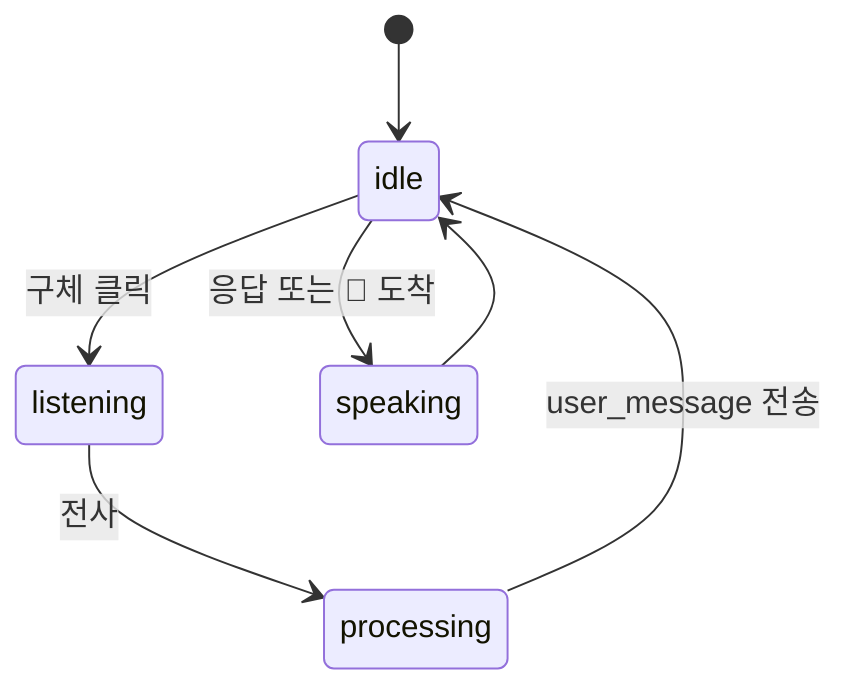

# 음성

STT 와 TTS 를 어디서 처리할지 설정으로 정한다. 구현은 `voice/`(서버 프로바이더), `ui/web/static/voice.js`(브라우저 상태 기계), `ui/tui/`(터미널).

| | `browser`(기본) | 서버 |
|---|---|---|
| STT | Web Speech API 가 브라우저에서 인식 | `whisper`: 브라우저가 MediaRecorder 로 녹음해 `voice_stt_submit` 으로 보내고 faster-whisper 가 전사 |
| TTS | Web Speech API 가 합성 | `supertonic`: ONNX 합성 결과를 WAV 로 돌려준다 |

서버 프로바이더는 `uv sync --extra voice`. Docker 의 web 이미지에는 들어 있지 않다.

## Web HUD



- 구체 클릭이 음성 모드 토글. 켜져 있으면 응답과 🔔, 스케줄 알림을 읽어 준다(놓친 알림은 읽지 않는다)
- 서버 TTS 는 `voice_tts_request` 로 보내고 `voice_tts_audio` 로 받는다. `data` 가 비어 오면 브라우저가 직접 읽는다. 서버가 응답하지 않으면 화면이 "음성 처리 중" 에 멈추므로 서버는 빈 응답이라도 돌려준다
- 브라우저 STT 는 Chrome 계열에서 된다. 미지원이면 SYS 에러 한 줄

## TUI

```bash
JARVIS_VOICE__TUI_ENABLED=true
JARVIS_VOICE__STT_PROVIDER=whisper
JARVIS_VOICE__TTS_PROVIDER=supertonic
JARVIS_VOICE__TUI_RECORD_SECONDS=5
```

| 키 | 동작 |
|---|---|
| `Ctrl+T` | 응답 읽어 주기 토글 |
| `Ctrl+R` | 녹음 → 전사 → 입력창에 채움. 자동 전송하지 않는다 |

시스템 오디오 도구가 필요하다. 재생은 afplay, paplay, aplay, ffplay 중 하나, 녹음은 sox 또는 arecord. 없으면 안내 메시지와 함께 꺼진다.

## 알아 둘 것

- `JARVIS_VOICE__WHISPER_MODEL_SIZE`, `SUPERTONIC_MODEL`, `STT_LANG` 은 설정에 있지만 현재 프로바이더가 읽지 않는다. whisper 언어는 한국어로 고정이다
- Full-voice 모드(승인 모달까지 음성으로 묻고 답하기)는 계획 단계다. 레포의 `TODO.md` 에 설계가 있다
