# 서비스 기능 지도

jarvis-agent 가 제공하는 기능 전체를 한 곳에 모은 페이지다. 기능마다 무엇을 하는지, 어떤 모듈과 저장소가 맞물리는지(구조도), 실제로 어떤 순서로 도는지(흐름도)를 보여 준다. 흐름도의 정본은 각 기능 페이지에 있고 여기서는 링크로 잇는다.

## 기능 목록

| 기능 | 무엇을 하나 | 쓰는 곳 |
|---|---|---|
| [대화와 도구 실행](./architecture.md) | 메시지를 받아 LLM 과 도구를 오가며 답한다. 스트리밍, 중단, 프로바이더 교체 | 입력창, 음성, TUI |
| [내적 사고](./features/inner-thought.md) | 메인 응답과 분리된 호출로 해석, 결정, 확신도, 약속을 만든다 | 💭 한 줄 |
| [Dual channel](./features/proactive.md#dual-channel) | 오래 걸릴 요청이면 "잠깐만요" 를 먼저 말하고 메인은 뒤에서 돈다 | 💬 filler |
| [자율 성찰과 🔔](./features/proactive.md#자율-성찰과-) | 요청이 없어도 주기적으로 성찰해 가치가 분명할 때만 먼저 말한다 | 🔔, Slack |
| [피드백 학습과 답 분류](./features/proactive.md#피드백-학습) | 🔔 에 대한 수락, 무시, 무응답으로 발화 임계치를 움직인다. 키워드가 아닌 답은 사고 모델이 분류한다 | 🔔 아래 질문, `Ctrl+Y`/`Ctrl+G` |
| [Open loop](./features/agenda.md) | 대화에서 흘린 약속을 기억하고, 끝나거나 취소되거나 기한이 지나면 닫는다 | AGENDA, `/openloop` |
| [스케줄](./features/agenda.md#스케줄) | 한 번, 마감까지 반복, cron 으로 알림이나 작업을 돌린다 | `/schedule`, AGENDA |
| [외부 이벤트](./features/agenda.md#외부-이벤트) | MCP 도구를 주기적으로 불러 새 항목을 성찰에 먹인다 | 🔔 |
| [메모리](./features/memory.md) | 작업 메모리, 일화, 의미, 절차 기억. 회상, 통합, 임베딩 | 사고와 응답의 맥락 |
| [사용자 모델과 저널](./features/agenda.md#사용자-모델과-저널) | 기억에서 사용자 성향을 증류하고, 사고 기록으로 메타 성찰을 쓴다 | `/usermodel`, `/journal` |
| [도구, 승인, 절차 학습](./features/tools-and-approval.md) | 내장 도구와 MCP, 실행 전 승인과 승인 기억, 반복 작업을 절차 도구로 | 승인 모달, `/procedures` |
| [세션](./features/sessions.md) | 대화 단위. 만들기, 전환, 분기, 이어 붙이기 | SESSIONS 카드, TUI 사이드바 |
| [멀티 에이전트](./features/multi-agent.md) | 정의 파일의 서브 에이전트에게 일을 나눈다. 다섯 가지 패턴 | `/orchestrate`, 위임 도구 |
| [음성과 Full-voice](./features/voice.md) | 음성 입력과 읽기. Full-voice 는 응답, 승인, 🔔 피드백까지 말로 묻고 답한다 | 구체 클릭, 헤더 `FULL-VOICE` |
| [외부 알림](./features/proactive.md#외부-알림) | 열린 화면이 없어도 🔔 와 스케줄 결과를 Slack 으로 보낸다 | Slack |
| [슬래시 커맨드와 확장](./usage/slash-commands.md) | `/` 명령, 스킬, 플러그인 훅, 사용자 도구 | 입력창 `/` |

## 기능별 아키텍처 설계도

각 도식은 왼쪽이 사용자와 화면, 가운데가 코드 모듈, 오른쪽이 저장소다. 화살표는 호출이나 데이터의 방향이다.

### 대화와 도구 실행

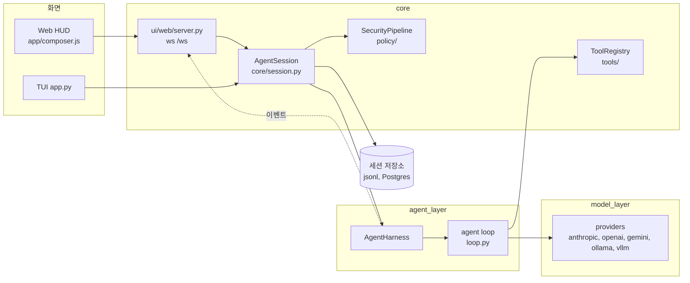

- 핵심 모듈: `core/session.py`, `agent_layer/loop.py`, `model_layer/`
- 저장: 세션 저장소

### 내적 사고

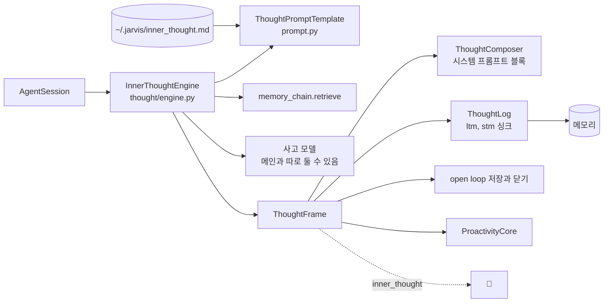

- 핵심 모듈: `agent_layer/thought/engine.py`
- 저장: 사고 로그(일화 기억 또는 작업 메모)

### 자율 성찰, 🔔, 피드백 학습

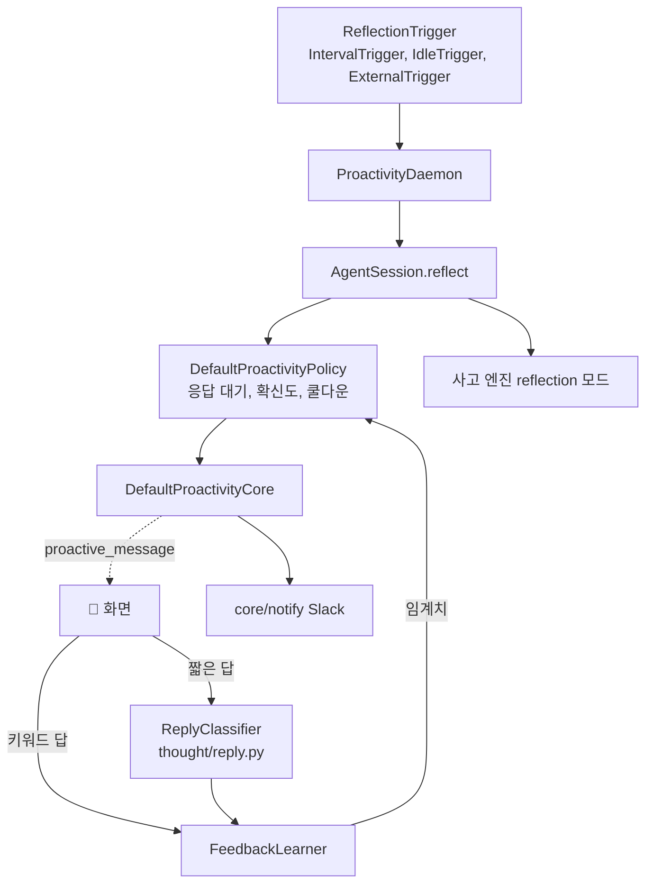

- 핵심 모듈: `core/proactive/daemon.py`, `core/proactive/policy.py`, `core/proactive/feedback.py`, `agent_layer/thought/reply.py`, `core/proactive/core.py`
- 저장: 프로세스 메모리(쿨다운, 응답 대기, 임계치). 재시작하면 기본값으로 돌아간다

### Open loop

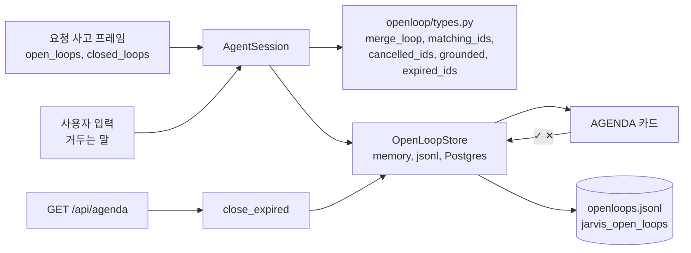

- 핵심 모듈: `agent_layer/openloop/`
- 저장: `openloops.jsonl` 또는 Postgres

### 스케줄

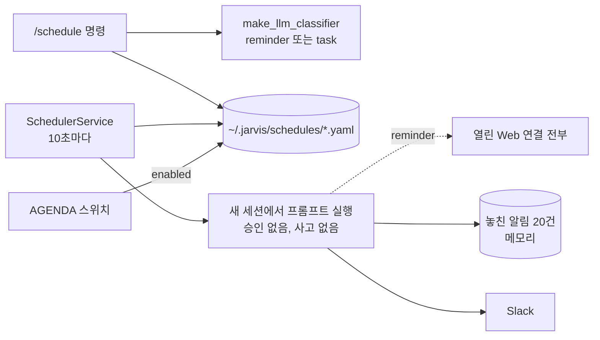

- 핵심 모듈: `core/scheduler/`
- 저장: `~/.jarvis/schedules/*.yaml`

### 외부 이벤트

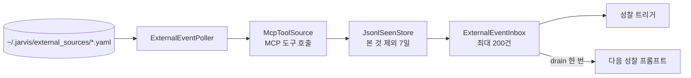

- 핵심 모듈: `core/external/`
- 저장: `external_seen.jsonl`

### 메모리

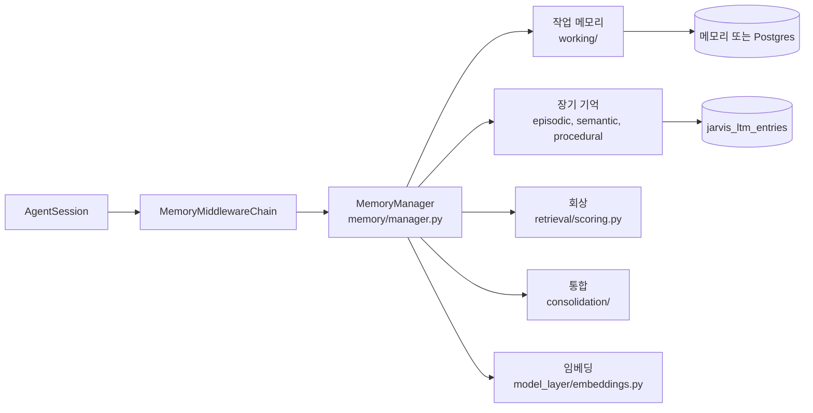

- 핵심 모듈: `memory/`
- 저장: 메모리 또는 Postgres

### 도구, 승인, 절차 학습

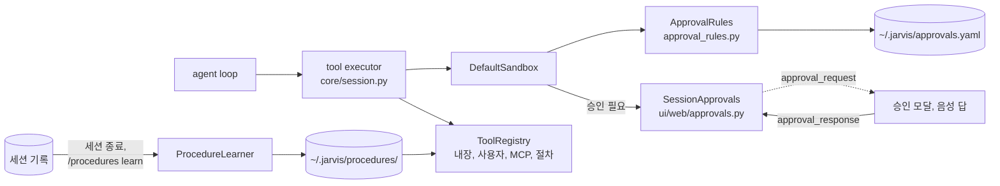

- 핵심 모듈: `core/tools/`, `core/policy/`, `core/procedures/`
- 저장: `approvals.yaml`, `procedures/`

### 세션

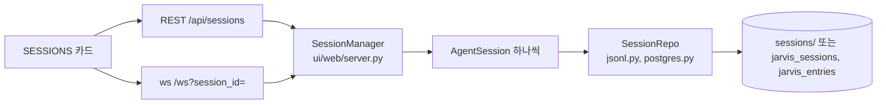

- 핵심 모듈: `agent_layer/session/`
- 저장: jsonl 또는 Postgres

### 멀티 에이전트

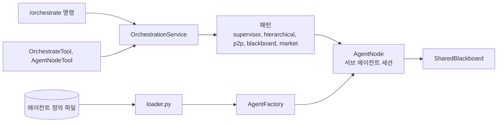

- 핵심 모듈: `core/multi_agent/`
- 저장: 작업 공유 메모리(blackboard)

### 음성과 Full-voice

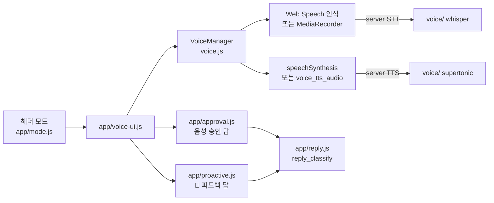

- 핵심 모듈: `ui/web/static/voice.js`, `voice/`
- 저장: 없음

## 기능 동작 흐름도

흐름도는 기능 페이지에 있다.

| 기능 | 흐름도 |
|---|---|
| 요청 한 번(사고, 응답, 이벤트) | [아키텍처 → 요청 한 번의 흐름](./architecture.md#요청-한-번의-흐름) |
| 내적 사고 | [내적 사고 → 흐름](./features/inner-thought.md#흐름) |
| Dual channel | [먼저 행동하기 → Dual channel](./features/proactive.md#dual-channel) |
| 자율 성찰과 🔔 게이트 | [먼저 행동하기 → 자율 성찰과 🔔](./features/proactive.md#자율-성찰과-) |
| 🔔 답 처리(키워드, 분류) | [먼저 행동하기 → 피드백 학습](./features/proactive.md#피드백-학습) |
| Open loop | [약속, 스케줄, 외부 이벤트 → Open loop](./features/agenda.md#open-loop-흘린-약속-추적) |
| 스케줄 실행 | [약속, 스케줄, 외부 이벤트 → 스케줄](./features/agenda.md#스케줄) |
| 외부 이벤트 | [약속, 스케줄, 외부 이벤트 → 외부 이벤트](./features/agenda.md#외부-이벤트) |
| 사용자 모델과 저널 | [약속, 스케줄, 외부 이벤트 → 사용자 모델과 저널](./features/agenda.md#사용자-모델과-저널) |
| 메모리 한 턴 | [메모리 → 턴마다 일어나는 일](./features/memory.md#턴마다-일어나는-일) |
| 도구 호출과 승인 | [도구와 승인 → 도구 호출 한 번](./features/tools-and-approval.md#도구-호출-한-번) |
| 절차 학습 | [도구와 승인 → 절차 학습](./features/tools-and-approval.md#절차-학습) |
| 세션 생애 | [세션 → 생애](./features/sessions.md#생애) |
| 멀티 에이전트 패턴 | [멀티 에이전트 → 패턴](./features/multi-agent.md#패턴) |
| 음성 상태와 Full-voice | [음성 → Web HUD](./features/voice.md#web-hud) |
